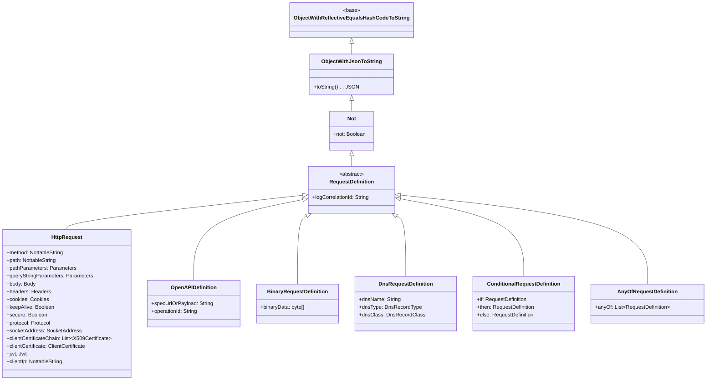
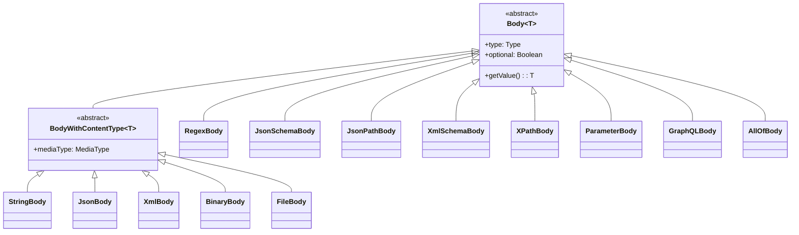
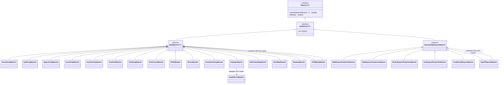
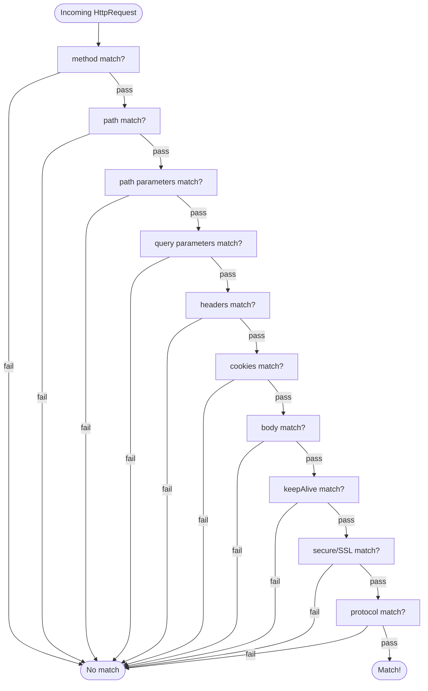
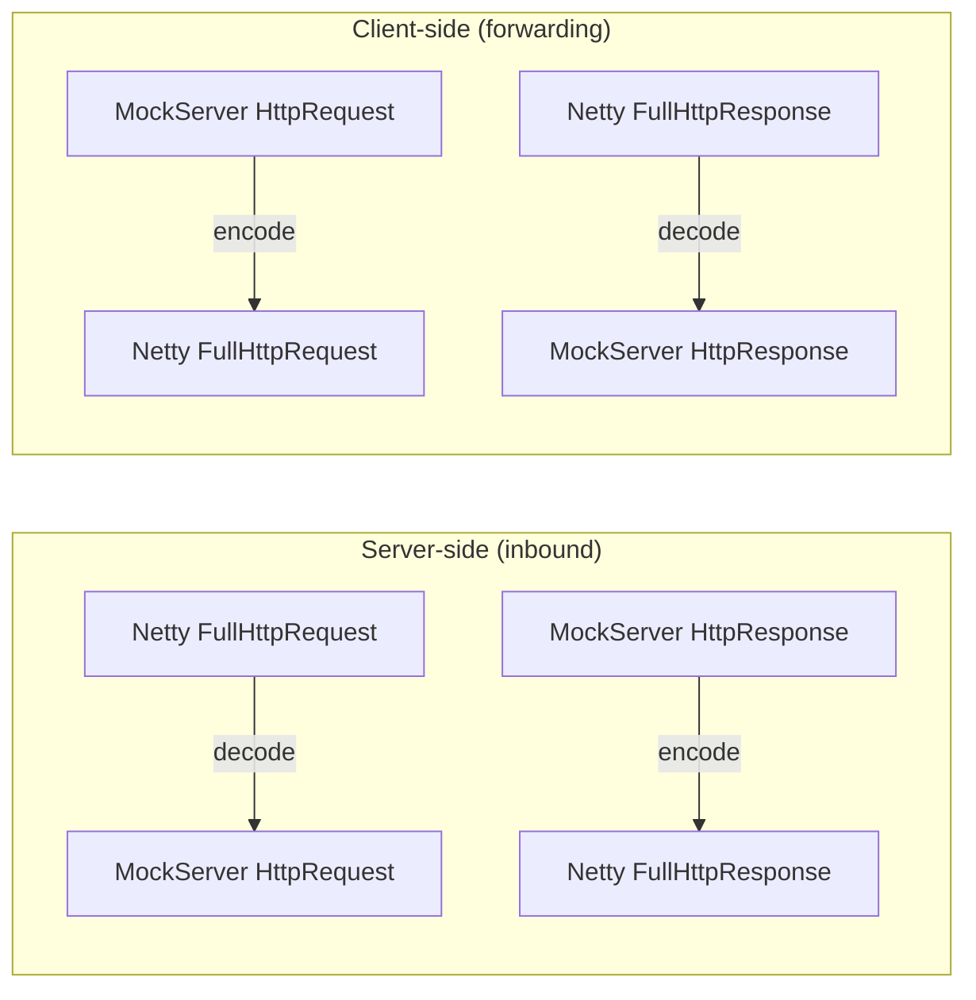
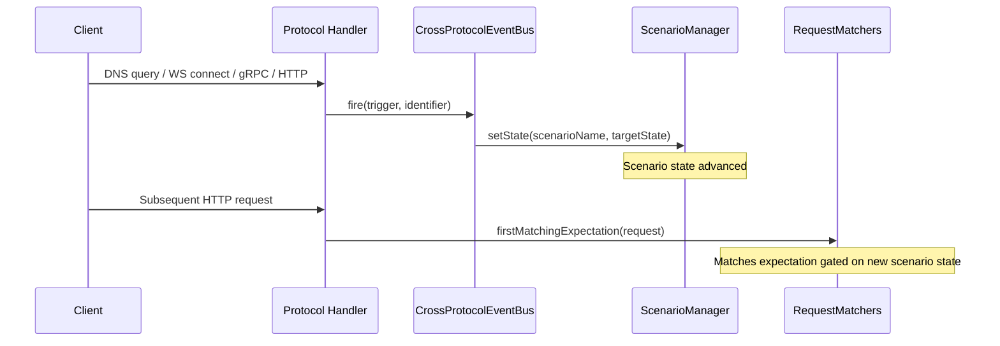

# Domain Model, Matchers & Serialization

## Domain Model Hierarchy

All domain objects descend from a common base providing reflection-based equality, JSON serialization, and a NOT operator:



`BinaryRequestDefinition` matches raw binary connections by byte content. `DnsRequestDefinition` matches DNS queries by name, record type, and record class.

`ConditionalRequestDefinition` (if/then/else) and `AnyOfRequestDefinition` (logical OR) compose other request
definitions. Both serialise as an `httpRequest` holding their own keys (`if`/`then`/`else`, or an `anyOf` array), and
`RequestDefinitionDTODeserializer` dispatches on those keys before any other shape. Their branches are limited to
`HttpRequest`, `OpenAPIDefinition`, a conditional or an anyOf (`AnyOfRequestDefinitionDTO.branchDTO`, shared by both
DTOs), matching the `anyOfBranch` and `conditionalBranch` JSON schema definitions; `anyOf` needs at least one branch.

- **Matching.** `AnyOfRequestMatcher` compiles each branch once to its own matcher via `MatcherBuilder`, in the same
  plane (data-plane branches through a throwaway `Expectation`, as `ConditionalRequestMatcher` does), into an array
  published through one `volatile` holder. A match walks the array with an indexed loop, passing the caller's
  `MatchDifference` through, and stops at the first branch that matches, so the composition allocates nothing beyond
  what its branches allocate (`AnyOfRequestMatcherCostTest`, in the `allocation-tests-without-c2` execution). `not`
  inverts the result. As with conditional branches, each data-plane branch writes its own `EXPECTATION_NOT_MATCHED`
  entry at INFO, under the shared `maxLoggedMatchFailures` budget.
- **Diagnostics.** Only a context that is both detailed and log-suppressed (`MatchDifference.isDiagnosticOnly()`: the
  explain, closest-match and debug-mismatch re-evaluations; the serving scan never creates one) evaluates every branch
  in its own context and keeps the closest branch's differences rather than the union. `RequestMatchExplainer`
  then adds an `anyOf` object (`closestBranch`, 0-based, and each branch's differing fields) to the per-expectation
  node of `explain`, `explainUnmatched` and `debugMismatch`. The 404 closest-match INFO line is ranked on the serving
  scan, where an anyOf's branches share one context, so an anyOf counts the union of its branches' differing fields
  and can lose to a plain expectation that its closest branch beats; it is ranked that way to keep the
  per-branch comparison off the serving path. The explain endpoints rank by the closest branch.
- **Filters.** An HTTP-shaped filter cannot describe an anyOf (or a conditional), so retrieving active expectations
  with one always lists an anyOf expectation, and clearing with one never removes it; clear it by id.
- **Indexing.** `CandidateIndex` buckets only `HttpRequestPropertiesMatcher`, so an anyOf (like a conditional) goes to
  the fallthrough and is evaluated for every request in global priority order; expectations without one are indexed
  exactly as before. The closest-match memo reuses only exact-class `HttpRequestPropertiesMatcher` non-matches, so it
  re-evaluates an anyOf. `BinaryExpectationIndex` treats an anyOf as able to match any binary message, since a negated
  one does.
- **Clients.** Python, Ruby and PHP model it as its own class (`AnyOfRequestDefinition`, PHP `HttpRequest::anyOf`); Go
  and .NET as an `AnyOf` list on `HttpRequest`; Rust in `HttpRequest.extra` (`HttpRequest::any_of`,
  `any_of_value`), so no public field changed; Node types it in `mockServer.d.ts`.

`HttpRequest` carries two distinct client-certificate fields that must not be confused:

- **`clientCertificateChain`** (`List<X509Certificate>`) is the **actual** mTLS chain a request was
  received with, captured from the TLS/QUIC handshake (see [tls-and-security.md](tls-and-security.md)).
  It is populated on incoming requests and serialized on recorded requests; it is *not* a matcher.
- **`clientCertificate`** (`ClientCertificate`) is the **expectation matching criteria** for that chain.
  `ClientCertificateMatcher` (`org.mockserver.matchers`) matches it against the **leaf certificate**
  (index `0` — the client's own certificate, per RFC 5246 / RFC 8446) of the request's
  `clientCertificateChain`:

  | Criterion | Nottable | Matched against (leaf certificate) |
  |-----------|----------|-------------------------------------|
  | `subject` | yes | Common Name, full subject Distinguished Name, or any Subject Alternative Name (DNS / IP / email / URI) — a match against any is a match |
  | `issuer` | yes | issuer Common Name or full issuer Distinguished Name |
  | `fingerprintSha256` | yes | SHA-256 fingerprint of the leaf's DER encoding; colons/whitespace stripped and compared case-insensitively so `AB:CD:...` == `abcd...` |

  Each criterion is a `NottableString` (regex / `!` negation / optional). A blank criterion (no
  `clientCertificate`, or every field blank) matches every request. A non-blank criterion never matches a
  request that presents no certificate chain. Mismatches are reported through `MatchDifference` under the
  `clientCertificate` field so `explainUnmatched`, `explain` and `debugMismatch` explain them. This is **matching only**
  and does not change mTLS authentication (`MTLSAuthenticationHandler`).

`HttpRequest` also carries a **`jwt`** (`Jwt`) matcher — expectation criteria for a JSON Web Token
carried in a request header:

- **`jwt`** (`Jwt`, `org.mockserver.model`) matches a request by the claims inside a JWT read from a
  header (default `authorization`, `Bearer ` prefix). `JwtMatcher` (`org.mockserver.matchers`) reads the
  header named by `Jwt.header`, strips the `Jwt.scheme` prefix (case-insensitive), base64url + JSON
  decodes the token's `header.payload` segments, and matches:

  | Criterion | Type | Matched against |
  |-----------|------|-----------------|
  | `claims` | `Map<String, NottableString>` | each entry asserts a payload claim's value (exact / regex / `!` negation); an array claim matches if any element matches; an absent claim never matches a positive criterion but matches a negated one vacuously (same De Morgan semantics for `issuer` / `audience` / `algorithm`) |
  | `issuer` | `NottableString` | convenience for the `iss` claim |
  | `audience` | `NottableString` | convenience for the `aud` claim (string or array) |
  | `algorithm` | `NottableString` | convenience for the JOSE header `alg` field |
  | `header` | `String` | request header the token is read from (default `authorization`) |
  | `scheme` | `String` | prefix stripped before decoding (default `Bearer`; blank ⇒ raw token) |

  **No signature verification is performed** — this is request matching for test routing, not
  authentication (the control-plane JWT auth stack under `authentication/` is a separate concern and is
  untouched). A malformed or absent token never matches a non-blank criterion and never surfaces an
  exception. A blank `Jwt` matches every request. Mismatches are reported through `MatchDifference` under
  the `jwt` field; the diagnostic message can include decoded JWT payload claim values (`found:…`), which
  is consistent with the token-bearing `Authorization` header already appearing in request logs — the JWT
  is not treated as a secret by this matcher. Wired through `HttpRequest.jwt` → `HttpRequestDTO`/`RequestDefinitionDTODeserializer`
  → `JwtSerializer`/`JwtDeserializer` (registered in `ObjectMapperFactory`) and the `jwt` block of the
  `httpRequest` JSON schema.

`HttpRequest` also carries a **`clientIp`** (`NottableString`) matcher: an IP address or CIDR range, IPv4 or
IPv6, optionally `!`-negated, matched against the request's client address.

- **Compiled once.** `ClientIpMatcher.compile` (`org.mockserver.matchers`) parses the value into masked network
  bytes plus a prefix length when the expectation is applied, and `HttpRequest.withClientIp` runs the same parse
  to reject a host name or malformed range up front. Matching only compares bytes: no text parsing, no DNS.
- **Where the address comes from.** `HttpRequest.remoteAddress` is one slot holding either the text (a `String`)
  or an `HttpRequest.RemoteAddress` (the text plus the peer's `InetAddress`, with IP bytes derived and memoised on
  the first comparison), so `HttpRequest` gains no field. `FullHttpRequestToMockServerHttpRequest` sets the cached
  text, exactly as before, until `ClientIpMatcher.isInUse()` (a JVM-wide latch set the first time a `clientIp` is
  compiled for matching, never cleared); from then on it builds one holder per connection. So requests allocate
  nothing new until some expectation or filter uses `clientIp`; the only standing cost is 8 B on each connection's
  mapper (64 B to 72 B: the cached holder and the test seam for the latch). Retention per connection is listed in
  [memory-management.md](memory-management.md#httprequest-35-5-kb-typical). The address is
  `SocketAddresses.clientAddress` (the TCP peer, or a PROXY protocol header's source, in both the normal decoder
  and `EarlyMatchingHandler`); never `X-Forwarded-For`. The PROXY header is accepted from any client when
  transparent proxying is on, so `clientIp` is not access control. A request without a holder (mapped before the
  latch, deserialised, or from the servlet) parses its `remoteAddress` text once, with `NetUtil` (no lookup), and
  keeps the result. HTTP/3 requests carry no address, so never match.
- **Cost when unused.** `HttpRequestPropertiesMatcher.Compiled.clientIpMatcher` is null unless the expectation
  declares a `clientIp`, so every other expectation pays one null test. It is not indexed by `CandidateIndex`
  and does not mark a mismatch as decided by method or path, so the closest-match memo never reuses it.
- **Semantics.** IPv4-mapped IPv6 addresses (`::ffff:a.b.c.d`) are treated as IPv4; an IPv4 client checked
  against an IPv6 range is compared as its mapped form. An unknown client address never matches, even negated.
  Mismatches are reported under the `clientIp` `MatchDifference` field.

### Action Types

```mermaid
classDiagram
    class Action~T~ {
        <<abstract>>
        +type: Type
        +delay: Delay
        +expectationId: String
    }
    class Delay {
        +timeUnit: TimeUnit
        +value: long
        +distribution: DelayDistribution
    }
    class DelayDistribution {
        +type: UNIFORM/LOG_NORMAL/GAUSSIAN
        +min/max: Long
        +median/p99: Long
        +mean/stdDev: Long
    }
    Delay --> DelayDistribution : optional
    class HttpResponse {
        +statusCode: Integer
        +reasonPhrase: String
        +body: Body
        +headers: Headers
        +cookies: Cookies
        +connectionOptions: ConnectionOptions
        +recoverAfter: RecoverAfter
        +timing: Timing
    }
    class RecoverAfter {
        +failTimes: Integer
        +failResponse: HttpResponse
        +idempotencyHeader: String
    }
    HttpResponse --> RecoverAfter : optional
    class HttpForward {
        +host: String
        +port: Integer
        +scheme: Scheme
    }
    class HttpTemplate {
        +template: String
        +templateType: TemplateType
        +parameters: Map
        +actionType: Type
    }
    class HttpClassCallback {
        +callbackClass: String
        +actionType: Type
    }
    class HttpObjectCallback {
        +clientId: String
        +responseCallback: Boolean
        +actionType: Type
    }
    class HttpOverrideForwardedRequest {
        +requestOverride: HttpRequest
        +requestModifier: HttpRequestModifier
        +responseOverride: HttpResponse
        +responseModifier: HttpResponseModifier
    }
    class HttpError {
        +dropConnection: Boolean
        +resetConnection: Boolean
        +responseBytes: byte[]
        +streamError: Long
    }

    Action <|-- HttpResponse
    Action <|-- HttpForward
    Action <|-- HttpTemplate
    Action <|-- HttpClassCallback
    Action <|-- HttpObjectCallback
    Action <|-- HttpOverrideForwardedRequest
    class GrpcStreamResponse {
        +statusCode: Integer
        +messages: List~GrpcStreamMessage~
    }
    class GrpcStreamMessage {
        +json: String
        +delay: Delay
    }
    GrpcStreamResponse --> GrpcStreamMessage : 0..*

    class HttpForwardValidateAction {
        +specUrlOrPayload: String
        +host: String
        +port: Integer
        +scheme: Scheme
        +validateRequest: Boolean
        +validateResponse: Boolean
        +validationMode: ValidationMode
    }
    class HttpForwardWithFallback {
        +httpForward: HttpForward
        +fallbackResponse: HttpResponse
        +fallbackOnStatusCodes: List~Integer~
        +fallbackOnTimeout: Boolean
    }
    class HttpSseResponse {
        +statusCode: Integer
        +headers: Headers
        +events: List~SseEvent~
        +closeConnection: Boolean
    }
    class HttpWebSocketResponse {
        +subprotocol: String
        +messages: List~WebSocketMessage~
        +matchers: List~WebSocketMessageMatcher~
        +closeConnection: Boolean
    }
    class WebSocketMessageMatcher {
        +frameType: WebSocketFrameType
        +textMatcher: NottableString
        +responses: List~WebSocketMessage~
    }

    class BinaryResponse {
        +binaryData: byte[]
        +upstream: Upstream
    }
    class DnsResponse {
        +answerRecords: List~DnsRecord~
        +authorityRecords: List~DnsRecord~
        +additionalRecords: List~DnsRecord~
        +responseCode: DnsResponseCode
    }

    class HttpLlmResponse {
        +provider: Provider
        +model: String
        +completion: Completion
        +embedding: EmbeddingResponse
        +conversationPredicates: ConversationPredicates
    }
    class Completion {
        +text: String
        +toolCalls: List~ToolUse~
        +stopReason: String
        +usage: Usage
        +streaming: Boolean
        +streamingPhysics: StreamingPhysics
    }
    class ToolUse {
        +id: String
        +name: String
        +arguments: String
    }
    class Usage {
        +inputTokens: Integer
        +outputTokens: Integer
    }
    class StreamingPhysics {
        +timeToFirstToken: Delay
        +tokensPerSecond: Integer
        +jitter: Double
        +seed: Long
    }
    class EmbeddingResponse {
        +dimensions: Integer
        +deterministicFromInput: Boolean
        +seed: Integer
    }
    class ConversationPredicates {
        +turnIndex: Integer
        +latestMessageContains: String
        +latestMessageMatches: String
        +latestMessageRole: Role
        +containsToolResultFor: String
    }
    class ParsedConversation {
        +messages: List~ParsedMessage~
    }
    class ParsedMessage {
        +role: Role
        +textContent: String
        +toolName: String
        +toolCallId: String
    }
    class IsolationSource {
        +kind: Kind
        +name: String
    }

    HttpLlmResponse --> Completion
    HttpLlmResponse --> EmbeddingResponse
    HttpLlmResponse --> ConversationPredicates
    Completion --> ToolUse : 0..*
    Completion --> Usage
    Completion --> StreamingPhysics

    Action <|-- HttpError
    Action <|-- HttpForwardValidateAction
    Action <|-- HttpForwardWithFallback
    Action <|-- HttpSseResponse
    Action <|-- HttpWebSocketResponse
    Action <|-- GrpcStreamResponse
    Action <|-- BinaryResponse
    Action <|-- DnsResponse
    Action <|-- HttpLlmResponse
```



### HttpTemplate Engine Notes

`HttpTemplate.templateType` is one of `VELOCITY`, `MUSTACHE`, or `JAVASCRIPT`. Velocity and Mustache are always available. The `JAVASCRIPT` engine requires the GraalVM Polyglot JARs (`org.graalvm.polyglot:polyglot` + `js`), which are declared `<optional>true</optional>` in `mockserver-core/pom.xml` and are absent from the standard netty jar-with-dependencies and default Docker image. Invoking a `JAVASCRIPT` template without GraalJS on the classpath causes `JavaScriptTemplateEngine` to throw a `RuntimeException` with an actionable error message rather than degrading silently. See [request-processing.md — Template Engines](request-processing.md#template-engines) for full behaviour.

Scenario and capture state is accessed via a different syntax per engine because jmustache cannot call a helper method with an argument:

| Engine | Scenario state accessor | Example |
|--------|------------------------|---------|
| Velocity | Method call on `$scenario` helper | `$scenario.get('key')` |
| JavaScript | Method call on `scenario` helper | `scenario.get('key')` |
| Mustache | Section `Mustache.Lambda` (in `MustacheTemplateEngine`) | `{{#scenario.get}}key{{/scenario.get}}` |

All three engines delegate to the same `ScenarioTemplateHelper.get(...)` call; only the invocation form differs.

**Derived request fields are lazy.** `HttpRequestTemplateObject` keeps a reference to the source `HttpRequest` and computes `formData`, `parts`, `host`, `port`, `scheme`, `baseUrl`, `bodyAsBase64` and `id` (the log correlation id) on first read, memoised per render. They are `@JsonIgnore`, so `toString()` — which the JavaScript engine `JSON.parse`s into its `request` object — neither computes them nor changes shape; `PolyglotRunner` instead adds each one to the parsed object as a non-enumerable getter that calls `derivedFieldAsJson(name)` on first read. For `parts` that JSON carries no content (`MultipartPartTemplateObject.describeWithoutBody`); each part's `body` and `bodyAsBase64` are further getters calling `partField(name, index, field)`, which returns the Java string directly, so in every engine a part's content is copied only when read. Multipart decoding reuses `MultipartFormDataDecoder.decodeParts` (Netty's decoder, capped at 100 parts; about 3x the body in transient copies) and is skipped for bodies over 10 MiB, a segmented body's size being checked before its segments are joined; form decoding uses Netty's `QueryStringDecoder` capped at 1,000 fields. Hitting a cap logs a WARN entry through the engine's `MockServerLogger`, which `TemplateDryRun` reports as a template warning; any other decoding failure yields an empty map, logged at DEBUG. Do not add these fields to `equals`/`hashCode` or the JSON form: either would compute them on every render.

### Body Types



Body `Type` enum: `BINARY`, `FILE`, `JSON`, `JSON_SCHEMA`, `JSON_PATH`, `PARAMETERS`, `REGEX`, `STRING`, `XML`, `XML_SCHEMA`, `XPATH`, `JSON_RPC`, `GRAPHQL`, `LOG_EVENT`, `WASM`, `MULTIPART`, `ALL_OF`

A body decoded from the wire with no `Content-Type` is a `StringBody` when its bytes are valid UTF-8
and a `BinaryBody` (no content type) otherwise, so the raw bytes always survive a forward; string
matchers read the latter through `BinaryBody.matchableString`. See
[request-processing.md](request-processing.md#bodies-with-no-content-type).

#### AllOfBody (Composite Body Matcher)

`AllOfBody` (`org.mockserver.model`, type `ALL_OF`) is a composite request-body matcher that matches only when **all** of its component body matchers match the *same* request body — e.g. a body required to satisfy a `jsonPath`, a `jsonSchema` and a `regex` matcher at once. It composes the existing matcher implementations without changing any of their individual semantics.

| Field | Type | Description |
|-------|------|-------------|
| `bodyAllOf` | `List<Body>` | the component body matchers; every one must match. An empty list matches any body |

Static factories: `AllOfBody.allOf(Body...)`, `AllOfBody.allOf(List<Body>)`. Each component keeps its own `not` flag; the composite honours its own `not` (negate the whole conjunction) and `optional` (an absent body matches) flags. `BodyMatcherBuilder` builds an `AllOfBodyMatcher` holding the component `BodyMatcher`s, and `BodyMatching` performs the per-component dispatch (so each component sees the body representation and JSON decoder it needs). Serialised via `AllOfBodyDTO` / `AllOfBodySerializer` / `AllOfBodyDTOSerializer` and the `ALL_OF` alternative of the `body` JSON schema; the wire form is `{"type":"ALL_OF","bodyAllOf":[ ... ]}`.

#### FileBody

`FileBody` (`org.mockserver.model.FileBody`) loads response content from a file path at response time, rather than embedding the content in the expectation JSON. This keeps expectations clean when response bodies are large or shared across expectations.

| Field | Type | Description |
|-------|------|-------------|
| `filePath` | `String` | Path to the file to load (absolute or relative to working directory) |
| `contentType` | `String` | MIME type of the file content (optional) |
| `templateType` | `TemplateType` | `VELOCITY` or `MUSTACHE` renders the file contents against the request (optional) |
| `templatedFilePath` | `Boolean` | With a supported `templateType`, also renders `filePath` against the request before reading; the result is confined by `TemplatedFilePathGuard` (optional, default off) |

Static factory: `FileBody.file(filePath)`, `FileBody.file(filePath, contentType)`. Convenience: `HttpResponse.withBodyFromFile(filePath)`.

#### GraphQL Body Matcher

`GraphQLBody` (`org.mockserver.model.GraphQLBody`) enables matching GraphQL requests by query structure, operation name, and variables schema. The matcher normalizes whitespace and comments before comparison, so formatting differences between the expected and actual queries are ignored.

| Field | Type | Description |
|-------|------|-------------|
| `query` | `String` | GraphQL query string, normalized before comparison (whitespace collapsed, comments stripped) |
| `operationName` | `String` | Optional operation name filter; supports exact match or regex |
| `variablesSchema` | `String` | Optional JSON Schema that the request's `variables` object must validate against |
| `selectionSetMatchType` | `SelectionSetMatchType` | Controls how the selection set is compared (default: `NORMALISED_STRING`) |
| `fields` | `List<String>` | Explicit list of top-level field names to match (optional; extracted from `query` if not set) |

`GraphQLMatcher` (`org.mockserver.matchers.GraphQLMatcher`) parses the incoming request body as JSON, extracts the `query`, `operationName`, and `variables` fields, and matches each against the expectation. The `GraphQLBodyDTO` handles serialization. Static factory: `GraphQLBody.graphQL(query)`, `GraphQLBody.graphQL(query, operationName)`, `GraphQLBody.graphQL(query, operationName, variablesSchema)`.

##### SelectionSetMatchType

The `SelectionSetMatchType` enum (`org.mockserver.model.SelectionSetMatchType`) controls how GraphQL body matching compares the selection set:

| Value | Behaviour |
|-------|-----------|
| `NORMALISED_STRING` | Default. Whitespace-normalised string comparison of the full query (existing behaviour). |
| `AST_EXACT` | Extracts operation type, operation name, and top-level field names; all must match exactly. Whitespace and nested field details are ignored. |
| `AST_SUBSET` | Like `AST_EXACT`, but the expected fields only need to be a *subset* of the actual request's top-level fields. Useful for matching requests that contain additional fields beyond what the test cares about. |

AST modes use a lightweight parser (`GraphQLAstMatcher`) that extracts operation type/name and top-level fields without a full GraphQL grammar dependency. It handles comments, string literals, argument lists, and nested braces.

**Example -- AST_SUBSET matching:**

```java
GraphQLBody.graphQL("query { users { id } }")
    .withSelectionSetMatchType(SelectionSetMatchType.AST_SUBSET)
    .withFields("users");
// Matches any query with operation type "query" that includes a top-level "users" field,
// regardless of what other fields are present.
```

**Example -- AST_EXACT matching:**

```java
GraphQLBody.graphQL("query GetUser { user profile }")
    .withSelectionSetMatchType(SelectionSetMatchType.AST_EXACT);
// Matches only queries with operation type "query", name "GetUser", and exactly
// the top-level fields "user" and "profile" (in any order, with any sub-selections).
```

### ConnectionOptions

`ConnectionOptions` on `HttpResponse` provides low-level control over the HTTP connection:

| Field | Type | Description |
|-------|------|-------------|
| `suppressContentLengthHeader` | Boolean | Prevent `Content-Length` header from being added |
| `contentLengthHeaderOverride` | Integer | Override `Content-Length` with a specific value |
| `suppressConnectionHeader` | Boolean | Prevent `Connection` header from being added |
| `chunkSize` | Integer | If positive, response is sent with `Transfer-Encoding: chunked` in chunks of this size |
| `chunkDelay` | Delay | Delay between each chunk when `chunkSize` is set. Uses Netty `EventLoop.schedule()` (non-blocking). Supports all delay distributions (fixed, uniform, lognormal, Gaussian). First chunk (headers) is written immediately; subsequent chunks are scheduled with cumulative delays |
| `keepAliveOverride` | Boolean | If true, `Connection: keep-alive`; if false, `Connection: close`. Unset: `keep-alive` only for a keep-alive request whose `closeSocket` is not true |
| `closeSocket` | Boolean | Force close (true) or keep open (false) the socket after responding. True also makes the default `Connection` header `close` |
| `closeSocketDelay` | Delay | Delay before closing the socket (ignored if socket is not being closed) |

### RecoverAfter (Retry/Backoff Recovery)

`RecoverAfter` is an optional, nullable field on `HttpResponse` (`org.mockserver.model.RecoverAfter`) that makes a mocked response "fail N times then succeed" — a deterministic recovery primitive for testing a client's retry/backoff logic against a transiently-failing dependency. It is a response-level value object (not a chaos field and not a new action type), so a response without a `recoverAfter` clause behaves and serializes byte-for-byte as before.

| Field | Type | Description |
|-------|------|-------------|
| `failTimes` | Integer | K — the number of leading attempts that serve the failure response. `null` or `<= 0` makes the primitive inert (the configured response is served unchanged) |
| `failResponse` | HttpResponse | Optional failure response. When omitted, a default `503 Service Unavailable` is served for the failing attempts |
| `idempotencyHeader` | String | Optional request header whose value scopes an independent failure window (see below) |

Counting is 1-based over attempt `n`: attempts `1..failTimes` serve the failure response; attempt `failTimes + 1` and beyond serve the configured success response. So `failTimes = K` yields exactly K failures followed by success.

**Counter source.** By default the counter is per-expectation, taken from the expectation's match count (`capturedMatchCount`) — so no extra state is held. When `idempotencyHeader` is set and present on the request, the counter is instead keyed per `(expectationId, header-value)` in the node-local `RecoveryAttemptRegistry` (`org.mockserver.mock.action.http.RecoveryAttemptRegistry`), so each distinct idempotency key gets its own `1..K` window while requests sharing a key share one window. If the header is configured but absent on a request, that request falls back to the per-expectation count. The keyed registry is touched only on the keyed path; the default path adds zero new state or overhead. The registry is **bounded** (a synchronized access-ordered `LinkedHashMap` capped at 10,000 keys, mirroring `DnsIntentRegistry`) so client-supplied idempotency keys — typically fresh UUIDs — cannot exhaust the heap; once full, the least-recently-used key is evicted and a subsequent request under that key restarts its failure window at attempt 1 (matching `reset()` semantics). The composite key uses a NUL separator (`expectationId + NUL + keyValue`) so a client-settable expectation id containing a space cannot collide with another `(id, key)` pair. The registry is node-local in v1 (clustering deferred) and is cleared by `HttpState.reset()`.

**Independence from `Times`.** Recovery counting is independent of `Times`: a failing attempt still matches the expectation but does not consume an extra `Times` use, so the expectation keeps matching across the whole failure window. For example `Times.exactly(5)` with `failTimes = 2` yields `503, 503, 200, 200, 200` over five matches.

**Relationship to chaos `succeedFirst`/`failRequestCount`.** `HttpChaosProfile`'s `succeedFirst`/`failRequestCount` define a count-window over which *probabilistic* faults are injected. `RecoverAfter` is the simpler, deterministic, response-level "fail-then-succeed" with optional idempotency-key scoping, expressed directly on the response action. v1 covers RESPONSE actions only (FORWARD-action support is deferred).

Example JSON (default 503 for the first 3 attempts, then the configured 200):

```json
{ "httpResponse": { "statusCode": 200, "body": "ok", "recoverAfter": { "failTimes": 3 } } }
```

Example with an explicit failure response and idempotency-key scoping:

```json
{ "httpResponse": { "statusCode": 200, "body": "ok",
  "recoverAfter": {
    "failTimes": 3,
    "failResponse": { "statusCode": 503, "headers": { "Retry-After": ["1"] } },
    "idempotencyHeader": "Idempotency-Key"
  } } }
```

### Timing (Forward Response Metadata)

`Timing` captures latency metrics when MockServer forwards a request:

| Field | Type | Description |
|-------|------|-------------|
| `connectTimeInMillis` | `Long` | Time to establish the TCP connection |
| `totalTimeInMillis` | `Long` | Total round-trip time including connect, send, and receive |

Timing is automatically populated by `NettyHttpClient.sendRequest()` and included in forwarded response objects. It appears in retrieved request-response pairs via the retrieve API.

### Request & Response Modifiers

Used by `HttpOverrideForwardedRequest` to modify forwarded requests and responses:

**`HttpRequestModifier`** fields:

| Field | Type | Description |
|-------|------|-------------|
| `path` | `PathModifier` | Regex-based path rewriting (`regex` + `substitution`) |
| `queryStringParameters` | `QueryParametersModifier` | Add, replace, or remove query parameters |
| `headers` | `HeadersModifier` | Add, replace, or remove headers |
| `cookies` | `CookiesModifier` | Add, replace, or remove cookies |

**`HttpResponseModifier`** fields:

| Field | Type | Description |
|-------|------|-------------|
| `headers` | `HeadersModifier` | Add, replace, or remove response headers |
| `cookies` | `CookiesModifier` | Add, replace, or remove response cookies |

Each modifier type (`HeadersModifier`, `CookiesModifier`, `QueryParametersModifier`) supports three operations: `add`, `replace`, and `remove`.

### Deep Copies for the Data-Plane Hooks (`deepCopy`, `Body.copy`)

**Outcome.** `HttpRequest.deepCopy()`, `HttpResponse.deepCopy()` and `Body.copy()` give a copy that shares no mutable state with the original, for the data-plane request filter and response transformer. Nothing on today's request path calls them; they run only when such a hook is loaded.

| Copied | Shared (immutable) | Not carried over |
|---|---|---|
| headers, trailers, cookies, path and query parameters (with their key match style and raw query string); the body; byte arrays (`originalBody`, a body's bytes, a certificate's bytes); `SegmentedBytes` segments; lists and maps (certificate chain, JWT claims, path groups, masked credential values, a GraphQL body's fields, an XPath body's namespaces); `ConnectionOptions`, `Delay` and its `DelayDistribution`, `RecoverAfter` and its response, `Timing`, `SocketAddress`, `ClientCertificate`, `Jwt`, `X509Certificate`; a log entry body's JSON tree | `String`s, boxed values and enums, `NottableString`s, `MediaType`, `java.security.cert.Certificate`, `InetAddress` | cached hashes; the transient parse and conversion caches; a text body's decoded view when its bytes give it back; the derived bytes of a `RemoteAddress` that has an `InetAddress`; a response's `streamingBody` (a transformer sees `null`) |

**Body.copy().** Every built-in body overrides it; `Body`'s own version throws `UnsupportedOperationException` naming the subclass, so a custom subclass must override it to be used with a data-plane hook. Every body is copied, even one whose value is immutable, because the `not` and `optional` flags are mutable on all of them. A text body (`StringBody`, `JsonBody`, `XmlBody`) keeps its cached text only when the bytes cannot give it back (a blank `StringBody` kept as `""`, or text the charset cannot encode); otherwise the copy decodes the bytes afresh, so text cached before the bytes were edited in place is dropped.

**Result rules.** The package-private `DataPlaneCopies` holds them, for the chain runner to use:
- `copyForFilter` and `copyForTransformer` hand a hook a deep copy, so its input stays pristine for `proceed()` and fail-open.
- `acceptFilteredRequest(result, input, received)` takes a deep copy of the result, so no hash cached before an in-place edit survives and the server holds nothing the extension can still reach. It then re-stamps every field the transport owns from the received request: `streamId`, `keepAlive`, `secure`, `protocol`, `clientCertificateChain`, `clientCertificate`, `jwt`, `clientIp`, `remoteAddress`, `localAddress`, the log correlation id and received timestamp, `respondBeforeBody`, `undecodableQueryString`, `loadGenerated`, `controlPlaneRequest` and the masked credential values. `socketAddress` stays writable, so a filter can steer a forward's host and port, but not whether it uses TLS: `secure` records how the client connected, which matching, the event log, `verify` and recordings report, so a socket address the filter changed takes the received connection's scheme. Finally it settles the body provenance: when the body equals the input's by value it takes the input's `originalBody` and Content-Encoding record, so a forward still sends the client's bytes; otherwise it clears them, so a forward sends the new body encoded again in its coding. A framed Snappy `originalBody` is kept even then, as an override keeps it, so the changed body is framed again.
- `acceptTransformedResponse(result, original)` takes a deep copy and restores the original `streamingBody`.
- `changed(accepted, input)` is `!accepted.equals(input)`, so an identity hook is never a change.

`DeepCopyCompletenessTest` walks a fixture with every field set, for every concrete body in `org.mockserver.model` and every remote-address shape (text, a received `RemoteAddress`, and bytes only), through every reachable field, without reflecting into `java.*`. Each mutable object must be a different instance with the same values, and each primitive the same value. A fixture may hold no null reference, no primitive at its type's default, and no value a newly built instance of the class also has (an initializer's enum, string, number or empty collection), cached `hashCode` fields aside, which a copy recomputes, and two named fields every instance shares (`Body.type`, `BinaryBody.base64Converter`). The fixtures give any primitive left at its default another value reflectively. So a new model field of any kind fails it until the copy carries it; a new body fails it until a fixture covers it.

### NottableString

The fundamental primitive throughout the model. A string value that can be negated (`!value`) or made optional (`?value`):

| Variant | Class | Purpose |
|---------|-------|---------|
| Standard | `NottableString` | Exact or regex string matching with NOT operator |
| Optional | `NottableOptionalString` | Matches if present; absence also matches |
| Schema | `NottableSchemaString` | Validates against a JSON Schema (a `NottableMatcherString`) |
| Date-time | `NottableDateTimeString` | `before` / `after` / `equalToDateTime` comparison (a `NottableMatcherString`) |

### Expectation

The `Expectation` class binds a `RequestDefinition` (matcher) to an `Action`, with `Times` and `TimeToLive` constraints:

```java
Expectation.when(request)      // RequestDefinition
    .thenRespond(response)     // Action (only one allowed)
    .withTimes(Times.exactly(3))
    .withTimeToLive(TimeToLive.exactly(TimeUnit.MINUTES, 5))
    .withPriority(10)
    .withId("unique-id")
    .withScenarioName("MyScenario")
    .withScenarioState("Started")
    .withNewScenarioState("Step2")
```

Scenario fields are optional. When `scenarioName` and `scenarioState` are set, the expectation only matches when the named scenario is in the required state. After matching, the scenario transitions to `newScenarioState` (if set). All scenarios start in the `"Started"` state. State is managed by `ScenarioManager` in `RequestMatchers`.

`ExpectationLinter` checks expectations for combinations of these fields that can never match (for example `times` of 0, or a path without a leading slash) and for expectations shadowed by an earlier one; it is advisory and never rejects an expectation. See [Expectation Lint](request-processing.md#expectation-lint).

#### Metadata (`metadata`) and control-plane housekeeping filters

`Expectation.metadata` is an optional `Map<String, Object>` of arbitrary labels (string keys, any JSON value). It is set at creation (`withMetadata(key, value)`, `withMetadata(Map)`, `withMetadataJson(key, json)`), returned on retrieve, and used **only** by control-plane filters. Matching never reads it.

- **Storage.** The field is `null` or an unmodifiable `LinkedHashMap`. `clone()`/`cloneWith()` share the reference, so cloning allocates nothing for it. `getMetadataJson()` serialises it once per change (cached, reset by `withMetadata`). `ExpectationDTO` writes that cached text through a `NON_EMPTY` `@JsonRawValue` `String` getter (so metadata appears compact inside otherwise pretty-printed JSON), so the serving-triggered persistence rewrite (`persistExpectations`, after a limited-`Times` match) copies it rather than re-serialising the map. All conversion goes through `MetadataJson`: values are written with MockServer's mapper (Java time module) keeping null values, and read with a plain mapper, because MockServer's `ObjectMapper` reads arrays as `Object[]`, which has identity equality. The copy in `withMetadata` is shallow; a nested value must not be changed after it is set, as the serialised form is cached.
- **Equality.** `metadata` is part of `equals`/`hashCode`. This is required because `AbstractHttpRequestMatcher.update(Expectation)` keeps the old expectation when the new one is equal, so an upsert that changed only metadata would otherwise be dropped. `update` runs from the control-plane `add`/upsert and from the clustered `reconcileClusteredScan`; `AbstractHttpRequestMatcher` and `LogEntry` equality also delegate to it. None of these is on the per-request path. The hash is cached, and the match loop and `CandidateIndex` use identity or ids, never `Expectation.hashCode`. An upsert or clustered update that replaces the expectation resets its `matchCount`.
- **Per-request cost.** Zero for an expectation without metadata. With metadata, the per-request match log entries (matched, not matched, closest match) take `cloneWithoutMetadata()`, so neither the INFO log line nor the dashboard event payload serialises it. Retrieve, `retrieve?type=logs&format=log_entries` (whose entries' `expectation` field is the live expectation, serialised on that control-plane call), the dashboard's active-expectation list (rebuilt only when the expectation or its remaining `Times` changes) and persistence carry it. `estimatedHeapSize()` counts it as its JSON length × 20 for the `maxExpectations` byte budget.
- **Clustered state.** `ExpectationEntry` marshals the expectation as `ExpectationDTO` JSON, so metadata survives replication and file/blob persistence with no extra code.

`ExpectationFilter` (`org.mockserver.mock`) is the query-string filter for `PUT /mockserver/retrieve` and `PUT /mockserver/clear`. It sits alongside the `namespace` filter and the request-matcher or expectation-id body, and every filter present must hold.

| Parameter | Applies to | Selects |
|-----------|-----------|---------|
| `metadataKey` (+ optional `metadataValue`) | retrieve `active_expectations`; clear `expectations`/`all` | the metadata has the key. A string value is compared as text; anything else as JSON, with numbers compared by value |
| `metadataJsonPath` | same | the JSONPath, read against the metadata object serialised as JSON, selects a non-empty result |
| `unmatched=true` | same | `Expectation.getMatchCount() == 0`. This reads the existing counter, which is node-local and resets when an upsert replaces the expectation |
| `offset`, `limit` | retrieve `active_expectations` and `recorded_expectations` | a page taken after every other filter (and, for recorded, after consolidation, deduplication and redaction). Active expectations come in `CircularPriorityQueue` order (priority desc, created asc, id), recorded expectations in log order |

Each selection is a linear scan when the control-plane call is made. Nothing is indexed and nothing is maintained on mutation (see [optimisation-safety.md](optimisation-safety.md#the-data-plane-wins-ties)). Clearing goes through `RequestMatchers.clear(RequestDefinition, ExpectationId, Predicate, ...)`. Like `clearByNamespace`, a metadata or unmatched clear removes expectations only and never touches the event log. Invalid values, selections on types they do not apply to, and paging on clear are rejected with `400`. `ExpectationFilter.fromControlPlaneRequest` is the one gate both `clear` and `retrieve` use, and it decides from the RAW query, not the decoded parameters. The server's decoder drops every parameter when any part of the query cannot be decoded, so the transport mappers record that raw query on the request (`HttpRequest.undecodableQueryString`, transient, set only on a decode failure), and the gate refuses it. A decodable raw query is decoded again strictly (a `%` must be followed by two hex digits, percent-encoded bytes must be valid UTF-8, `+` is a space, `;` is ordinary, `#` ends the query). Both mappers decode the query the same way: the servlet mapper passes `getQueryString()` as `"?" + query` with a path, so a literal `?` inside the query is data, exactly as in Netty's request URI, so a value the server would silently replace is refused too. A request that names any filter must then pass `requireComplete`: on clear a selection with no paging, on retrieve a selection or paging; a clear with a blank `namespace` is refused; and a filtered clear whose body is neither a request matcher nor an id is refused. Only a query with no filter names takes the unfiltered path, unchanged. Filter names are matched ignoring case, like every other control-plane parameter, through one lookup that both the presence checks and the values come from. A filter given twice, or a name that looks like a filter but is not one (`metadata_key`, `unmatchedOnly`), is rejected. Other unknown names are ignored, as on every endpoint. Names and values are literal: the Java client adds them as `string(x, false)` (the `String` overloads would parse a leading `!` or `?` as a not or optional marker, which the encoder drops), the server's query decoder builds literal strings, and an in-process not, optional or schema `NottableString` is refused. So is a selection parameter that is present but blank (`metadataKey=`, `metadataJsonPath=`, `unmatched=`), and `unmatched=false` on its own on clear: on clear, "no selection" would mean clearing everything, so a filter that selects nothing fails closed. The Java client's `ExpectationFilter` rejects blank keys and JSONPaths and a null value (`withMetadataKey` is the explicit "any value" form, and resets any value set before), and `MockServerClient.clear(request, filter)` refuses a filter with no selection before sending anything. `clearByMetadataKey`, `clear(expectationId)` and `clearByNamespace` refuse null or blank arguments.

#### Rate Limit (`rateLimit`)

`Expectation.rateLimit` (a `RateLimit`, `org.mockserver.model`) is an optional, nullable clause — a sibling of `chaos` — that declaratively rate-limits the matched expectation. It follows the same model field / `withX` / getter convention as `HttpChaosProfile` (plain Jackson bean, no custom serializer) and round-trips through `RateLimitDTO` (`org.mockserver.serialization.model`), wired into `ExpectationDTO` exactly like `chaos` (nullable field, null-guarded copy in the constructor, `withRateLimit(...)` in `buildObject()`). An expectation **without** a `rateLimit` clause serializes and behaves byte-for-byte identically to before (the field is omitted from JSON, the response is untouched).

`RateLimit` fields: `name` (shared counter key; `null` ⇒ the expectation id is used), `algorithm` (`FIXED_WINDOW` default, or `TOKEN_BUCKET`; serialized as a lowercase string), `limit` + `windowMillis` (fixed-window, each `>= 1`), `burst` + `refillPerSecond` (token-bucket, `>= 1` and `> 0`), `errorStatus` (default `429`), and `retryAfter` (literal `Retry-After` override, else computed). The `withX` setters carry the same `>= 1` / range guards as `HttpChaosProfile.withQuotaLimit`. Counting is backed by the node-local `RateLimitRegistry` (`org.mockserver.ratelimit`) and the over-limit response is produced in the write path — see [docs/code/request-processing.md](request-processing.md).

#### Timed and Triggered Scenario Flows

Beyond expectation-driven transitions, scenarios support timed auto-transitions and external triggers via REST endpoints:

**Timed auto-transitions** (`TimedScenarioTransition` model): A scenario can be configured to automatically advance from one state to another after a delay. The `ScenarioManager.scheduleTransition()` method accepts a `TimedScenarioTransition` and a `Scheduler`, using generation-based cancellation to ensure only the latest scheduled transition for a given scenario fires. The transition only fires if the scenario is still in the expected `currentState`.

**REST endpoints for external control:**

| Method | Path | Body | Description |
|--------|------|------|-------------|
| `GET` | `/mockserver/scenario` | — | Lists all known scenarios: `{"scenarios": [{"scenarioName": "...", "currentState": "..."}, ...]}` |
| `GET` | `/mockserver/scenario/{name}` | — | Returns `{"scenarioName": "...", "currentState": "..."}` |
| `PUT` | `/mockserver/scenario/{name}` | `{"state": "Running"}` | Sets state immediately |
| `PUT` | `/mockserver/scenario/{name}` | `{"state": "Running", "transitionAfterMs": 5000, "nextState": "Finished"}` | Sets state and schedules timed transition |
| `PUT` | `/mockserver/scenario/{name}/trigger` | `{"newState": "Step3"}` | Sets state to `newState` immediately (external trigger) |

These endpoints are handled in `HttpState.handleScenarioPut()`, `HttpState.handleScenarioGet()`, and `HttpState.handleScenarioList()` (the no-name `GET /mockserver/scenario` form, used by the dashboard's Scenarios panel to list existing scenarios), authenticated via the control plane authentication handler.

#### Sequential/Cycling Responses (`httpResponses`)

An expectation can return multiple responses by setting `httpResponses` (a `List<HttpResponse>`) instead of `httpResponse`. Each match returns the next response, cycling back to the first after the last. The `responseMode` field (`ResponseMode.SEQUENTIAL`, `ResponseMode.RANDOM`, or `ResponseMode.WEIGHTED`) controls selection. Sequential mode uses `(matchCount - 1) % size` because `matchCount` is incremented in `consumeMatch()` before `getPrimaryAction()` is called. `WEIGHTED` mode selects probabilistically using the index-aligned `responseWeights` list (`List<Integer>`); a missing or non-positive weight defaults to `1`, and a non-positive total falls back to uniform random.

#### Before & After Actions (`beforeActions` / `afterActions`)

An expectation can carry two optional ordered side-effect lists, both `List<AfterAction>`: `beforeActions` run before the primary response (and can gate it), `afterActions` run after it (fire-and-forget). Each `AfterAction` fires one of four mutually-exclusive targets, with an optional delay:

| Field | Type | Description |
|-------|------|-------------|
| `httpRequest` | `HttpRequest` | An HTTP request (webhook) to send |
| `httpRequestTemplate` | `HttpTemplate` | A webhook whose request a Velocity / Mustache / JavaScript template renders from the triggering request |
| `httpClassCallback` | `HttpClassCallback` | A Java class callback to invoke |
| `httpObjectCallback` | `HttpObjectCallback` | A WebSocket object callback to invoke |
| `delay` | `Delay` | Optional delay before executing the action |

Setting one target clears the others. `AfterAction` also carries three optional controls that are meaningful only for before-actions (after-actions ignore them):

| Field | Type | Default | Description |
|-------|------|---------|-------------|
| `blocking` | `Boolean` | `true` (when null) | Whether the response waits for the action to complete |
| `timeout` | `Delay` | `maxSocketTimeout` | Max wait for a blocking action; on expiry the action is treated as failed |
| `failurePolicy` | `FailurePolicy` | `BEST_EFFORT` | `FAIL_FAST` aborts with `502` (primary action skipped); `BEST_EFFORT` logs and continues |

In the Java API (`Expectation` and the client's `ForwardChainExpectation`) the singular `withBeforeAction` / `withAfterAction` append one action to the list, while the plural `withBeforeActions` / `withAfterActions` replace the whole list.

Both lists are additive and optional (an expectation without them is unchanged), serialised via `AfterActionDTO`/`ExpectationDTO`, and validated against the shared `afterAction` JSON schema definition. Dispatch is handled in `HttpActionHandler` (`runBeforeActions` / `dispatchSideAction`) — see [request-processing.md](request-processing.md) for the before/after dispatch flow.

#### Unified Ordered Steps (`steps`)

As an alternative to separate `beforeActions` + primary action + `afterActions`, an expectation can declare a `List<ExpectationStep>` in the `steps` field. Each `ExpectationStep` carries:

- Exactly one action target: `httpRequest` (webhook), `httpClassCallback`, `httpObjectCallback`, `httpForward`, `httpOverrideForwardedRequest`, `httpResponse`, or `httpError`.
- A `responder` boolean flag — exactly one step must be the responder (the action that produces the HTTP response).
- The same blocking/timeout/failurePolicy controls as before-actions, for pre-responder side-effect steps.

**Validation rules** (enforced in `Expectation.validateSteps()`, called at upsert time in `HttpState.add()`):
- Exactly one step must have `responder = true`.
- `httpError` cannot be combined with other steps (must be sole step).
- `httpRequest` (webhook) cannot be a responder (side-effect only).
- Each step must have exactly one action target.

**Dispatch order** (in `HttpActionHandler`):
1. Pre-responder steps (blocking/async side-effects, like beforeActions).
2. The responder step's action is dispatched via the normal `dispatchPrimaryAction` path.
3. Post-responder steps run as fire-and-forget side-effects (like afterActions).

Serialised via `ExpectationStepDTO`/`ExpectationDTO`, validated against `expectationStep.json` schema. Backward-compatible: when `steps` is null/empty, the existing beforeActions + primary action path is used unchanged.

#### Bidirectional WebSocket Matching (`WebSocketMessageMatcher`)

`HttpWebSocketResponse` supports bidirectional WebSocket mocking via `matchers` -- a list of `WebSocketMessageMatcher` objects that evaluate incoming WebSocket frames and send configured response messages when matched.

Each `WebSocketMessageMatcher` specifies:

| Field | Type | Description |
|-------|------|-------------|
| `frameType` | `WebSocketFrameType` | Frame type to match: `TEXT`, `BINARY`, `PING`, `PONG`, or `ANY` (default) |
| `textMatcher` | `NottableString` | Text pattern to match against text frame content (exact or regex) |
| `responses` | `List<WebSocketMessage>` | Response messages to send when the matcher matches |

Matchers are evaluated in order; the first match wins and sends its responses. If no matcher matches, the frame is passed through to the next pipeline handler. When matchers are present, the connection remains open after initial messages are sent, enabling request-response patterns over WebSocket.

The `BidirectionalWebSocketFrameHandler` (a Netty `SimpleChannelInboundHandler<WebSocketFrame>`) is installed in the pipeline after the WebSocket handshake completes, only when the `HttpWebSocketResponse` has matchers configured.

#### GraphQL Subscriptions over WebSocket (`GraphQLSubscriptionHandler`)

`HttpWebSocketResponse` supports GraphQL subscription mocking via the [graphql-transport-ws](https://github.com/enisdenjo/graphql-ws/blob/master/PROTOCOL.md) protocol. When the negotiated subprotocol is `graphql-transport-ws` (or the legacy `graphql-ws`) and a `graphqlSubscriptionFilter` is configured, the `GraphQLSubscriptionHandler` is installed in the pipeline instead of the `BidirectionalWebSocketFrameHandler`.

| Field | Type | Description |
|-------|------|-------------|
| `graphqlSubscriptionFilter` | `GraphQLBody` | Subscription query to match against incoming `subscribe` messages using `GraphQLAstMatcher` |

The handler implements the full graphql-transport-ws protocol state machine:

| Client Message | Server Response | Description |
|----------------|-----------------|-------------|
| `connection_init` | `connection_ack` | Connection handshake |
| `ping` | `pong` | Keepalive |
| `subscribe` (matching) | `next`... `complete` | Pushes configured `messages` as `next` payloads, then sends `complete` |
| `subscribe` (non-matching) | `error` | Sends error with diagnostic message |
| `complete` | (cancels stream) | Stops pending pushes for that subscription ID |

The `messages` from `HttpWebSocketResponse` are wrapped in the protocol envelope: each message's `text` is embedded as the `data` field inside `{"id":"...","type":"next","payload":{"data":...}}`. Per-message `delay` settings from `WebSocketMessage` are respected.

The `graphqlSubscriptionFilter` uses the existing `GraphQLAstMatcher` for query matching. If no `selectionSetMatchType` is set on the filter, it defaults to `AST_SUBSET` for forgiving matching. The filter supports all match types: `AST_EXACT`, `AST_SUBSET`, and `NORMALISED_STRING`.

Example expectation shape:

```json
{
    "httpRequest": {
        "method": "GET",
        "path": "/graphql"
    },
    "httpWebSocketResponse": {
        "subprotocol": "graphql-transport-ws",
        "graphqlSubscriptionFilter": {
            "query": "subscription { userUpdated { id name } }",
            "selectionSetMatchType": "AST_SUBSET"
        },
        "messages": [
            {"text": "{\"id\": \"1\", \"name\": \"Alice\"}"},
            {"text": "{\"id\": \"2\", \"name\": \"Bob\"}", "delay": {"timeUnit": "MILLISECONDS", "value": 500}}
        ]
    }
}
```

#### Forward Validate Action (`HttpForwardValidateAction`)

`HttpForwardValidateAction` forwards requests to a target server and validates the request and/or response against an OpenAPI specification. It combines forwarding with contract validation.

| Field | Type | Default | Description |
|-------|------|---------|-------------|
| `specUrlOrPayload` | `String` | — | OpenAPI spec URL or inline spec content |
| `host` | `String` | — | Target host to forward to |
| `port` | `Integer` | `80` | Target port |
| `scheme` | `HttpForward.Scheme` | `HTTP` | Target scheme (HTTP/HTTPS) |
| `validateRequest` | `Boolean` | `true` | Validate the outbound request against the spec |
| `validateResponse` | `Boolean` | `true` | Validate the response from the target against the spec |
| `validationMode` | `ValidationMode` | `STRICT` | `STRICT` fails the request on validation error; `LOG_ONLY` logs but still returns the response |

Static factory: `HttpForwardValidateAction.forwardValidate()`

#### Forward with Fallback (`HttpForwardWithFallback`)

`HttpForwardWithFallback` forwards requests to an upstream host but returns a pre-configured fallback mock response when the upstream returns an error status code (default 500-599) or the request times out / connection fails. This combines MockServer's proxy and mock capabilities for resilience testing scenarios.

| Field | Type | Default | Description |
|-------|------|---------|-------------|
| `httpForward` | `HttpForward` | — | The upstream target (host, port, scheme) |
| `fallbackResponse` | `HttpResponse` | — | The mock response to return when fallback triggers |
| `fallbackOnStatusCodes` | `List<Integer>` | `500-599` | HTTP status codes that trigger the fallback |
| `fallbackOnTimeout` | `Boolean` | `true` | Whether to fall back on connection errors/timeouts |

Static factory: `HttpForwardWithFallback.forwardWithFallback()`

#### Match Count

Each `Expectation` tracks how many times it has been matched via `matchCount` (an `AtomicInteger`). This is incremented in `consumeMatch()` and exposed via `getMatchCount()`. The match count is `@JsonIgnore` — it is runtime-only state, not serialized. The control plane exposes it only through the `unmatched=true` retrieve/clear filter (see [Metadata and control-plane housekeeping filters](#metadata-metadata-and-control-plane-housekeeping-filters)).

## Request Matching

### Matcher Hierarchy



### BinaryRequestPropertiesMatcher

Matches `BinaryRequestDefinition` against incoming binary data using exact byte comparison via `BinaryMatcher`.

### DnsRequestPropertiesMatcher

Matches `DnsRequestDefinition` against incoming DNS queries. Compares `dnsName` (case-insensitive, trailing-dot-normalized), `dnsType`, and `dnsClass` fields. Uses fail-fast matching order: name → type → class.

### HttpRequestPropertiesMatcher

The primary matcher decomposes an `HttpRequest` into individual property matchers using a fail-fast strategy:



Each field uses the appropriate body matcher type:

| Field | Matcher Type |
|-------|-------------|
| Method | `RegexStringMatcher` |
| Path | `RegexStringMatcher` |
| Path parameters | `MultiValueMapMatcher` |
| Query parameters | `MultiValueMapMatcher` |
| Headers | `MultiValueMapMatcher` |
| Cookies | `HashMapMatcher` |
| Body (by type) | `JsonStringMatcher`, `XmlStringMatcher`, `RegexStringMatcher`, `BinaryMatcher`, etc. |
| keepAlive, secure | `BooleanMatcher` |

### Matcher values: plain strings, directives and matcher objects

A header, cookie, query-string or path-parameter value is matched in one of two ways:

- **Plain string.** Exact or regex matching, plus two string directives read only by `RegexStringMatcher`'s key/value constructor: numeric comparison (`> 60`, `!== 5`, `NumericComparisonMatcher`) and content negotiation (`accept:application/json`, `AcceptHeaderMatcher`).
- **Matcher object.** A `NottableMatcherString` subtype built only from the explicit object form of a value: `NottableSchemaString` (`{"schema": ...}`) or `NottableDateTimeString` (`{"after": "now -1 days", ...}`). `RegexStringMatcher.matches` dispatches it with the same `instanceof` it always used for schema values, so a plain value takes exactly the branches it took before.

**Date-time matchers** (`NottableDateTimeString`, WireMock's `before` / `after` / `equalToDateTime`):

- Fields: `before` / `after` / `equalToDateTime`, plus optional `actualFormat`, `truncateExpected`, `truncateActual`, `applyTruncationLast` and `zone`, plus `not`.
- The expected value is `now` (read from `TimeService.now()`, so the controllable clock applies), `now` with a `DateOffset`, or an ISO-8601 / RFC-1123 / epoch literal.
- The Java builder is `NottableDateTimeString.after(...)` and its siblings. Instances are immutable, and each step validates.
- The serialiser writes the object form, and `NottableStringToJavaSerializer` generates the builder call.
- Offsets, truncation names and strict pattern parsing are shared with the `dates` template helper through `org.mockserver.time` (`DateOffset`, `DateTruncation`, `StrictDateFormats`).

Cost model:

- **Expectations without date-time matchers** do no new work. The dispatch `instanceof` was retargeted from `NottableSchemaString` to its new superclass, so the check count is the same. `NottableString` gained no field. `CandidateIndex` treats every `NottableMatcherString` as non-literal, as it did schema values. `DateTimeMatcherHotPathStructureTest` pins all three facts.
- **When it is parsed.** The value is parsed once, when the `NottableDateTimeString` is constructed (deserialisation or the Java builder), into an immutable `DateTimeComparisonMatcher`. An invalid value rejects the expectation with the reason.
- **Per match, expected side.** A literal expected value is a precomputed `Instant`. `now` costs one `Instant.plus(Duration)` when the offset is calendar-free (seconds to hours, or days/weeks in a fixed-offset zone) and there is no expected truncation; otherwise it costs a `ZonedDateTime` offset/truncate.
- **Per match, actual side.** `SubSetMatcher` compares a matcher value against every value of the request map, not just the one under the same key, so most values a date-time matcher sees are not dates at all. The form is chosen from the first character (digits for epoch and ISO, a letter for RFC-1123), then the formatter's syntax is checked with `parseUnresolved` and a `ParsePosition`, which never throws. A value that is not a date-time, such as `application/json`, is rejected without an exception; `DateTimeComparisonMatcherCostTest` bounds it below 2 KB per comparison at depth 400 (an exception there costs about 9 KB). A value with date-time syntax is then parsed and resolved strictly, so only an impossible date such as 30 February creates an exception.
- **Unreadable actual value.** It never matches, even when negated, and never throws to the caller.

**Body date-time comparisons.** `JsonPathBody` and `XPathBody` carry an optional `NottableDateTimeString dateTime` (wire field `dateTime`, the same object form; `BodyDateTimeField` reads it for both body deserialisers only once the body type is known to be JSON_PATH or XPATH, rejects it on an explicit other `type`, and leaves it alone as content in an untyped JSON shorthand body). `JsonPathMatcher` applies it to each value the path selects (strings as written, whole numbers as epoch) and `XPathMatcher` to the text of each node an XPath `NODESET` evaluation returns; one matching value is enough. Without one the field is `null` and each matcher tests it once per match, so a plain JSONPath/XPath body runs the old code with no new allocation (`BodyDateTimeMatcherCostTest` pins the matcher at the cost of the bare Jayway / XPath call). The date parse per value uses the same compiled `DateTimeComparisonMatcher` as header values. `equals`/`hashCode` include `dateTime` only when it is set, so existing bodies hash as before.

### HttpRequestsPropertiesMatcher (OpenAPI)

For `OpenAPIDefinition` request definitions, this matcher parses an OpenAPI spec and creates multiple `HttpRequestPropertiesMatcher` instances (one per operation + content-type combination). A request matches if it matches any of the generated matchers.

### MatchDifference

Collects per-field match failure details for debugging. Fields correspond to HTTP request properties:

`METHOD`, `PATH`, `PATH_PARAMETERS`, `QUERY_PARAMETERS`, `COOKIES`, `HEADERS`, `BODY`, `SECURE`, `PROTOCOL`, `CLIENT_CERTIFICATE`, `JWT`, `KEEP_ALIVE`, `OPERATION`, `OPENAPI`, `DNS_NAME`, `DNS_TYPE`, `DNS_CLASS`, `BINARY_BODY`

The "matched X/Y fields" closest-match log uses the total field count. OpenAPI fields (`OPERATION`, `OPENAPI`) are unused by non-OpenAPI matchers but still counted, which is imprecise but consistent.

## Codec Layer

The codec package bridges Netty's HTTP objects and MockServer's domain model:



| Codec | Direction | Conversion |
|-------|-----------|------------|
| `MockServerHttpServerCodec` | Server pipeline | Combines request decoder + response encoder |
| `MockServerHttpClientCodec` | Client pipeline | Combines response decoder + request encoder |
| `BodyDecoderEncoder` | Both | Body ↔ ByteBuf conversion |
| `ExpandedParameterDecoder` | Inbound | Query/form parameter parsing (OpenAPI styles) |
| `PathParametersDecoder` | Inbound | URL path parameter extraction |

### OpenAPI Parameter Styles

`ExpandedParameterDecoder` handles 13 OpenAPI parameter serialization styles: `SIMPLE`, `SIMPLE_EXPLODED`, `LABEL`, `LABEL_EXPLODED`, `MATRIX`, `MATRIX_EXPLODED`, `FORM`, `FORM_EXPLODED`, `SPACE_DELIMITED`, `SPACE_DELIMITED_EXPLODED`, `PIPE_DELIMITED`, `PIPE_DELIMITED_EXPLODED`, `DEEP_OBJECT`.

## Serialization

### Architecture

Three serialization layers:

1. **Top-level serializers**: Public API for JSON (de)serialization (`ExpectationSerializer`, `HttpRequestSerializer`, etc.)
2. **DTO layer** (`serialization/model/`): Data Transfer Objects mirroring domain objects, each with a `buildObject()` method
3. **Custom Jackson modules** (`serialization/serializers/`, `serialization/deserializers/`): Type-specific JSON handling

### ObjectMapperFactory

Central registry configuring Jackson `ObjectMapper` with all custom serializers, deserializers, and modules. Used by all serialization operations.

### Java Code Serializers

`serialization/java/` package generates Java client API code from domain objects (e.g., `ExpectationToJavaSerializer` produces Java code that recreates an expectation programmatically: `client.when(...).respond(...)` for one action, or `client.upsert(new Expectation(...).thenRespond(...).thenForward(...))` with `.withPrimary(true)` on the primary action when there is more than one, or when the action is a forward-validate, which `when(...)` has no terminal for; the upsert form is also used for a rate limit, which `ForwardChainExpectation` has no setter for, and for steps with no top-level action). Every action type has a serializer, as do before and after actions and the expectation-level `id` (written when set; the server assigns one to every active expectation when it is added, so retrieved active expectations carry theirs, while recorded expectations are written with `new ExpectationToJavaSerializer(false)` and never carry one, since a recording gets an id only if something such as a JSON retrieve asks for it), `chaos`, `rateLimit`, `steps`, `crossProtocolScenarios` and `capture`; the newer ones (SSE, LLM, WebSocket, gRPC, binary, DNS, forward-validate, forward-with-fallback, after actions) are written through the package-private `FluentJavaBuilder`, which emits a call only for a value that is set and writes enum constants fully qualified. Object callbacks cannot be generated and are marked with a `NOT POSSIBLE` comment. `GeneratedJavaCodeRoundTripTest` (mockserver-client-java) compiles and runs the generated code against a capturing client and compares the submitted expectation's JSON with the original's.

## OpenAPI

### Processing Pipeline

```mermaid
flowchart LR
    SPEC["OpenAPI Spec
URL, file, or inline"] --> PARSER["OpenAPIParser
Swagger Parser + LRU cache"]
    PARSER --> CONV["OpenAPIConverter
Spec → Expectations"]
    CONV --> EXP[Expectation[]]
    
    CONV --> EB["ExampleBuilder
Schema → example values"]
    EB --> RESP[Example HttpResponse]
```

`OpenAPIConverter` creates one `Expectation` per operation, with an `OpenAPIDefinition` matcher and an example `HttpResponse` built from the spec's response schemas, headers, and examples. Both path operations and webhook operations (OAS 3.1 `webhooks` top-level key) are included.

`OpenAPIConverter.buildExampleRequests(...)` is a separate, additive entry point that returns, per operation, a concrete example `HttpRequest` (keyed by `operationId`) with example `path`, `query`, `header`, and `cookie` parameter values plus a request body where the operation declares one. Unlike `buildExpectations(...)` — whose request side is always an `OpenAPIDefinition` matcher that carries no concrete parameter values — these realised example requests are intended for documentation, preview, replay seeding, and client/contract-test scaffolding. The parameter example-value logic (parameter `example`/`examples` → schema `default` → schema `enum` → generated sample → `"example"` fallback for required parameters) lives in the shared `OpenApiParameterExamples` helper, reused by the converter and the `OpenApiContractTest`/`OpenApiResiliencyTest` harnesses.

### Load Problems

`OpenAPILoadProblems` turns swagger-parser's messages into problems grouped by kind (syntax error, unreadable location, unresolved or mistyped `$ref`, wrong value type, missing field, duplicate value, invalid path, unexpected field, other), each with a hint for common causes. swagger-parser names locations as dotted paths (`paths.'/pets'(get).responses.200`); these are converted best-effort to JSON pointers (`#/paths/~1pets/get/responses/200`). A missing field points at its parent object, and a parameter problem stops at the `parameters` array because swagger-parser gives no index. Syntax errors are located by the last `line N, column M` in the YAML or JSON parser's message (the problem mark, not the context mark).

`OpenAPIParser` uses it on the load path only: when swagger-parser returns no `OpenAPI`, the `IllegalArgumentException` reads `Unable to load API spec, <N> problem(s) found:` followed by the groups, so every caller keeps its existing status code (400 for the control-plane endpoints). When it returns a usable `OpenAPI` with messages, which were previously discarded, the spec still loads and the groups are logged once per parse at `WARN` (not on parse-cache hits). The parse cache holds the problems with the parsed spec (`OpenAPIParser.LoadedSpec`), so `HttpState.addOpenAPI(...)` reports them on every import, including a cache hit: `PUT /mockserver/openapi` counts them in the `x-mockserver-openapi-load-problems` header of its 201 and, with `?includeLoadProblems=true`, answers `{"expectations": [...], "loadProblems": [...]}` instead of the bare expectation array; the MCP tool `create_expectation_from_openapi` returns at most 50 of them as `loadProblems` (with `loadProblemsNotShown` counting the rest), and the dashboard's OpenAPI import lists them. A JSON Schema that `JsonSchemaResponseSynthesizer` wraps in an OpenAPI 3.0 document (`generateFromSchema`) is parsed through `buildOpenAPIForInlineJsonSchema` instead: valid JSON Schema such as `$schema`, `const` or a list of types breaks OpenAPI 3.0 rules, and the user loaded no spec, so its problems are logged at `DEBUG` with wording that names the inline schema. The parse cache key carries this flag, so the same text loaded as a spec still warns. swagger-parser does not check every rule; for example it does not reject an unknown schema `type` name.

### Spec Namespacing and Incremental Sync

`OpenApiSyncPlanner` assigns every imported spec a stable `specKey` and derives a namespace prefix `openapi:<specKey>:` from it. On re-import, only expectations whose IDs start with the spec's own namespace prefix are candidates for pruning; expectations added manually or generated from a different spec are never touched.

The key is computed by `OpenApiSyncPlanner.deriveSpecKey(String title, String specUrlOrPayload)` as `<sanitizedTitle>_<shortHash>`, where `sanitizedTitle` is `info.title` lowercased with every non-alphanumeric character replaced by `_`, and `shortHash` is the first 16 hex characters (8 bytes) of SHA-256 applied to the spec **source identity**. When `info.title` is blank, the key is the hash alone.

| Source kind | Source identity | Incremental-sync behaviour |
|-------------|-----------------|---------------------------|
| URL or file reference | The reference string | Re-importing the same URL reuses the same namespace, so pruning correctly removes operations deleted from the spec |
| Inline payload | The payload content | Editing the payload changes the hash and therefore the key; expectations from the old namespace are **orphaned** (not pruned). Use a URL or file reference for specs that evolve and need clean incremental sync |

Manually-registered expectations are never pruned because their IDs do not carry any `openapi:` prefix.

### Request Validation

`OpenAPIRequestValidator.validate(...)` validates a request against the matched operation. It checks both the request **body** (against the operation's `requestBody` schema) and the request **parameters**: for every declared `path`, `query`, `header`, and `cookie` parameter it enforces `required` presence in the matching `in` location and validates each supplied value against the parameter's `schema` using the same `JsonSchemaValidator.cachedJsonSchemaValidator` mechanism as the body. Path-parameter values are extracted by mapping the concrete request path back onto the matched path template (`OpenApiTrafficValidator` threads the already-resolved template through so it is not re-derived). This validator backs `OpenApiTrafficValidator` and the contract/traffic-validation surfaces (including the `verify_traffic` MCP tool).

`array`/`object`-typed parameters are decoded from their `style`/`explode` serialisation into a JSON literal before schema validation by `OpenApiStyleParameterDeserializer`, so array elements and object properties are checked against the parameter `schema` (e.g. a `form`/`explode:false` query array `ids=1,not-a-number,3` now fails `items: integer`). The decoder covers query (`form`/`spaceDelimited`/`pipeDelimited`/`deepObject`), path (`simple`/`label`/`matrix`) and header (`simple`) parameters for both explode values, defaulting per the OpenAPI spec (query/cookie → `form`; path/header → `simple`; `explode` defaults to `true` only for `form`). It is **type-aware and fail-open**: each token is coerced to the JSON literal its element/property scalar schema expects (numeric/boolean tokens emitted unquoted, everything else quoted), so a request that was valid before stays valid — only a value the spec genuinely rejects now fails; whenever a value cannot be soundly reconstructed (a non-primitive item/property schema, or an ambiguous/unsupported style combination such as a `spaceDelimited`/`pipeDelimited` object) the schema check is skipped rather than false-positiving, while `required`-presence is still enforced.

### OpenAPI 3.1 Support

MockServer fully supports OpenAPI 3.1 specifications. The swagger-parser library (2.1.x with swagger-models 2.2.x) handles both 3.0.x and 3.1 specs transparently. Three 3.1-specific constructs are explicitly handled:

| Construct | How it works |
|-----------|-------------|
| `type` as array (`type: [string, "null"]`) | `ExampleBuilder` detects `Schema.getTypes()` (the OAS 3.1 type set) when no typed subclass matches, extracts the primary non-null type, and generates the correct example value. `alreadyProcessedRefExample` also resolves types from the set. |
| `$ref` siblings | Handled by the swagger-parser with `resolveFully(true)` -- sibling properties (e.g. `description` alongside `$ref`) are preserved in the resolved model. |
| `webhooks` top-level key | `OpenAPIParser.addMissingOperationIds()`, `OpenAPIConverter.buildExpectations()`, `OpenAPISerialiser.retrieveOperation(s)()`, and both validators iterate `openAPI.getWebhooks()` alongside `openAPI.getPaths()`. |

### Realistic Example Values (`generateRealisticExampleValues`)

By default `ExampleBuilder` produces generic placeholder values (`"string"`, `0`, `true`). When the `generateRealisticExampleValues` configuration property is set to `true`, `ExampleBuilder` constructs a `SampleDataGenerator` instance and delegates format-aware value generation to it. `SampleDataGenerator` (`mockserver-core/.../openapi/examples/SampleDataGenerator.java`) uses [Datafaker](https://www.datafaker.net/) with a fixed seed (`42L`) so every run produces the same output — generated examples are deterministic and safe to commit as fixtures.

The decision is carried per generation run by `GenerationOptions` (`getRealisticValues()`): an explicit value wins, and only when it is absent (`null`) does `ExampleBuilder` fall back to reading the global `generateRealisticExampleValues` property. An OpenAPI import can therefore request realistic generation for a single import — without changing global configuration — via a `"realisticValues": true` entry in the reserved `__generationOptions__` map (alongside the existing `seed` and `fieldOverrides` options). Reading the global only as a fallback (rather than deep inside generation) also keeps generation free of shared-state reads, so callers and tests drive it deterministically.

Coverage by schema format:

| Format | Generated value |
|--------|----------------|
| `email` | `faker.internet().emailAddress()` |
| `uuid` | Seeded UUID v4 |
| `date` | ISO-8601 date (e.g. `2022-07-14`) |
| `date-time` | ISO-8601 offset date-time (UTC) |
| `time` | `HH:mm:ss` (e.g. `14:32:07`) |
| `uri` / `url` | `faker.internet().url()` |
| `hostname` | `faker.internet().domainName()` |
| `ipv4` / `ipv6` | `faker.internet().ipV4Address()` / `ipV6Address()` |
| `password` | Mixed-case alphanumeric 8–16 chars |
| `byte` | Base64-encoded 12 random bytes |
| `string` (no format) | `faker.lorem().word()`, respecting `minLength`/`maxLength` |
| `integer` / `int32` | Random int within `minimum`/`maximum` (default 0–1000) |
| `int64` | Random long within bounds (default 0–10 000) |
| `float` / `number` | Random float/double/decimal within bounds (2 decimal places) |
| `boolean` | `random.nextBoolean()` |

This feature is off by default (`generateRealisticExampleValues=false`). Enabling it affects all paths that call `ExampleBuilder`: `PUT /mockserver/openapi`, `initializationOpenAPIPath`, the `run_contract_test` and `run_resiliency_test` MCP tools, and `OpenApiContractTest` used by WSDL-generated callbacks.

### JSON-Schema constraints honoured during generation

Independently of the `generateRealisticExampleValues` flag, `ExampleBuilder` honours several additional JSON-Schema constraints so generated examples are less likely to fail a consumer's own validators. These apply in both the default (placeholder) and realistic modes:

| Constraint | Behaviour |
|------------|-----------|
| `minItems` / `maxItems` (arrays) | Emits `minItems` items (clamped to a small cap of 5) instead of always a single element; `maxItems` below 1 yields an empty array. Default is still 1 item when neither is set. |
| `pattern` (strings) | Generates a value matching the regex via Datafaker's seeded `regexify` (e.g. SKUs, phone numbers). An unsupported/invalid regex falls back to the previous behaviour rather than failing. This runs even with the flag off, using a deterministic generator. |
| `exclusiveMinimum` / `exclusiveMaximum` (numbers) | The generated number sits strictly inside the open bound. Both the OpenAPI 3.0 boolean-flag form (paired with `minimum`/`maximum`) and the 3.1 numeric form (`exclusiveMinimumValue`/`exclusiveMaximumValue`) are supported. |
| `time` format (strings) | Produces a valid `HH:mm:ss` example. |
| `minProperties` (free-form / `additionalProperties` objects) | Emits at least that many entries (clamped to a cap of 10). |

Unconstrained schemas are unaffected — there is no behaviour change when none of these constraints are present.

### `discriminator` and `readOnly`/`writeOnly` example generation

`ExampleBuilder` also honours two OpenAPI object-composition keywords:

| Keyword | Behaviour |
|---------|-----------|
| `discriminator` (on `oneOf`/`anyOf`) | Instead of blindly taking the first subschema, a concrete subschema is selected and the discriminator property is set to the matching value. With an explicit `mapping`, the first entry is used (`value -> schema ref`) and the discriminator property is set to that `value`; without a `mapping`, the first subschema is used and, if it is a `$ref`, the referenced schema's short name is the discriminator value. Falls back to the historic first-non-null selection when no usable discriminator is declared. |
| `readOnly` / `writeOnly` | `readOnly` properties are excluded from **request** examples and `writeOnly` properties from **response** examples, per the spec. The direction is carried by a new `ExampleBuilder.Direction` (`REQUEST`/`RESPONSE`/`UNSPECIFIED`) threaded from the call sites: request-body / callback-request / parameter / contract-test / load-scenario generation pass `REQUEST`; response-body / response-header / JSON-schema-response synthesis pass `RESPONSE`. `UNSPECIFIED` (the default for the historic two-/three-arg `fromSchema` overloads) applies no filtering, so existing callers are unchanged. |

The `discriminator` handling composes cleanly with the `allOf` scalar-`$ref` normalisation (`normalizeFlattenedExample`, #2357): discriminator selection only applies to `oneOf`/`anyOf`, leaving the `allOf` merge path untouched.

## Configuration

Two complementary configuration mechanisms:

| Class | Scope | Source |
|-------|-------|--------|
| `Configuration` | Instance (runtime POJO) | Programmatic, ~1900 lines |
| `ConfigurationProperties` | Static (system properties) | `mockserver.properties` or `mockserver.json` file + JVM system properties, ~1900 lines |
| `ClientConfiguration` | Client subset | Timeout, TLS, JWT settings |
| `ConfigurationDTO` | Serialization DTO | JSON API and JSON config file format, ~1100 lines |
| `ConfigurationSerializer` | JSON codec | Serialize/deserialize `Configuration` via `ConfigurationDTO` |

Configuration properties cover: logging, memory usage, scalability, socket settings, HTTP parsing, CORS, template restrictions, initialization/persistence, verification, proxy settings, TLS (forward, control plane), ring buffer sizing, MCP.

### ConfigurationDTO

`ConfigurationDTO` (`serialization/model/ConfigurationDTO.java`) is a Jackson-annotated DTO covering all ~85 configuration properties. It serves dual purpose:
- **API response/request**: JSON schema for `GET/PUT /mockserver/configuration` endpoints
- **JSON config file format**: The JSON produced by serializing a `Configuration` can be saved as a `mockserver.json` config file and loaded at startup

Key methods:
- `ConfigurationDTO(Configuration)`: Constructs DTO from live configuration (reads all getters including fallback defaults)
- `buildObject()`: Creates a new `Configuration` from DTO values
- `applyTo(Configuration target)`: Merges only non-null DTO fields into an existing `Configuration` (used by `PUT /mockserver/configuration`)

### JSON Configuration File

`ConfigurationProperties.readPropertyFile()` detects `.json` file extension and parses it using Jackson. JSON property names use camelCase without the `mockserver.` prefix (e.g., `logLevel` not `mockserver.logLevel`). The parsed values are converted to a `Properties` object with `mockserver.` prefixed keys, occupying the same precedence slot as `.properties` files.

### Configuration API

Runtime configuration is exposed via REST endpoints in `HttpRequestHandler`:
- `GET /mockserver/configuration`: Returns current configuration as JSON
- `PUT /mockserver/configuration`: Updates configuration at runtime (only non-null fields are applied)

Client methods: `MockServerClient.retrieveConfiguration()`, `MockServerClient.updateConfiguration(String)`

### Metrics Retrieval

Metrics can be retrieved via the existing `PUT /mockserver/retrieve` endpoint with `type=METRICS`, returning a JSON map of metric names to counts. Client method: `MockServerClient.retrieveMetrics()`.

### MCP Configuration

The Model Context Protocol endpoint is controlled by a single property:

| Property | Type | Default | Source |
|----------|------|---------|--------|
| `mcpEnabled` | `boolean` | `true` | `Configuration` / `ConfigurationProperties` / system property `mockserver.mcpEnabled` |

When `mcpEnabled` is `true` (the default), MockServer registers the `McpStreamableHttpHandler` in the Netty pipeline to serve MCP requests at `/mockserver/mcp`. When `false`, no MCP handler is registered and requests to that path are handled normally by `HttpRequestHandler`.

### DNS Configuration

| Property | Type | Default | Source |
|----------|------|---------|--------|
| `dnsEnabled` | `boolean` | `false` | `Configuration` / `ConfigurationProperties` / system property `mockserver.dnsEnabled` |
| `dnsPort` | `Integer` | `0` (auto-assign) | `Configuration` / `ConfigurationProperties` / system property `mockserver.dnsPort` |

When `dnsEnabled` is `true`, MockServer starts a UDP DNS server on the specified port (or auto-assigns if 0), and refuses to start if it cannot (see [netty-pipeline.md](netty-pipeline.md#dns-start-up-refusal)). DNS queries are matched against expectations using `DnsRequestDefinition` and responded with `DnsResponse`. Supported record types: A, AAAA, CNAME, MX, SRV, TXT, PTR.

### gRPC Configuration

| Property | Type | Default | Source |
|----------|------|---------|--------|
| `grpcEnabled` | `boolean` | `true` | `Configuration` / `ConfigurationProperties` / system property `mockserver.grpcEnabled` |
| `grpcDescriptorDirectory` | `String` | `null` | Directory of pre-compiled `.dsc`/`.desc` proto descriptor files |
| `grpcProtoDirectory` | `String` | `null` | Directory of `.proto` files to compile at startup |
| `grpcProtocPath` | `String` | `"protoc"` | Path to the `protoc` compiler binary |

When `grpcEnabled` is `true` (the default) and descriptors are loaded (via directory config or runtime API upload), MockServer inserts `GrpcToHttpRequestHandler` and `GrpcToHttpResponseHandler` into the HTTP/2 pipeline to intercept and convert gRPC requests. The `GrpcProtoDescriptorStore` is initialized in `HttpState` and provides method descriptors for protobuf-to-JSON conversion.

## Cross-Protocol Session Correlation

Cross-protocol session correlation allows protocol events (DNS queries, WebSocket connects, gRPC requests, HTTP requests) to trigger scenario state transitions, enabling multi-protocol test flows.

### Model

| Class | Package | Description |
|-------|---------|-------------|
| `CrossProtocolTrigger` | `org.mockserver.model` | Enum: `DNS_QUERY`, `WEBSOCKET_CONNECT`, `GRPC_REQUEST`, `HTTP_REQUEST` |
| `CrossProtocolScenario` | `org.mockserver.model` | Binds a trigger + optional match pattern to a scenario name and target state |
| `CrossProtocolEventBus` | `org.mockserver.mock` | Singleton event bus: listeners register scenario transitions, `fire()` advances matching scenarios |

### How It Works



### Configuration

Cross-protocol scenarios are configured on expectations via the `crossProtocolScenarios` field:

```json
{
  "httpRequest": { "path": "/api/users" },
  "httpResponse": { "statusCode": 200 },
  "crossProtocolScenarios": [
    {
      "trigger": "DNS_QUERY",
      "matchPattern": "api.example.com",
      "scenarioName": "DnsFlow",
      "targetState": "DnsObserved"
    }
  ]
}
```

Convenience builders are provided for common patterns:

- `CrossProtocolScenario.onDnsQuery(queryName, scenarioName, targetState)`
- `CrossProtocolScenario.onWebSocketConnect(scenarioName, targetState)`
- `CrossProtocolScenario.onGrpcRequest(serviceName, scenarioName, targetState)`
- `CrossProtocolScenario.onHttpPath(pathPattern, scenarioName, targetState)`

### Event Bus Lifecycle

- **Registration**: scenarios are registered with `CrossProtocolEventBus.getInstance()` when expectations are added (via `ExpectationDTO.buildObject()`)
- **Firing**: protocol handlers call `fire(trigger, identifier)` on successful events
- **Reset**: `HttpState.reset()` calls `CrossProtocolEventBus.getInstance().reset()` to clear all listeners
- **Scenario manager**: each `HttpState` registers its `ScenarioManager` as it starts (`registerScenarioManager`) and unregisters it as it stops; the bus uses the most recently registered manager of a server still running, so stopping a newer server hands the scenario state back to an older one still running, and a stopped server is not kept in memory; the managers kept for that fallback are held weakly, so one whose server was never stopped is dropped once nothing else refers to it (though a server never stopped is still kept by its own event-log thread: see plan row 460)
- **Pattern matching**: if `matchPattern` is set, the event identifier must contain the pattern; if unset, all events of that trigger type match

## Known API Inconsistencies and Open Questions

### `KeysToMultiValues.withEntry(NottableString, List)` — missing empty-list guard

`KeysToMultiValues.withEntry(NottableString name, List<NottableString> values)` (`KeysToMultiValues.java:256-261`) calls `appendAll(name, values)` whenever `values != null`, with no check for an empty list. `appendAll` stores one key/value pair per value, so `withEntry(name, emptyList())` stores nothing: the name is silently dropped (while still marking the collection modified). Two other call sites were changed to store `string("")` for an empty value list so the name survives; this overload was not, so the behaviour differs by entry point.

The varargs overload `withEntry(NottableString name, NottableString... values)` (`KeysToMultiValues.java:264-267`) guards with `ArrayUtils.isNotEmpty(values)` before delegating to the List overload, so `withEntry(name)` (zero varargs) is a safe no-op. The inconsistency only surfaces through the List overload directly.

### `Body.getRawBytes()` on matcher-side body types

`Body.getRawBytes()` (`Body.java:38-40`) returns `toString().getBytes(UTF_8)`, which produces the Jackson JSON serialisation of the object. Neither `MultipartBody` nor `LogEntryBody` overrides this method.

`BodyDecoderEncoder.bodyToBytes()` (`BodyDecoderEncoder.java:88`) calls `body.getRawBytes()` as its fallback for any body whose `getValue()` is not a `String`. `MultipartBody.getValue()` returns `Parameters` (not a String), so a `MultipartBody` on the response encode path would reach this branch and emit its JSON serialisation bytes. `LogEntryBody.getValue()` returns `Object`; same result unless the value happens to be a `String`.

Both `MultipartBody` and `LogEntryBody` are matcher-side types and do not appear as response bodies in normal production use, so this fallback is not exercised on a live path. It is reachable via the API (a client can set any `Body` subtype as a response body), but the output in that case — JSON bytes — is incidental, not a design intent.
