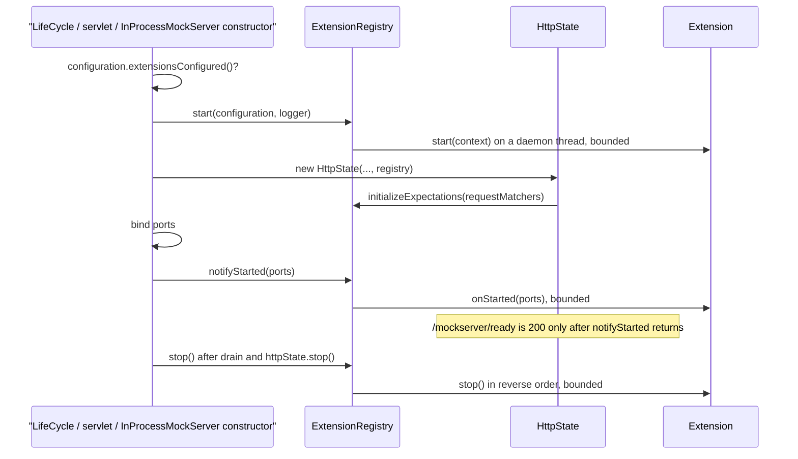
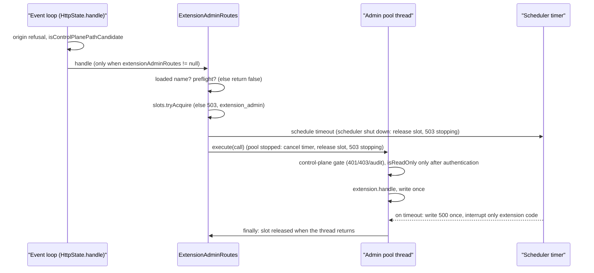
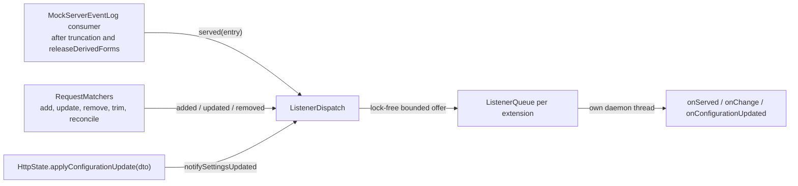
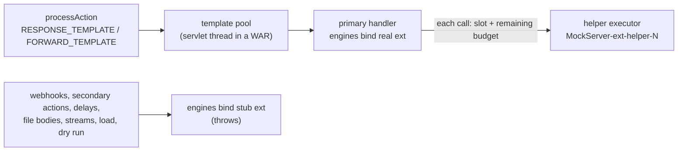

# Extensions (server extension SPI)

## TL;DR

- An extension is trusted Java code (`org.mockserver.extension.Extension`) loaded **once, at startup**, from
  `mockserver.extensions` class names, from `Configuration.extensions(Class...)` / `extensions(Supplier...)` when
  embedded, or from `META-INF/services` entries when `mockserver.extensionScanning=true`.
- Extensions start **first**, before any event loop, selector or scheduler exists, and stop in **reverse** order.
  Any load, `start()` or `onStarted()` failure refuses start-up and stops the extensions already started.
- Docker images load JARs mounted at `/extensions` (last on the classpath, AppCDS and AOT archives still map); Helm
  mounts `extensions.volume` there read-only. Start-up is refused when an enabled output file would be written
  where extension code is loaded from ([Deployment](#deployment)).
- The control plane can never change extensions: `ConfigurationDTO.applyTo` skips the three `extension*`
  properties and `HttpState.applyConfigurationUpdate` warns via `warnInitOnlyProperty`.
- **With nothing configured, nothing changes:** no `ServiceLoader` call, no `org.mockserver.extension` class
  loaded, and the request path is byte-for-byte unchanged. `ExtensionClassLoadingTest` pins this in a fresh JVM.
- Phase 1 is delivered in units. **U11a** is the core: API, loader, registry, lifecycle and the
  expectation-initializer hook. **U11b** adds admin routes: an `AdminApiExtension` serves
  `/mockserver/extensions/<name>/…` behind the control-plane gate, on a capped pool of its own with a timeout.
  **U11d** adds three listeners: served requests (H3), expectation lifecycle (H7) and configuration updates (H8),
  each delivered on the extension's own thread through a queue that never waits. **U11c** adds `$ext` template
  helpers (see [Template helpers](#template-helpers-h6)), each call on a capped helper executor. The global request
  filter (H1) and response transformer (H2) are being added in units: their SPI and executor exist
  ([Request filter and response transformer](#request-filter-and-response-transformer-h1-h2)). Both run on Netty
  HTTP/1.1 and HTTP/2, HTTP/3 (plain and gRPC), both servlets and `InProcessMockServer`; the request filter runs at
  the top of `processAction`, after data-plane authentication.
- **Every deployment loads them:** the Netty server (`LifeCycle`), both servlets and `InProcessMockServer` start,
  notify and stop the registry the same way (see [Start, ready and stop](#start-ready-and-stop)).
- **With listeners loaded, no listener code runs on a server thread.** The thread that logs, removes or changes
  something only builds a small event and makes a lock-free, bounded offer; when the queue is full the event is
  dropped and counted, never waited on.

## Lifecycle



## Components

| Type | Role |
|---|---|
| `Extension` | Public API: `name()`, `priority()`, `start(ExtensionContext)`, `onStarted(List<Integer>)`, `stop()` |
| `ExtensionContext` | The server's live `Configuration` and `MockServerLogger` |
| `ExtensionHook` | The optional capabilities an extension adds by implementing a hook interface: `EXPECTATION_INITIALIZER` (U11a), `ADMIN_API` (U11b), `SERVE_EVENT_LISTENER`, `EXPECTATION_LIFECYCLE_LISTENER`, `SETTINGS_LISTENER` (U11d), `TEMPLATE_HELPER` (U11c), `REQUEST_FILTER`, `RESPONSE_TRANSFORMER` (data plane) |
| `TemplateHelperProvider`, `MustacheHelper` | Public API of the template-helper hook: `helpers()` (public interface → implementation, for Velocity and JavaScript) and `mustacheHelpers()` (key → `String apply(String renderedSection)`) |
| `TemplateHelpers` | One server's `ext` namespace, helper executor, admission cap and per-render budget |
| `ExtensionHelperNamespace` | A read-only level of `ext`; a missing name throws. A stub with no entries is what every non-primary engine binds |
| `ExtensionHelperException` | Every helper failure thrown into a render: timeout, budget used, cap reached, nested call, event loop, stub, stopping |
| `AdminApiExtension` | Public API (U11b): `handle(request, subPath)` and `isReadOnly(method, subPath)` |
| `ExtensionAdminRoutes` | Built by `ExtensionRegistry.createAdminRoutes` only when a started extension implements `ADMIN_API`: route lookup, admission cap, admin pool, timeout, response-once writer, start-up shadow WARN |
| `ServeEventListener`, `ServeEvent` | H3: each answered request (`MOCKED`, `FORWARDED`, `NOT_MATCHED`) with request, response, expectation id, correlation id and time |
| `ExpectationLifecycleListener`, `ExpectationChange`, `ChangeCause` | H7: each expectation `ADDED`, `UPDATED` or `REMOVED`, with why and, for clustered exhaustion, `isFleetWide()` |
| `SettingsListener` | H8: the live `Configuration` after each `PUT /mockserver/configuration` |
| `ListenerDispatch` | Public only so `RequestMatchers`, `MockServerEventLog` and `HttpState` can hold it; builds events and offers them to each listener's queue |
| `ListenerQueue` | Package-private. One per listener extension: a lock-free queue bounded by count (and, for H3 and H7, bytes), drained by one daemon thread `MockServer-ext-listener-<name>` |
| `LoadedExtension` | One loaded extension: instance, name, priority, class, source JAR, implemented hooks and **disabled hooks with their reasons** |
| `ExtensionLoader` | Package-private. Resolves classes through `CallbackClassLoaderResolver`, validates and de-duplicates, sorts by priority then name |
| `ExtensionRegistry` | Starts, notifies and stops extensions; disables hooks; runs the initializer hook |
| `ExtensionException` | Every refusal: load error, duplicate or invalid name, an output written into extension code, start/onStarted throw or timeout |
| `ExtensionOutputPaths` | Start-up check that no enabled output file is written where an extension's code is loaded from ([Deployment](#deployment)) |
| `RequestFilter`, `FilterResult`, `ResponseTransformer`, `FilterContext`, `TransformContext` | Public, experimental API of the data-plane hooks: `filter(request, context)` returning `proceed()`, `proceedWith(request)` or `respond(response)`; `transform(request, response, context)`; `failOpen()` on both; read-only contexts |
| `DataPlaneHooks` | Built by `ExtensionRegistry.start` only when a started extension implements H1 or H2 (`dataPlaneHooks()` is otherwise `null`): the two chains, the capped `MockServer-ext-dataplane-*` pool, the slots, the counters, `droppedWrite(...)` and an idempotent `stop()` |
| `DataPlaneCall` | Package-private. One chain run: slot `tryAcquire`, timer on the scheduler, once-guard, interrupt only inside extension code, slot released when the thread returns |
| `DataPlaneOutcome` | What a chain run tells the transport: proceed with a request, write a filter's response, write a transformed response, or write a failure response untransformed |
| `DataPlaneExtensionTestKit` | In the `mockserver-core` test JAR: runs filters and transformers as a server would, with no server, plus assertions on outcomes and on the transport-owned request fields |

## Rationale

- **Startup-only.** Loading code over the control plane would be remote code execution. The properties follow
  the `controlPlaneCorsAllowOrigin` pattern: echoed read-only by `GET /mockserver/configuration`, skipped by
  `applyTo`, warned about by `applyConfigurationUpdate`, and read only through the `Configuration` instance.
- **Start before anything else.** A refused start then leaks no event loop, selector or scheduler: in
  `LifeCycle`, both servlets and `InProcessMockServer` the registry is built straight after the logger.
- **Zero cost when unconfigured.** The gate, `Configuration.extensionsConfigured()`, lives outside the extension
  package. Fields of type `ExtensionRegistry` in `LifeCycle`, `HttpState` and the servlets stay `null`; holding,
  passing and null-checking a reference does not load its class. The same holds for the field in
  `InProcessMockServer`, pinned by `InProcessMockServerExtensionClassLoadingTest` in a fresh JVM.
- **Bounded calls.** `start`, `onStarted` and `stop` each run on a short-lived daemon thread
  (`MockServer-ext-<phase>-<name>`) awaited for `extensionStartTimeoutMillis`, because the `Scheduler` does not
  exist yet. A timed-out `start` counts as not started, is not stopped, and logs a WARN that its thread may still
  run.
- **Loaded but disabled.** A hook can be switched off for every extension that implements it, with a reason,
  without unloading the extension: `ExtensionRegistry.disableHook(hook, reason)` records the reason on each
  `LoadedExtension` and logs a WARN. Nothing disables a hook today: U11c used it to turn off `$ext` template helpers
  when HTTP/3 was enabled, until HTTP/3 stopped rendering template actions on its QUIC event loop.
- **Helpers never on an event loop.** A helper runs on its own executor while the render waits on the template pool
  (Netty: HTTP/1.1, HTTP/2 and HTTP/3 alike) or the servlet thread (WAR); `TemplateHelpers.call` also refuses outright
  when the caller is an event loop thread (`ThreadExecutorMap.currentExecutor() instanceof EventLoop`).

## Detailed behaviour

### Loading

1. Class names from `extensions()` (comma-separated, trimmed), loaded with `Class.forName(name, false,
   CallbackClassLoaderResolver.resolveClassLoader())`.
2. Embedded classes (`extensionClasses()`), then suppliers (`extensionSuppliers()`), called once per server.
3. Only when `extensionScanning()` is true: `ServiceLoader.load(Extension.class, loader).stream()`, de-duplicated
   by provider type before instantiation.

A class is instantiated once however many sources name it. Each server built from one `Configuration` gets its
own instances. Names must match `[a-z0-9-]+` and be unique. The INFO line per extension names its class, source
JAR and hooks.

### Deployment

| Deployment | Where the JARs go |
|---|---|
| JAR | `java -cp mockserver-netty-jar-with-dependencies.jar:ext/* org.mockserver.cli.Main -extensions com.acme.Ext` (`java -jar` ignores `-cp`) |
| Docker | Every server image ends its classpath with `/libs/*:/extensions/*`: `-v ./ext:/extensions:ro -e MOCKSERVER_EXTENSIONS=com.acme.Ext`. The AppCDS archive and AOT cache still map, because the runtime classpath only extends the training one ([docker.md](../infrastructure/docker.md)) |
| Helm | `extensions.volume` (any volume source) is mounted `readOnly: true` at `/extensions`; `extensions.classes` and `extensions.scanning` set the two properties ([helm.md](../infrastructure/helm.md)) |
| WAR | JARs in `WEB-INF/lib`, properties as system properties |

**Output-path refusal.** Before any extension starts, `ExtensionOutputPaths` refuses start-up with an
`ExtensionException` when an enabled output would be written where an extension's code is loaded from:
`persistedExpectationsPath` (with `persistExpectations`), `persistedRecordedExpectationsPath` (with
`persistRecordedExpectations`), `persistedRecordedRequestsPath` (with `persistRecordedRequestsToDisk`),
`auditLogFile` (when set) or `memoryUsageCsvDirectory` (with `outputMemoryUsageCsv`). For a class directory the
output may not be anywhere beneath it, because a directory entry loads any file under it. For a JAR the output may
not be directly in the JAR's directory, because a classpath wildcard over that directory (`/extensions/*`) is not
recursive, so a subdirectory is allowed. Disabled outputs are not checked, so the default relative paths never
refuse a `java -cp mockserver.jar:acme.jar` run from the JAR's own directory. The check runs only at start-up.
A start-up-only check is enough because all five paths, and `controlPlaneAuditEnabled`, are fixed at startup:
`PUT /mockserver/configuration` ignores a different value and logs a warning (see
[configuration-reference.md](configuration-reference.md#capacity-properties-fixed-at-startup)), so a later PUT
cannot point a writer inside an extension classpath directory.

### Start, ready and stop

| Deployment | `start` | `onStarted` | Refused start cleanup | `stop` |
|---|---|---|---|---|
| Netty (`LifeCycle`) | First in the constructor | `startedServer(ports)`, after every port binds | Constructor `catch` stops the registry; an `onStarted` failure calls `stop()` (server and extensions) and rethrows | `stopAsync`, after the drain and `httpState.stop()` |
| WAR / proxy WAR | First in the servlet constructor | End of the constructor, empty port list | Shuts down whatever the constructor built, then stops the registry | `shutdown()` (idempotent): `httpState.stopDataPlaneHooks()`, the scheduler, the worker group, `httpState.stop()`, then the registry |
| `InProcessMockServer` | First in the constructor, straight after the logger | End of the constructor, empty port list | `httpState.stop()` (when built), `scheduler.shutdown()`, then `registry.stop()`, and rethrows | `close()` (idempotent): `httpState.stop()`, scheduler, forward group, then `registry.stop()` last |

`notifyStarted` runs at most once and skips the remaining extensions once the registry is stopping (for example a
`PUT /mockserver/stop` during start-up). `LifeCycle.stop()` waits the drain budget plus `maximumStopMillis()` (one
`extensionStartTimeoutMillis` per started extension), so a slow extension `stop()` cannot make it return early. Both
`MockServer` constructors stop everything, extensions included, when anything after `super(...)` throws.

`HttpState.isInitializationComplete()` is `initializationComplete && (registry == null ||
registry.isStartedNotified())`, so `/mockserver/ready` stays 503 until every `onStarted` returns.

### In-process (`InProcessMockServer`)

`InProcessMockServer` wires the registry as the WAR does, so every hook works without a socket:

| Hook | In-process behaviour |
|---|---|
| Lifecycle | `start` before the scheduler and `HttpState` exist; `onStarted(List.of())`, as a WAR has no ports of its own; `stop` in reverse on `close()` or a refused start. `isInitializationComplete()` is true once `onStarted` returns |
| H4 initialiser | Applied while `HttpState` is built, as elsewhere |
| H5 admin routes | `handle()` / `handleAsync()` reach `/mockserver/extensions/<name>/…` through `HttpState.handle(..., warDeployment = true)`, behind the same control-plane gate as the instance's other REST routes (JWT or Basic as configured; mTLS cannot work, there is no client certificate). The Java methods (`upsert`, `verify`, …) never reach an admin route |
| H3, H7 listeners | Fire as on Netty: served requests from the event-log consumer, expectation changes from the store, each on the listener's own thread |
| H8 settings listener | Never fires through `handle()`: `PUT /mockserver/configuration` is a Netty-only route and answers `404` in-process. Only a direct `getHttpState().applyConfigurationUpdate(dto)` call fires it |
| H6 `$ext` helpers | `handle()` renders a response or forward template on the caller thread and `handleAsync()` on the template pool; each helper call still runs on the helper executor with its usual budget |

`InProcessMockServerExtensionTest` covers each of these and that `close()` leaves no extension thread running.

### Expectation initializer hook (H4)

After the configured initialisers, `HttpState` calls `registry.initializeExpectations(requestMatchers)`. Each
started extension that implements `ExpectationInitializer` (and whose hook is enabled) has its expectations
applied with `requestMatchers.update(..., new Cause("extension:<name>", CLASS_INITIALISER))`. A throw refuses
start-up.

### Admin routes (H5)

**Outcome.** A started `AdminApiExtension` named `acme` answers every method on `/mockserver/extensions/acme` and
`/mockserver/extensions/acme/…`. The call passes the same origin refusal, authentication, authorization, audit and
control-plane CORS headers as a built-in route, runs on `MockServer-ext-admin-<n>-<m>` threads (never an event loop
or the shared scheduler), takes one of `extensionAdminMaxInFlight` slots or gets a `503`, and on Netty gets a `500`
if it has not answered within `extensionAdminTimeoutMillis`.



| Aspect | Behaviour |
|---|---|
| Routing | `HttpState.handle` checks `extensionAdminRoutes != null` after the origin refusal and the `isControlPlanePathCandidate` fast reject, so data-plane paths never reach it. Only loaded names are taken (an owner decision): `/mockserver/extensions/other/…`, `/mockserver/extensions/` and bare `/extensions/…` fall through exactly as before. `subPath` is `/` for the bare name |
| CORS | A preflight returns `false` and is answered by the existing control-plane preflight path in `HttpActionHandler`; responses are written with `apiResponse=true`, so they get the control-plane CORS policy and the `version` header |
| Gate | `HttpState.extensionAdminRouteAllowed` = `controlPlaneRequestAuthenticated` with a read override: `controlPlaneAuthorized` and `recordAudit` use `isReadOnly(method, subPath)` instead of the method, so every route needs MUTATE (GET included) unless the extension says it only reads. The override is a memoised `BooleanSupplier` evaluated only after authentication succeeds, so an unauthenticated caller runs no extension code at all. Any throw from `isReadOnly`, an `Error` included, is answered `500` without calling `handle` (`recordAudit` swallows its own failures, so `serve` rethrows the recorded failure) |
| Threads | `ThreadPoolExecutor(cap, cap)` with core time-out: never more threads than slots. The slot is released in the task's `finally`, so a handler that ignores the interrupt keeps its slot and no extra thread is made; hung handlers turn into `503`s |
| Timeout | Netty only, on the scheduler's timer. The timer writes one `500` (correlation id; the logged exception carries the stuck thread's stack) and interrupts the thread only while it is inside extension code (`isReadOnly` or `handle`), never MockServer's gate, audit or response writing (an interrupt there could close the audit file sink's channel and disable it). The interrupt flag is cleared as each extension call returns. `OnceResponseWriter` makes the timeout and a late handler mutually exclusive; a late result is discarded and counted (`lateResultCount`) |
| Loopback | A handler calling its own server at the cap gets a `503` (non-blocking `tryAcquire`), not a deadlock |
| Errors | A throw is answered `500` with a correlation id through `ControlPlaneFailureResponse.writeUnexpectedFailure`; `null` is answered `404` |
| WAR and in-process | Runs inline on the servlet thread, or on the thread calling `InProcessMockServer.handle` / `handleAsync`, inside the cap, with no timeout: `extensionAdminTimeoutMillis` does not apply, and a handler that never returns holds that caller (`handleAsync` included) |
| Shutdown | `HttpState.stop` stops the routes first, which `LifeCycle` runs after the drain and before `ExtensionRegistry.stop`: `shutdown()` (not `shutdownNow`), then an interrupt only for the live calls that are inside extension code, so MockServer's own authentication, audit and response writing are never interrupted. A call that has not reached `handle` yet is answered `503`. A call made once the routes or the `Scheduler` are stopped is answered `503` "MockServer is stopping" at once: the timer is armed before the call is queued, and the `Scheduler`'s `CallerRunsPolicy` discards (never rejects) a timer after shutdown, so `Scheduler.scheduleUnlessShutDown` schedules it behind a run-once claim: either the timer runs or the call is answered `503`, exactly once |
| Shadowing | After the initialisers, `warnOnShadowedExpectations` logs a WARN for each start-up expectation whose literal or regex path falls under a loaded name. Expectations added later are not checked; they simply never match there |
| Ordering | On pipelined HTTP/1.1 an admin reply can overtake an earlier response, as with `dispatchOffTheEventLoop` |

**Cost with no admin extension.** `createAdminRoutes` returns `null` and starts nothing. A control-plane request
pays one null check of a final field; a data-plane request returns at `isControlPlanePathCandidate` first and pays
nothing. `ExtensionClassLoadingTest` sends a control-plane request, a `/mockserver/extensions/…` request and a
data-plane request in a fresh JVM and still sees no `org.mockserver.extension` class load.

**Follow-up (not in U11b):** the design's §5.7 per-extension metrics (`mock_server_extension_invocations_total`,
`_errors_total`, `_timeouts_total`, `_duration_seconds` and the `mock_server_extension_stuck` gauge) are not
registered yet. They span every hook, so they are owned by the listener unit (U11d), which adds the listener drop
counter anyway. Until then H5 failures show as ERROR log entries with correlation ids and as the `extension_admin`
overload reason, and `ExtensionAdminRoutes` keeps `timeoutCount`, `lateResultCount` and `errorCount` for them.

### Store factory overload

`ExpectationStoreFactory.Factory` gained a default five-argument `create(..., ExtensionRegistry)` that delegates to
the four-argument form, so existing factories are unchanged. The default factory overrides both and calls the
five-argument `RequestMatchers` constructor, which takes the registry's lifecycle dispatch; `HttpState` likewise
calls the five-argument `MockServerEventLog` constructor. The four-argument constructors stay, so benchmarks and
other callers are unchanged.

### Listeners (H3, H7, H8)



The registry builds the dispatch after every `start()` has returned, with one `ListenerQueue` per started extension
that implements any listener interface. `serveEventDispatch()` and `lifecycleDispatch()` return `null` when no
extension implements that hook, so the fields that hold them stay `null` and each site costs one null check.

**Where each event is emitted.**

| Event | Site | Thread |
|---|---|---|
| H3 serve event | `MockServerEventLog.processLogEntry`, after `truncateBodiesForLog` and `releaseDerivedForms`, immediately before `eventLog.add`. Types `EXPECTATION_RESPONSE` (`MOCKED`), `FORWARDED_REQUEST` (`FORWARDED`, not re-imported archives), `NO_MATCH_RESPONSE` (`NOT_MATCHED`); an entry without a response is skipped | Event-log consumer |
| H7 `ADDED` / `UPDATED` | `add` and `update`, inside the monitor, right after the node-local mutation. `UPDATED` only when the matcher actually changed, so an identical re-add or an unchanged file reload is silent | Caller (control plane, initialiser, watcher) |
| H7 `REMOVED` | `removeHttpRequestMatcher`, inside the monitor and only when the CPQ removal returned `true` (so a racing `postProcess` and lazy task report once); `trimEvictedFromBackend` and the no-backend CPQ eviction listener (`EVICTED`); `reconcileClusteredScan` (`CLUSTER`). Clear, the OpenAPI prune, `update`'s removals and reset (one event per expectation) all go through `removeHttpRequestMatcher` | Remover: control plane, scheduler, or the response-completion thread (an event loop for binary, gRPC bidi and HTTP/3) |
| H8 | `HttpState.applyConfigurationUpdate(ConfigurationDTO)` with a non-null DTO, after the update and the init-only warnings. The no-argument form (programmatic changes) does not fire | Control plane |

**Order.** Every H7 offer is made under the store's monitor, at the mutation it reports, so a listener sees changes in
the order the store applied them: an expectation's `ADDED` always precedes its `REMOVED`, even when a request uses up a
just-added `once()` expectation before `add` returns. The offer never waits, so this is the one listener call allowed
inside the monitor's "no notification" invariant. An `update` batch reports its adds and updates before the removals
it makes outside the monitor.

**`ChangeCause`.** `RequestMatchers` passes a package-private `Origin` constant (`CAUSE`, `FILE_WATCHER`, `RECLAIM`,
`FLEET_EXHAUSTED`) alongside the legacy `Cause`, and maps it to the public `ChangeCause` only inside the
`lifecycleDispatch != null` branch. The legacy `Cause` and the `MockServerMatcherListener` firing set are unchanged
(pinned by `shouldLeaveTheLegacyListenerFiringSetUnchanged`).

| Cause | When |
|---|---|
| `API` | Legacy `Cause.Type.API`: control-plane or client add, update, clear, reset |
| `FILE_INITIALISER` | Legacy `FILE_INITIALISER`: startup JSON/OpenAPI files and the persisted-blob reload |
| `CLASS_INITIALISER` | Legacy `CLASS_INITIALISER`: `initializationClass` and H4 extension initialisers |
| `FILE_WATCHER` | `ExpectationFileWatcher` calls `ExpectationInitializerLoader.retrieveExpectationsFrom*File(..., true)`, which calls `update(expectations, cause, true)`; the legacy `Cause` stays `FILE_INITIALISER`, so the update still replaces that file's expectations |
| `EXHAUSTED` | `Origin.RECLAIM` (from `postProcess` and the lazy-removal task) when `!hasRemainingMatches()`; also `Origin.FLEET_EXHAUSTED`, with `isFleetWide()` true |
| `EXPIRED` | `Origin.RECLAIM` when matches remain, so the `TimeToLive` passed. `EXHAUSTED` wins when both apply |
| `EVICTED` | Non-clustered backend trim, or the no-backend CPQ eviction |
| `CLUSTER` | Clustered reconcile: remote add, changed remote update, and every reconcile removal (a remote remove and a clustered eviction look the same there). A reconcile racing this node's own write, before `lastReconciledVersion` records it, can report that write once more as `CLUSTER` `UPDATED` |

**Timing.** `EXHAUSTED` and `EXPIRED` fire when the store removes the expectation: normally from `postProcess` as the
response that used the last match completes (a `TimeToLive` lapsing mid-response is `EXPIRED` the same way);
otherwise when a later match or a control-plane retrieval meets the inactive expectation and schedules the lazy
removal. In clustered shared-Times mode the node-local `Times` never decrements, so exhaustion is reported when a node
next tries to match the expectation (the `consumeTimesViaBackendCas` result is `exhausted`, origin
`FLEET_EXHAUSTED`), or as `CLUSTER` on a peer that reconciles the backend removal. A served decrement never fires H7.

**Events carry references, not copies.** `ExpectationChange.expectation()` is the live expectation (read-only by
contract). `ServeEvent` copies the log entry's request, response, expectation id, correlation id and time on the
consumer thread and never holds the `LogEntry`, so ring eviction's `LogEntry::clear` cannot change it. Its weight is
the entry's memoised `estimatedHeapSize()`; because the hook sits after `releaseDerivedForms`, `eventLog.add` reuses
the same memo, and the event log's retained bytes are identical with and without an H3 loaded (pinned).

**Bounds and drops.** Each queue holds at most `extensionListenerQueueSize` events (including the one being
delivered). Queues of H3 or H7 listeners also share `extensionListenerMaxBytes` equally, so one stuck listener can
fill only its own share. A serve event weighs its log entry's `estimatedHeapSize()`; an expectation change weighs its
expectation's memoised `estimatedHeapSize()`, because it keeps a removed or superseded expectation reachable; one oversize event is admitted into an empty queue, matching `wouldExceedInFlightBudget`. The offer is a CAS on
two counters plus a `ConcurrentLinkedQueue.offer`, with an `unpark` only when the delivery thread is parked. A refused
event increments `mock_server_extension_listener_dropped_total{extension, reason}` (`count`, `bytes`, `shutdown`) and
logs one WARN per queue; it never touches `MockServerEventLog.DropReason` or `droppedSinceLogReset`, so verification is
not tainted (pinned). A throw from a listener is counted in `mock_server_extension_errors_total{extension, hook}`,
logged once, and delivery continues. A hook disabled with `disableHook` is skipped at delivery.

**Stop.** `ExtensionRegistry.stop()` stops accepting events and waits up to `stopDrainMillis` for each queue to
drain, calls every extension's `stop()` in reverse order, then ends the listener threads, counting anything still
queued as `shutdown`. `maximumStopMillis()` includes the flush budget, so `LifeCycle.stop()` waits for it.

**Not yet implemented.** From design §5.7, `mock_server_extension_invocations_total`, `_timeouts_total`,
`_duration_seconds` and the `mock_server_extension_stuck` gauge do not exist for the listener hooks yet; only the
dropped and errors counters do. They are a tracked U11 follow-up.

### What runs with no listener loaded

| Site | Added |
|---|---|
| `processAction`, Netty handlers, the per-decrement commit branch, `postProcess` signature | Nothing. `postProcess` passes the constant `Origin.RECLAIM` on its existing removal branch |
| `processLogEntry` | `if (serveEventDispatch != null)` |
| `removeHttpRequestMatcher` (via `expectationRemoved`) and the active-expectation `postProcess` | One null check and nothing allocated, pinned by `ExpectationRemovalNoListenerCostTest`, which also runs in the C1-only `allocation-tests-without-c2` execution because C2 escape analysis would hide an added allocation |
| `add`, `update`, trim, reconcile, CPQ eviction | `if (lifecycleDispatch != null)`, once per mutation; nothing is built before the check (by inspection, not pinned) |
| The two per-match commit branches | No listener check at all, pinned structurally by `shouldKeepEveryListenerCheckOutOfThePerMatchCommitBranches` |
| `applyConfigurationUpdate` | `if (extensionRegistry != null)` |
| Class loading | None: `ExtensionClassLoadingTest`'s fresh-JVM probe adds, serves to exhaustion, logs, PUTs configuration and resets, and loads no `org.mockserver.extension` class |

### Template helpers (H6)



**Binding, by call site.** `ExtensionRegistry.start` collects each started provider's `helpers()` and
`mustacheHelpers()` (each bounded like `start`) and builds `TemplateHelpers`. `HttpActionHandler` reads
`registry.templateHelpers()` once in its constructor; when non-null, matched `RESPONSE_TEMPLATE` and
`FORWARD_TEMPLATE` actions use **dedicated** `HttpResponseTemplateActionHandler` / `HttpForwardTemplateActionHandler`
instances whose engines get the real namespace through the three-argument engine constructors. When null, the
`getPrimary…` getters return the shared handlers, so the dispatch is the same single lazy null check as before. The
registry also sets `Configuration.extensionTemplateHelperStub()`; every engine built by the two-argument constructor
(or `forDryRun`) binds that stub as `ext`, so a webhook, secondary action, delay, file body, stream, load scenario
or dry-run template that calls a helper fails loudly instead of rendering the reference as written. With no helper
extension the stub is null and no engine binds anything. The registry clears the stub when a reused configuration's
extensions offer no helpers, and on `stop()` when the stub is still the one it set.

**Zero per-render cost.** `ext` goes into the engines' shared, build-once bindings (Velocity
`sharedFunctionsAndHelpers`, Mustache `baseBindings`); JavaScript binds it only for scripts that name `ext`, decided
once per parsed script (`CachedScript.namesExtensionHelpers`, computed lazily and only when the engine has helpers, so
an engine without helpers never scans). The only per-render addition is in the dedicated
primary handlers, which exist only when helpers are loaded: one `ThreadLocal.remove()` (`TemplateHelpers.endRender`)
after each render.

**One call.** `TemplateHelpers.call` refuses a call from a helper thread (nested) or an event loop, starts the
render's deadline on the first call (`extensionHelperTimeoutMillis`), refuses once it has passed, takes a slot of
`extensionHelperMaxInFlight` with `tryAcquire`, and hands the call to a cached daemon executor carrying the caller's
`HttpState` port thread-local. It waits for the remaining budget; on timeout it cancels with interrupt. A helper that throws is logged at WARN with
its exception, and the `ExtensionHelperException` thrown into the render names only the exception's type, because a
template failure's message reaches the client in the 500 body. The slot is
released by a wrapper around the task, so it is held until the helper's thread really returns, even for a call
cancelled before it started. After `registry.stop()` the executor is shut down and calls fail as "the server is
stopping".

**JavaScript arguments.** A JS object or array passed to a helper arrives as a polyglot value bound to the render
thread's context and cannot be read on the helper thread; parameters should be strings, numbers or booleans
(`JSON.stringify` for structured data).

**Velocity and JavaScript** call a JDK proxy of each declared public interface, at
`ext.<extension>.<InterfaceSimpleName>`; `Object` methods are answered locally. JavaScript reads each namespace level
through a `ProxyObject`; the proxy itself is a host object. The proxy works under `SecureUberspector`.

**Mustache** (resolving design review 5's MINOR on `Mustache.Lambda`): the API is MockServer's own
`MustacheHelper.apply(String)`, not `Mustache.Lambda`. The wrapping lambda runs `fragment.execute()` on the render
thread first (so nested `{{...}}` and any `ext` section inside it run in order on the render thread, are not refused,
and count against the same budget), passes the
text to the helper on the helper executor, and writes the result only if it returned in time.

**Breakpoint continuations.** A REQUEST-phase breakpoint continuation of a `RESPONSE_TEMPLATE` or
`FORWARD_TEMPLATE` is executed through `scheduler.scheduleTemplateAction` when helpers are loaded
(`continuationExecutorFor`), so it never waits on a helper from the shared scheduler. Without helpers it continues on
the shared scheduler as before.

**HTTP/3.** Helpers behave the same with `http3Port > 0`: HTTP/3 dispatches template actions to the template pool as
HTTP/1.1 and HTTP/2 do (see [http3.md](http3.md#threading-nothing-waits-on-the-quic-event-loop)), so the same capped
helper executor, timeout and per-render budget apply. `ExtensionTemplateHelpersTest` renders helpers over HTTP/3 and
checks a slow helper does not hold up another HTTP/3 request.

**Start-up refusal.** A `helpers()` key that is not a public interface, a value that does not implement its key, two
interfaces of one extension with the same simple name, a Mustache key outside `[A-Za-z0-9_-]+`, a null helper, or a
throw or timeout from `helpers()` / `mustacheHelpers()`.

Not in U11c: the `mock_server_extension_*` metrics of the design's §5.7 and a `TemplateRenderAllocationBenchmark` arm
with a no-op helper.

### Request filter and response transformer (H1, H2)

**Outcome.** A started `RequestFilter` or `ResponseTransformer` makes `ExtensionRegistry.start` build one
`DataPlaneHooks`: the filter chain (ascending priority, then name), the transformer chain (the reverse), and one capped
pool both run on. Each chain run takes a slot or is refused at once, runs on a `MockServer-ext-dataplane-*` thread
(never an event loop) within one budget, and ends with exactly one `DataPlaneOutcome`. **Status:** the SPI, executor,
properties and metrics exist (unit DP1a of the design), and the Netty server's HTTP/1.1 and HTTP/2 writer runs the
transformer chain (DP4a; see [netty-pipeline.md](netty-pipeline.md#exchange-ends-with-an-extension-response-transformer)).
The filter chain runs at the top of `HttpActionHandler.processAction` for every transport, verified on Netty HTTP/1.1
and HTTP/2 (DP2) and on HTTP/3, both servlets and in-process (DP3; see
[request-processing.md](request-processing.md#extension-request-filter-h1-at-the-top-of-processaction)).
HTTP/3 (plain and gRPC), both servlets and `InProcessMockServer` run the transformer chain too (DP5; see
[http3.md](http3.md#extension-response-transformers)), each through a transforming subclass built only when a hook is
loaded: `CoreDataPlaneWriters.servlet` for the servlets and the nested `InProcessMockServer$TransformingInProcessResponseWriter`.
A servlet and `InProcessMockServer.handle` answer on the calling thread, so their writers use
`TransformingWrites(..., waitOnCaller=true)`: that thread waits for at most the budget (`transformAndWait`) and then
calls `sendResponse` itself; `handleAsync` is completed by the pool thread that finishes the chain.

```mermaid
sequenceDiagram
    participant T as "Transport (later units)"
    participant H as DataPlaneHooks
    participant P as "Hook pool thread"
    participant S as "Scheduler timer"
    T->>H: filter / transform (async) or filterAndWait / transformAndWait
    H->>H: stopping? 503. slots.tryAcquire, else 503 (or skip if all fail open)
    H->>S: schedule the budget (a shut-down scheduler means stopping, 503)
    H->>P: execute the chain
    P->>P: each hook on a copy; interrupt allowed only inside extension code
    P->>H: finally: slot released, then the outcome
    S-->>H: budget used: 500 (or unchanged if the rest fail open), interrupt
    H-->>T: onDone exactly once (once-guard)
```

| Event | Filter chain (fail-closed default) | Transformer chain | Extension's `failOpen()` is true |
|---|---|---|---|
| Throw, `null`, contract violation | `500` naming the extension, hook and failure type with the correlation id | `500` | Continue with that hook's input |
| Budget used | `500` | `500` | Unchanged value, only when the timed-out hook **and every later hook** fail open; a fail-closed hook is never skipped |
| No slot free | `503`, `Retry-After: 1`, `extension_dataplane` overload | `503` | Chain skipped (`isSkipped()`), only when every hook in it fails open |
| Stopping, or the scheduler rejects the timer | `503` | `503` | `503` |

| Aspect | Behaviour |
|---|---|
| Threads | `ThreadPoolExecutor(cap, cap)` with core time-out; the slot is released in the task's `finally`, before the outcome is acted on, so a continuation or a transformer never holds two slots and a hook that ignores its interrupt keeps its slot (hung hooks become `503`s) |
| Budget | `extensionDataPlaneTimeoutMillis` from admission. Async callers rely on the scheduler's timer (a scheduler without one is refused as stopping); a waiting caller (`filterAndWait`, `transformAndWait`) also bounds its own wait, so a WAR's synchronous scheduler needs no timer. The scheduler's `CallerRunsPolicy` silently drops a task once it is shut down, so the call checks `isShutdown()` after scheduling |
| Once-guard | The chain, the timer and `stop()` race to complete the call; the first wins and the rest are discarded (`lateResultCount`) |
| Copies | Each filter gets a deep copy of its input (`DataPlaneCopies.copyForFilter`), so `proceed()` discards edits to the copy; what it continues with (`acceptFilteredRequest`: the transport's fields re-stamped) or answers is taken as a fresh copy, and a result equal to its input leaves the input in place. Each transformer gets a deep copy of the response (`DataPlaneCopies.copyForTransformer`, no streaming body) and of the request; its result is accepted as a fresh deep copy carrying the original streaming body, without an inherited `Content-Length` when its body changed, and a result equal to its input leaves the input itself to be written. A change is detected by value and named in `changedBy()` |
| Contract | A filter may not move a request under `/mockserver/` or `/_mockserver_` (an unserved control-plane path left where it is is fine) or, for gRPC, change the path or `x-grpc-service` / `x-grpc-method`, nor answer with a `1xx` response; a transformer may not replace a streamed response's body |
| Logging | One WARN per hook failure (with the correlation id, extension, hook, type and the response sent), never rate-limited; only the stack trace is limited to one per extension per 10 s. Start-up logs the chain order at INFO, and a WARN when twice the budget is not below `inboundConnectionIdleTimeoutMillis` or `stopDrainMillis` (each skipped when that value is `0` or less) |
| Stop | `DataPlaneHooks.stop()` (idempotent) stops admission, shuts the pool down, completes every pending call as stopping synchronously, and interrupts only the threads inside extension code. It runs while whatever writes each pending call's `503` is still up: first in `HttpState.stop()` (`stopDataPlaneHooks()`), and first in both servlets' `shutdown()`, before they stop the scheduler and worker group. `MockServer.stopAsync` first stops only the HTTP/3 calls (`stopCalls(HTTP_3)`), since HTTP/3 stops before the drain. `ExtensionRegistry.stop()` calls it again as a backstop. A call whose timer the scheduler rejects, or that starts after the scheduler shut down, completes at once as stopping |
| Start-up | `failOpen()` is asked once per extension, bounded like `start`; a throw or timeout refuses start-up |
| Metrics | `mock_server_extension_dataplane_failures{extension,hook,type}`, `mock_server_extension_dataplane_dropped_writes{reason}` and the `extension_dataplane` overload reason ([metrics.md](metrics.md)) |

**Cost with no data-plane hook.** `prepareDataPlaneHooks` returns before touching any data-plane class, so
`dataPlaneHooks()` is `null`; with no extension configured the registry itself is never built.
`DataPlaneHooksAbsentCostTest`, `NettyDataPlaneHooksAbsentCostTest` and `ExtensionClassLoadingTest` pin this.

## Appendix: configuration

| Property | Default | Notes |
|---|---|---|
| `mockserver.extensions` / `--extensions` | empty | Comma-separated class names |
| `mockserver.extensionScanning` | `false` | Also load `META-INF/services/org.mockserver.extension.Extension` entries |
| `mockserver.extensionStartTimeoutMillis` | `30000` | Per `start`, `onStarted` and `stop` (and `helpers()`); values below 1 read as 1 |
| `mockserver.extensionAdminMaxInFlight` | `32` | Admin route calls in flight; beyond it a `503` counted as `extension_admin`; values below 1 read as 1 |
| `mockserver.extensionAdminTimeoutMillis` | `30000` | Per admin route call on Netty; values below 1 read as 1 |
| `mockserver.extensionListenerQueueSize` | `10000` | Events per listener queue; values below 1 read as 1 |
| `mockserver.extensionListenerMaxBytes` | `heapFraction(heapAvailableInKB(), 20)`, or 16 MB with no heap ceiling | Shared equally by the H3 and H7 queues; values below 1 use the default, so it is never unbounded |
| `mockserver.extensionHelperTimeoutMillis` | `1000` | One budget for all the helper calls of one render; values below 1 read as 1 |
| `mockserver.extensionHelperMaxInFlight` | `32` | Helper calls running at once; a call beyond it fails at once; values below 1 read as 1 |
| `mockserver.extensionDataPlaneMaxInFlight` | `32` | Request filter and response transformer chains running at once; beyond it a `503` counted as `extension_dataplane`; values below 1 read as 1 |
| `mockserver.extensionDataPlaneTimeoutMillis` | `1000` | Budget of one filter or transformer chain; values below 1 read as 1 |

All eleven are startup-only (skipped by `ConfigurationDTO.applyTo`, warned about by `applyConfigurationUpdate`).

Spring: `MockServerPropertyCustomizer.applyProperty` maps all eleven, so `@MockServerInstance(properties = ...)`
gives each named instance its own extensions.

Tests: `ExtensionRegistryTest`, `TemplateHelpersTest`, `ExtensionAdminRoutesTest`, `ExtensionListenersTest`,
`DataPlaneHooksTest`, `DataPlaneHooksMetricsTest`, `DataPlaneExtensionTestKitTest`,
`ExpectationRemovalNoListenerCostTest` and the extension case in `HttpStateAuditTest` (core), `ExtensionLifecycleTest`,
`ExtensionAdminRouteTest`, `ExtensionListenersIntegrationTest`, `ExtensionTemplateHelpersTest`,
`ExtensionHelperBreakpointIntegrationTest` and `ExtensionClassLoadingTest` (netty),
`MockServerServletExtensionTest`, `ProxyServletExtensionTest`, `MockServerInstanceExtensionsTest` (Spring),
`InProcessMockServerExtensionTest` and `InProcessMockServerExtensionClassLoadingTest` (core, in-process), plus
the startup-only cases in `HttpStateConfigurationUpdateTest` and `ConfigurationDTOTest`. The request filter on HTTP/3,
the servlets and in-process, and its stop order: `Http3RequestFilterIntegrationTest` and
`RequestFilterStopIntegrationTest` (netty), `MockServerServletRequestFilterTest`, `ProxyServletRequestFilterTest` and
`InProcessMockServerRequestFilterTest`, and the identity-filter corpora for HTTP/3, the servlet and in-process.
