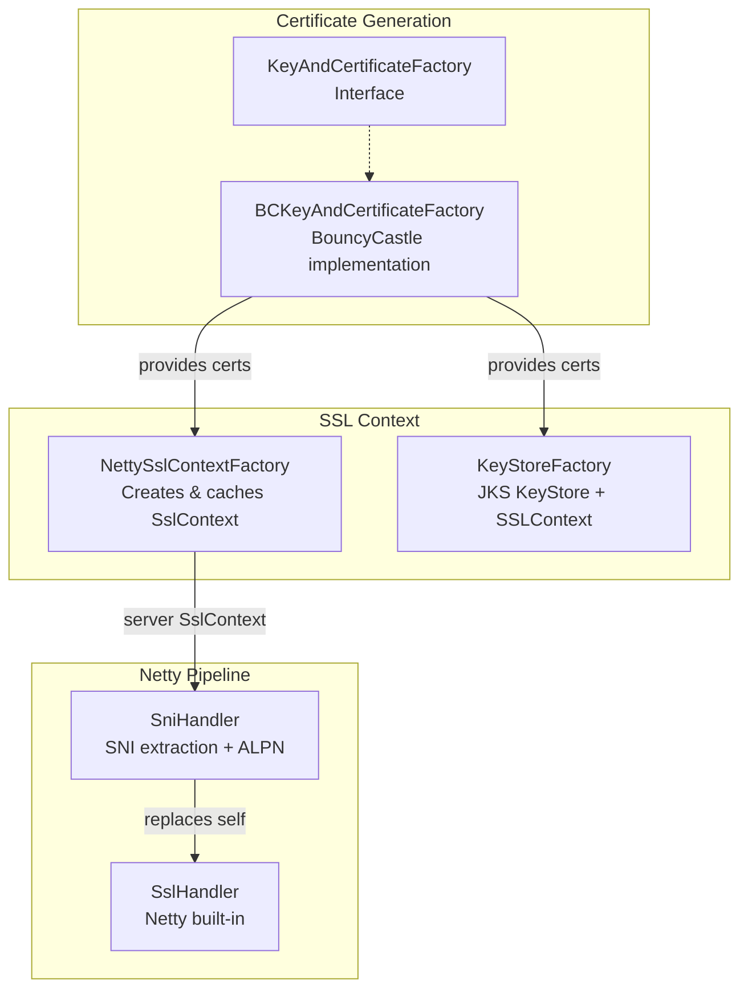
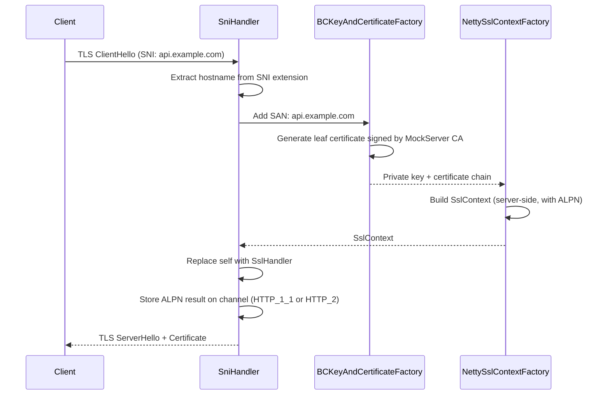
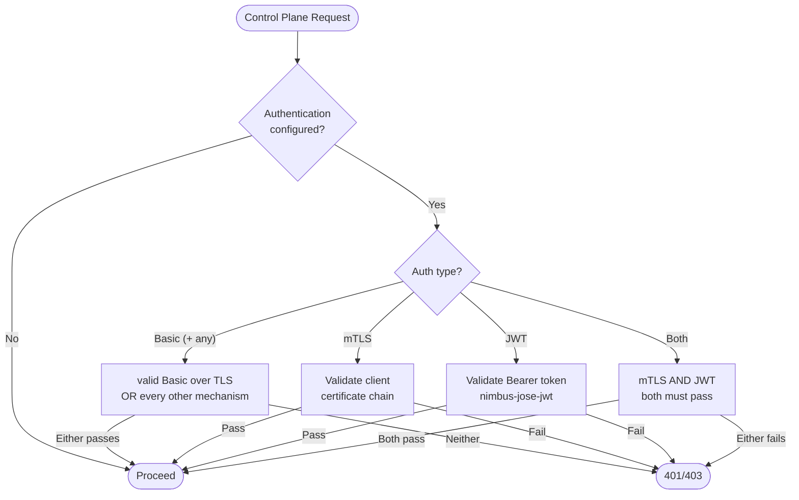
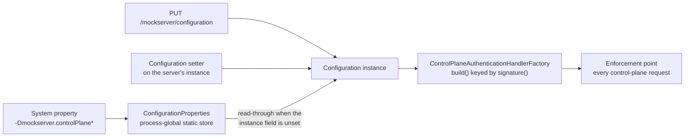
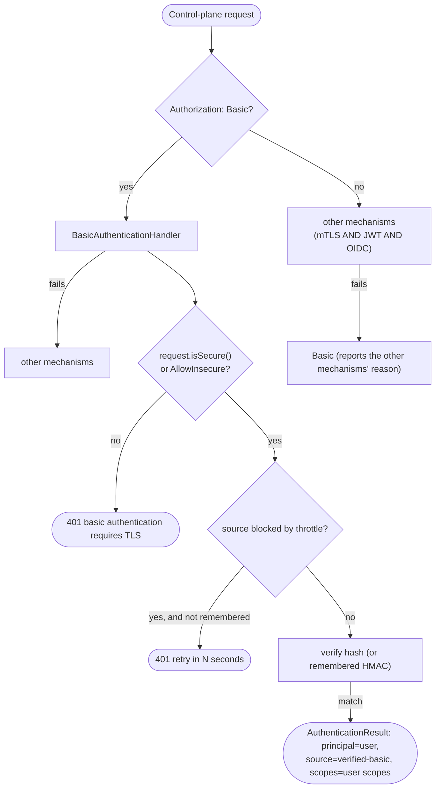
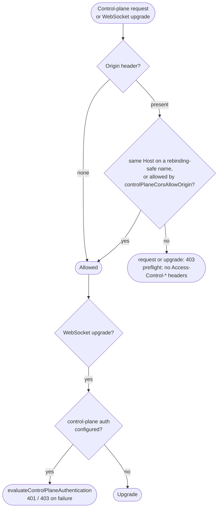
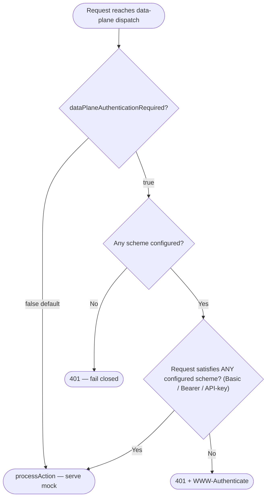

# TLS, Certificates & Security

## TLS Architecture

MockServer dynamically generates TLS certificates using BouncyCastle, enabling transparent HTTPS interception without pre-configured certificates.



### Dynamic Certificate Generation

When a TLS connection arrives:



The diagram shows the first handshake for a host. **In the steady state nothing is generated:** when the
cached server `SslContext` is still valid, `SniHandler.lookup` returns it on the event loop as an
already-completed future (`NettySslContextFactory.cachedServerSslContext()`). Only a miss — no context
yet, a new SAN, a leaf past its renewal threshold, a changed TLS input, or a due re-check of a fixed
certificate on disk (file I/O) — goes to the `mockserver-ssl-context-*` pool. Validity is checked with
one `long` compare against `Configuration.serverTLSContextGeneration()`, which every TLS-input setter and
every SAN add/clear/eviction advances (as does any global property change); only when it has moved is the
full input signature recomputed and compared, so a no-op change does not rebuild. The SAN part of the
signature is read *before* a build, so a SAN added while a build is in flight forces another build rather
than being recorded as already present. SAN sets must be changed through `Configuration`'s methods — a
direct mutation of the set returned by `sslSubjectAlternativeNameDomains()` is not seen.

**The held ClientHello.** While a lookup runs, Netty's `SslClientHelloHandler` holds a retained slice of
the ClientHello and releases it only when the lookup future notifies its listeners on the channel's event
loop. Two paths could leave it unreleased: a stop during certificate generation (a terminated event loop
never runs the notification) and a failed lookup, after which Netty decodes the buffered ClientHello again
at `channelInactive` and starts a second lookup. So `SniHandler.lookup` fails at once for a channel that
is no longer active (no certificate is generated for it), fails a pending lookup when the channel closes,
which happens on the event loop even while it shuts down, and `onLookupComplete` reports nothing for a
closed channel. `SniLookupFailureLeakIntegrationTest` (mockserver-netty, under the leak detector) covers
both paths.

### Certificate Authority

MockServer maintains an in-memory CA with default DN:
- **CN**: `www.mockserver.com`
- **O**: `MockServer`
- **L**: `London`
- **ST**: `England`
- **C**: `UK`

**Certificate validity periods** (CA and leaf are now split):

| Certificate | Validity | Anchored to | Constant / property |
|-------------|----------|-------------|---------------------|
| Dynamically-generated **CA** | **10 years** (3655 days including the 5-day back-dated `notBefore`) | issuance of the CA | `KeyAndCertificateFactory.CERTIFICATE_VALIDITY_YEARS = 10` |
| **Leaf** (server) certificate | **397 days** by default (total window `notAfter - notBefore`) | its own last (re)generation, *not* server startup | `sslCertificateLeafValidityInDays` (default `KeyAndCertificateFactory.LEAF_CERTIFICATE_VALIDITY_DAYS_DEFAULT = 397`) |
| HTTP/3 legacy echo-mode self-signed fallback | **10 years** | issuance | `KeyAndCertificateFactory.CERTIFICATE_VALIDITY_YEARS` |

The CA is the trust anchor users pin into their trust stores, so it keeps a long life. The **leaf was shortened to 397 days** so it stays inside Apple's **825-day** maximum for TLS server certificates (iOS 13 / macOS 10.15, [support.apple.com/en-us/103769](https://support.apple.com/en-us/103769)) — the old 10-year leaf blew straight through that cap and is the likely cause of TLS handshake failures on Apple platforms (issue #2531). Note the operative rule here is the 825-day server-certificate cap, **not** Apple's better-known 398-day ATS limit: ATS explicitly exempts certificates issued from user-added / administrator-added roots, which is exactly MockServer's dynamically generated CA, so ATS does not apply. 397 days also sits inside the CA/Browser Forum's tightening trend.

The HTTP/3 legacy echo-mode self-signed fallback is simultaneously trust anchor *and* server certificate with no renewal loop behind it, so it deliberately keeps the long CA-style validity rather than the short leaf validity — a short-lived self-signed anchor with nothing to renew it would simply expire the echo endpoint.

To restore the previous long-lived leaf, set `mockserver.sslCertificateLeafValidityInDays` (e.g. `3650`). A non-positive value falls back to the default.

**Leaf certificate extensions.** The generated leaf carries a `serverAuth` + `clientAuth` `extendedKeyUsage` (Apple requires `serverAuth` on the leaf independently of validity — without it iOS/macOS reject the certificate even with a compliant validity period), a critical `keyUsage` of `digitalSignature | keyEncipherment`, an `authorityKeyIdentifier` derived from the CA (so chain builders that match a leaf's AKI to the issuer's `subjectKeyIdentifier` can find the CA), the subject alternative names, and a positive serial number (RFC 5280 §4.1.2.2). The root CA carries **no** `extendedKeyUsage` — EKU on a trust anchor is non-idiomatic and only newly-generated CAs are affected (an existing dynamic CA on disk is never regenerated).

**Proactive leaf renewal (self-healing cache).** The dynamic TLS certificate cache is expiry-aware: the leaf is proactively regenerated once **80% of its validity window has elapsed** (`KeyAndCertificateFactory.RENEWAL_ELAPSED_FRACTION = 0.8`), which for the 397-day default is ~318 days after issuance. A renewed leaf is minted with a fresh full validity window anchored to its new `notBefore`, so renewal happens once per window rather than thrashing on every handshake. The renewal instant is computed once per certificate instance (`BCKeyAndCertificateFactory.RenewalInstant`) because the check runs on every handshake and BouncyCastle re-parses a certificate's validity dates on each read; a renewed leaf is a new instance, so it gets its own instant. This is what makes the short leaf safe: a long-running server never keeps serving an expired leaf out of its cached `SslContext`. A dynamically-generated **CA** nearing its own expiry is *warned about once* rather than auto-rotated — silently rotating a CA would invalidate every client trust store that imported it, so rotation is left to the operator. User-supplied fixed certificates never self-renew; they are validated (and loudly rejected on expiry) by `CertificateConfigurationValidator`.

**Bounded dynamic SAN list (`maxSubjectAlternativeNames`).** MockServer adds a Subject Alternative Name for every distinct SNI hostname and `Host` header it observes and re-mints the leaf (a connection records its `Host` value once, and again only when it changes or the SAN set has changed since — `HostSubjectAlternativeNames`). Without a cap a hostile client could grow the SAN list without bound (a memory/CPU denial-of-service, and eventually a certificate too large to fit a handshake). `maxSubjectAlternativeNames` (default `100`) caps the retained **dynamically-discovered** entries; eviction is FIFO and configured/default SANs (e.g. `localhost`, anything set via `sslSubjectAlternativeNameDomains` / `sslSubjectAlternativeNameIps`) are never evicted. Hostnames are normalised and validated before being added, and an eviction logs a WARN.

Custom CA certificates can be loaded from PEM files via configuration.

**Clustered / multi-replica deployments must NOT use dynamic CA generation.** The CA is node-local — it is generated per node and is not shared or replicated by the `StateBackend`. With `dynamicallyCreateCertificateAuthorityCertificate=true`, every node in a cluster mints its own distinct CA, so a client that trusts one node's `mockserver-ca.pem` gets a TLS validation failure when a load balancer routes it to a different node (an intermittent trust error — the intermittency is the tell). Instead, supply **one shared CA** to every node via `certificateAuthorityCertificate` + `certificateAuthorityPrivateKey` and set `dynamicallyCreateCertificateAuthorityCertificate=false`. `StateBackendFactory.create()` logs a WARN when it detects `clusterEnabled=true` together with dynamic CA generation. See [docs/code/clustered-state.md → Per-Node Dynamic CA (TLS Trust)](clustered-state.md#per-node-dynamic-ca-tls-trust).

### Proxy Setup — CA Materialisation and Copy-Paste Block

The `proxySetupLogging` property (env `MOCKSERVER_PROXY_SETUP_LOGGING`, default `false`) gates both the startup CA file write and the "Proxy Setup" log block. The block contains ready-to-paste environment variable exports for both Unix and Windows PowerShell:

```
HTTPS_PROXY=http://localhost:<port>
NODE_EXTRA_CA_CERTS=<ca path>       # Node.js
SSL_CERT_FILE=<ca path>             # Python (httpx, standard library)
REQUESTS_CA_BUNDLE=<ca path>        # Python requests
```

When `proxySetupLogging` is enabled, MockServer writes the active CA certificate to `<directoryToSaveDynamicSSLCertificate>/mockserver-ca.pem` at startup and prints the block. The standalone launcher (executable JAR, Docker image, `mockserver` CLI) automatically enables `proxySetupLogging`, so proxy users see both without any extra configuration. Embedded usage (`new ClientAndServer(...)`) stays silent by default; when `proxySetupLogging` is disabled, the CA file is instead written on the first call to `GET /mockserver/proxyConfiguration`.

The `GET /mockserver/proxyConfiguration` endpoint is always available regardless of `proxySetupLogging`. It returns JSON by default or a plain copy-paste text block with `Accept: text/plain`. It never exposes the private key.

The `--proxy-setup` CLI flag (property `mockserver.proxySetup`, env `MOCKSERVER_PROXY_SETUP`, default `false`) is a convenience switch: when set, it forces `dynamicallyCreateCertificateAuthorityCertificate=true`, generating a unique local CA whose private key never leaves the machine. Without it, MockServer uses the built-in default CA whose private key is published in the git repository — safe only for isolated local development. The startup block includes a security warning when the default public CA is in use.

### Key Classes

| Class | Package | Purpose |
|-------|---------|---------|
| `KeyAndCertificateFactory` | `o.m.socket.tls` | Interface for cert generation |
| `BCKeyAndCertificateFactory` | `o.m.socket.tls.bouncycastle` | BouncyCastle implementation: generates CA + leaf X.509 certs, supports dynamic SANs, reads custom PEM certs (including intermediate chains) |
| `KeyAndCertificateFactoryFactory` | `o.m.socket.tls` | Factory with pluggable supplier |
| `NettySslContextFactory` | `o.m.socket.tls` | Creates and caches Netty `SslContext` for server and client sides; supports mTLS, HTTP/2 ALPN; throws on failure instead of returning null |
| `CertificateConfigurationValidator` | `o.m.socket.tls` | Validates TLS certificate configuration at startup: key/cert pairing, CA chain verification, expiry, file existence |
| `KeyStoreFactory` | `o.m.socket.tls` | Creates JKS `KeyStore` and `SSLContext` for non-Netty use |
| `SniHandler` | `o.m.socket.tls` | Extends Netty's `AbstractSniHandler`; extracts SNI hostname, provisions certificate, negotiates ALPN |
| `PEMToFile` | `o.m.socket.tls` | PEM format utilities (read/write private keys and X.509 chains); properly closes InputStreams |

### BouncyCastle FIPS Support

MockServer supports both standard BouncyCastle (`bcprov-jdk18on`) and BouncyCastle FIPS (`bc-fips`) as the JCE provider for certificate generation. The provider is selected automatically at runtime:

1. `KeyAndCertificateFactoryFactory.isBouncyCastleAvailable()` checks if `org.bouncycastle.jce.provider.BouncyCastleProvider` is on the classpath
2. If available, `BCKeyAndCertificateFactory` is used; otherwise, MockServer falls back to JDK default crypto

`BCKeyAndCertificateFactory` uses lazy initialization:
- The provider name `"BC"` is hardcoded as a string constant (not referencing `BouncyCastleProvider.PROVIDER_NAME`) to avoid triggering class loading of the provider class at factory construction time
- `ensureProviderRegistered()` is called on first use (synchronized) and registers the provider via `Security.addProvider(new BouncyCastleProvider())`
- This design supports both `bcprov-jdk18on` (standard) and `bc-fips` (FIPS) since both register under the `"BC"` provider name

To use FIPS mode, replace the `bcprov-jdk18on` dependency with `bc-fips` in your classpath. No configuration changes are needed.

### Startup Certificate Validation

When custom TLS certificates are configured (`privateKeyPath` and `x509CertificatePath`), `CertificateConfigurationValidator` runs eagerly during `NettySslContextFactory.createServerSslContext()` and performs these checks:

| Check | Behaviour on Failure |
|-------|---------------------|
| Both `privateKeyPath` and `x509CertificatePath` must be set together | **Hard failure** with message naming both properties |
| Private key file must be valid PEM | **Hard failure** |
| Certificate file must be valid PEM | **Hard failure** |
| Certificate must not be expired or not-yet-valid | **Hard failure** with expiry/notBefore date |
| Private key must match certificate (sign-verify challenge) | **Hard failure** |
| Leaf certificate must be signed by configured CA | **Hard failure** |
| CA certificate file must be valid PEM (when non-default) | **Hard failure** |
| CA private key file must be valid PEM (when non-default) | **Hard failure** |
| Certificate should include `serverAuth` EKU | **WARN log** (not hard failure) |

Validation only runs when custom certs are provided. Default/auto-generated certificate deployments are unaffected.

### Intermediate CA Chain Support

When `x509CertificatePath` contains multiple PEM-encoded certificates, `BCKeyAndCertificateFactory` loads the full chain using `PEMToFile.x509ChainFromPEMFile()`. The first certificate is the leaf; subsequent certificates are intermediates. The full chain `[leaf, intermediate₁, ..., intermediateₙ, CA]` is sent during TLS handshake.

### SSL Context Caching

`NettySslContextFactory` caches `SslContext` objects to avoid regenerating them for every connection. It creates separate contexts for:
- **Server-side**: For accepting client connections (with the dynamically-generated certificate)
- **Client-side**: For forwarding to upstream servers (with configurable trust)

### Forward Proxy Trust

When forwarding requests, MockServer's `NettyHttpClient` needs to trust upstream servers. Three modes are supported via `ForwardProxyTLSX509CertificatesTrustManager`:

| Mode | Behaviour |
|------|-----------|
| `ANY` | Trust all certificates and do **not** verify the host name (insecure, the default, useful for testing) |
| `JVM` | Use the JVM's default truststore, **and** verify the upstream host name |
| `CUSTOM` | Use a custom CA chain from configuration, **and** verify the upstream host name |

**Outbound host name verification (Wave 3).** For the validating trust managers (`JVM` / `CUSTOM`), chain validation alone is not enough: a certificate signed by a trusted CA *for the wrong host* would still be accepted, leaving a user who opted into real upstream validation open to a man-in-the-middle. The Netty in use *already* enables RFC 2818 / HTTPS endpoint identification for a **client** context created via `newHandler(host, port)` — but **not** for the no-host `newHandler` overloads (e.g. the original reverse-proxy relay), so verification was inconsistent across outbound paths and, crucially, could not be turned off. MockServer now forces it uniformly at the single chokepoint every outbound path shares: `NettySslContextFactory.createClientSslContext(...)` wraps the built client `SslContext` (for JVM/CUSTOM only) in a `DelegatingSslContext` whose `initEngine` sets `SSLParameters.setEndpointIdentificationAlgorithm(...)` on every engine — to `"HTTPS"` when verification is enabled (covering the no-host paths too), or explicitly to `null` when disabled (so Netty's default cannot leave it on). Every `newHandler`/`newEngine` overload funnels through `initEngine` (the handler overloads via `DelegatingSslContext`'s default `initHandler`, which calls `initEngine(handler.engine())`), so overriding only `initEngine` is sufficient. HTTP/1.1, HTTP/2, the `CONNECT`-tunnelled relay (`RelayConnectHandler`), the reverse-proxy relay (`UpstreamProxyRelayHandler`, which verifies against the **CONNECT target host/port** — not the connected socket address, whose `getHostString()` is the MockServer loopback on the common forward-proxy path and only coincidentally the target on a reverse-proxy path), the websocket relay, the binary relay's upstream connection, upgraded in-band or TLS from its first byte (`NettyHttpClient.newBinaryRelaySslHandler`, against the target's `getHostString()`, or the client's SNI name when the target is an IP address) and the LLM forward paths are all covered uniformly. `ANY` is never wrapped (its insecure trust manager makes endpoint identification a no-op anyway), so it is left exactly as-is. `forwardProxyTLSHostnameVerificationEnabled` (default `true`) turns off just the host-name check while keeping chain validation, for the legitimate case of an upstream whose certificate host name does not match the address connected to; it is folded into the client `SslContext` cache key so a runtime change self-invalidates.

**Bundled-CA warning (Wave 3).** MockServer ships a default CA *and its private key* in the jar. When that bundled CA is the trust anchor signing served traffic (dynamic CA generation off, no fixed leaf supplied, default CA paths), `NettySslContextFactory` logs a single startup WARN (once per JVM) naming the two fixes — `dynamicallyCreateCertificateAuthorityCertificate=true` or `--proxy-setup`. Shipping the key is intentional and the default is unchanged; the warning only makes the trade-off visible.

**Fixed-certificate re-check (Wave 3).** Self-generated leaves self-renew (see *SSL Context Caching*), but a user-supplied fixed leaf was previously validated only at startup and then pinned into the cached context. `createServerSslContext` now re-checks it on a cheap, time-bounded schedule (at most once a minute, `stat` only — never a per-handshake re-parse): a certificate rotated in place on disk (changed mtime/length) forces a rebuild that re-runs `CertificateConfigurationValidator` and picks up the replacement, while an unchanged-but-expired certificate is surfaced with a single WARN rather than served silently.

**Control-plane TLS-posture audit (Wave 3).** `HttpState.warnIfLoweringTlsPosture(...)` runs on `PUT /mockserver/configuration` (before the DTO is applied, while the old values are still readable) and logs a single audit WARN when the change downgrades the forward-proxy trust manager to `ANY`, turns off `tlsMutualAuthenticationRequired` or `forwardProxyTLSHostnameVerificationEnabled`, or repoints the TLS key/certificate/CA paths. It audits, it does not block (control-plane auth is off by default, so the downgrade would otherwise be silent).

### Per-Host Outbound mTLS

Outbound client authentication (mTLS to the upstream) is global by default: the single
`forwardProxyPrivateKey` / `forwardProxyCertificateChain` pair (or MockServer's own generated key/cert) is
presented to every upstream. `forwardProxyClientCertificatesByHost` adds a per-host override — a
comma-separated list of `host=certificateChainPath;privateKeyPath` entries. When MockServer opens an outbound
TLS connection whose target host matches an entry (case-insensitive), that host's cert/key pair is presented;
any host without an entry falls back to the global pair. The default is empty (global pair only, unchanged).

Selection and caching live in `NettySslContextFactory.createClientSslContext(forwardProxyClient, enableHttp2, host)`:

- The pure, unit-tested resolver `resolveForwardProxyClientCertificate(mapping, host)` parses the map and returns
  the matching `[certificateChainPath, privateKeyPath]` (or `null` to fall back). Malformed entries (missing `=`
  or `;`, or a blank cert/key) are skipped.
- The `SslContext` cache is keyed by host **only for hosts that have a mapping**; every unmapped host shares one
  global-pair context, so a forward proxy that sees many upstream hosts cannot grow the cache without bound.
- The target host is taken from the upstream socket (`REMOTE_SOCKET`) at pipeline-init time in
  `HttpClientInitializer`, the same host already used for SNI. The `CONNECT`-tunnel loopback
  (`RelayConnectHandler`) is MockServer talking to itself, not an upstream, so it keeps the global pair.

### When an Outbound TLS Connection Fails

A forward whose TLS handshake fails (an untrusted certificate, a certificate for another host, an upstream
that does not speak TLS, an upstream that closes the connection during the handshake, a handshake that outlasts
`socketConnectionTimeout`), or whose client TLS context
cannot be built (`forwardProxyPrivateKey` / `forwardProxyCertificateChain` that are not valid PEM), is answered
`502` with the reason in the body, for example `TLS with the upstream failed: SSLHandshakeException: PKIX path
building failed: ...` or `connection to the upstream could not be set up: RuntimeException: Exception creating
SSL context for client`, and logged once at `ERROR` with the request and the cause. Before, each failed as a
closed connection (`Channel handler removed before valid response has been received`), with the reason only in
a `WARN` that named no request, or for a context that could not be built only in Netty's own log.

The body is bounded as a fault's log entry is (`ExceptionHandling.boundedFaultDescription`), so a non-TLS
answer is shown as its byte count, never as a hex dump of the upstream's bytes; for a context that could not be
built it gives only the top-level message, because a deeper cause may quote a configured file. A client TLS
context that cannot be built is a configuration error: it is not retried and does not count against the
forward circuit breaker. The Java client still throws `SocketConnectionException`, now with the TLS exception
or the initialisation error as its cause. See
[request-processing.md](request-processing.md#how-a-failed-forward-is-answered).

### A Client's Failed TLS Handshake

**A client's failed handshake is logged at `WARN` once for each client address and transport, and at `DEBUG` after
that, with a probable cause and no stack trace.** `PortUnificationHandler` (TCP) and `Http3ExceptionHandler`
(HTTP/3) hand the failure to `ClientTlsHandshakeFailureLog`, one per server, held by `LifeCycle` and shared by
every port. Over TCP a failure is any `SSLHandshakeException` in the cause chain, including OpenSSL's subclass,
which `ExceptionHandling.sslHandshakeException` (exact classes only) does not match, so an OpenSSL engine's
failed handshake used to be logged as an SSL fault with a stack trace. Over HTTP/3 a client that rejects
MockServer's certificate fires no exception: it closes the connection with the TLS alert as its error, so the
handler also logs a `QuicConnectionCloseEvent` whose `isTlsError()` is true, naming the alert. The entry
names the transport, the client's address, the failure's message bounded by
`ExceptionHandling.boundedFaultMessage` (so no peer bytes), a probable cause read from the TLS alert
(`certificate_unknown` or `unknown_ca`: the client does not trust MockServer's Certificate Authority;
`bad_certificate` (and `unsupported_certificate`, `certificate_revoked`, `certificate_expired`),
`no_application_protocol`, `handshake_failure`, `no_certificate` / `certificate_required`),
the link to the trust instructions and the configured certificate paths. A client that closes during the handshake
(`close_notify during handshake`) logs nothing.

The addresses are kept in an access-ordered map of at most 1,024 entries (`MAX_CLIENT_ADDRESSES`), keyed by
transport and host without the port, so a scan from many addresses costs bounded memory; an address forgotten
that way is warned about again. An address is remembered even when the log level drops its `WARN`.

### Forward Target SSRF Validation

When `forwardProxyBlockPrivateNetworks` is `true` (default `false`), MockServer validates the target host before opening any outbound connection. `InetAddressValidator.validateForwardTarget` resolves the hostname and rejects addresses in these ranges (an IPv4-mapped IPv6 address such as `::ffff:100.64.0.1` is checked as the IPv4 address it carries, because the JDK resolves it to one):

| Blocked range | Reason |
|--------------|--------|
| `169.254.169.254` / `fd00:ec2::254` | Cloud instance metadata (AWS/GCP/Azure/Oracle) |
| Loopback (`127.0.0.0/8`, `::1`) | Localhost |
| Link-local (`169.254.0.0/16`, `fe80::/10`) | Link-local |
| RFC 1918 private / RFC 4193 unique-local (`fc00::/7`) | Private network |
| RFC 6598 shared address space (`100.64.0.0/10`) | Carrier-grade NAT, Tailscale and similar overlay networks |
| Wildcard / any-local | Bind-all addresses |

The validation runs on every route that forwards or proxies a request:

- every forward action (`httpForward`, templates, fallbacks, validating forwards, override-forwarded-request, and the class and object forward callbacks), also when it is a secondary action of a multi-action expectation, in `HttpForwardAction.sendRequest`, which they all send through; the warning names the action (`forward action blocked by SSRF policy`, `override forwarded request action blocked by SSRF policy`, ...) and the client gets `502`. `HttpForwardWithFallbackActionHandler` also checks first itself, so a refused target can be answered with its fallback response;
- a request that matched no expectation, whether proxied to a destination the client named, to `proxyRemoteHost`, or to a `proxyPassMappings` target (`HttpActionHandler.refusedByPrivateNetworkBlock`): `502`, warning `proxied request blocked by SSRF policy`. Targets set in configuration are checked too, as the binary relay already did. A Host header that names MockServer itself by a name not in its local addresses (a Docker or Kubernetes service name) is proxied, so it is now refused with `502` rather than looping back to a `404`; listing the name in `noProxyHosts` stops it being proxied;
- a binary connection's one upstream connection (`NettyHttpClient.connectBinaryRelay`), the WebSocket relay (`WebSocketProxyRelayHandler`), HTTP/3 CONNECT-UDP, and several `HttpState` call sites that accept an explicit target (replay, contract test, record-and-forward, traffic validation spec fetch);
- before-action, after-action and step webhooks (`HttpActionHandler.refusedWebhook`): the webhook is not sent and one warning is logged (`after-action webhook blocked by SSRF policy`, `before-action ...`, `step ...`). A blocking `FAIL_FAST` webhook answers the client `502` (`before-action failed: ...`, `step failed: ...`); a `BEST_EFFORT` one lets the response go ahead;
- everything sent through `HttpActionHandler.getRequestSender()` (load scenarios, drift-alert webhooks, and replay and contract tests, which check first themselves): the future fails with `ForwardTargetBlockedException` and nothing is sent. A load scenario counts each refused request as an error of kind `blocked` and logs `load scenario ... request blocked by SSRF policy` once per run; a refused drift alert logs `drift alert webhook blocked by SSRF policy`;
- the MCP tools that send to a caller's URL (`run_contract_test`, `run_resiliency_test`, `run_mcp_contract_test` in `McpToolRegistry`): the tool checks the URL's host before sending anything and returns an error result, `<tool> blocked by SSRF policy: ...`, with one warning; each request is checked again just before it is sent (a refusal then is that request's connection error), and with the setting on `HttpURLConnection` does not follow redirects, which would otherwise reach an unchecked host;
- a request in a CONNECT or SOCKS tunnel: `RelayConnectHandler` always opens the tunnel to MockServer itself, also on a connection that names a destination (`proxyRemoteHost`, a transparent-proxy original destination or a PROXY protocol header), so the tunnel is not checked; each request in it that MockServer proxies to the CONNECT or SOCKS target is, as an unmatched request (`proxied request blocked by SSRF policy`, `502`).

`proxyRemoteHost` is checked like any other destination although it is configuration: it is where requests are sent, as a destination a client names is. Only the upstream proxies MockServer sends through (`forwardHttpProxy`, `forwardHttpsProxy`, `forwardSocksProxy`) are exempt, because they are how MockServer reaches a destination, not a destination; the destination behind them is checked.

For an HTTP request the checked destination is what `NettyHttpClient` connects to (the given address, else the request's socket address or Host header) and, when the request goes through `forwardHttpProxy`, also its Host header, which that proxy is sent as the URI (`InetAddressValidator.validateForwardTarget(Configuration, HttpRequest, InetSocketAddress, boolean)`). Each name is checked by a lookup where MockServer runs, even when `forwardHttpsProxy` or `forwardSocksProxy` resolves it again to connect: a name MockServer cannot resolve is refused.

Without an upstream proxy every route connects to the exact address it checked, so a name whose DNS answer changes between lookups (DNS rebinding) cannot pass the check with one address and connect to another. `InetAddressValidator.validateForwardTarget(Configuration, InetSocketAddress)` resolves an unresolved target once and returns that address, still carrying the name; the caller connects to it, and keeps the name for SNI, the certificate check, the `Host` header, the circuit-breaker key and the connection-pool key. Where this happens:

| Route | Connects to |
|---|---|
| HTTP sends of the forward client (`NettyHttpClient.sendRequest(HttpRequest, ...)`, `forwardProxyClient` only): forward actions, the unmatched-proxy route, webhooks, everything sent through `getRequestSender()` | the address the client checks itself, just before connecting; a refused one fails the future with `ForwardTargetBlockedException` and nothing is sent. Forward actions and the unmatched-proxy route answer it `502` with one warning (`forward blocked by SSRF policy`, `proxied request blocked by SSRF policy`) |
| `connectBinaryRelay`, `RelayConnectHandler`, HTTP/3 CONNECT-UDP | the address checked |
| `WebSocketProxyRelayHandler` | the address checked |

The callers' earlier check of the name (which gives each route its own warning) stays; the client's check is the one the connection is bound to. Through an upstream proxy MockServer does not connect to the destination at all: with `forwardHttpProxy` an HTTP send has the destination and the Host header checked by a local lookup and sends the proxy the name in the request, while a binary relay opens a `CONNECT` tunnel through it by name and the proxy resolves it; with `forwardHttpsProxy` or `forwardSocksProxy` the tunnel is opened by name (`NoopAddressResolverGroup`) and the proxy resolves it, so what is checked is MockServer's own answer for the name, not the address the proxy reaches.

**OpenAPI spec fetches.** `OpenAPIParser.buildOpenAPI(spec, logger, configuration)` applies the setting to everything swagger-parser fetches for a spec: the spec URL, each remote `$ref` (OpenAPI 3 and Swagger 2) and each redirect, including the ones `HttpURLConnection` follows itself. swagger-parser has no fetch hook, but `HttpURLConnection` asks the default `ProxySelector` where to connect before each of those connections, so `SpecFetchGuard`, which wraps the default selector the first time a spec is parsed with the setting on, checks the URL's host there, only on a thread that is parsing a spec with the setting on; other connections go to the wrapped selector unchanged. A refused fetch fails the parse with `Unable to load API spec, Forward to ... blocked: ...`, whatever swagger-parser made of the failure. The wrapper is JVM-wide and never removed; each class loader that loads `SpecFetchGuard` (a redeployed WAR) adds a wrapper and keeps the previous one, and its class loader, reachable; and installing reads then replaces the default selector, so a selector an embedder sets at the same moment can be wrapped over and lost, and one set during a parse leaves that parse unchecked until the next parse re-wraps.

swagger-parser's `ParseOptions.setSafelyResolveURL` (with `setRemoteRefAllowList`/`setRemoteRefBlockList`) was evaluated and is not enough. Its `PermittedUrlsChecker` blocks similar ranges (loopback, link-local, site-local, unique-local, any-local, NAT64), but against 2.1.48 it does not check the spec URL itself (`readLocation` fetches without it), does not check a redirect `HttpURLConnection` follows itself (it only checks redirects its own loop sees, which are the cross-protocol ones), is not applied by the Swagger 2 converter, reports a refused `$ref` only as a parse message while still returning the spec, and refuses every relative file `$ref` (`Failed to parse URL. URL [./pet.json]`), which would break local multi-file specs. The host is checked by a lookup, as the spec host checks in `HttpState` are; the connection then looks it up again, which the JVM's address cache normally answers with the address checked. Every server path passes the running server's own `Configuration` (the dashboard's `DescriptionProcessor`, `ExpectationSerializer` and `OpenAPIExpectationSerializer` as built by `HttpState`, `McpToolRegistry`, `ExpectationInitializerLoader` and the blob-store restore, and the matchers, converters and validators), so two servers in one JVM each apply their own setting; a `null` configuration, which reads the global properties, is left only to client-side use where no server runs. The parsed-spec cache is keyed by the spec and by whether the check was on for the parse, so a spec parsed without the check never answers a parse for a server with it on.

The feature is opt-in because MockServer is most commonly used to mock services running on localhost, Docker bridge networks, or Kubernetes service IPs, where blocking private addresses would prevent normal usage.

The setting is startup-only, like the allow and deny lists below: `ConfigurationDTO.applyTo` never applies it and `HttpState.applyConfigurationUpdate` warns about a differing value, so a control-plane caller cannot switch SSRF protection off. It is read through the server's `Configuration` (`InetAddressValidator.isEnabled`), falling back to `ConfigurationProperties` only when there is no instance.

### Forward Target Allow and Deny Lists

`forwardProxyAllowedHosts` and `forwardProxyDeniedHosts` are applied at the same choke point, in every `InetAddressValidator.validateForwardTarget` overload, so they reach every route listed above, with the same refusal (`ForwardTargetBlockedException`: `502`, a closed connection, an unsent webhook) and the same warnings. OpenAPI spec fetches are covered too: `OpenAPIParser` arms `SpecFetchGuard` when either check is on, fixing `forwardProxyBlockPrivateNetworks` and the parsed `ForwardTargetHostPolicy` when the parse starts (`InetAddressValidator.validateForwardTarget(boolean, ForwardTargetHostPolicy, String)`), and both are part of the parsed-spec cache key (the policy compares by its two source strings), so a spec parsed under other lists never answers this one. Only network fetches reach the `ProxySelector`, so a spec or `$ref` read from a file or the classpath (`initializationOpenAPIPath`, local multi-file specs) is never checked.

| Rule | Behaviour |
|---|---|
| Entry forms | host name (exact), `*.domain` / `.domain` (the domain and every name under it, as `noProxyHosts`), IP address, CIDR block (IPv4 or IPv6; an IPv4-mapped block is folded to IPv4) |
| Precedence | deny wins; with an allow list set, a target on neither its name nor its address part is refused |
| Names | compared lower-case without a trailing dot, so `EVIL.example.` cannot slip past `evil.example`; an all-digit entry Netty does not parse as an address (`127.1`, `2130706433`) is rejected, because the JDK would resolve the target to an address the name entry never matches |
| Addresses | IP and CIDR entries match the address the name resolved to as well as a literal target, in its own form and folded to IPv4 when it is IPv4-mapped (`::ffff:a.b.c.d`) or IPv4-compatible (`::a.b.c.d`) |
| This host | a deny list holding any loopback address also refuses the loopback and unspecified addresses `127.0.0.0/8`, `::1`, `0.0.0.0` and `::` (`HostList.coversThisHost`); it does not refuse this machine's other interface addresses, which need their own deny entries. Allow lists get no such widening |
| Rebinding | the resolved address is connected to on the direct routes (the forward client, binary relay, WebSocket relay, HTTP/3 CONNECT-UDP). It is not through an upstream proxy, which resolves the name itself, nor for the MCP tools and spec fetches, whose `HttpURLConnection` looks the name up again (normally answered by the JVM address cache) |
| Lookups | a name is looked up only when `forwardProxyBlockPrivateNetworks` is on or a list holds an address or CIDR; name-only lists need no lookup and leave the connection's own resolution unchanged |
| Invalid list | rejected by both setters; a value that bypasses them (environment variable, properties file) makes the policy refuse every target, rather than drop the entry and widen what is allowed |
| Runtime changes | startup-only, as `controlPlaneCorsAllowOrigin`: `ConfigurationDTO.applyTo` never applies them and `HttpState.applyConfigurationUpdate` warns about a differing value, so a control-plane caller cannot widen them |

`ForwardTargetHostPolicy` holds both lists parsed: a `HashSet` of names, an array of domain suffixes and an array of CIDR blocks. `InetAddressValidator.hostPolicy(Configuration)` reads both lists from the `Configuration` instance (the static store only when there is no instance) and returns `null` when both are empty, which is the only cost the forward path pays when they are unset (two cached property reads and two `isEmpty` checks, no allocation); otherwise `Configuration.forwardTargetHostPolicy(String, String)` returns the policy it parsed before, kept on the instance, while the two strings are unchanged, so a list is parsed once, never per request. A check is then a set lookup and a suffix scan for the name and a byte comparison per CIDR block for the address.

## Mutual TLS (mTLS)

MockServer supports mTLS for both incoming connections and the control plane.

A complete end-to-end mTLS example with self-generated certificates, Docker Compose configuration, and curl commands is available in [`examples/docker-compose/docker_compose_with_mtls/`](../../examples/docker-compose/docker_compose_with_mtls/). The consumer-facing documentation is on the [HTTPS & TLS page](https://www.mock-server.com/mock_server/HTTPS_TLS.html#mtls_examples).

### Incoming Connection mTLS

When `tlsMutualAuthenticationRequired` is configured, `PortUnificationHandler` checks for TLS on the channel. If the connection is not TLS, it returns **426 Upgrade Required** and disconnects.

**Which client certificates are trusted.** Data-plane mTLS never trusts the bundled default CA, whose private key is published in the jar, unless `tlsMutualAuthenticationAllowBundledCa` is set. `DataPlaneMutualTlsTrust.clientCertificateTrust` builds the trust set for both the TCP listener (`NettySslContextFactory.createServerSslContext`) and the HTTP/3 listener (`Http3Server`), whenever `tlsMutualAuthenticationRequired` is true or a `tlsMutualAuthenticationCertificateChain` is set:

| `tlsMutualAuthenticationCertificateChain` | MockServer's CA | Trusted |
|---|---|---|
| set, without the bundled CA | its own (configured or dynamically created) | the chain plus MockServer's CA |
| set, without the bundled CA | the bundled default CA | the chain only; the bundled CA is left out, and a startup WARN says that client certificates signed by MockServer's CA (such as `MockServerClient`'s default) are not accepted |
| set, containing the bundled CA or any certificate for its key | any | refused |
| set, without the bundled CA, with `tlsMutualAuthenticationAllowBundledCa` | the bundled default CA | the chain plus the bundled CA, with the opt-in WARN |
| not set | its own (configured or dynamically created) | MockServer's CA |
| not set | the bundled default CA | refused |

Up to 9.1.0 the bundled CA was always added, so by default anyone could create a client certificate (any subject, issuer or serial) that passed data-plane mTLS and satisfied `ClientCertificateMatcher` criteria, and a deployment relying on `tlsMutualAuthenticationRequired` as server-wide access control, including the control plane on the same port when control-plane authentication is off, was open to anyone with the jar.

**Refusal.** A refused set-up throws `DataPlaneMutualTlsConfigurationException` (an `IllegalArgumentException`) whose message names the fixes: own CA (`certificateAuthorityCertificate` and `certificateAuthorityPrivateKey`), `dynamicallyCreateCertificateAuthorityCertificate=true`, or a `tlsMutualAuthenticationCertificateChain` without the bundled CA. It is raised in three places:

- at start, by `DataPlaneMutualTlsTrust.requireUsableDataPlaneMutualTls(Configuration, MockServerLogger)`, which `MockServer.createServerBootstrap` calls before binding a port (`Main` prints just the message);
- on `PUT /mockserver/configuration`, by `requireUsableDataPlaneMutualTls(ConfigurationDTO, Configuration)` against the merged result, before any of it is applied (`400`);
- whenever the server TLS context is rebuilt at runtime (for example after a system-property change), by `clientCertificateTrust` itself, so no context that trusts the bundled CA is ever built.

The startup and `PUT` checks judge MockServer's CA from `certificateAuthorityCertificate` and `dynamicallyCreateCertificateAuthorityCertificate`, except with a custom `KeyAndCertificateFactorySupplier`, where they check the CA certificate its factory serves. Bundled-CA detection is shared with control-plane mTLS (`BundledCertificateAuthority`): it compares key material, not encodings, so a copy of the bundled PEM at another path, or a certificate re-issued for the bundled key, is caught too.

**Opt-in.** `tlsMutualAuthenticationAllowBundledCa=true` restores the old trust set for throwaway local tests. Whenever it makes mTLS trust the bundled CA (no chain, a chain containing it, or a chain beside the bundled default CA), it logs a WARN that anyone can create a client certificate MockServer accepts: at start (`requireUsableDataPlaneMutualTls(Configuration, …)`), on a `PUT /mockserver/configuration` that makes the bundled CA trusted when it was not (`requireUsableDataPlaneMutualTls(ConfigurationDTO, …)`), and on every server TLS-context build that trusts it (`clientCertificateTrust`, TCP and HTTP/3; contexts are cached, so once per rebuild, not per connection). With mTLS off, or with MockServer's own CA and a clean chain, nothing is logged. It is fixed at startup: `ConfigurationDTO.applyTo` never applies it and `HttpState.applyConfigurationUpdate` logs the usual fixed-at-startup WARN when a `PUT` supplies a different value.

Client certificates are extracted from the SSL session via `SniHandler.retrieveClientCertificates()` and stored as a channel attribute (`UPSTREAM_CLIENT_CERTIFICATES`), then mapped onto the request's `clientCertificateChain` by `JDKCertificateToMockServerX509Certificate` (the same path is used for HTTP/3 — see [http3.md](http3.md)). On HTTP/1.1 and HTTP/2 the mapper is built once per connection and sees the same `Certificate[]` on every request, so it extracts the serial, DNs and signature algorithm once per chain (keyed on the identity of the array and each element) and builds fresh model objects per request. HTTP/3 reads a fresh array from the QUIC session per request, so it extracts per request but still skips the re-parse. Certificates from the JDK or OpenSSL engine are already parsed by the default `X.509` `CertificateFactory` and are read directly; any other implementation is re-parsed through that factory, because providers disagree on some fields (BouncyCastle reports `SHA256WITHRSA` where the JDK reports `SHA256withRSA`). On the gRPC-bidi HTTP/2 multiplex pipeline every stream is a child channel that does not inherit this attribute from the connection channel, so `ConnectionScopeHandler` copies `UPSTREAM_CLIENT_CERTIFICATES` (and `UPSTREAM_SSL_ENGINE`) onto each child; without it a live `retrieveClientCertificates()` read on a stream (e.g. MCP control-plane auth) would see no certificate — see [netty-pipeline.md](netty-pipeline.md) (GitHub issue #2669).

### Matching Expectations on the Client Certificate

Beyond authentication, an expectation can **match** on the presented client-certificate chain via the
`clientCertificate` request matcher (`ClientCertificateMatcher`, `org.mockserver.matchers`). Matching is
performed against the **leaf certificate** (index `0` — the client's own certificate) of the request's
`clientCertificateChain`:

- `subject` — leaf Common Name, full subject Distinguished Name, or any Subject Alternative Name.
- `issuer` — leaf issuer Common Name or full issuer Distinguished Name.
- `fingerprintSha256` — SHA-256 fingerprint of the leaf's DER encoding (colons/whitespace and case ignored).

Each criterion is a `NottableString` (regex / `!` negation / optional). This is **matching only** — it does
not perform or replace mTLS authentication (`MTLSAuthenticationHandler`, below), which independently
validates the chain against the configured trust store. A non-blank `clientCertificate` criterion never
matches a request that presented no client certificate. See
[domain-model.md](domain-model.md) for the field table.

### Control Plane mTLS

Control plane endpoints (`/mockserver/expectation`, `/mockserver/verify`, etc.) can require mTLS authentication. When configured, `HttpState.controlPlaneRequestAuthenticated()` delegates to `MTLSAuthenticationHandler`, which validates the presented client-certificate chain against the configured trust store (`controlPlaneTLSMutualAuthenticationCAChain`).

**Which CAs the server trusts for control-plane client certificates** (`ControlPlaneAuthenticationHandlerFactory.controlPlaneClientCertificateTrust`):

| `controlPlaneTLSMutualAuthenticationCAChain` | MockServer's CA certificate | Trusted |
|---|---|---|
| set | any | only the certificates in the chain; MockServer's CA is **not** added. A chain containing the bundled default CA, or any certificate for its public key, is refused: see below. |
| not set | your own, or dynamically created (`dynamicallyCreateCertificateAuthorityCertificate`) | MockServer's CA certificate only (unchanged) |
| not set | the bundled default CA | refused: see below |

Before this, the server always added MockServer's CA certificate to the chain, so setting a chain never narrowed which client certificates were accepted. The bundled CA's private key is published in the jar, so it must never be the trust for control-plane client certificates. A deployment whose control-plane client certificates are signed by MockServer's CA must now put that CA in the chain; if that CA is the bundled default, it should use its own CA instead.

**Set-ups that would trust the bundled CA are refused.** Its private key is in the jar, so trusting it lets anyone mint an accepted client certificate. `ControlPlaneAuthenticationHandlerFactory.requireUsableControlPlaneMutualTls` throws `ControlPlaneMutualTlsConfigurationException` (an `IllegalArgumentException`) when control-plane mTLS is required and either (a) no chain is set and MockServer's CA is the bundled CA (not dynamically created; a copy of the bundled PEM at another path counts), naming both fixes: set the chain, or give MockServer its own CA with `certificateAuthorityCertificate` and `certificateAuthorityPrivateKey`; or (b) the chain contains a certificate for the bundled CA's key (`containsBundledCertificateAuthority` compares key material, not encodings: an RSA key by modulus and public exponent under either the rsaEncryption or the RSASSA-PSS algorithm identifier, an EC key by curve and point, so a certificate re-issued or re-encoded for that key counts), telling the operator to remove it. `controlPlaneClientCertificateTrust` applies the same two checks when it builds the handler, so a set-up that slips past the start-up check still denies every request. With no chain, the only anchor is MockServer's own CA when it is not the bundled one (a configured `certificateAuthorityCertificate`, or a dynamically created CA whose key stays in `directoryToSaveDynamicSSLCertificate`).

| Path | Result |
|---|---|
| `MockServer` construction (CLI, `ClientAndServer`, JUnit rule and extension, Spring, Maven plugin) | refuses to start before binding a port (`createServerBootstrap`, which stops what it allocated); the CLI prints the message alone |
| `MockServerServlet` / `ProxyServlet` construction (WAR) | the constructor throws, so the servlet does not start |
| `PUT /mockserver/configuration` | cannot change the control-plane mTLS settings (they are fixed at startup), but the update is checked with the mTLS settings in force and the update's CA settings (`certificateAuthorityCertificate`, `dynamicallyCreateCertificateAuthorityCertificate`) before any of it is applied, and answered `400` with the message |
| any other runtime change (a `Configuration` setter, the static store) | cannot be refused: building the handler fails, an ERROR is logged and every control-plane request is denied (`DenyAllAuthenticationHandler`) |

**Only the end-entity certificate authenticates.** The handler authenticates the first certificate of the presented chain, the one whose private key the TLS handshake proved, and nothing else. The other presented certificates are only untrusted intermediates for building its path. This matters because the TLS layer does not check client certificates here: with control-plane mTLS on and data-plane `tlsMutualAuthenticationRequired` off, `NettySslContextFactory` (and `Http3Server`) install `InsecureTrustManagerFactory` with `ClientAuth.OPTIONAL`, so the handler is the only check. Before this was fixed the handler tried every presented certificate as a candidate identity and accepted the chain if any one validated; a one-certificate path whose only certificate is a configured CA validates against itself, so a client presenting its own certificate with the real (public) CA certificate appended was authenticated without the CA's private key (affected 5.13.0 to 9.1.0).

| Check | How | Failure |
|-------|-----|---------|
| Not a CA | `basicConstraints` CA=true on the end-entity certificate | Rejected |
| Not self-signed | subject equals issuer and the signature verifies with its own key | Rejected (there is no pinned-client-identity setting, so a self-signed client certificate never authenticates, even when it is listed in `controlPlaneTLSMutualAuthenticationCAChain`) |
| Not a trust anchor | the end-entity certificate equals a certificate in `controlPlaneTLSMutualAuthenticationCAChain` | Rejected |
| Key Usage | If the certificate carries a `keyUsage` extension it must include `digitalSignature` (the bit the TLS CertificateVerify needs). | Rejected when KU present but lacks digitalSignature |
| Extended Key Usage | If the certificate carries an EKU extension it must include `clientAuth` (`id-kp-clientAuth` `1.3.6.1.5.5.7.3.2`) or `anyExtendedKeyUsage` (`2.5.29.37.0`). A certificate with **no** EKU extension is unrestricted and is allowed (RFC 5280 practice). | Rejected when EKU present but lacks clientAuth |
| PKIX path building | `CertPathBuilder` "PKIX" with the end-entity certificate as the `X509CertSelector` target, every certificate in the chain as a `TrustAnchor`, up to 10 presented intermediates in a `Collection` `CertStore`, and `setRevocationEnabled(false)`. This verifies every signature on the path, the validity window of the end-entity certificate and of each intermediate, and the CA constraints of each intermediate. | Rejected (unknown issuer, bad signature, expired/not-yet-valid certificate or intermediate, missing intermediate) |

Any failure throws `AuthenticationException` ("no client certificates can be validated by control plane CA"). Revocation (CRL/OCSP) is intentionally disabled so validation never makes a network call, consistent with the rest of the codebase. Because a certificate with no EKU is accepted, existing client certificates (including those that carry `serverAuth`+`clientAuth`, as MockServer's own generated certificates do) keep working unchanged.

**Verified identity.** `MTLSAuthenticationHandler` overrides `authenticate()` (its boolean method delegates to it) and returns an `AuthenticationResult` with principal = the end-entity subject DN (RFC 2253; `sha256:<fingerprint>` when the subject is empty), source `verified-mtls` (`MTLSAuthenticationHandler.PRINCIPAL_SOURCE`) and claims `subjectDistinguishedName`, `issuerDistinguishedName`, `serialNumber` and `sha256Fingerprint` (lower-case hex of the DER encoding). Use the fingerprint to compare callers: two certificates can share a subject. The control-plane audit log records this principal. In a `ChainedAuthenticationHandler`, an OIDC principal wins over the mTLS principal. `JWTAuthenticationHandler` supplies no principal, so with mTLS and JWT both on the audit principal is the certificate subject (`verified-mtls`), where before it was the unverified JWT `sub` read by `HttpState.bestEffortPrincipal`.

**Chain positions are preserved.** `JDKCertificateToMockServerX509Certificate` stops at the first certificate it cannot decode instead of skipping it, so a later certificate can never move into position 0 and be taken for the one the handshake proved.

**Other client-certificate trust decisions.** Data-plane mTLS (`tlsMutualAuthenticationRequired` / `tlsMutualAuthenticationCertificateChain`) is enforced by the TLS engine's standard trust manager, which builds the path from the end-entity certificate, so it does not have the any-certificate flaw, and it never trusts the bundled CA unless `tlsMutualAuthenticationAllowBundledCa` is set (see [Incoming Connection mTLS](#incoming-connection-mtls)). `ControlPlaneMTLSPresentedChainIntegrationTest` covers both an unrelated-CA attacker and a bundled-CA attacker with the control-plane CA appended; with data-plane mTLS on, both are rejected in the handshake. The dashboard WebSocket, the callback WebSocket (`ControlPlaneWebSocketUpgradeGate`), MCP (`McpStreamableHttpHandler`) and HTTP/3 (`Http3MockServerHandler`) all go through `HttpState.evaluateControlPlaneAuthentication` and so through this handler. Client-certificate expectation matching (`ClientCertificateMatcher`) is matching, not authentication.

The same property has a second, client-side use: `MockServerClient` with control-plane mTLS required trusts only the certificates in its own `controlPlaneTLSMutualAuthenticationCAChain` for MockServer's server certificate (`NettySslContextFactory.controlPlaneTrustCertificates`). It does not add MockServer's CA certificate, so a client given a chain trusts nothing outside it, and the chain must contain the CA that signed MockServer's certificate.

`MockServerClient`'s callback WebSocket (`WebSocketClient`, used by object callbacks) and breakpoint WebSocket (`BreakpointWebSocketClient`) use the same TLS context as its HTTP requests (`MockServerClient.webSocketSslContext()`, built by the one factory the HTTP client uses): they verify MockServer's certificate against the same certificates and, with control-plane mTLS, present the same client certificate. They used to trust any server certificate and present none. `WebSocketClient`'s three-argument constructor, which has no client to share a context with, uses `NettySslContextFactory.forMockServerClient` over the global configuration.

## Control Plane Authentication



Authentication is **derived from the live `Configuration` on every request** by `ControlPlaneAuthenticationHandlerFactory.build()` (cached against `signature(Configuration)` and rebuilt whenever an auth-relevant value changes) and validated in `HttpState.controlPlaneRequestAuthenticated()`. It is no longer built once during `MockServer.createServerBootstrap()` and pushed into `HttpState` — see [Runtime Mutability of the Control-Plane Trust Anchor](#runtime-mutability-of-the-control-plane-trust-anchor) for what that implies.

| Configuration | Handler | Mechanism |
|---------------|---------|-----------|
| `controlPlaneTLSMutualAuthenticationCAChain` | mTLS handler | Validates client cert against CA chain |
| `controlPlaneJWTAuthenticationJWKSource` | JWT handler | Validates Bearer token using JWK source |
| `controlPlaneOidcAuthenticationRequired` | OIDC handler | Verifies an external-IdP Bearer token (issuer + audience + scopes) and surfaces a verified principal |
| Two or more configured | Chained handler | Every configured handler must succeed (logical AND) |
| `controlPlaneBasicAuthenticationRequired` | Basic handler, or `AnyOfAuthenticationHandler(basic, rest)` | Valid HTTP Basic credentials over TLS **or** the other configured mechanisms (still ANDed together); see [Control-Plane HTTP Basic Authentication](#control-plane-http-basic-authentication) |

### Runtime Mutability of the Control-Plane Trust Anchor

**`PUT /mockserver/configuration` cannot change the control-plane trust anchor, but in-process code still can.** Every setting that decides who may use the control plane, or what each user may do, is fixed at startup as far as the control plane is concerned: `controlPlaneTLSMutualAuthenticationRequired` and `controlPlaneTLSMutualAuthenticationCAChain`, the `controlPlaneJWTAuthentication*`, `controlPlaneOidc*` and `controlPlaneBasicAuthentication*` properties, `controlPlaneAuthorizationEnabled` and `controlPlaneScopeMapping`. `ConfigurationDTO.applyTo` never applies them and `HttpState.applyConfigurationUpdate` logs a WARN naming the value in force, so a principal with control-plane write access cannot switch authentication off, trust its own key set or grant itself a role; and because the PUT cannot change the `signature()`, it cannot rebuild the derived handler either. The anchor is still mutable at runtime in process, including through the process-global static `ConfigurationProperties` store: pinning a CA chain, JWKS source or issuer before starting a server does not fix it against code in the same JVM.

This is intended: it is what makes enabling control-plane authentication on an already-running instance actually take effect, rather than being accepted and silently ignored (the defect fixed in `efc0d256c`, where the handler was built once at bootstrap so every later configuration route returned success and left the handler `null` — and a `null` handler means "authenticated"). The trade-off is deliberate but it is a genuine widening versus immutable-after-bootstrap, so it needs to be understood.



Consequences to be aware of:

- **A `Configuration` reads through to the static store for any field it has not set itself.** So a server started with an unset `controlPlaneTLSMutualAuthenticationCAChain` on its own instance will follow *later* mutations of the global store — the running server's trust anchor changes underneath it, with no restart and no log line announcing a trust change.
- **Any in-process route can do it**: a system property, a `Configuration` setter or `AtomicConfigurationUpdate`, or unrelated code in the same process. The handler is rebuilt as soon as `signature(Configuration)` changes. `PUT /mockserver/configuration` cannot (see above).
- **Every construction path shares one `Configuration`.** A server started without a `Configuration` (the CLI, the Docker images, the Maven plugin) used to build one for the request handlers and another for `HttpState`, so a `PUT` was echoed back while the gate read the other copy. Every construction path now shares one instance (see [configuration-reference.md](configuration-reference.md#one-configuration-instance-per-server)); `RuntimeConfigurationEveryConstructionPathIntegrationTest` proves a `PUT` reaches it, and that a `PUT` enabling control-plane mTLS is ignored, on each path.
- **An in-process change applies to connections that are already open.** The gate is re-derived on every control-plane request (`HttpState.getControlPlaneAuthenticationHandler()` compares `signature(Configuration)` each time), not fixed per connection, so the next request on an existing HTTP/2 connection or HTTP/1.1 keep-alive connection is checked against the new settings. `Configuration` fields are `volatile`, so a worker thread sees the write without taking its lock.
- **A multi-field update reaches the gate and the server TLS context all at once.** `PUT /mockserver/configuration` no longer changes the control-plane authentication settings, but it still changes the server TLS inputs, and an in-process `AtomicConfigurationUpdate` can change both. `ConfigurationDTO.applyTo` still writes the fields one at a time, so the getters change one by one, but it runs as an `AtomicConfigurationUpdate`. The control-plane authentication and authorization settings (`ControlPlaneAuthenticationSettings`) and the server TLS inputs (`ServerTlsSettings`) are each published as an immutable snapshot through one volatile reference, replaced when the update finishes. A setter called outside an update replaces them at once.

  The gate reads one snapshot per decision, and `NettySslContextFactory` builds the server context from one and records that same snapshot's signature. So an update switching from mTLS to JWT is seen as all-mTLS or all-JWT, never "nothing required", and a context built while an update lands is rebuilt on the next handshake.

  A `PUT` that is rejected changes nothing: `ConfigurationDTO.validateFields` makes every check a setter would make (the seven certificate and key paths must exist, `globalResponseDelayMillis` must not be negative) before anything is written, and if a setter throws anyway the update restores the authentication and TLS fields it had changed before republishing. The two private-key paths skip the existence check for a value carrying the redaction mask, because `applyTo` keeps the held key for those instead of writing the mask; the other five reject it like any missing file.

  One input of the server context is not taken from the snapshot: the certificate paths the certificate factory writes while building (the dynamic CA paths, and the leaf paths when none are configured): they are read after the build unless an update completed during it. Only an `AtomicConfigurationUpdate` counts as an update here, so a plain Java-API setter called on another thread during a build can have its value recorded as if the build derived it (not reachable through `PUT`, which always runs as an update).

  Other groups still read field by field, because a half-applied change to them is no weaker than the old or the new values: data-plane authentication that is required with no complete scheme rejects every request, a half-set proxy username and password counts as unset (the old or new state when enabling or disabling it), CORS with `corsAllowCredentials: true` already reflects any origin, and `redactSecretsInLog` is one field. A proxy or data-plane Basic username and password rotated together in one `PUT` can briefly accept the new username with the old password.

  A path that authenticates a request and authorizes an operation later uses one snapshot for both. An MCP tool call is authenticated when its request arrives (`McpStreamableHttpHandler.authenticate` over HTTP/1.1 and HTTP/2, `Http3MockServerHandler.authenticateMcpRequestResult` over HTTP/3) and authorized when the tool is dispatched. Each transport takes `HttpState.controlPlaneAuthenticationSettings()` once, resolves the handler from it with `getControlPlaneAuthenticationHandler(settings)`, and hands the result and that snapshot to `McpRequestProcessor` as a `ControlPlaneAuthentication`; the tool is authorized by `controlPlaneToolAuthorized(settings, scopes, …)` from the same snapshot. Before, the authorization read a fresh snapshot, so an update between the two steps (then possible over `PUT`) could pair them: after switching from OIDC with authorization to mTLS without it, an OIDC principal lacking MUTATE could run a mutating tool. The dashboard WebSocket upgrade only uses a separate read to skip the check when no authentication is configured; its decision comes from one snapshot inside `evaluateControlPlaneAuthentication`. An MCP tool call already in flight when an update lands completes under the settings it was authenticated with; the next request sees the new ones.

  The outbound (client) TLS context is built from one read of its inputs (`NettySslContextFactory.ClientTlsInputs`: the forward-proxy key, chain and per-host mapping, trust manager type, custom trust chain, host-name verification, mTLS chain, TLS protocols, `http2Enabled` and the CA identity) and cached under that read's signature. The certificate factory reads the CA settings itself while building, so the context is cached only if the inputs read again after the build still match; otherwise it is used for that connection and rebuilt for the next. Unlike the server inputs, the client inputs are read field by field, not from a published snapshot, so a context built mid-`PUT` can combine old and new values, but it is always cached under exactly the combination it was built from. `http2Enabled` is part of that key, so turning HTTP/2 off at runtime stops outbound contexts advertising `h2`. The post-build re-read cannot detect a value changed and changed back (A to B to A) within one build.

  The two plain-text `426 Upgrade Required` checks read the snapshots too: `PortUnificationHandler` (data-plane and control-plane mTLS both required) and `HttpRequestHandler` (data-plane mTLS required). `ConfigurationCallSiteGuardTest#shouldReadSnapshottedSettingsOnlyThroughTheirSnapshots` keeps it that way: it scans the built bytecode of every module and fails on any call, or method reference, to a `Configuration` getter or `ConfigurationProperties` method whose name is a value accessor of either snapshot class, so a field added to a snapshot is guarded without editing the test. Reads inside the classes that define, copy or serialise the values (`Configuration`, `ClientConfiguration`, `ConfigurationDTO`) are allowed, as are the sites in `ALLOWED_DIRECT_SNAPSHOTTED_READS`, each limited to the getters it names and given a reason a mixed read there cannot weaken authentication or TLS: warnings and log messages, the outbound client context, HTTP/2 protocol routing, and the certificate factory's CA and leaf paths. No control-plane authentication or authorization getter is read outside the definition classes. The check is held tight in four ways:

  - **Subclasses are owners; supertypes are forbidden.** javac names the receiver's static type as a call's owner, so a read through a subclass, superclass or interface of `Configuration` or `ConfigurationProperties` would not mention either class. Both scanning tests treat every scanned subclass as an owner, and fail on any main-code subclass not in `ALLOWED_CONFIGURATION_SUBCLASSES` (empty), on a listed subclass that redeclares a method of the class it extends, on either class gaining a superclass other than `Object`, and on either class or any subclass implementing an interface (a subclass inherits the getters, so an interface it implements can expose them without redeclaring one).
  - **Stale entries fail.** An `ALLOWED_DIRECT_SNAPSHOTTED_READS` entry that no longer reads every getter it permits (the site was removed, renamed or stopped reading), or a definition class that makes no direct read, fails the build, so no entry outlives its site as a licence for whatever next takes the name. `ALLOWED_STATIC_ONLY_CALL_SITES` in the static-store check is ratcheted the same way.
  - **Overloads are keyed apart.** An `ALLOWED_DIRECT_SNAPSHOTTED_READS` entry is looked up by `Class#method(descriptor)return`, then `Class#method`, then `Class`, and an `ALLOWED_STATIC_ONLY_CALL_SITES` entry by the first two; in either, a `Class#method` entry that covers more than one reading overload fails until each overload is keyed by its descriptor, so a new overload cannot inherit an entry's reason unreviewed while the licensed overload still reads it the same way (a change that removes the licensed overload and adds another in one go is the accepted gap).
  - **Both tests prove full coverage.** Each scanning test asserts every expected module contributed at least one compiled class before judging the reads, so neither can pass over a partly built tree.

  The guard reads bytecode call sites only. It cannot see a read made by reflection or a `MethodHandle`, a raw `System.getProperty` of a property name, a decision made from a `ConfigurationDTO` or `ClientConfiguration` copy, or a subclass chain that passes through a class in an unscanned jar.

  The guard runs in the whole-reactor `configuration-callsite-guard` execution (see [ci-cd.md](../infrastructure/ci-cd.md)).
- **Cross-test contamination hazard in a shared JVM.** Two tests in one JVM share the static store, so one test's control-plane configuration can re-point another's running server. This is not hypothetical: `AuthenticatedControlPlaneUsingMTLSClientNotAuthenticatedIntegrationTest` used to set the global CA chain to `ca.pem`, start a server, then rewrite the global store to a *different* CA purely to build a differently-signed client — which, once the handler became live-derived, re-pointed the running server's trust anchor at the very CA that signed the supposedly-unauthorised client, and it authenticated. **Tests (and any embedded use) that need a fixed trust anchor must pin it on the server's own `Configuration` instance and must not use the global store as a client-config vehicle.**

To pin a trust anchor that cannot be moved by unrelated code, set it on the server's own `Configuration` instance and start the server with it:

```java
Configuration serverConfiguration = configuration()
    .controlPlaneTLSMutualAuthenticationCAChain("path/to/ca.pem")
    .controlPlaneTLSMutualAuthenticationRequired(true);
ClientAndServer server = ClientAndServer.startClientAndServer(serverConfiguration);
```

An instance field that has been explicitly set wins over the static store, so this is stable against global mutation. It is still mutable through that instance from in-process code, but not through `PUT /mockserver/configuration`.

### Verified OIDC Control-Plane Authentication

`OidcAuthenticationHandler` (`o.m.authentication.oidc`) lets an external OIDC IdP govern the control plane. It is off by default — with no `controlPlaneOidc*` configuration the control plane behaves byte-for-byte as before. When `controlPlaneOidcAuthenticationRequired` is enabled it:

1. extracts the single `Authorization: Bearer <jwt>` access token (missing or non-Bearer → `AuthenticationException` → 401);
2. resolves the IdP JWK set — directly from `controlPlaneOidcJwksUri`, or by fetching `{controlPlaneOidcIssuer}/.well-known/openid-configuration` and reading its `jwks_uri`;
3. verifies the token signature and asserts issuer (`controlPlaneOidcIssuer`), audience (`controlPlaneOidcAudience`), `exp`/`nbf` (60s skew), and that the granted scopes contain every `controlPlaneOidcRequiredScopes` entry. Scopes are read from `controlPlaneOidcScopeClaim` (default `scope`, space-delimited; array claims such as `scp`/`roles`/`groups` are also supported);
4. returns an `AuthenticationResult` carrying the **verified** principal (`sub`), source `verified-oidc`, a redaction-safe claim subset (`sub`/`iss`/`aud`/`scope`/`groups`/`email` — never the raw token) and the normalised scope set.

The verified principal flows into the control-plane audit log (`AuditEntry.principalSource == "verified-oidc"`, `principal == sub`) instead of the unverified best-effort extraction. Wave 1 authenticates only; scope-based authorization/403 enforcement is a later wave.

**Secure-by-default hardening** (the OIDC handler only — the legacy `JWTAuthenticationHandler` is unchanged):

- **Asymmetric algorithms only.** The OIDC validator accepts only asymmetric JWS families (`RS*`, `PS*`, `ES*`, `EdDSA`). HMAC (`HS256/384/512`) and the unsecured `alg=none` are rejected — accepting HMAC against a public JWK set is the classic algorithm-confusion attack (forge an HMAC token using the public key bytes as the shared secret).
- **`exp` required.** A token without an `exp` claim is rejected (nimbus only checks expiry when the claim is present, so without this a no-`exp` token would be valid forever). Real OIDC tokens always carry `exp`.
- **`iss` or `aud` required.** At least one of `controlPlaneOidcIssuer` / `controlPlaneOidcAudience` must be configured. If both are blank the handler **fails construction** (logs an error, leaves the validator null so every request 401s fail-closed) — with neither set, any validly-signed token from the configured JWKS would be accepted regardless of who it was minted for.
- **HTTPS JWKS required.** A remote `controlPlaneOidcJwksUri` / `controlPlaneOidcIssuer` (used for discovery) must use `https://`. Plaintext `http://` is permitted **only** to `localhost`/loopback (local testing); file/classpath JWKS paths are unaffected. An `http://` URL to any other host fails construction (fail-closed), preventing MITM on plaintext key retrieval.
- **Generic 401 body.** On an OIDC authentication failure the client receives a generic `Unauthorized for control plane` body; the detailed reason (expected issuer/audience/scopes, signature failure) is logged **server-side only**. The legacy JWT/mTLS path still echoes its detailed reason to the client (unchanged). This is driven by `AuthenticationException.isClientSafeMessage()` — `false` for OIDC-originated exceptions, `true` (the default) for all others.

### Control-Plane HTTP Basic Authentication

**Outcome.** `controlPlaneBasicAuthenticationRequired=true` lets a control-plane caller authenticate with `Authorization: Basic` over TLS, as an *alternative* to mTLS/JWT/OIDC. Users are configured only as password hashes (bcrypt, argon2, PBKDF2), guessing is throttled per source address with bounded state, and the verified user name is the audited principal. With the property off (the default) the handler chain is built exactly as before.



| Component | Role |
|---|---|
| `BasicAuthenticationCredentials` (`o.m.authentication.basic`) | Parses `controlPlaneBasicAuthenticationCredentials` (entries `user:hash[:scopes]`, separated by `;` or new lines) and `controlPlaneBasicAuthenticationUsersFile` (one per line, `#` comments; the `htpasswd -B` format). Refuses a plain-text password, a malformed or duplicate entry, an unreadable file, or no users; messages name the entry and user, never the hash. |
| `PasswordHash` | `$2a$/$2b$/$2y$` bcrypt and `$argon2id$/$argon2i$/$argon2d$` PHC strings through BouncyCastle (`OpenBSDBCrypt`, `Argon2BytesGenerator`, loaded only when such a hash is parsed); `$pbkdf2-sha256$/$pbkdf2-sha512$` through the JDK's `PBKDF2WithHmacSHA*`, in passlib (`<rounds>`, `.` for `+`) or PHC (`i=<rounds>`) form. Derived values are compared with `MessageDigest.isEqual`. Work factors are bounded at parse time (so at startup): bcrypt cost 4–16, PBKDF2 10,000–10,000,000 iterations with a salt of at least 8 bytes, argon2 at most m=256 MiB, t=16, p=16, because each check runs on the event loop and an absurd factor would hang it. `weakness()` names factors below OWASP guidance (bcrypt < 10, PBKDF2-SHA256 < 600k / SHA512 < 210k, argon2 m·t < 19 MiB·2) and startup logs a WARN per such user. Under `bc-fips` the BouncyCastle classes are absent, so bcrypt/argon2 entries are refused at startup and PBKDF2 must be used. |
| `BasicAuthenticationThrottle` | Per source host (the remote address without its port): 5 free failures, then a block of 1s doubling to 60s, refusing without hashing while blocked; a success or 15 minutes without a failure forgets the source. At most 4,096 sources (LRU), so an address sweep cannot grow it without bound. Every transport records the peer: HTTP/1.1, h2 and the WebSocket gates through `FullHttpRequestToMockServerHttpRequest`, MCP over TCP from the channel, HTTP/3 from `Http3ExceptionHandler.peerAddress` (control-plane paths only, so mock traffic is unchanged), and the servlet from the container. A request whose transport records no peer (a stream whose QUIC connection is gone) shares one `unknown` record: never unthrottled, and a credential already verified is admitted through a block, so that record cannot lock out users who logged in. Clients behind one NAT share a record, so a guesser there blocks them too, except for a credential already remembered (below); an IPv6 attacker can rotate addresses, and each first-time guess still costs a hash on the event loop. |
| `BasicAuthenticationHandler` | Refuses credentials on a request whose `isSecure()` is not `true` unless `controlPlaneBasicAuthenticationAllowInsecure` (tests only). Checks every attempt against one hash of each distinct cost configured (the named user's own for its cost), so an attempt takes the same time whether the user exists and whichever user it names, and returns one message for a wrong password and an unknown user. Remembers up to 256 verified `user:password` pairs as an HMAC-SHA256 under a per-handler random key, so a client's later requests skip the slow hash and are admitted even while their source is blocked. Logs failures at WARN at most once per 10s with a count of those suppressed, never the password. |
| `AnyOfAuthenticationHandler` (`o.m.authentication`) | Composes Basic with the existing chain: tries Basic first when the request carries a Basic header, else the other mechanisms first, returning the first success and otherwise the first-tried mechanism's failure. `principalIdentity` follows the mechanism that authenticated, so a callback WebSocket takeover compares `basic:<user>` for Basic callers. |

**Rationale.** Basic and a bearer token share the `Authorization` header, so ANDing Basic with JWT/OIDC would be unsatisfiable; OR is the only useful composition, and it keeps the existing AND chain intact for the other mechanisms. The settings are startup-only (`ConfigurationDTO.applyTo` never applies them, `HttpState.applyConfigurationUpdate` warns, the credentials are `@JsonIgnore`-d and masked on the diagnostic surfaces) because they decide who may use the control plane. They live in the `ControlPlaneAuthenticationSettings` snapshot so the gate reads them atomically and the handler is rebuilt when they change through the Java API; the signature carries a SHA-256 of the credentials, not the hashes. Every start path (`MockServer`, both servlets) calls `ControlPlaneAuthenticationHandlerFactory.requireUsableControlPlaneBasicAuthentication` before binding, and a handler that cannot be built at request time fails closed to `DenyAllAuthenticationHandler`.

**Behaviour.** The principal and scopes feed `HttpState.evaluateControlPlaneAuthentication` unchanged: the audit entry records `principal=<user>`, `principalSource=verified-basic`, and `controlPlaneScopeMapping` maps the user's configured scopes to roles when `controlPlaneAuthorizationEnabled`. A `401` from `controlPlaneRequestAuthenticated` carries `WWW-Authenticate: Basic realm="MockServer control plane", charset="UTF-8"` when Basic is configured and the request arrived over TLS (or `AllowInsecure` is set), so a browser prompts for the dashboard over HTTPS but is never invited to send a password over plain HTTP. Credentials a browser has cached are then sent ambiently, like cookies, so cross-site protection rests on the control-plane Origin gate; every `/mockserver` `GET` route is a read. MCP over TCP sets `isSecure` from the channel's (or, for an h2 stream, its parent's) TLS state; the WebSocket gates (`ControlPlaneWebSocketUpgradeGate` for the dashboard and callback sockets) take the same decision from the upgrade request's headers and TLS state. Every client (Java, Node, Python, Ruby, Go, .NET, Rust, PHP) sends Basic credentials on its HTTP calls and on its callback/breakpoint WebSockets wherever it sends a bearer token; a bearer token, when both are set, takes precedence. Each warns when Basic is configured on a non-TLS connection (Go also fails every request for an unsendable username), and none puts the credentials in an error message: the Java client formats the request into `ClientException` through `CredentialRedaction`. Data-plane requests never reach this code.

**Logging.** No control-plane log entry (the event log behind `retrieve?type=LOGS`, the dashboard and the SLF4J lines rendered from entries) carries credentials, whatever `redactSecretsInLog` says. Out of scope: at TRACE, `org.mockserver.logging.LoggingHandler` (added after the `SslHandler`, so decrypted) and Netty's `Http2FrameLogger` write the raw bytes and HEADERS frames, `Authorization` included, to the SLF4J text log only; they never reach the event log, but TRACE text logs must be treated as secret. `HttpState.handle` marks a request with `HttpRequest.markControlPlaneRequest()` as soon as `isControlPlaneRequest` identifies it, before its TRACE "received request" entry, and so does `HttpState.evaluateControlPlaneAuthentication` (the gate every control-plane route, the configuration `PUT` in `HttpRequestHandler` and the WebSocket gates pass through) and the MCP gates over TCP and HTTP/3; `LogEntry.setHttpRequest`, `setHttpRequests` and `setArguments` then store a marked request through `CredentialRedaction.forLog`, a copy with `Authorization`, `Proxy-Authorization`, `Cookie` and API-key headers masked and cookies dropped. The marker is the first line of defence; the sink is the structural one: `forLog` also masks any request whose method and path name a control-plane route (`HttpState.isControlPlaneRoute`, so `/mockserver/*`, `/_mockserver_*` and the bare aliases with the methods the control plane serves there), whether or not anything marked it, and `argumentForLog` does the same for a raw Netty request argument (whose `toString()` lists every header), deciding by `HttpState.isControlPlaneRequestTarget`, which derives the path with `URLParser.returnPath` exactly as the router's `FullHttpRequestToMockServerHttpRequest` does, so an absolute-form target (`PUT http://host:port/mockserver/...`, sent by a client using MockServer as its proxy) is recognised; `NettyMessageForLog.request`, the diagnostic copy of a half-received or undecodable message, masks credentials whatever its path, keeping the masked values only in a transient field (`HttpRequest.getMaskedCredentialValues`) so `redactSecretsInLog` can still scrub them from the entry's other text and for the request a curl `DeferredLogArgument` renders. So a pre-gate entry built from the raw transport message, such as `Http1RequestCutShort`'s cut-short upload, `Http2StreamFaults`, the HTTP/3 certificate-capture failure or a mapper decode failure, cannot store a control-plane credential, and neither can any future site. For a data-plane request the sink costs one `instanceof` and one bit-table lookup on the path's first two characters after `/` (`isControlPlaneRoute` rejects any opening no route has, the table derived from the route tables), allocates nothing (`CredentialRedactionCostTest`), and runs once per entry: an argument that is the entry's own request is not checked again. The one control-plane request no route names, the configured liveness `GET`, is marked by `HttpState.handle` before its TRACE entry. One choke point covers every success and failure entry (clock, configuration, chaos, scenario, load, preemption, ...), and so the `retrieve?type=LOGS` response and the dashboard stream, which a read-only principal may see: before it, a successful call stored its bearer token, and with Basic its password, in the log. Data-plane requests are never marked, so mocked traffic is logged exactly as sent and header verification is unchanged. The marker is transient and outside request identity. It must be set before the first entry is made: a `LogEntry` masks a request when the request is set on it, and the event log copies an entry again later (re-running those setters), so an entry made before marking held the live request and was masked only if that copy happened after the mark, a race that leaked the TRACE entry in some runs. `HttpStateControlPlaneBasicAuthenticationTest#shouldNotLogControlPlaneCredentialsAtAnyLogLevelOnAnyRun` checks every log level, three runs each.

### Control-Plane Authorization (claims→scopes)

Authentication answers *who* a caller is; **authorization** answers *what they may do*. On top of verified OIDC authentication, MockServer adds a coarse, hierarchical role model — "RBAC by standards conformance" — that maps a verified principal's scopes/groups to one of three roles and enforces a read/mutate split on the control plane.

Off by default: with `controlPlaneAuthorizationEnabled=false` (the default) no authorization check runs and the control plane behaves byte-for-byte as before (verified authentication only). Authentication is unaffected by this switch.

**Role model.** Roles are strictly hierarchical — `ADMIN ⊇ MUTATE ⊇ READ`:

| Role | Grants |
|------|--------|
| `read` | Read-only control-plane operations (every `GET`, plus the read `PUT`s: `retrieve`, `verify`, `verifySequence`, `verifySLO`, `diff`, `explainUnmatched`, `explain`, `debugMismatch`, `lint`, `files/retrieve`, `files/list`). A `retrieve` with `extractBodiesLargerThan` (writes body files) or `forwardUnmatchedTo` (repoints where unmatched requests are forwarded) changes server state, so `isControlPlaneRead(HttpRequest, …)` classifies it as a mutation, whichever method carries it |
| `mutate` | Everything `read` grants **plus** all mutations (creating expectations, clearing, resetting, binding ports, etc.) |
| `admin` | Everything `mutate` grants (ceiling for future admin-only operations; currently a strict superset of `mutate`) |

**Mapping.** `controlPlaneScopeMapping` maps a verified scope/group **value** to a role. Serialized form is a comma-separated list of `value=role` pairs, e.g. `platform-admins=admin,qa-team=mutate,viewers=read`. The scope values come from the same verified scope set as authentication (`controlPlaneOidcScopeClaim` — `scope`/`scp`/`roles`/`groups`). Unrecognised roles and malformed pairs are skipped at parse time so a typo can never silently widen access.

**Enforcement** (in `HttpState.controlPlaneRequestAuthenticated`, after authentication succeeds and before the operation runs):

1. the operation's **required role** is derived from the existing read/mutate split (`isControlPlaneRead` → `READ`; otherwise `MUTATE`);
2. the principal's verified scopes are mapped through `controlPlaneScopeMapping` into its **granted roles**;
3. if no granted role `satisfies` the required role, the request is denied with a generic **`403 Forbidden`** (`Forbidden for control plane`) and an audit entry is recorded with **`outcome=FORBIDDEN`**. The denial detail (granted vs required role) is logged at INFO **server-side only**, so authorization policy is not disclosed to the client.
4. otherwise the operation proceeds and is audited with `outcome=AUTHORIZED` (as before).

**Fail-closed, requires a verified principal.** Authorization maps the *verified* scope set, so it requires control-plane OIDC authentication to be enabled. A principal with no scopes, or whose scopes map to no role, is granted nothing and is **denied every mutation** (and every read unless it has a `READ`-or-higher role). A `read`-only principal passes reads but is `403`'d on mutations; an `admin` principal passes everything. FORBIDDEN denials are always recorded when auditing is enabled, even for reads (unlike AUTHORIZED reads, which honour `controlPlaneAuditReads`).

Classes: `ControlPlaneRole` (enum, `o.m.authentication.authorization`) with `satisfies(required)`; `ControlPlaneAuthorizer` (same package) maps scopes→roles and decides allow/deny.

**Coverage — exactly what authorization protects.** The authorization decision runs in `HttpState.controlPlaneRequestAuthenticated`. Every operation dispatched through `HttpState.handle` is covered: all expectation CRUD (`PUT/POST /expectation`), `clear`, `reset`, retrieve/verify, mode/bind-config, drift/chaos/SLO, replay, contract-test, and so on. A handful of routes are serviced directly in the Netty layer (`HttpRequestHandler`) outside `HttpState.handle`; their coverage is:

| Route | Authn | Authz | Notes |
|-------|-------|-------|-------|
| `PUT /mockserver/configuration` (mutates live config) | yes | **yes** | Routed through the shared `HttpState.controlPlaneRequestAuthenticated` gate, so it takes the same read/mutate authorization as `handle`-dispatched mutations (classified `MUTATE`). A read-only principal is `403`'d; mutate/admin proceed. |
| `GET /mockserver/configuration` | yes | yes | Same gate, classified `READ`. |
| `GET /mockserver/openapi.yaml`, `GET /mockserver/llm/optimisationReport` | yes | yes | Reads; routed through the shared gate. |
| `GET /mockserver/dashboard*` (dashboard SPA + assets) | yes | yes | Routed through the shared `controlPlaneRequestAuthenticated` gate in `HttpRequestHandler`, classified `READ` — the dashboard streams all captured traffic, so a read-only role may view it but an unauthenticated caller is `401`'d. Default (no auth configured) is a no-op: the gate returns true and the dashboard stays open. |
| `/_mockserver_ui_websocket` (dashboard UI WebSocket upgrade) | yes | yes | Gated in `DashboardWebSocketHandler` via the non-writing `HttpState.evaluateControlPlaneAuthentication` (the upgrade must render a raw `401`/`403` handshake rejection, not a MockServer `HttpResponse`), classified `READ`. On a non-`ALLOWED` decision the upgrade is refused. Default (no auth configured) short-circuits to allow, so the open dashboard is unchanged. Browsers cannot attach a bearer token to a WebSocket, so a token/OIDC-authenticated dashboard must sit behind an authenticating proxy (or use mutual TLS). |
| `GET /mockserver/status`, `GET /mockserver/ready` | **no** | **no** | Deliberately open: these are liveness/readiness probes and must be reachable by health-check infrastructure without credentials. |
| `GET /mockserver/metrics` (Prometheus scrape) | **no** | **no** | Deliberately open: Prometheus/OTEL scrapers cannot present a control-plane certificate or bearer token while scraping, so the endpoint is served by `MetricsHandler` outside the `controlPlaneRequestAuthenticated` gate. Its labels expose operational metadata (`upstream_host`; LLM `provider`/`model` token & cost counters). Secure it by disabling (`metricsEnabled=false`, the default → `404`, nothing exposed), restricting at the network layer, or preferring PUSH export (OTLP / Prometheus Remote-Write) which has no scrape endpoint. **Do not add control-plane auth here.** The JSON snapshot `PUT /mockserver/retrieve?type=METRICS` *is* gated (dispatched through `HttpState.handle`). See [metrics.md → Scrape Endpoint](metrics.md). |
| `PUT /mockserver/bind` | yes | **yes (MUTATE)** | Auth-gated in `HttpRequestHandler` via the same `controlPlaneRequestAuthenticated` call as every other mutation. An unauthenticated caller receives 401/403 before any port is rebound. Default (no auth configured) is a no-op: the gate returns true and binding proceeds. |
| `PUT /mockserver/stop` | yes | **yes (MUTATE)** | Auth-gated identically to `/bind` — an unauthenticated caller cannot stop the server. Default (no auth configured) is a no-op: the gate returns true and `/stop` proceeds. |
| MCP control plane (`POST /mockserver/mcp` over HTTP/1.1, HTTP/2, HTTP/3, and JSON-RPC batch) | yes | **yes — per-tool read/mutate** | MCP requests are **authenticated** (same mTLS/JWT/OIDC/Basic as every control-plane route; Basic needs TLS, which HTTP/3 always has). When `controlPlaneAuthorizationEnabled` is true, per-tool **read/mutate authorization** is enforced: `McpToolRegistry` classifies each tool as read or mutate (fail-closed — an unclassified tool defaults to MUTATE), and `McpRequestProcessor` calls `HttpState.controlPlaneToolAuthorized` before executing the tool. A read-only principal is `403`'d on mutating tools (`create_expectation`, `clear_expectations`, `reset`, etc.). When `controlPlaneAuthorizationEnabled` is false (the default), no authorization check runs. |

HTTP/3 non-MCP control-plane requests re-dispatch into `HttpState.handle`, so they inherit full authorization automatically.

### Enriched Authentication SPI (`AuthenticationResult`)

The `AuthenticationHandler` SPI gained a richer, default-adapted method alongside the legacy boolean:

```java
default AuthenticationResult authenticate(HttpRequest request) {
    return controlPlaneRequestAuthenticated(request)
        ? AuthenticationResult.authenticated(null, "none", Map.of(), Set.of())
        : AuthenticationResult.unauthenticated();
}
```

`AuthenticationResult` is immutable and carries `authenticated`, `principal` (null = anonymous), `principalSource`, a read-only `claims` map and a read-only `scopes` set. Existing and third-party handlers that implement only the boolean method keep working unchanged — the default adapter treats their `true` as authenticated-but-anonymous. `ChainedAuthenticationHandler.authenticate()` ANDs every delegate, returns unauthenticated if any fails, and otherwise selects the first delegate with a non-null principal (so an OIDC/JWT principal wins over an mTLS-only null) while unioning all delegates' scopes.

### Browser Origins (CORS and WebSocket Upgrades)

**Outcome.** `controlPlaneCorsAllowOrigin` decides which browser origins may use the control plane. A request the control plane serves (`HttpState.isControlPlaneRequest`: any `/mockserver` or `/_mockserver_` path, including MCP, metrics, the dashboard and both WebSocket upgrades; a bare legacy alias with a method the control plane routes there; the liveness `GET` path), with any method, that carries an `Origin` the property does not allow is refused with `403` before any handler runs and before any expectation (including a `respondBeforeBody` one) can answer it (`HttpState.handle`, `McpStreamableHttpHandler`, `Http3MockServerHandler`, `ControlPlaneWebSocketUpgradeGate`). A CORS preflight for such a request is not refused: it is answered first, before CRUD and expectation matching, without `Access-Control-Allow-*` headers. Blank (the default) allows an http or https origin on `localhost`, `127.0.0.1` or `[::1]` (any port); an explicit value is a comma-separated allow-list, where `*` allows any origin. An origin whose host and port equal the request's `Host` header (a page MockServer served itself, such as the dashboard) is allowed only on a host DNS rebinding cannot take over (see *DNS rebinding* below), whatever `controlPlaneCorsAllowOrigin` is; on any other host it must be listed in `controlPlaneCorsAllowOrigin`. `Origin: null` is never allowed by default. A request with no `Origin` (any non-browser client) is unaffected. Data-plane CORS is unchanged: mocked and proxied responses get CORS only with `enableCORSForAllResponses`, under `corsAllowOrigin`, which reflects any origin when blank and does not affect the control plane.



| Piece | Where | What it does |
|---|---|---|
| `CORSOriginPolicy` | `mockserver-core/.../cors/` | The single control-plane origin decision, `isControlPlaneOriginAllowed(configuration, origin, hostHeaders)`, and the rebinding-safe host test `isRebindingSafeHost`. `consistentHost` reduces the request's `Host` values to one, or to none when they disagree (an HTTP/2 `:authority` becomes a `host` header, so a different explicit `host` makes two), and no `Host` means no same-host trust |
| `CORSHeaders.addControlPlaneCORSHeaders` | `mockserver-core/.../cors/` | Control-plane CORS headers (`ResponseWriter` with `apiResponse == true`, `HttpState.withDashboardCORS`, `MetricsHandler`); reads `controlPlaneCorsAllowOrigin` and `controlPlaneTrustedHostSuffixes` from the server's `Configuration`, as the WebSocket gate does, so the two never disagree |
| `HttpState.isControlPlaneRequest(request)` / `isControlPlaneRoute(method, path)` | `mockserver-core/.../mock/` | The single routing decision: anything under `/mockserver` or `/_mockserver_`, a bare legacy alias with a method the control plane routes there (`CONTROL_PLANE_BARE_ROUTE_METHODS`, kept complete by `ControlPlaneGateCoverageTest`), or the liveness `GET` path; for a preflight, the method is its `Access-Control-Request-Method`. Used by the origin check, the preflight classifier in `HttpActionHandler` and the `respondBeforeBody` guard in `HttpState.firstMatchingEarlyExpectation`, so they cannot disagree. It over-approximates, so a foreign-origin browser request is refused even where a mock would have answered it, for exactly: `GET` or `DELETE` on `/loadScenario/start` or `/loadScenario/stop`; `PUT /pact`; `GET` or `DELETE` on any deeper path under `/loadScenario/<name>/` other than `GET /loadScenario/<name>/report`; `GET`, `PUT` or `DELETE` under `/chaosExperiment/profiles/<name>/`; `POST` under `/chaosExperiment/apply/<name>/`; and any method on a `/mockserver` or `/_mockserver_` path that is not a route |
| `HttpState.isControlPlaneOriginRefused` / `writeControlPlaneOriginRefused` | `mockserver-core/.../mock/` | The `403` for a control-plane request with a disallowed `Origin`, applied at the top of `HttpState.handle`, which every transport calls before its own control-plane routes and before expectation matching |
| `CORSHeaders.addCORSHeaders`, `ResponseWriter.writeDataPlanePreflightResponse` | `mockserver-core` | Data-plane CORS (mocked and proxied responses with `enableCORSForAllResponses`, and any other answered preflight), unchanged, except that an unmatched preflight on a bare alias path allows only the requested method. Security does not depend on this: a preflight an expectation answers can list any method, and a browser may then send a control-plane request without a new preflight, but that request is refused by the origin check |
| `McpStreamableHttpHandler`, `Http3MockServerHandler` | `mockserver-netty` | The MCP endpoint's own CORS headers use `isControlPlaneOriginAllowed` |
| `ControlPlaneWebSocketUpgradeGate` | `mockserver-netty/.../websocketregistry/` | Shared upgrade gate for the dashboard and callback WebSockets: origin check (`403`), then control-plane authentication (`401`/`403`) |

**Why a separate property.** From 7.0.0 to 9.1.0 a blank `corsAllowOrigin` reflected any origin on every control-plane response and `/mockserver/*` preflights were always answered, so any web site a developer visited could read recorded traffic from, and write expectations to, a MockServer on their machine. Tightening `corsAllowOrigin` itself would have changed CORS for users' mocked APIs, and its only remedy (`*`) would have reopened the control plane, so the two policies are now separate.

**Fixed at startup.** `controlPlaneCorsAllowOrigin` and `controlPlaneTrustedHostSuffixes` are never applied by `PUT /mockserver/configuration` (`ConfigurationDTO.applyTo` skips them; `HttpState.applyConfigurationUpdate` WARNs), so a blind cross-site write to the control plane cannot widen them.

**Non-browser clients send no `Origin`.** The Java callback and breakpoint WebSocket clients build their Netty handshaker with `generateOriginHeader=false`, so a proxy that rewrites `Host` cannot turn their own URL-derived `Origin` into a cross-origin refusal. Java clients up to 9.0.0 do send one. <!-- version-ref:keep -->

**Why enforce on the request, not only on its CORS headers.** CORS headers only stop a page *reading* the answer. A request that needs no preflight (a `text/plain` `POST` or `PUT`), or one whose preflight an expectation answered or the browser cached, still reaches the server; a single blind `PUT /expectation` that forwards to `/mockserver/retrieve` then exposes recorded traffic. Refusing the request itself by its `Origin` closes every such path without relying on browser cache semantics.

**DNS rebinding.** A malicious site can re-point its own name at MockServer; its page is then same-origin with the `Host` it sends, so a bare same-host rule lets it in. The same-host rule therefore trusts only hosts public DNS cannot hand to an attacker (`CORSOriginPolicy.isRebindingSafeHost`). The trusted-name check ignores case and one trailing dot; the `Origin` must still match `Host` exactly, port included. "Who can still rebind it" is the residual risk:

| Host | Why public DNS cannot rebind it | Who can still rebind it |
|---|---|---|
| `localhost`, an IPv4 literal, a bracketed IPv6 literal | no DNS lookup | nobody |
| a single-label name (`mockserver`, `project_mockserver_1`) | public DNS has no dotless names an attacker can register; Docker, Compose and Kubernetes short service names | whoever controls the victim's name resolution: the network's resolver, LLMNR / NBT-NS / mDNS on the LAN, a zone in the DNS search list |
| a name ending in `.svc` or `.svc.cluster.local` | Kubernetes service names; not delegated public top-level domains (`.svc` is not reserved, so a future delegation is a small long-term risk) | the victim's resolver, or a cluster tenant who can create or retarget Services |
| a name ending in `.internal` | reserved by ICANN (2024) for private use; covers `host.docker.internal` and `*.ec2.internal` | the victim's resolver |
| a name ending in a `controlPlaneTrustedHostSuffixes` entry | operator-declared private suffix, for clusters with a custom domain; `corp.example`, `.corp.example` and `*.corp.example` are the same, a bare suffix is not a host under itself; a public suffix (`com`, `co.uk`, `github.io`, by Guava `InternetDomainName.isPublicSuffix`, except `home.arpa` and the built-in suffixes) is rejected and logged as an ERROR at startup; an entry that is not a host-name suffix, or a single-label suffix not on the public suffix list, is logged as a WARN | the victim's resolver; any web site, for a public domain such as `example.com` |

This applies whatever `controlPlaneCorsAllowOrigin` is set to: an allow-list adds the exact origins it names and never restores same-host trust for other names. Anything else (a multi-label public-looking name, `localhost.evil.com`, `svc.evil.com`, `internal.evil.com`, `x.svc.cluster.local.evil.com`, a non-ASCII host) gets no same-host trust. Browsers send punycode, so a lookalike name stays ASCII and is judged as written; a non-ASCII byte in `Origin` or `Host` never parses (it is refused before lower-casing, so `U+212A` cannot become `k`). User info, a path or more than one port in `Host` never parses either. Listing a public name's origin in `controlPlaneCorsAllowOrigin` (or listing a public domain such as `example.com` as a suffix) opts that name back in, and with it its exposure to rebinding.

**What this does not stop, by decision.**
- *DNS rebinding by an attacker who controls the victim's name resolution.* A hostile Wi-Fi resolver, LLMNR or mDNS spoofing on the local network, a zone in the DNS search list, or a cluster tenant who controls Services can rebind every trusted name except IP literals and `localhost` (the right-hand column above). This matters most for a laptop running MockServer on loopback on an untrusted network, where it is the only way in; Firefox and Safari show no local-network-access prompt.
- *DNS rebinding of a name the operator has trusted.* A public name listed in `controlPlaneCorsAllowOrigin` or under a configured suffix can still be rebound by any web site. DEF-9 in `docs/plans/later/security-defaults.md`.
- *A browser proxied through MockServer.* The control plane is routed by path whatever the `Host`, so a page on any site, fetched through MockServer as the browser's proxy, reaches `/mockserver/*` from its own origin.

Control-plane authentication stops all three: the attacker's page has no bearer token or client certificate to send. Turn it on if any of them is in the threat model.

**Callback WebSocket authentication.** When control-plane authentication is configured, the callback upgrade is authenticated exactly like the dashboard's. The Java client sends its control-plane JWT (or its request override's `Authorization` header) on the callback and breakpoint WebSocket upgrades, resolved before connecting, and presents its control-plane client certificate for mTLS; the Node, Python, Go, Rust and .NET clients send their bearer token, present the client certificate and trust the CA certificate their HTTP calls use. Browser clients cannot set headers, so with JWT or OIDC they can only use these WebSockets with mTLS.

**Client id takeover.** An upgrade whose `X-CLIENT-REGISTRATION-ID` is already registered to another open connection goes through `CallbackClientIdClaim` before the handshake:

| Situation | Outcome |
|---|---|
| Both connections authenticated by a handler that names the caller (`AuthenticationHandler.principalIdentity`) | Same identity: takes over at once. Different identity: MockServer pings the registered connection; a pong within 2 s means `403`, otherwise the new connection takes over |
| Otherwise (authentication off, or either connection has no identity) | MockServer pings the registered connection: a pong within `LIVENESS_TIMEOUT_MILLIS` (2 s) means `409`; no pong, a failed ping write or a close means the new connection takes over. Clients answer pings only while reading their WebSocket (Go and .NET only inside their read call, which also runs callbacks), so a client busy in a callback for longer than that looks gone |

**Residual risk (accepted):** the ping cannot tell a dead connection from a busy one. A live client that spends more than 2 s in a callback or breakpoint handler without reading its WebSocket does not answer, and is taken over by the next claimant: anyone with authentication off, or any authenticated caller, whatever its identity, with it on.

The identities are `verified-oidc:<sub>` (the default from `AuthenticationResult`), `jwt:<iss>|<sub>` (`JWTAuthenticationHandler`, from the `verifiedJwtIssuer` and `verifiedJwtSubject` claims of its own result, or by authenticating the request again), `mtls:sha256:<fingerprint>` of the verified client certificate (`MTLSAuthenticationHandler`, from the `sha256Fingerprint` claim of its own result, or by authenticating the request again when a chain's combined result came from another handler), and, for a chain, every delegate's identity joined. An identity is stored on the registered channel (`CallbackClientIdClaim.PRINCIPAL_IDENTITY`). Only one connection at a time may take an id over (`WebSocketClientRegistry.reserveTakeover`); a second gets `409`, and once the reservation is held the registry is read again, so a connection that registered while a decision was pending is decided against instead of displaced. The liveness check's listeners are removed from the registered channel once it decides. A renewed client certificate has a new fingerprint, so it is another caller: it is refused with `403` while the old connection answers pings, and takes over once it does not. A connection replaced because it did not answer is closed only after the new one is registered, so its close listener finds the id bound to the new channel and leaves the id's breakpoint matchers and callbacks alone (`WebSocketClientRegistry.unregisterClient(id, channel)` removes the entry only if it is still bound to the closing channel). A live connection replaced by the same caller is left open, so two live connections sharing an id cannot close each other in a reconnect loop. The server handles `PongWebSocketFrame` on callback channels for this check; the Java clients flush their pong at once.

### MCP Endpoint Authentication

The MCP endpoint (`/mockserver/mcp`) enforces the same control-plane **authentication** as all other control-plane routes. When `controlPlaneTLSMutualAuthenticationCAChain` and/or `controlPlaneJWTAuthenticationJWKSource` are configured, MCP requests must satisfy the same mTLS and/or JWT requirements. Unauthenticated MCP requests receive a `401 Unauthorized` response with a JSON-RPC error body. This ensures that enabling MCP does not widen the attack surface of a secured MockServer instance.

**Per-tool authorization.** When `controlPlaneAuthorizationEnabled=true`, per-tool read/mutate authorization is enforced at the MCP layer (see the coverage table above): `McpToolRegistry` classifies each tool as read or mutate (fail-closed), and `McpRequestProcessor` enforces the role check via `HttpState.controlPlaneToolAuthorized` before executing any tool call, from the settings snapshot the request was authenticated under (see the multi-field `PUT` notes above).

### Authentication Classes

| Class | Package | Purpose |
|-------|---------|---------|
| `AuthenticationHandler` | `o.m.authentication` | Core interface: legacy `controlPlaneRequestAuthenticated(HttpRequest): boolean` plus default-adapted `authenticate(HttpRequest): AuthenticationResult` |
| `AuthenticationResult` | `o.m.authentication` | Immutable enriched outcome: authenticated flag, verified principal, principalSource, read-only claims/scopes |
| `ChainedAuthenticationHandler` | `o.m.authentication` | Chains multiple `AuthenticationHandler` instances (logical AND — all must pass); combines results selecting the first verified principal and unioning scopes |
| `AuthenticationException` | `o.m.authentication` | Thrown on authentication failure |
| `MTLSAuthenticationHandler` | `o.m.authentication.mtls` | Authenticates only the end-entity client certificate: rejects a CA, self-signed or trust-anchor certificate, requires `clientAuth` EKU (absent EKU allowed), builds a PKIX path to the configured CAs with the other presented certificates as untrusted intermediates (revocation disabled), and returns a `verified-mtls` principal |
| `JWTAuthenticationHandler` | `o.m.authentication.jwt` | Loads JWK keys from URL (`RemoteJWKSet`) or file (`ImmutableJWKSet`), extracts Bearer token from `Authorization` header, delegates to `JWTValidator` |
| `BasicAuthenticationHandler` | `o.m.authentication.basic` | Verifies `Authorization: Basic` credentials over TLS against bcrypt/argon2/PBKDF2 hashes (`PasswordHash`), throttles failures per source (`BasicAuthenticationThrottle`), and returns a `verified-basic` principal with the user's configured scopes |
| `AnyOfAuthenticationHandler` | `o.m.authentication` | Accepts a request that Basic **or** the other configured mechanisms authenticate |
| `OidcAuthenticationHandler` | `o.m.authentication.oidc` | Verifies an external-IdP OIDC Bearer token (signature + issuer + audience + exp/nbf + required scopes) and returns a verified-principal `AuthenticationResult`; resolves the JWK set directly or via OIDC discovery |
| `ControlPlaneRole` | `o.m.authentication.authorization` | Coarse hierarchical role enum (`READ` < `MUTATE` < `ADMIN`) with `satisfies(required)` |
| `ControlPlaneAuthorizer` | `o.m.authentication.authorization` | Maps a principal's verified scopes through `controlPlaneScopeMapping` into granted roles and decides allow/deny against the operation's required role |
| `JWTValidator` | `o.m.authentication.jwt` | Validates JWT tokens using nimbus-jose-jwt; supports `withExpectedAudience()`, `withMatchingClaims()`, `withRequiredClaims()` |
| `JWTGenerator` | `o.m.authentication.jwt` | Generates JWT tokens with configurable claims (used in tests) |
| `JWKGenerator` | `o.m.authentication.jwt` | Generates JWK sets from `AsymmetricKeyPair` objects (RSA and EC key types) |

### Supported JWS Algorithms

`JWTValidator` supports 11 JWS algorithms — **asymmetric families only**. HMAC (`HS256/384/512`)
is rejected: the validator verifies against a public-key JWK set loaded from a URL or file, and
accepting HMAC there is the classic algorithm-confusion forgery vector (an attacker signs an HMAC
token using the public key bytes as the shared secret). This matches `OidcJWTValidator`.

| Family | Algorithms |
|--------|-----------|
| RSA PKCS#1 | `RS256`, `RS384`, `RS512` |
| ECDSA | `ES256`, `ES256K`, `ES384`, `ES512` |
| RSA-PSS | `PS256`, `PS384`, `PS512` |
| EdDSA | `EdDSA` |

### JWT Authentication

Uses `nimbus-jose-jwt` library. The JWT handler:
1. Extracts the `Authorization: Bearer <token>` header
2. Validates the token against the configured JWK source
3. Checks required claims (issuer, audience, etc.)

## Proxy Authentication

For HTTP CONNECT proxy requests, MockServer supports Basic authentication:

1. `HttpRequestHandler` checks the `Proxy-Authorization` header
2. Validates against configured username/password
3. On failure: returns **407 Proxy Authentication Required** with `Proxy-Authenticate: Basic` header

SOCKS5 proxy also supports username/password authentication (configured separately).

## Data Plane Authentication

All of the authentication above protects the **control plane** (`/mockserver/*`) or the `CONNECT`
proxy. The **data plane** — the mocked endpoints themselves — is open by default. An opt-in,
default-off gate (`dataPlaneAuthenticationRequired`) can require credentials on every mocked request.



The gate sits at the top of the data-plane `else` branch in `HttpRequestHandler.channelRead0`, just
before the existing mTLS-upgrade check and `httpActionHandler.processAction(...)`, and at the same place in
the WAR servlets and `InProcessMockServer`. Because control-plane routes, health/status/ready probes and
`CONNECT` are all matched in **earlier** branches, reaching this branch already means the request is a
genuine data-plane request — so control-plane administration, liveness/readiness probes and the proxy
`CONNECT` handshake are never gated by data-plane auth.

The gate therefore exempts **no path by its prefix**: whatever reaches it goes to expectation matching,
so `/mockserverfoo`, an unrouted `/mockserver/nope`, a liveness path with a method the probe does not serve,
and (over HTTP/3, which has no `/status`, `/ready` or liveness branches) `/mockserver/status` and `/ready`
are all gated like any mocked endpoint. The single exemption is a CORS preflight for a control-plane route
(`CORSHeaders.isCorsPreflight(request) && httpState.isControlPlaneRequest(request)`): `processAction` answers
it with a bare `200` before matching, and a browser never sends credentials on a preflight. An earlier
`startsWith("/mockserver")` exemption let any such path reach a catch-all expectation without credentials.

| Aspect | Behaviour |
|--------|-----------|
| Default | `dataPlaneAuthenticationRequired=false` — no gate, byte-identical to a server without the feature |
| Schemes | HTTP Basic, Bearer token, API-key header — any combination |
| Multi-scheme | **Accept-any** (logical OR): a request is accepted if it satisfies any one configured scheme. Adding a scheme can only widen the accepted set |
| Required-but-unconfigured | **Fail-closed**: every data-plane request is rejected (401) rather than allowed |
| Failure response | `401 Unauthorized`, body `Unauthorized for data plane`; `WWW-Authenticate: Basic realm="…"` when Basic is configured, else `Bearer` when Bearer is configured, else no challenge (API-key-only) |
| Secret comparison | Constant-time (`MessageDigest.isEqual` on UTF-8 bytes) for password / token / API-key value; credential values never logged |

The policy/decision lives in core (`DataPlaneAuthenticator`, `o.m.authentication.dataplane`) so it is unit
testable. The invocation + 401-writing is factored into one core helper
(`o.m.authentication.DataPlaneAuthenticationGate.isAuthenticated(...)`), so every data-plane entry point
listed below, Netty, servlet and in-process, enforces it identically. Paths that match an expectation
before that gate runs call `DataPlaneAuthenticationGate.hasCredentialsIfRequired(...)` **before** their
consuming match (which uses up `Times`, moves scenarios and sets `responseInProgress`), and on `false` fall
through to the gate, which writes the `401`. `configuration.dataPlaneAuthenticationRequired()` is a single
boolean read, so the default-off path adds nothing measurable to the hot path.

**Scope.** The gate covers every HTTP data-plane dispatch path:

- **HTTP/1.1, HTTP/2 and gRPC-over-h2** — `HttpRequestHandler`, just before `httpActionHandler.processAction(...)`.
- **HTTP/3 (QUIC), including gRPC-over-HTTP/3** — `Http3MockServerHandler`, at both the normal and the
  gRPC data-plane dispatch sites, before `processAction(...)`. HTTP/3 carries the same HTTP
  `Authorization` / api-key headers, so it is the same request type and the same gate applies. (This path
  previously bypassed the gate — a fail-open — and is now closed.)
- **HTTP/1.1 `respondBeforeBody` expectations** — `EarlyMatchingHandler` answers these from the headers of
  a connection's first request, ahead of `HttpRequestHandler`. It checks credentials before
  `firstMatchingEarlyExpectation`; without them it passes the request on, and `HttpRequestHandler`'s gate
  writes the `401`.
- **gRPC bidirectional streaming** (`GrpcBidiResponse`) — `GrpcBidiRouterHandler` (HTTP/2) and
  `Http3MockServerHandler.tryBeginGrpcBidi` (HTTP/3) match at HEADERS time. Both check credentials before the
  peek-then-consume match; without them the stream takes the ordinary gRPC path, whose gate answers gRPC
  status `UNAUTHENTICATED` (16).
- **gRPC answered before matching** — `GrpcToHttpRequestHandler` (HTTP/2 and HTTP/1.1 gRPC-Web) answers
  Server Reflection, gRPC chaos faults and decode errors (such as an unknown method's `UNIMPLEMENTED`)
  itself, so after the health check it calls `DataPlaneAuthenticationGate.unauthorizedResponse(...)` for
  every gRPC request and, without credentials, answers `UNAUTHENTICATED` (with the `WWW-Authenticate`
  challenge) there. A refused call is not counted by a chaos profile, and the answer no longer tells an
  unauthenticated client which methods the loaded schemas define. With bidi streaming on,
  `GrpcBidiRouterHandler` installs the streaming reflection handler only for a stream with credentials;
  any other takes the re-aggregating chain to that refusal. Over HTTP/3, which serves no reflection,
  `Http3MockServerHandler` gates its decode-error answer the same way. With authentication on, an
  authenticated HTTP/2 gRPC request is checked twice (here and in `HttpRequestHandler`); off, it costs one
  boolean read.
- Requests tunnelled through a `CONNECT` proxy are decrypted and re-dispatched back through
  `HttpRequestHandler`, so they are gated too once enabled.
- **WAR deployments** — `MockServerServlet` and `ProxyServlet` call `ServletDataPlaneAuthentication.isAuthenticated`
  (`o.m.servlet`, core) at the top of their data-plane branch, after `httpState.handle(...)` and the WAR-only
  status/bind/stop routes decline the request and before `processAction`. It runs the shared gate, then the
  servlet's data-plane mTLS check (below).
- **In-process** — `InProcessMockServer.dispatch` runs the shared gate at the same point. An in-process request
  is an `HttpRequest` built by the caller, so its only credentials are its headers (`Authorization`, the API-key
  header). There is no TLS: `tlsMutualAuthenticationRequired` does not apply in process, and a
  `clientCertificateChain` on the request is never a credential, because nothing proved its private key. The
  Java methods (`upsert`, `verify`, `reset`, `getHttpState`) are in-JVM calls and stay unauthenticated.

Each of these runs before anything that can match an expectation, so a refused request uses up no `Times`,
moves no scenario and sets no `responseInProgress`. A data-plane hook (the extension request filter) must run
after the gate: in the servlets and in-process it belongs after the `isAuthenticated(...)` check and before
`processAction`, as `HttpRequestHandler` runs its hooks after the gate.

The **gRPC health service** (`grpc.health.v1.Health/Check`) stays open, for the reason `/mockserver/status`
and `/mockserver/ready` do: it is a liveness probe, and a Kubernetes `grpc` probe cannot send credentials. It
reports only the serving status an operator registered, and serves no mock and changes no state.

On all of the above, the control-plane routes, the liveness/status/ready probes and `CONNECT` are served by
`httpState.handle(...)` (or earlier branches) **before** the gate, so they remain reachable without
data-plane credentials — an operator can still administer a locked-down server. Over HTTP/3 only the routes
`httpState.handle(...)` and the MCP endpoint serve are control plane.

**Not covered.** `dataPlaneAuthenticationRequired` has no effect on these, so their mocks stay reachable
without credentials:

| Path | Why |
|------|-----|
| DNS mocking (`DnsRequestHandler`) | DNS queries carry no HTTP credentials |
| Raw binary proxying (`BinaryRequestProxyingHandler`) | A non-HTTP byte stream, so HTTP credentials do not apply |

mTLS for incoming connections (`tlsMutualAuthenticationRequired`) is an orthogonal transport-layer
check handled earlier in `PortUnificationHandler` and is unaffected. On Netty, a plain-text data-plane request
with it set gets `426 Upgrade Required` (`DataPlaneAuthenticationGate.writeTlsRequiredResponse`, after the gate).

**WAR data-plane mTLS.** In a WAR the container terminates TLS, so MockServer neither builds the trust set
(`DataPlaneMutualTlsTrust`) nor sees the handshake; `tlsMutualAuthenticationCertificateChain` does not apply.
With `tlsMutualAuthenticationRequired`, `ServletDataPlaneAuthentication` answers `426` to a request that is
not `isSecure()` and `401 Unauthorized` (body `Unauthorized for data plane`, no challenge, an
`AUTHENTICATION_FAILED` entry) to one whose `jakarta.servlet.request.X509Certificate` attribute holds no
certificate. Trust is the container's: Tomcat's `certificateVerification="optional"` or `"required"` with a
trust store verifies the chain, while `"optional_no_ca"` (or any container setting that skips verification)
lets any certificate through. Behind a TLS-terminating proxy the container sees neither TLS nor the client
certificate, so every mocked request is refused; mTLS must then be enforced at the proxy instead. Before this, a
WAR ignored `tlsMutualAuthenticationRequired` and served the data plane over plain HTTP. The certificate is not
copied onto the request, so `ClientCertificateMatcher` and control-plane mTLS still see no client certificate in
a WAR.

### Data-Plane Authentication Properties

| Property | Default | Purpose |
|----------|---------|---------|
| `dataPlaneAuthenticationRequired` | false | Master switch — require auth on mocked endpoints |
| `dataPlaneBasicAuthenticationUsername` | (none) | HTTP Basic username (Basic active only when both username and password are set) |
| `dataPlaneBasicAuthenticationPassword` | (none) | HTTP Basic password |
| `dataPlaneBasicAuthenticationRealm` | MockServer | Realm advertised in the `WWW-Authenticate: Basic` challenge |
| `dataPlaneBearerAuthenticationToken` | (none) | Expected `Authorization: Bearer <token>` value |
| `dataPlaneApiKeyAuthenticationHeader` | (none) | Header name carrying the API key (e.g. `X-API-Key`) |
| `dataPlaneApiKeyAuthenticationValue` | (none) | Expected API-key value (API-key active only when both header and value are set) |

## TLS Configuration Properties

| Property | Default | Purpose |
|----------|---------|---------|
| `tlsProtocols` | TLSv1.2,TLSv1.3 | Enabled TLS protocol versions. TLSv1/TLSv1.1 are no longer in the default (RFC 8996); TLSv1.3 is now included. Restore legacy protocols by adding them here **and** setting `tlsAllowInsecureProtocols=true` |
| `tlsAllowInsecureProtocols` | false | Whether deprecated TLSv1/TLSv1.1 entries in `tlsProtocols` are honoured (otherwise stripped) |
| `tlsMutualAuthenticationRequired` | false | Require client certificates |
| `tlsMutualAuthenticationCertificateChain` | (none) | PEM file with trusted CA chain for client certs |
| `tlsMutualAuthenticationAllowBundledCa` | false | Let data-plane mTLS trust the bundled CA (throwaway tests only; fixed at startup) |
| `dynamicallyCreateCertificateAuthorityCertificate` | false | Auto-generate CA cert |
| `certificateAuthorityPrivateKey` | (auto) | PEM file for custom CA private key |
| `certificateAuthorityCertificate` | (auto) | PEM file for custom CA certificate |
| `forwardProxyTLSX509CertificatesTrustManagerType` | ANY | Trust mode for upstream connections (ANY = trust-all + no host-name check; JVM/CUSTOM = validate chain + verify host name) |
| `forwardProxyTLSHostnameVerificationEnabled` | true | Verify the upstream host name against its certificate for the JVM/CUSTOM trust managers; no effect for ANY |
| `forwardProxyTLSCustomTrustX509Certificates` | (none) | PEM file for custom upstream trust |
| `forwardProxyPrivateKey` | (none) | Global outbound mTLS client private key (PKCS#8/PKCS#1 PEM) |
| `forwardProxyCertificateChain` | (none) | Global outbound mTLS client certificate chain (X.509 PEM) |
| `forwardProxyClientCertificatesByHost` | (none) | Per-host outbound mTLS cert/key map: `host=certChainPath;keyPath,...`; falls back to the global pair |
| `controlPlaneTLSMutualAuthenticationRequired` | false | Require mTLS for control plane |
| `controlPlaneTLSMutualAuthenticationCAChain` | (none) | CA chain for control plane mTLS |
| `controlPlaneJWTAuthenticationJWKSource` | (none) | JWK source URL for JWT validation |
| `controlPlaneJWTAuthenticationRequired` | false | Require JWT for control plane |
| `controlPlaneOidcAuthenticationRequired` | false | Require verified external-IdP OIDC token for control plane |
| `controlPlaneOidcIssuer` | (none) | Required `iss`; also used for OIDC discovery of the JWKS URI |
| `controlPlaneOidcJwksUri` | (none) | JWK set URI (skips discovery when set) |
| `controlPlaneOidcAudience` | (none) | Required `aud` on control-plane tokens |
| `controlPlaneOidcRequiredScopes` | (empty) | Scopes that must all be present |
| `controlPlaneOidcScopeClaim` | scope | Claim holding granted scopes (`scope`/`scp`/`roles`/`groups`) |
| `controlPlaneAuthorizationEnabled` | false | Enforce coarse role-based authorization of control-plane requests (requires a verified principal) |
| `controlPlaneScopeMapping` | (empty) | Map verified scope/group values to roles, e.g. `platform-admins=admin,qa-team=mutate,viewers=read` |
