# CI/CD

## Overview

MockServer uses two CI/CD systems:

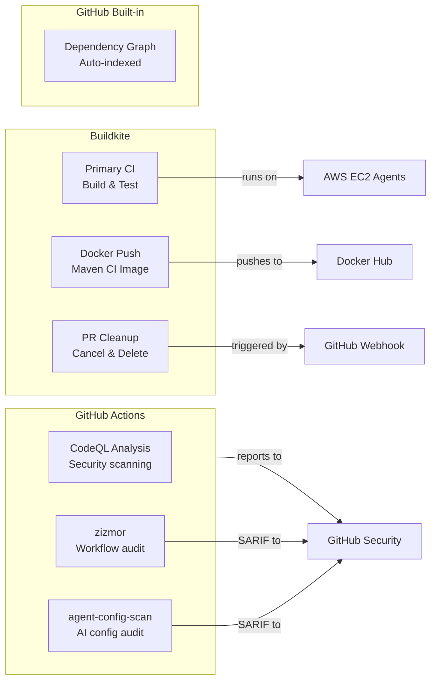

### CI Security Model

All custom CI pipelines run on Buildkite with self-managed EC2 agents. This keeps secrets (API tokens, Docker Hub credentials, AWS credentials) within the Buildkite/AWS boundary and avoids exposing them as GitHub Actions secrets.

**Principle:** Use Buildkite for any pipeline that needs secrets or performs actions. Use GitHub Actions only for read-only analysis that requires no secrets (e.g., CodeQL). Use Buildkite Pipeline Triggers to react to GitHub events without giving GitHub access to CI credentials.

| Concern | Approach |
|---|---|
| Build & test | Buildkite (EC2 agents, secrets in AWS Secrets Manager) for in-repo branches; **fork PRs** build & test on GitHub Actions (`pr-tests.yml`, secret-free, read-only token) since Buildkite must not run fork code |
| Docker push | Buildkite (Docker Hub credentials in AWS Secrets Manager) |
| GitHub event reactions | Buildkite Pipeline Triggers (GitHub webhook → Buildkite, no secrets in GitHub) |
| Security scanning | GitHub Actions CodeQL, zizmor and agent-config-scan (read-only plus `security-events: write`, no secrets needed); all report as code scanning alerts in the Security tab |
| Dependency graph | GitHub built-in (auto-indexed from manifests, no workflow needed) |

## Buildkite Pipelines

The monorepo uses a path-based pipeline orchestrator that dynamically triggers separate child pipelines based on changed files. Each child pipeline appears individually in the Buildkite dashboard, giving per-project visibility. These agent queues are used:

| Queue | Instance Types | Purpose |
|-------|---------------|---------|
| `default` | `m7i.2xlarge` (on-demand), plus `m6a.2xlarge`, `m6i.2xlarge`, `m7a.2xlarge` for Spot | Build and test workloads (Maven, Docker, k3d) |
| `trigger` | `t3.small`, `t3a.small`, `t3.micro` | Trigger polling jobs (`sleep` + `curl` loops) |
| `release` | Same as `default` | Release pipeline steps that access release secrets |
| `perf` | `c5.12xlarge` | Daily performance-regression benchmarks (k6 + JMH); scale-to-zero, max 3 with one agent per instance, 100% on-demand |
| `perf-xl` | `c6i.32xlarge` | Opt-in (`PERF_XL=true`, set by a weekly schedule and on manual builds) multi-k6 arm and hardware matrix: performance runs that need more cores than one `perf` box (128 vCPU / 64 physical cores, two NUMA nodes); scale-to-zero, max 1, one agent per instance, 100% on-demand. About $6.46/hr while running (eu-west-2 on-demand) |

Trigger jobs (which poll child builds via the Buildkite API) run on cheap `trigger` queue instances to avoid starving build agents. See [Agent Starvation](#agent-starvation-from-script-based-triggers-resolved) for background.

### Pipeline Orchestrator

**File:** `.buildkite/scripts/generate-pipeline.sh`

The orchestrator runs as the first step of every build (via the main "MockServer" pipeline). It determines which files changed since the last successful build and emits command steps that call `trigger-pipeline.sh` to create child builds via the Buildkite API. For PRs, it diffs against the merge-base. For pushes to master, it queries the Buildkite API for the last successful build's commit SHA and diffs against it — this ensures that batch pushes with multiple commits correctly trigger all affected pipelines. If the base commit cannot be determined (API failure, first build, shallow clone), the orchestrator conservatively triggers all pipelines.

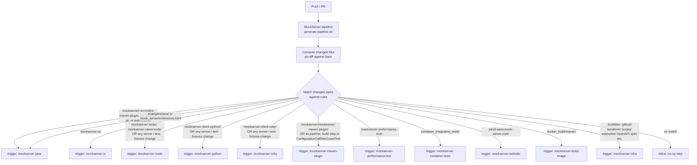

`examples/java/` and `jekyll-www.mock-server.com/mock_server/extensions.html` also trigger
`mockserver-java`: `examples/java` builds only there (`scripts/buildkite_quick_build.sh`), and
`RequestFilterAndResponseTransformerExampleTest` checks the page's Java against it. They are kept
out of `JAVA_TRIGGER_REGEX` in `lib/snapshot-image-inputs.sh`, because that list also decides which
commits share a `:snapshot` image and neither path is in the image.

#### Client Conformance Triggering

Client pipelines trigger on **their own directory OR any server / `test-fixtures/`
change** (`trigger_client_if_changed` in `generate-pipeline.sh`). A server change
alters the wire format every client library encodes against, and `test-fixtures/`
is the shared parity corpus each client round-trips — so gating clients purely on
their own directory meant wire-format drift shipped with **zero** non-Java
verification, and editing the parity corpus triggered no build at all.
`mockserver/mockserver-maven-plugin/` is excluded: it has its own pipeline and does
not define the wire format.

#### Gates That Must Fail Closed

Several suites previously reported green while executing nothing. A skip is
indistinguishable from a pass, so these gates now fail loudly instead:

| Gate | Failure mode removed | Mechanism |
|------|---------------------|-----------|
| Cloud blob-store contract suites | `Assume` Docker guard skipped them on 100% of builds (`java-build.sh` never passed `-s`) | Own socket-enabled step (`java-cloud-store-test.sh`) + `assert-suite-ran.sh` asserts non-skipped tests actually ran |
| Real-PostgreSQL binary proxying (`PostgresThroughMockServerIntegrationTest`, `mockserver-netty`) | Its `Assume` Docker guard skipped it in the socket-free `:maven: build` on every build | Own socket-enabled step (`java-binary-proxy-docker-test.sh`) runs only that Failsafe class and `assert-suite-ran.sh` fails the step if it skipped; the main build is unchanged and still skips it |
| `container_integration_tests` | A test script crashing before `logTestResult` left no record; `EXIT_CODE` is only set from a non-empty fail log, so a total harness crash exited 0 | `test()` records unaccounted-for non-zero exits; the summary fails when nothing at all was recorded |
| Go / .NET / PHP client integration | Skipped silently without `MOCKSERVER_URL` (never set in CI) | Dedicated steps run a live server built from HEAD (`with-mockserver.sh`, which also enables DNS mocking on UDP 1053 and exports `MOCKSERVER_DNS_PORT` and `MOCKSERVER_DNS_ADDRESS`); `MOCKSERVER_REQUIRE_SERVER=true` turns any skip into a hard failure, including the DNS tests when `MOCKSERVER_DNS_ADDRESS` is unset (Go) or the server reports no DNS port (.NET) |
| Rust client integration | Entirely `#[ignore]`d; CI never passed `-- --ignored` | `rust-integration-test.sh` passes `-- --ignored` against the same `with-mockserver.sh` server, and passes `MOCKSERVER_DNS_PORT` through; the DNS test panics without it |
| Node client tests | A hand-maintained 7-file list while the suite had 15 | Test files are **discovered by glob**, in CI, `npm test`, and `test:coverage` alike |
| UI Playwright e2e (`ui-e2e.sh`) | Tests that need a second server or a server flag (`test.skip` when absent) would skip in a one-server topology and the step still passed | The Playwright config boots every server the specs need; in CI `requireOrSkip` turns a missing precondition into a failure, `no-silent-skip-reporter.ts` fails the run on any skip that is not a `test.fixme`, and the step asserts from the JUnit XML that every listed spec ran and the total meets a floor |
| Go / .NET / Rust testcontainers | `soft_fail: true` made failures green | `soft_fail` removed |
| Real dashboard bundle served by the netty jar (`DashboardRealBundleServedIntegrationTest`) | It `Assume`-skipped on a 404, so a packaging change that stopped bundling the UI was skipped, not failed, in the netty IT shards | The `build-ui` profile sets `mockserver.dashboardBundleExpected=true`, which failsafe passes to the test; with it set a missing bundle fails. The profile is file-activated by `mockserver-ui/package.json`, so it is active in the IT shards (which reuse the prebuild's classes); only a build with `-P '!build-ui'` still skips |
| Node / Python / Go / .NET / Rust testcontainers container-start tests | Each skips when Docker is unusable, so a run that started no container passed. Go probed with a `docker info` CLI the `golang` image lacks, and .NET timed out starting its probe container (Ryuk / host resolution), so both skipped every container test on every build | The container-start test prints `<LANG>_TESTCONTAINERS_STATUS_OK` only after `PUT /mockserver/status` returns 200 from a real container (.NET writes it to the TRX output), and the step fails if the marker is absent. Go probes via `testcontainers.SkipIfProviderIsNotHealthy`; the .NET step sets `TESTCONTAINERS_HOST_OVERRIDE=host.docker.internal` when that name resolves (Docker Desktop) |
| Configuration call-site guard over `mockserver-maven-plugin` | The plugin ships but is outside the reactor, so the java build's guard never scanned it; it was scanned only on a machine that had built it locally | `maven-plugin-build.sh` re-runs the guard after the plugin's `verify` with `-Dguard.extraExpectedModules=mockserver-maven-plugin`, so a missing plugin `target/classes` fails the coverage check. The pipeline runs when the plugin, its pipeline or step, or `ConfigurationCallSiteGuardTest` changes; a server-only change that makes a plugin call site a violation surfaces on the next plugin build, not on its own |
| Transparent-proxy end-to-end suites | Named `*EndToEndIT`, matching neither Surefire (`**/*Test.java`) nor Failsafe (`**/*IntegrationTest.java`), so `SoOriginalDstEndToEndIntegrationTest`, `TproxyEndToEndIntegrationTest` and `EbpfOriginalDestinationEndToEndIntegrationTest` never ran on any build | Renamed to `*EndToEndIntegrationTest` so Failsafe collects them; the `:shield: transparent-proxy e2e tests` step (`java-transparent-proxy-test.sh`, enabled by `RUN_TRANSPARENT_PROXY_E2E=true` in `pipeline-java.yml`) runs them on the `default` queue with a docker CLI and the Docker socket, and `assert-suite-ran.sh` fails it if any of the three skipped — see below |

**How the transparent-proxy end-to-end suites run on the `default` queue:**
Unlike the cloud/async Docker-gated suites, which reach the daemon through
docker-java over the mounted socket, these three shell out to the **`docker` CLI**
to build and run a **sibling** container with real kernel privilege
(`--cap-add=NET_ADMIN` for SO_ORIGINAL_DST/TPROXY, `--privileged` for eBPF), and
bind-mount the fat jar into it by absolute path. Three things stood in the way on
the existing agents, and `java-transparent-proxy-test.sh` handles each without a
new queue:

| Obstacle | Handling |
|----------|----------|
| The maven CI image (`docker_build/maven/Dockerfile`) has no `docker` CLI | The step copies `docker` and the `docker-buildx` plugin out of a digest-pinned `docker:<ver>-cli` image on the host and mounts them read-only into the maven container |
| The sibling container is started by the **host** daemon, so a `/build/...` jar path does not exist there | The checkout is also mounted at its host path and Maven runs from there, so the path the suites pass to `docker run -v` resolves on the host |
| The elastic-ci-stack agents run dockerd with **user-namespace remapping** (`enable_docker_user_namespace_remap` defaults to `true`), which rejects `--privileged` | The suites start their containers with `--userns=host` (`DockerCliTestSupport.HOST_USER_NAMESPACE`), the per-container opt-out dockerd requires for `--privileged`. On a daemon without remapping it changes nothing |

For the step's own code, `--userns=host` adds nothing: the Docker socket is
already root on the host, and `run-in-docker.sh` withholds it from PR builds, so
the step runs only on trusted branch builds. **What it does add is trust in
third-party image content, which now runs as real host root on non-PR builds on
`default` agents** (agents that hold the build secrets, ECR Public push and the
Docker Hub token). That content is the `docker`/`docker-buildx` binaries from
`docker:<ver>-cli` (digest-pinned), `eclipse-temurin:17-jre` plus the Ubuntu
`iptables`/`curl`/`iproute2`/`bpftool` packages installed at test time, and the
eBPF suite's `fedora:41` fallback. The remap stays on for every other container.
Rejected: a new queue without remapping (more infrastructure for no extra
capability over the socket), and baking the CLI into the maven image (the step
could not use it until a rebuilt image was pushed).

`RUN_TRANSPARENT_PROXY_E2E=true` is set on the step in
`pipeline-java.yml`; without it the script prints a notice and exits 0, so a local
run opts in explicitly. With it, `assert-suite-ran.sh` fails the step if any suite
skipped, including when the daemon refuses the privileged container
(`DockerCliTestSupport.containerStartRejected(...)` turns that into a skip) or the
kernel lacks `xt_TPROXY` or BPF. The suites run the unshaded
jar-with-dependencies unless `-Dmockserver.e2e.jar=<path>` names another jar. The
image-level equivalent, `.buildkite/scripts/steps/docker-transparent-proxy-verify.sh
<image>`, is not wired into any pipeline; run it locally after changing the image
jar or JNA (see [docker.md](docker.md#image-server-jar-mockserver-netty-docker)).

**Why the cloud suites are a separate step, not `-s` on `java-build.sh`:**
`run-in-docker.sh` withholds the Docker socket from PR builds and `exit 0`s the
step when one is requested. Adding `-s` to the main build would therefore make the
**entire Java reactor** silently exit 0 on every PR build — trading a narrow false
positive for a total one. The split keeps the main build socket-free and confines
the PR-build socket skip to the three cloud modules, where it is announced in the
log rather than hidden behind an `Assume`. `java-async-broker-test.sh` is split out
the same way: its five `*LiveBrokerIntegrationTest` suites were collected by
Failsafe in the main build but skipped every test there (mockserver-java builds
#1580 and #1583 reported `Tests run: 5, Failures: 0, Errors: 0, Skipped: 5` on a
passing `:maven: build` job). Run against real brokers they execute 24 tests in
about 75 s.

**Why the Docker-socket Testcontainers steps set
`TESTCONTAINERS_RYUK_CONTAINER_PRIVILEGED=false`:** Testcontainers-Java starts its
Ryuk reaper with `Privileged=true` by default
(`TestcontainersConfiguration.isRyukPrivileged()`), and the elastic-ci-stack agents
run dockerd with user-namespace remapping, which rejects it:
`BadRequestException: Status 400: privileged mode is incompatible with user
namespaces`. Ryuk reaps through the mounted socket and does not need privilege, so
dropping only that flag keeps cleanup on abnormal JVM exit. The variable name
matters: Testcontainers maps `ryuk.container.privileged` to
`TESTCONTAINERS_RYUK_CONTAINER_PRIVILEGED`; the intuitive
`TESTCONTAINERS_RYUK_PRIVILEGED` is read by nothing (confirmed locally — Ryuk still
came up privileged). Rejected alternatives:

- `TESTCONTAINERS_RYUK_DISABLED=true` — also passes the probe, but containers leak
  whenever the JVM dies without running its shutdown hooks.
- Disabling userns remap on the agent daemon — it is a deliberate security boundary
  of the elastic-ci-stack AMI that the repo builds around (`run-in-docker.sh
  --harden`, the ownership workaround in `vscode-test.sh`).
- Running Ryuk in the host namespace, as the error suggests — Testcontainers-Java
  exposes no setting for it.

**Why those steps use `-m 7g`, not 4g:** at 4g the cloud step intermittently died
with exit 137 in its first command, the `-am` dependency build, so the contract
suites never ran (build #1755). `mockserver/.mvn/jvm.config` pins the Maven JVM to
`-Xms2048m -Xmx6144m` and mvnw prepends it to `MAVEN_OPTS`, overriding container
ergonomics (verified under `--memory=4g`: ergonomics alone would pick a 1 GiB
`MaxHeapSize`; with jvm.config it is 6 GiB). With `-T 1C` building upstream modules
concurrently in that JVM, live heap climbs toward 6g and the 4g cgroup kills it —
hence intermittent. 7g is what the `-pl <module> -am` test steps use
(`ui-java-codegen-compile.sh`, `helm-integration-test.sh`); it clears the 6g Xmx plus
native overhead. Steps that package mockserver-netty or the shaded jars, which also fork
vite and the shaded-jar probe JVMs, use 12g (`java-build.sh`, `java-deploy-snapshot.sh`,
`maven-plugin-build.sh`, `container-tests-build-jars.sh`; see `java-build.sh`). The
sibling Testcontainers containers run on the host daemon, outside this cgroup.
Rejected: capping the heap (`MAVEN_OPTS=-Xmx3g` — works mechanically, since the
last `-Xmx` wins, but under-provisions the reactor and diverges from every other
Maven step), and dropping `-T 1C` (only makes the OOM rarer; 6g Xmx in a 4g cgroup
is a defect at any parallelism).

The `mockserver-infra` pipeline (`pipeline-infra.yml`) runs lightweight validation
steps in Docker: opencode config lint, the **AI eval gate**, shell-script lint,
the release-script **Maven `unzip` prelude guard** (`check-release-maven-prelude.sh`,
`trigger` queue, no Docker; see [release-process.md](../operations/release-process.md#maven-runs-install-unzip-first)),
Dockerfile sync, Helm chart validation, the **performance headline lint fixtures**
(`website-perf-headline-lint-test.sh`, `trigger` queue, no Docker: the lint the website pipeline
runs, exercised on fixtures and run on the committed site; see
[website.md](../operations/website.md#performance-headline-lint)), the **release perf preflight
gate fixtures** (`perf-preflight-gate-test.sh`, which also fails when a gating budget in
`perf-budgets.json` is one the gate cannot evaluate; see
[release-process.md](../operations/release-process.md#release-preflight-performance-gate)), and **API-collection validation**. The collection step
(`collections-validate.sh`) regenerates the Postman and Bruno collections from the
OpenAPI spec and fails if the committed `examples/postman/**` or `examples/bruno/**`
have drifted — so `examples/` and `jekyll-www.mock-server.com/mockserver-openapi.yaml`
also route to this pipeline. Regeneration proves nothing about whether the examples work, so
`collections-live-validate.sh` also fires every Postman example at a live MockServer and fails on a
400/415/500. A bodyless request for a required body had shipped for `/mockserver/baseline/compare`
and `/mockserver/pact/import`, green under the drift check, until a reviewer ran the examples by hand.

It also runs the **perf baseline-freshness assertion** (`perf-baseline-freshness.sh`,
`trigger` queue). This is a decay detector for the daily perf-regression control:
it lives here, in a *different* pipeline from the perf producer, so it survives that
producer dying. It keys off **producer liveness via the Buildkite API** — that the
daily `mockserver-performance-test` schedule is still firing and its most recent
completed run passed — rather than the raw age of the S3 baseline object, because
the producer is commit-gated not to write on a quiet day, so object age cannot tell a
dead producer apart from a legitimately quiet master. It queries by **time, not by
count**: it pages (100 per page, following the `Link` header) through builds created in
a lookback window (the 30h liveness window + 24h). A fixed "newest N builds" page would
be crowded out by manual `[perf-run]` builds and report `NO_SCHEDULE` on a healthy
producer. Only if that window holds no daily scheduled build does it page back through
older history, to tell `STALLED` (a schedule exists but stopped firing) from
`NO_SCHEDULE` (none ever). If the window holds daily scheduled builds but none has
finished, it fails as `STALLED` (producer wedged): an older pass cannot vouch for them. Every outcome
other than a pass exits non-zero (no-schedule, stalled, last-run-not-passed, truncated
at the page cap, denied, transport, config), and a fixture step
(`.buildkite/scripts/test/perf-baseline-freshness-test.sh`) exercises each of those
classes against a fake API. So that it has a guaranteed cadence rather than depending
on an infra-path commit, it runs on its **own daily Buildkite schedule**
(`infra_baseline_freshness_daily` at 16:00 UTC, offset from
the producer's 04:00 run) as well as on every infra-path build.

**A measured manual run also counts for the pass/fail verdict.** The verdict comes from the
newest finished run in the lookback window: the last finished daily scheduled build, or a
newer non-scheduled build that measured the same thing. So after a failed daily run,
`bk build create -p mockserver-performance-test -b master -m "[perf-run] ..."` clears the
check once it passes, without waiting for the next 04:00 run. The check counts a
non-scheduled build only if all of these hold:

| Condition | Why |
|---|---|
| The message contains `[perf-run]`, or the build was started from the UI | Without either, the commit guard dispatches nothing |
| No build env overrides (`env` is empty) | Overrides mark an A/B experiment, not the default configuration the daily run measures |
| Its `perf-run`, `perf-microbench` and `perf-compare` steps all executed (`passed` or `failed`), or its `perf-run` step ended `failed` or `timed_out` | A build that skipped measurement shows them `broken` or not at all, and measured nothing. A failed `perf-run` skips compare, but the build did measure, and failed |
| It has finished | An in-flight build has no verdict yet |
| No `[perf-soak]` or `[perf-xl-weekly]` in the message | Neither weekly build is the baseline producer |
| It is on `master` | The check queries only the producer's `master` builds |
| Its meta-data does not carry `perf_run_refused=image_revision` | `perf-test-run.sh` sets it when a forced build refuses an image its commit is not served; that build measured nothing |

A counted manual build that failed fails the check (`NOT_PASSED`), the same as a failed
scheduled one. A build whose `perf-run` step failed always counts as not passed, and the
annotation says compare never ran. A manual build cancelled before `perf-run` finished is
ignored, so the previous run still decides. Only scheduled builds prove the cron is firing, so a
manual run never clears `STALLED` or `NO_SCHEDULE`. The two weekly schedules (`[perf-soak]`
and `[perf-xl-weekly]` in the message) are not the daily producer either: the check ignores them
for liveness and for the verdict, so a fresh or passing weekly build cannot mask a dead or failed
daily, and a failed weekly build does not red the check.

### Buildkite Pipelines

All pipelines are managed via Terraform in `terraform/buildkite-pipelines/pipelines.tf`. Only the main orchestrator pipeline triggers from GitHub webhooks; all child pipelines have `trigger_mode = "none"` and are triggered by the orchestrator.

| Pipeline (Buildkite slug) | Pipeline File | Trigger | What It Builds |
|---|---|---|---|
| `mockserver` | `pipeline.yml` | GitHub push/PR | Orchestrator — triggers child pipelines |
| `mockserver-java` | `pipeline-java.yml` | Orchestrator | Full Maven build and test |
| `mockserver-ui` | `pipeline-ui.yml` | Orchestrator | UI lint, typecheck, test, build |
| `mockserver-node` | `pipeline-node.yml` | Orchestrator | Node.js lint and typecheck |
| `mockserver-python` | `pipeline-python.yml` | Orchestrator | Python unit + integration tests (builds MockServer image from HEAD) |
| `mockserver-ruby` | `pipeline-ruby.yml` | Orchestrator | Ruby unit + integration tests (builds MockServer image from HEAD) |
| `mockserver-maven-plugin` | `pipeline-maven-plugin.yml` | Orchestrator | Maven plugin build and test, then the configuration call-site guard over the plugin |
| `mockserver-performance-test` | `pipeline-perf-test.yml` | Orchestrator + daily Buildkite schedule (04:00 UTC) + weekly perf-xl schedule (Saturday 08:00 UTC) + weekly soak schedule (Sunday 08:00 UTC) | Perf test script validation on orchestrator builds; on the daily schedule, the performance-regression run — guard + k6 run + JMH microbench + rolling-baseline compare; on the weekly perf-xl schedule (`PERF_XL=true`, message carries `[perf-run] [perf-xl-weekly]`), the regression run plus the multi-k6 arm on `perf-xl`; on the weekly soak schedule (message carries `[perf-soak]`), only the 2-hour soak step. All trigger paths are the **same** Buildkite pipeline (Terraform attaches `buildkite_pipeline_schedule.perf_regression_daily`, `perf_xl_weekly` and `perf_soak_weekly` to it); there is no separate `mockserver-perf-regression` pipeline. |
| `mockserver-container-tests` | `pipeline-container-tests.yml` | Orchestrator | Shell script validation + k3d Helm integration tests (builds the `-clustered` + webhook images from tree-built jar artifacts) |
| `mockserver-website` | `pipeline-website.yml` | Orchestrator | Performance headline lint, then the Jekyll site build; website code examples |
| `mockserver-infra` | `pipeline-infra.yml` | Orchestrator | Infrastructure validation |
| `mockserver-build-image` | `docker-push-maven.yml` | Orchestrator + Manual | Build/push maven CI image |
| `mockserver-release` | `release-pipeline.yml` | Manual | Automated release pipeline (TOTP, Maven Central, maven-plugin, Docker Hub + ECR Public, npm, Helm, Javadoc, SwaggerHub, website, JSON Schema, PyPI, RubyGems, GitHub Release, optional versioned site) |
| `mockserver-cleanup` | `pipeline-cleanup.yml` | GitHub webhook + scheduled | Clean up builds for closed PRs |

A single commit can trigger multiple child pipelines if it changes files in multiple areas. For example, a commit touching both `mockserver/` and `mockserver-ui/` triggers both `mockserver-java` and `mockserver-ui` pipelines.

All pipelines have `cancel_intermediate_builds` and `skip_intermediate_builds` enabled, but cancellation of **running** builds is scoped to non-master branches via `cancel_intermediate_builds_branch_filter = "!master"` (set uniformly in `terraform/buildkite-pipelines/pipelines.tf`). When a new build arrives for the same **feature/PR** branch (e.g. Dependabot rebases a PR), Buildkite cancels the running build to save agent VMs, and native trigger steps cancel the child builds too. On **master**, running builds are never cancelled: they always run to completion and report true pass/fail. Cancelling a master build mid-run would (a) leave that commit untested and (b) surface as a misleading failure on the parent pipeline whose trigger step was waiting on the cancelled child. Queued (not-yet-started) builds are still skipped on all branches except on `mockserver-performance-test`'s master, where `skip_intermediate_builds_branch_filter = "!master"`: its scheduled builds are the measurement, so a newer master build must not supersede a queued one. Skipped builds report as "skipped" (neutral), not red.

### Closed PR Build Cleanup

**File:** `.buildkite/pipeline-cleanup.yml`

When a PR is closed or merged, its Buildkite builds are no longer needed. The cleanup pipeline cancels any running builds and deletes all builds for the closed PR's branch across all child pipelines. This keeps the Buildkite dashboard clean — only builds for open PRs and master are visible.

The cleanup pipeline operates in two modes:

1. **Webhook-triggered (primary):** A Buildkite Pipeline Trigger receives GitHub `pull_request:closed` webhooks directly. The webhook payload is available to the build step via `buildkite-agent meta-data get buildkite:webhook`. This provides immediate cleanup when a PR is closed.
2. **Scheduled sweep (safety net):** A daily cron schedule sweeps all pipelines for builds on branches whose PRs are no longer open on GitHub. This catches anything missed by the webhook.

#### Why Buildkite Pipeline Triggers instead of GitHub Actions

Buildkite Pipeline Triggers can receive GitHub webhooks directly with HMAC-SHA256 signature verification. This avoids storing a Buildkite API token as a GitHub Actions secret, keeping all CI credentials within the Buildkite/AWS boundary:

| Approach | Secrets exposed to GitHub | Event-driven | Complexity |
|---|---|---|---|
| **Buildkite Pipeline Trigger** | None (webhook URL only) | Yes | Low |
| GitHub Actions workflow | Buildkite API token | Yes | Low |
| AWS Lambda webhook receiver | None | Yes | High |
| Buildkite scheduled sweep only | None | No (polling) | Low |

#### Setup

Steps 1 and 4 are managed by Terraform (`terraform/buildkite-pipelines/pipelines.tf`). Steps 2 and 3 require manual setup because Buildkite Pipeline Triggers don't have a Terraform resource yet (the feature is in public preview).

1. **Pipeline + schedule** (Terraform): Run `terraform apply` in `terraform/buildkite-pipelines/` to create the `mockserver-cleanup` pipeline and its daily schedule.
2. **Pipeline Trigger** (Buildkite UI): Go to the [cleanup pipeline settings](https://buildkite.com/mockserver/mockserver-cleanup/settings) → Triggers → New Trigger → GitHub:
   - Description: `GitHub PR closed/merged`
   - Branch: `master`, Commit: `HEAD`
   - Security: check "Validate webhook deliveries", enter a secret (`openssl rand -hex 32`)
   - Copy the trigger URL (`https://webhook.buildkite.com/deliver/bktr_...`)
3. **GitHub webhook** (GitHub UI): Go to [repo webhook settings](https://github.com/mock-server/mockserver-monorepo/settings/hooks) → Add webhook:
   - Payload URL: paste the Buildkite trigger URL from step 2
   - Content type: `application/json`
   - Secret: same as step 2
   - Events: select "Let me select individual events" → check only "Pull requests"
4. **Daily schedule** (Terraform): Created automatically by step 1 — runs at 06:00 UTC daily as a safety net.

### Performance Regression Pipeline

**File:** `.buildkite/pipeline-perf-test.yml`

**Trigger:** Daily Buildkite schedule at 04:00 UTC (`build.source == 'schedule'`), the weekly perf-xl schedule (Saturday 08:00 UTC, see [The perf-xl steps](#the-perf-xl-steps-opt-in)), or via the Buildkite UI (`build.source == 'ui'`). Not triggered by the path-based orchestrator.

**Purpose:** Catch performance regressions automatically without requiring manual perf runs after every commit. The pipeline is notify-only — it never fails a build, only annotates.

#### Commit-guard dynamic-dispatch pattern

The pipeline's first step (`perf-test-guard.sh`, `trigger` queue) implements a "daily but only if there's something new" gate:

1. Calls `last_perf_run_commit` (in `lib/last-successful-commit.sh`) — resolves the commit the heavy regression run *last actually executed against*, by reading the most recent `perf_regression_ran_commit` Buildkite build meta-data (set by `perf-test-run.sh`) via the Buildkite API (token in AWS Secrets Manager `mockserver-build/buildkite-api-token`). This is deliberately distinct from the sibling `last_successful_commit` (last *passed build*, used by `generate-pipeline.sh`): the perf-test pipeline passes on its lint step on every push, so "last passed build" would almost always be `HEAD` and the guard would skip forever. `perf-test-run.sh` sets the meta-data only when the build's commit is served the measured `:snapshot` image: the image was built from it, or from an ancestor with no `mockserver-java`-triggering change since. A run on an image that `mockserver-java` has not yet rebuilt for the commit therefore does not make the next scheduled run skip it, and a `[perf-run]` or UI build on `master` in that state fails before the SUT starts (see [Run Provenance](../code/performance-measurement.md#run-provenance)).
2. If `HEAD` equals the last run commit, annotates "skipped" and exits 0 — no compute is consumed.
3. Otherwise (new commit, or no prior run recorded) uses `buildkite-agent pipeline upload` to dynamically inject the run, microbench, HTTP/2-multiplex, and compare steps into the running build. These steps target the `perf` agent queue (c5.12xlarge, on-demand, up to three agents with one per machine), so the measurement steps of one build run in parallel on separate machines. With `PERF_XL=true` it also uploads the arm-only steps for the `perf-xl` queue (see [The perf-xl steps](#the-perf-xl-steps-opt-in)).

This pattern avoids a fixed multi-step pipeline definition (which would always run all steps) while keeping the guard cheap on the `trigger` queue.

#### Steps

| Step script | Queue | What it does |
|---|---|---|
| `perf-test-guard.sh` | `trigger` | Commit guard + dynamic step upload |
| `perf-test-run.sh` | `perf` | k6 regression.js (HTTP + HTTPS/H2), sweep.js, growth.js + background sampler, the proxy/handshake/streaming/clustered profiles, the notify-only path-coverage phase (`lib/perf-path-coverage.sh` + `coverage.js`), the notify-only in-order pipelining A/B (`lib/perf-pipelining-ab.sh`, see [performance-measurement.md](../code/performance-measurement.md#in-order-pipelining-ab--pipelining_inorder-notify-only)) and the notify-only FILE-body A/B (`lib/perf-file-body-ab.sh`, see [performance-measurement.md](../code/performance-measurement.md#file-body-ab--file_body-notify-only)); uploads `perf-result.json`. `PERF_RELEASE_COMPARISON=<version>` measures a past release image instead and is never baselined (see [performance-measurement.md](../code/performance-measurement.md#release-comparison--measuring-a-past-release-on-todays-rig)). `PERF_SERVING_HW_MATRIX=true` on a manual `[perf-run]` build adds the hardware-size matrix (six multi-k6 points, about 10 minutes each) and the guard raises this step's timeout from 90 to 180 minutes (see [performance-measurement.md](../code/performance-measurement.md#hardware-matrix--throughput-by-cores-and-memory-item-27)). `PERF_DATAPLANE_AB=true` adds the opt-in data-plane hooks A/B (`lib/perf-dataplane-ab.sh`, about 13 minutes), the guard adds 20 minutes to this step's timeout, and the step fails, after uploading its result, if the A/B ran but did not measure (see [performance-measurement.md](../code/performance-measurement.md#data-plane-hooks-ab--dataplane_hooks-opt-in-notify-only)) |
| `perf-test-microbench.sh` | `perf` | JMH MatchingBenchmark with `-prof gc`; uploads `perf-microbench.json` |
| `perf-test-h2multiplex.sh` | `perf` | HTTP/2 multiplex benchmark (issue #2669): N=1,10,100 concurrent streams over one h2c connection; runs the harness `selftest` then the sweep; uploads `perf-h2-multiplex.json`. Notify-only, **no threshold** (recorded for trend only); a non-zero exit is a harness self-validation failure (bad measurement), not a slowdown |
| `perf-test-allocprofile.sh` | `perf` | Short deep-JFR run answering *what allocates* and *where the CPU goes at the ceiling*: JFR `settings=profile` (plus 1 ms monitor-enter threshold and the JDK 25 CPU-time sampler) dumped over the load window (`jcmd JFR.dump`), a second recording cut to the knee-to-top sweep rungs (`sut/ceiling.jfr`), NMT, `jcmd GC.class_histogram` during growth.js only (it is a stop-the-world pause); annotates allocation per request, peak direct memory, the top allocation sites, whether any heap inspection hit a sweep rung, and the ceiling's per-thread CPU, hot methods, contention, VM operations and GC pauses (read with a JDK 25 `jfr`), and reports a recording below its duration/sample floor as INVALID (see [performance-measurement.md](../code/performance-measurement.md#allocation-profile-step)). Deep profiling costs throughput, so it is `soft_fail`, gates nothing, and uploads under an `allocprofile-` prefix (`PERF_RUN_NAME`) so `perf-test-compare.sh` — which downloads `perf-result.json` by exact name — can never baseline it |
| `perf-alloc-gate.sh` | `default` | JMH allocation gate: fails the build if any of its nine benchmark rows (including the `HEADERS_MISS` matching-scan arm and the no-hook `ProcessActionBenchmark` row) allocates above its budget; a row without `gating: true` would post a warning annotation instead |
| `perf-test-run.sh` with `PERF_RUN_ARM` | `perf-xl` | Arm-only run, dispatched only when `PERF_XL=true`; see [The perf-xl steps](#the-perf-xl-steps-opt-in) |
| `perf-test-compare.sh` | `perf` | Merge artifacts + S3 persist + rolling median+MAD compare + Buildkite annotation. With `PERF_COMPARE_RESULT_ARTIFACT` (the `perfxl-rw-multik6-persist` step) it reads the multi-k6 arm's own result instead and persists it to `runs-perf-xl/<branch>/` only when it is a member of the published series |
| `perf-website-publish.sh` | `perf` | Tail step, `soft_fail`, non-gating. Acts only on the run this build's compare step persisted (the `perf-baseline-persisted-key` meta-data), and only when that run is still the newest under `runs/<branch>/` in S3; otherwise it leaves the figures unchanged with an info annotation (a scheduled build that persisted nothing soft-fails). From that run it regenerates `perf_figures.json` + chart data/PNGs; when the committed figures have drifted, emits the refresh as a `git format-patch` build artifact (the perf queue has no git/gh credentials, so it cannot push). Applying the patch is a manual step — see [Published Figures → Publishing a run's figures](../code/performance-measurement.md#published-figures). With `PERF_PUBLISH_SOURCE=rw_multik6` (the `perfxl-rw-multik6-publish` step) it does the same for the published headline from `runs-perf-xl/<branch>/` and the `perf-xl-persisted-key` meta-data, rewriting only `perf_figures.json` |
| `lib/perf-budgets-validate.sh` | — | Sourced by the compare and allocation gates to schema-check `perf-budgets.json` before either compares anything (a quoted number in that file does not error in jq, it silently disables the budget). Runs its own `--self-test` on every build |

#### Step dependency graph

The uploaded steps are ordered with `depends_on` and step keys, not a positional `- wait: ~`:

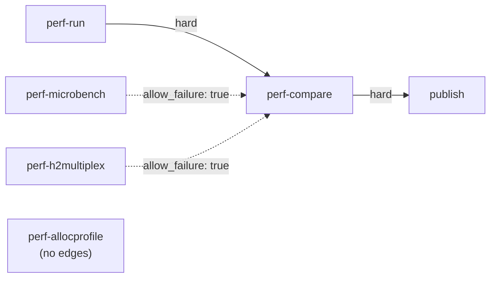

- **Not a `wait`.** A `wait` fails closed on any prior failure, and two of the parallel steps
  are notify-only: they go red on a harness self-validation failure, not a slowdown. Under a
  `wait` that red skipped compare and discarded a valid run — build 306: `run + sample` passed,
  `HTTP/2 multiplex` failed, and a valid result (`validity.valid: true`, `peak_achieved_rps`
  2000.1) was dropped, with compare and publish ending `waiting_failed`.
- **Why compare still waits for the notify-only steps.** It merges microbench's artifacts
  best-effort (`|| true`). Without the edge it could start before microbench uploads and
  persist a day with no `.microbench.*.time_per_op` rows — a gating metric vanishing without
  anything going red.
- **The property name.** Inside a `depends_on` entry it is `allow_failure`. The step-level
  `allow_dependency_failure` is rejected there ("not a valid property on the `depends_on`
  configuration"), which fails the pipeline upload so no steps run. Two reviews passed the
  wrong name before a throwaway pipeline (mockserver-infra build 1932) rejected it; build 1936
  then proved both directions (the `allow_failure` dependent ran after its dependency failed;
  the plain dependent did not).
- **Publish has no git credentials.** The perf stack's only application data grant is the
  perf-results S3 policy; the GitHub token comes from `read_release_secrets`, attached to the
  release stack alone. An earlier comment claimed otherwise, and build 325 died at `git push`
  ("could not read Username for https://github.com"); publish now emits a patch artifact.

**Step timeouts.** `perf-run` grew 45 → 60 minutes for the INFO-log-level arm (a second SUT
re-running `regression.js` and `sweep.js`, estimated at ~10 minutes) and 60 → 70 for the
path-coverage phase (~8 minutes) and 70 → 80 for the in-order pipelining A/B (~4.5 minutes; it
comes out again when the `http1PipeliningInOrder` flag is removed). The FILE-body A/B (~3.5 minutes)
fitted inside 80 without a raise; 80 → 90 then made room for the clustered A/B's paired windows
(~5.5 minutes). The guard raises the step timeout to 180 for
`PERF_SERVING_HW_MATRIX` and by 20 for `PERF_SERVING_RW_MULTIK6`. `perf-microbench` grew 30 → 50 when it took on `run-scaling.sh`
(8 `MatchingBenchmark` combos plus 10 `CandidateIndexBenchmark` combos after a second module
build, ~12–18 minutes), then 50 → 70 for the promoted dark benchmarks and the move to `-f 2`
(laptop JMH time ~6 → ~16 minutes, ~20–25 minutes more on the box, where JMH runs 2–3× slower).
The pinned proxy-path invocation added ~2 minutes on a laptop and ~5–6 on the box within that cap.

#### The perf-xl steps (opt-in)

**Outcome.** `PERF_XL=true` on a perf build moves the multi-k6 arm (item 31), and the hardware matrix (item 27) when `PERF_SERVING_HW_MATRIX=true` is also set, off the c5.12xlarge `perf-run` step and onto the `perf-xl` queue: a single on-demand c6i.32xlarge with two NUMA nodes. Every other arm stays on `perf`. With `PERF_XL` unset (or anything other than `true`), the guard uploads exactly what it did before. `perf-xl-dispatch-test.sh` checks that the main upload is byte-identical with and without the flag. The flag stays opt-in until the perf-xl rig trial passes. **Prerequisite:** apply both Terraform stacks before setting `PERF_XL=true`. Apply `terraform/buildkite-pipelines` first, for the `perf-xl` cluster queue, then `terraform/buildkite-agents`, for the c6i.32xlarge stack. Without them no `perf-xl` agent ever registers: the two perf-xl steps sit waiting for an agent and the build stays running. A step timeout only counts once a job has started, so it never fires here. Cancel the build, apply the stacks, and re-run.

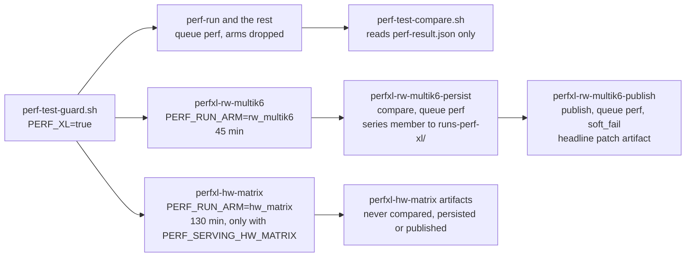

| Step key | Command | Timeout | Artifacts |
|---|---|---|---|
| `perfxl-rw-multik6` | `perf-test-run.sh` with `PERF_RUN_ARM=rw_multik6` | 45 min | `perfxl-rw-multik6-perf-result.json`, `-serving-rw-multik6.json`, `-serving-rw-multik6-work.tgz`, `-perf-jvm-diagnostics.tgz` |
| `perfxl-hw-matrix` | `perf-test-run.sh` with `PERF_RUN_ARM=hw_matrix` | 130 min | `perfxl-hw-matrix-perf-result.json`, `-serving-hw-matrix.json`, `-serving-hw-matrix-work.tgz`, `-perf-jvm-diagnostics.tgz` |
| `perfxl-rw-multik6-persist` | `perf-test-compare.sh` with `PERF_COMPARE_RESULT_ARTIFACT=perfxl-rw-multik6-perf-result.json`, on `perf` | 10 min | none; sets the `perf-xl-persisted-key` meta-data when it persisted the run |
| `perfxl-rw-multik6-publish` | `perf-website-publish.sh` with `PERF_PUBLISH_SOURCE=rw_multik6`, on `perf`, `soft_fail` | 15 min | `website-figures-<UTC-timestamp>.patch` and `perf_figures.json`, only when the headline has drifted |

The guard uploads them alongside the regression steps, so they follow the same commit guard: a manual (`ui`) build or a `[perf-run]` API build always gets them, and a scheduled build only when `master` moved. Both carry the standard agent-lost retry. With `max 1` on the queue, the two steps run one after the other.

**Weekly schedule (item 44a).** `buildkite_pipeline_schedule.perf_xl_weekly` in `terraform/buildkite-pipelines/pipelines.tf` creates a `master` build every Saturday at 08:00 UTC (cron `0 8 * * 6`) with `PERF_XL=true` and the message `Scheduled: weekly perf-xl headline run [perf-run] [perf-xl-weekly]`. It is a manual `PERF_XL=true` `[perf-run]` build made on a timer, so the multi-k6 headline series gets a new member every week without anyone starting it.

- **`[perf-run]` is required.** A scheduled build is commit-gated, and the 04:00 daily has usually measured `HEAD` already, so without the marker the guard would skip the week's run. The marker also forces the regression steps onto `perf` (as any `[perf-run]` build does), so the week's build persists a second `runs/master/` result, as a manual `PERF_XL` build does.
- **`[perf-xl-weekly]` keeps it out of the baseline-freshness check**, which treats it as it treats the soak (see the freshness section above).
- **Why Saturday 08:00.** A daily build can hold all three `perf` agents; 08:00 is clear of the daily's worst case, the 06:00 cleanup and the 16:00 freshness check, and a day before the Sunday 08:00 soak. The arm itself runs on `perf-xl`, which nothing else schedules.
- **What it does not set.** No `PERF_SERVING_HW_MATRIX` (the hardware matrix stays manual), no `PERF_JVM_DIAGNOSTICS` (the default `standard` tier is a series member) and no trial knob (`PERF_RW_*`), so each run is a counting member of the published series.
- **Cost.** One c6i.32xlarge for the 45-minute arm step plus the usual `perf` time of a daily run, once a week. Publishing stays manual: the publish step attaches a patch, and the owner applies it.
- `perf-xl-dispatch-test.sh` (section 7) reads the schedule's message and env from `pipelines.tf` and checks that the guard dispatches the arm when the daily already measured `HEAD`, and skips without `[perf-run]`.

**Arm-only mode.** `PERF_RUN_ARM` makes `perf-test-run.sh` start the SUT and upstream, and resolve and record provenance, image freshness, the config block and the instance type exactly as the full run does. It then runs only the named arm. That arm keeps its tail localisation and work-file upload, and its result is written with the full run's schema, with the other blocks empty and a top-level `run_arm`. The arms and workloads the step would otherwise inherit from the build env are forced off. The multi-k6 arm gets a 60 s warm-up of its own, because no regression or sweep load ran before it. `agent.queue` is read from the agent's `queue` tag. `agent.k6_cpus` names the arm's own k6 cpusets, not the single-k6 pin that no process of the run used.

**The multi-k6 arm's result is what the headline is published from (item 44).** `perfxl-rw-multik6-persist` depends on the arm step and `perfxl-rw-multik6-publish` on the persist step, both as hard edges: an arm that failed is never persisted, and a failed persist never publishes. Both run on `perf`, like the daily compare and publish. Persist runs `perf-test-compare.sh` on the arm's own artifact. It writes the result to `runs-perf-xl/<branch>/` only when `lib/perf-rw-multik6-series.jq` returns no unmet criterion; a trial, another rule or another rig exits 0 with an info annotation and persists nothing, and an artifact whose `run_arm` does not match its name, a member whose headline disagrees with its own rungs, or a history listing that fails all fail the step. Both steps annotate under their own contexts (`perf-regression-xl`, `perf-website-publish-rw`) and upload under their own names (`website-headline-multi-k6-<UTC-timestamp>.patch`, `perf_figures-multi-k6.json`), so the daily compare and publish in the same build neither replace their annotations nor collide with their artifacts. Publish then acts only on the key that persist recorded, refuses a run that is not a series member or whose headline disagrees with its own rungs, and attaches a patch that rewrites `perf_figures.json` alone. The headline it writes is stamped with the key and build it came from, and `lib/perf-website-figures-check.jq` refuses a committed multi-k6 headline without that stamp, in the lint and in the publish step. `perf-xl-publish-test.sh` checks both steps and the check against a stub bucket. The committed headline is build 667's (136,000 req/s, published by the owner's decision of 2026-10-12; the first member run, build 643, published 144,000); the daily single-k6 figures stay under `.single_k6`. `PERF_XL` is not on the daily schedule. The headline refreshes from the weekly perf-xl build (Saturday 08:00 UTC, `perf_xl_weekly`; see [Weekly schedule](#the-perf-xl-steps-opt-in) above) or from a manual `PERF_XL=true` build. The series, the rule and the page layout are in [performance-measurement.md](../code/performance-measurement.md#the-headline-rule-item-44).

**Why the results cannot mix with the c5.12xlarge baseline.** The daily compare and publish steps never read a perf-xl result:

- Every artifact name carries the `perfxl-` prefix (`PERF_RUN_NAME`). The daily `perf-test-compare.sh` downloads `perf-result.json` by exact name, the same isolation the `allocprofile-` step relies on. Only the persist step names the arm's artifact, and it merges none of the daily run's supplementary artifacts into it.
- The result is `baseline_eligible: false`, so compare would not persist it as a daily run even if it got one; an arm-only result under the daily artifact name fails the step.
- `perf-test-compare.sh` keeps one history per agent queue, read from `.agent.queue`. A `perf` run is stored under `runs/<branch>/`, as before, and any other queue's run under `runs-<queue>/<branch>/`. Each run is windowed only against its own prefix. That split is what guarantees a perf-xl run can neither enter nor push runs out of the perf queue's 10-run window. As a second check, a readable baseline object from another queue is dropped from the window, and an unreadable one fails the step rather than being guessed at. A queue name that cannot form a prefix also fails the step. `perf-compare-queue-history-test.sh` checks this against a stub bucket.
- If a perf-xl result did reach compare, its hardware-sensitive metrics would still be kept apart. Every `serving_hw_matrix.*` and `rig_valid_peak_achieved_rps` budget is `hw: true`, so those metrics compare only against runs with the same `agent.instance_type`. The hardware-matrix metrics also key on the latency fingerprint (settle, load client, k6 runtime).
- The daily `perf-website-publish.sh` reads only `runs/<branch>/`, where nothing from perf-xl is written, and rewrites only the single-k6 part of the page data (`.single_k6`, the charts, the per-behaviour and hardware tables). The multi-k6 source reads only `runs-perf-xl/<branch>/` and rewrites only the headline. The hardware matrix on perf-xl is still never persisted or published, so on a `PERF_XL` build the website's hardware table keeps its last committed figures.

Nothing downstream gates these results, so the step gates itself. It fails when its validity is false: on `arm_rw_multik6_valid` (the harness's own `valid`), or on `arm_hw_matrix_measured` (at least one point with a healthy ceiling or an out-of-memory verdict, the same rule as compare's presence gate). It also fails on `source_provenance`, as the regression run does through compare. `config.image_stale` is recorded but, unlike in compare, does not fail the step. It does not record `perf_regression_ran_commit`, so it never makes the guard skip a later regression run.

#### Concurrency on the `perf` queue

The queue runs up to three agents, one per c5.12xlarge, so a perf job never shares its machine. What that relies on:

- **Steps share nothing on disk.** Each measurement step builds or pulls what it needs; `perf-test-compare.sh` reads their results only through `buildkite-agent artifact download`, and `perf-website-publish.sh` only from S3. Either can land on any agent.
- **The S3 history is append-only.** Each run writes its own `runs/<branch>/<ISO timestamp>__<commit>.json` key (`runs-<queue>/` for a queue other than `perf`); no step rewrites a shared baseline object, and runs that are invalid or not baseline-eligible are never written. The baseline window is the newest N keys other than the run's own, so a concurrent build's run can fall in it — the same as a back-to-back run.
- **Close A/B comparisons need one machine or repeats.** Two builds that run at the same time land on different VMs, and VM-to-VM variance of a few percent can swamp a small effect. Measure both arms within one job (a within-run A/B), or repeat each arm.

See [Performance Tuning](../operations/performance-tuning.md#performance-regression-pipeline) for the full description of behaviours, thresholds, result schema, and how to re-baseline.

### Repeating One Integration Test

**What it is.** The `:repeat: test repeat under load` step in `pipeline-perf-test.yml` runs one `mockserver-netty` integration test class, or one method, N times in a row on a `default`-queue agent (Linux, epoll; instance types and capacity in `terraform/buildkite-agents/`), with busy loops saturating the CPUs. It counts flakes under load, and with `TEST_REPEAT_REF` it runs an older commit's code so a change can be compared with its base. It runs only in an API-created build (`bk build create`) with `TEST_REPEAT_IT` set and no `[perf-run]` or `[perf-soak]` in its message; the k6, guard and soak steps need a UI or scheduled build or one of those markers, so such a build runs only this step and the lint step.

```bash
bk build create -y -p mockserver-performance-test -b master -c <master commit containing the step> \
  -m "[test-repeat] <why>" \
  -e TEST_REPEAT_IT=ResponseWriteStallTimeoutIntegrationTest \
  -e TEST_REPEAT_COUNT=12 -e TEST_REPEAT_BUSY_LOOPS=12 \
  -e TEST_REPEAT_REF=<full 40-character SHA whose code is tested; omit for the build's commit>
```

| Variable | Meaning | Default |
|----------|---------|---------|
| `TEST_REPEAT_IT` | Failsafe selector, `Class` or `Class#method` (required) | none |
| `TEST_REPEAT_COUNT` | Runs, 1 to 50 | 12 |
| `TEST_REPEAT_BUSY_LOOPS` | Busy-loop processes during the runs (0 for no load) | 12 |
| `TEST_REPEAT_REF` | Full 40-character SHA whose code is built and tested | the build's commit |

**Behaviour.** The step extracts `TEST_REPEAT_REF`'s tree with `git archive` (the step script itself always comes from the build's commit), builds `mockserver-netty` and its upstream modules once without tests or the dashboard UI into a private local repository chained to the Maven cache, starts the busy loops, then runs `verify -Dit.test=<selector>` N times with CI's test arguments and no reruns. Each run's failsafe reports and Maven log go to the `test-repeat/` artifacts; `test-repeat/summary.txt` and the build annotation list each run's verdict (`PASS`, `FAIL` or `NO-TESTS`, the last when a run left no report with an executed test), its duration, the load average and the failed test names. The step fails if any run did not pass. Run one arm per build, one build at a time: two builds land on different VMs.

**Cancel and timeout.** The busy loops must not outlive the step, or they load the agent's next job. The container is named after the job and runs under `--init`; Maven runs in the background so the scripts' TERM traps fire at once; on TERM the step script `docker kill`s the container and the in-container script stops the loops; and each loop is bounded by `timeout` (4 h) in case the step is killed without a TERM.

### INFO-Level Investigation

**What it is.** Three on-demand steps in `pipeline-perf-test.yml` run `.buildkite/scripts/steps/perf-test-info-investigation.sh` on the `perf` queue: `PART=jfr` profiles the event-log consumer of an `INFO` SUT under the INFO arm's `sweep.js` ladder, `PART=heap` measures live heap per counted byte for json10k, proxy10k and json100k fills at `INFO` (with a `WARN` control) under G1 and generational ZGC, and `PART=promotion` measures young-GC promotion per `sweep.js` rung at chosen retention divisors, by the entry-lifetime rule that set `WARN`'s `/20`. They run only in an API-created build with `PERF_INFO_INVESTIGATION` set to `jfr`, `heap`, `both` (`jfr` and `heap`) or `promotion` and no `[perf-run]` or `[perf-soak]` marker, so such a build runs only these steps and lint. Nothing they produce is compared, persisted or published; results are the `perf-info-investigation/<part>/` artifacts. Methods and results: [memory-management.md](../code/memory-management.md#info-re-measured-on-the-perf-rig-2026-10-18) for `jfr` and `heap`, and [`INFO` promotion measured on the perf rig](../code/memory-management.md#info-promotion-measured-on-the-perf-rig-2026-10-19) for `promotion`.

```bash
bk build create -y -p mockserver-performance-test -b <branch> -c <full 40-character SHA> \
  -m "INFO investigation: <why>" -e PERF_INFO_INVESTIGATION=both
```

| Variable | Meaning | Default |
|----------|---------|---------|
| `PERF_INV_JFR_RATES`, `PERF_INV_JFR_STEP` | `sweep.js` rungs and rung length for `jfr` | `2000,…,16000`, `30s` |
| `PERF_INV_COLLECTORS` | `G1` and/or `ZGC` for `heap` | `G1 ZGC` |
| `PERF_INV_PROFILES` | `json10k`, `proxy10k`, `json100k` | `json10k proxy10k` |
| `PERF_INV_LEVELS` | `INFO` and/or `WARN` (only `INFO` gets the overload phase) | `INFO WARN` |
| `PERF_INV_HEAP_MB` | SUT `-Xmx`/`-Xms` for `heap` | `1024` |
| `PERF_INV_OVERLOAD_S` | overload window per `INFO` cell; 0 skips it | `60` |
| `PERF_INV_FILL_TIMEOUT_S` | how long a fill may take to reach 93% of the budget | `240` |
| `PERF_INV_PROMO_MEMORIES` | SUT container memory for `promotion`; the heap is the image's 45% of it | `1g 2g` |
| `PERF_INV_PROMO_DIVISORS` | retention divisors for `promotion`, each set as `maxEventLogSizeInBytes` = heap ÷ divisor | `12 20` |
| `PERF_INV_PROMO_LEVEL` | `INFO` or `WARN` (a control) for `promotion` | `INFO` |
| `PERF_INV_PROMO_RATES`, `PERF_INV_PROMO_STEP_S`, `PERF_INV_PROMO_SETTLE_S` | `sweep.js` rungs, rung length and settle for `promotion` | `2000,…,10000`, `30`, `5` |
| `PERF_INV_PROMO_PREFILL_RATE` | the rate that fills the log to 93% of its budget before the ladder; the `WARN` control used `10000` | `2000` |
| `PERF_INV_PROMO_SERVER_CPUS` | the SUT's cpuset for `promotion` (2 cores, as the `WARN` dose-response) | `0-1` |
| `MOCKSERVER_IMAGE` | the SUT and upstream image | `mockserver/mockserver:mockserver-snapshot-graaljs` |
| `PERF_HISTO_JDK_IMAGE` | the JDK sidecar that runs `jcmd` in the SUT's PID namespace | `eclipse-temurin:21-jdk` |

**Agents and schedules.** Each step holds one `perf` agent, so a `both` build holds two of the three: the `jfr` step for about 5 minutes (40-minute timeout) and the default `heap` step for about 8 minutes (180-minute timeout). A `promotion` build holds one agent for about 17 minutes with four cells (150-minute timeout). Give each build its own branch name (for example `ci/<unit>-1g`): a newer build on the same branch skips a queued one and cancels a running one. Keep such builds clear of the scheduled daily (04:00 UTC), the Saturday `PERF_XL` run and the Sunday soak (08:00 UTC), and confirm each step reaches `running`.

**Failure and cleanup.** The `heap` step fails, with an error annotation naming each cell, when any expected cell is missing or not fully measured: a SUT that did not start, a fill short of 93% of the budget, a drained probe that is not `measured`, a proxy cell whose upstream saw no request, or an `INFO` overload phase that is missing or incomplete. An incomplete phase has a sample without a whole-log figure or an in-flight reading, or no in-flight cap reading. Where the ring backed up, a sample that holds in-flight bytes but has no ring figure also makes it incomplete, as does a phase in which no sample has a ring figure. The ring backed up if a sample held at least 93% of the in-flight cap, or if the phase added drops of either cause. A phase whose ring never backed up has no ring backlog to measure, but it passes only if the load ran through the window: the overload k6 container was still running at the window's end, and the eviction counter rose from the window's open through each of the three samples. Such a phase is recorded as `not_reached` in `cells.jsonl` and `summary.tsv`, and the step posts an info annotation. Without that evidence the step fails. The `jfr` step fails without a `sweep.js` result or a JFR recording. The `promotion` step fails, with the same annotation, when a cell's budget is not confirmed by the server's `max_retained_bytes` and `max_in_flight_bytes` gauges, its prefill falls short of 93%, its GC log is missing or from the wrong collector, or any rung lacks a young collection, two metric samples, an eviction rate or a parsed promotion and allocation figure for every young collection (an unparsed figure never reads as 0), or had a failed request. Each cell keeps `gc.log.gz`, `sweep.json`, `samples.csv` and its derived rungs in `cells.jsonl` and `summary.tsv`; `lib/perf-info-promotion.py` does the derivation. Every container the steps start carries the labels `mockserver-perf-inv=<run>` and `mockserver-perf-inv.agent=<agent name>`. The exception is the live-heap probe's short-lived `jcmd` sidecars, which the run's cleanup removes by name. All of them are removed on exit, cancel or timeout, and a second signal does not cut that cleanup short. A SIGKILLed job's leftovers are reaped when the next investigation step or `perf-test-run.sh` starts on the same agent. Only that agent's labelled containers are removed, so another agent's are never touched. `.buildkite/scripts/test/perf-info-investigation-test.sh`, run by the perf lint step, checks both.

### CI Build Pipeline

**File:** `.buildkite/pipeline-java.yml`

Triggered by the orchestrator when files change in `mockserver/` or `mockserver-ui/`. The pipeline has multiple sequential phases separated by `- wait` directives:

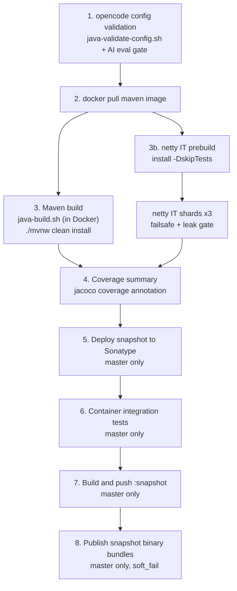

#### Step 1: Validate Config

Runs `.buildkite/scripts/steps/java-validate-config.sh` to lint opencode configuration files.

Alongside it, `.buildkite/scripts/steps/validate-ai-evals.sh` runs the AI-component
eval harness with `STRICT=1` (see [AI Eval Gate](#ai-eval-gate) below).

#### Step 2: Update Docker Image

Pulls the latest `mockserver/mockserver:maven` build image to ensure the CI environment is current.

#### Step 3: Build

Runs `.buildkite/scripts/steps/java-build.sh`, which executes the full Maven build inside the `mockserver/mockserver:maven` Docker image via `run-in-docker.sh`:

- Volume-mounts the repository into the container
- Passes the `BUILDKITE_BRANCH` environment variable
- Executes `scripts/buildkite_quick_build.sh` which runs `./mvnw clean install`, with `-Dmockserver.shadeSourcesJar=false` so the `-no-dependencies` modules' `-sources.jar` files, which no later step uses, are not built (see [build-system.md](../operations/build-system.md#their--sourcesjar-and-the-ci-build-that-skips-it))
- That build runs the unit and integration tests of `mockserver-core` and the unit tests of `mockserver-netty` (whose integration tests run in the [shard steps](#step-3b-netty-integration-test-shards)) under Netty's leak detector at `paranoid` (recording allocation sites but not accesses, `targetRecords=0`) and fails at each module's `check-netty-leaks` step if a buffer was leaked, or if tests ran and no fork installed the detector. The script's `-Dmockserver.testArgLine=...` does not remove the detector, whose flags are in `mockserver.leakArgLine`; while both shared one property, CI ran without it. See [ByteBuf Leak Detection in Tests](../code/netty-pipeline.md#bytebuf-leak-detection-in-tests)
- After that reactor `install` succeeds, the same script runs the whole-reactor **configuration-reachability guard** over the now fully-built tree: `./mvnw -pl mockserver-netty surefire:test@configuration-callsite-guard`. `ConfigurationCallSiteGuardTest` scans every module's compiled `target/classes` (except the on-demand `mockserver-benchmark`, which is outside the reactor and every release path, so a locally built benchmark cannot change the verdict) to prove no enforcement site reads a configuration value only from the static `ConfigurationProperties` store (unreachable from `PUT /mockserver/configuration`), and that control-plane authentication and server TLS values are read through their snapshots rather than field by field (see [tls-and-security.md](../code/tls-and-security.md)). It is **excluded from netty's own test phase** and run here instead, because under `-T 1C` every module downstream of `mockserver-netty` in the reactor (junit-rule, junit-jupiter, spring, async, blob-\*, state-infinispan, testcontainers, k8s-webhook) is uncompiled at netty's test time — so running it there silently scanned only a subset. Both scanning tests assert every module they should cover was actually scanned (deriving the expected set from the reactor `<modules>` list), so an incomplete tree fails loudly; its exit is folded into the build's exit so a violation reddens the build. `mockserver-maven-plugin` is outside the reactor, so this run does not scan it; the `mockserver-maven-plugin` pipeline runs the guard over it (see [Gates That Must Fail Closed](#gates-that-must-fail-closed)).
- Memory limit: 7 GB
- Collects build artifacts: `.log` files, the **failing** tests' reports plus their console output (`mockserver/target/failed-tests/**`, curated by `java-collect-failures.sh`), the jacoco coverage XML and HTML tarball, and the shaded JAR. Per-class `TEST-*.xml` for passing classes are **not** uploaded — only failing-test artefacts appear in the build's artefact list, keeping it small (one `TEST-*.xml` per class otherwise produced ~650 artefacts that cluttered the list). A pass/fail summary is still printed at the end of the build log.

#### Step 3b: Netty Integration-Test Shards

**Outcome.** `mockserver-netty`'s integration tests (about 28 minutes in one serial Failsafe fork on an m5.2xlarge) no longer run inside `:maven: build`. Three parallel steps run them, each on its own agent, so they leave the build's critical path. Every integration test still runs exactly once, under the same leak gate and CI arguments.

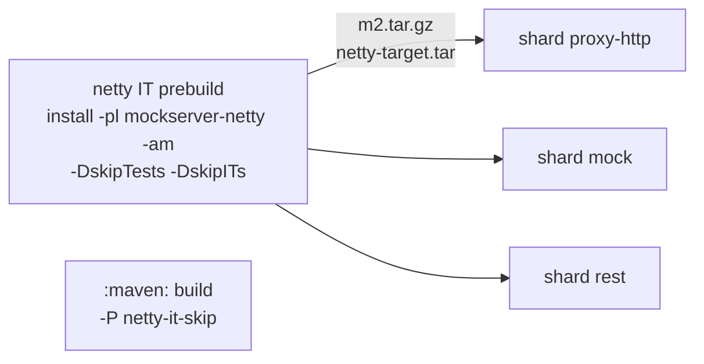

| Step | What it runs |
|---|---|
| `:maven: netty IT prebuild` (`java-netty-it-prebuild.sh`) | `scripts/buildkite_netty_it.sh prebuild`: builds `mockserver-netty` and its upstream modules once without tests, then uploads two archives: the SNAPSHOT artifacts that run installed (minus `mockserver-netty` itself) and netty's `target/classes`, `target/test-classes` and assembled fat jars (some integration tests boot them) |
| `:maven: netty IT {{matrix}}`, one job per `proxy-http`, `mock`, `rest` (`java-netty-it-shard.sh`) | Downloads the archives (`--step netty-it-prebuild`) and runs `scripts/buildkite_netty_it.sh shard <name>`: only the integration-test bindings, invoked directly so nothing recompiles (`delete-stale-failsafe-summary`, `jacoco:prepare-agent-integration`, `clean-netty-leaks`, `failsafe:integration-test`, `print-netty-leaks`, `failsafe:verify`, `check-netty-leaks`) under profile `netty-it-shard-<name>`. Then it collects failing-test artefacts. The `rest` shard also makes the HTTP/3 `assert-suite-ran.sh` check that `java-build-and-collect.sh` made before. On any exit, an `EXIT` trap runs `java-netty-it-echo-guard-report.sh`, which reports `SharedEchoServerGuard` firings (see below) |

**How the partition is defined.** In `mockserver-netty/pom.xml`. The properties `mockserver.nettyItShard.proxyHttp` (`org/mockserver/netty/integration/proxy/http`) and `mockserver.nettyItShard.mock` (`org/mockserver/netty/integration/mock`) are the named shards' packages, without their subpackages: an include with `/**/` in the middle passes Maven's scan but matches nothing in the JUnit Platform fork, which applies the pattern again, so a future subpackage's tests run in `rest`. Profiles `netty-it-shard-proxy-http` and `netty-it-shard-mock` include one each; `netty-it-shard-rest` includes every `*IntegrationTest` and excludes both, so the three are disjoint and their union is the full set by construction. No class list is kept anywhere. Each shard keeps the module's `failIfNoTests=true`, so a pattern that stops matching anything fails its shard rather than passing empty. The reactor build skips the module's integration tests with profile `netty-it-skip`, which `scripts/buildkite_quick_build.sh` adds only when `MOCKSERVER_NETTY_ITS_IN_SHARDS=true`, set on the `:maven: build` step in `pipeline-java.yml`. A local `./mvnw verify` activates none of these profiles and still runs every integration test in one fork.

**Why profiles by package, not a hash of class names.** A package pattern is readable in the pom, needs no script to compute or check, and the remainder-by-exclusion makes a missing or duplicated test impossible without a cross-shard union check. The split at build 2981 (m5.2xlarge, class times): `integration.proxy.http` 650 s (39 classes), `integration.mock` 538 s (106 classes), everything else 524 s (`http3` 151 s of it). That is about 9 to 11 minutes of tests per shard, plus about 2 to 3 minutes per shard to start the container, download the archives and resolve dependencies.

**Leak gate.** Each shard runs `clean-netty-leaks` before its fork and `check-netty-leaks` after it, so each shard fails on its own leaks and on a fork that did not install the detector, exactly as the module did in one fork.

**Shared echo server guard.** `SharedEchoServerGuard` prints a diagnostic to stderr when a shared echo server stops answering, and failsafe redirects that into a per-class `*-output.txt` that is never uploaded for a passing test. `java-netty-it-echo-guard-report.sh` greps those files for the guard's `DIAGNOSTIC_HEADER` (read from its source; `SharedEchoServerGuardTest` keeps the two in step), prints each matching block, adds a warning annotation with context `shared-echo-guard-<shard>`, and copies the file to `mockserver/target/failed-tests/shared-echo-guard/<shard>/`. It never fails the step, and prints and annotates nothing when the guard did not fire. If it cannot read `DIAGNOSTIC_HEADER` from the source, it says so in the log and in a warning annotation on every shard instead. Its fixture checks are `netty-it-echo-guard-report-test.sh` in `mockserver-infra`.

**Failure.** A failing shard fails its job, and so the build, like any other step in this group; the `wait` before the deploy block keeps a red shard from publishing. A failed prebuild fails the build and the shards do not start. A failing shard's failure artefacts are under `mockserver/target/failed-tests/` on that shard's job.

**Coverage.** The coverage summary and the diff-coverage gate read only the unit-test `target/site/jacoco/jacoco.xml` files, so they are unchanged. Netty's integration-test coverage, previously `mockserver-netty/target/site/jacoco-it/jacoco.xml` (and its HTML in `jacoco-html-reports.tar.gz`) from `:maven: build`, is now one `mockserver/mockserver-netty/target/jacoco-it-<shard>.exec` artefact per shard. To see it, download the three files and merge them with the JaCoCo CLI (`org.jacoco:org.jacoco.cli:<version>:jar:nodeps`): `java -jar jacococli.jar merge jacoco-it-*.exec --destfile jacoco-it.exec`, then `java -jar jacococli.jar report jacoco-it.exec --classfiles mockserver/mockserver-netty/target/classes --sourcefiles mockserver/mockserver-netty/src/main/java --html jacoco-it-html` in a tree built from the same commit.

**Rebalancing.** Move a package between shards by changing the two `mockserver.nettyItShard.*` properties; the `rest` exclusion follows automatically. To add a shard, add a property, a profile that includes it, an `<exclude>` of it in `netty-it-shard-rest`, a matrix value in `pipeline-java.yml`, and the name to the `case` in `buildkite_netty_it.sh`. If the `http3` package moves out of `rest`, move the HTTP/3 check in `java-netty-it-shard.sh` with it, or the `rest` shard fails on missing reports. Use the per-class `Time elapsed` lines of a recent `:maven: build` log (or the shards' logs) to choose.

**Rollback.** Delete the `env: MOCKSERVER_NETTY_ITS_IN_SHARDS` block on `:maven: build` and the two netty IT steps in `pipeline-java.yml`. The reactor build then runs all of the module's integration tests in one fork again and `java-build-and-collect.sh` makes the HTTP/3 check again; the profiles and scripts are inert. Remove the env and the steps together: the env without the steps would skip the tests entirely.

#### Step 4: Coverage Summary

Runs `.buildkite/scripts/steps/java-summarize.sh` to add a jacoco line-coverage annotation (and a link to download the `jacoco-html-reports.tar.gz` artefact) to the Buildkite build page. Runs with `continue_on_failure: true` / `soft_fail: true` so it never reddens the build. A separate diff-coverage gate (`diff-coverage.sh`, also `soft_fail`) annotates new-code coverage. The previous `junit-annotate` per-test-annotation step was removed along with the per-class `TEST-*.xml` upload it depended on; the end-of-log pass/fail summary and the failing-test artefacts cover failure triage instead.

#### Steps 5–8: Master-Only Steps

On `master` only, four additional steps run sequentially:

- **Deploy snapshot:** `.buildkite/scripts/steps/java-deploy-snapshot.sh` — publishes SNAPSHOT artifacts to Sonatype
- **Container integration tests:** `.buildkite/scripts/steps/container-tests-run.sh` — runs Docker Compose and Helm integration tests
- **Build and push :snapshot:** `.buildkite/scripts/steps/java-docker-push-snapshot.sh` — builds and pushes the `:snapshot` / `:mockserver-snapshot`, `-graaljs`, `-clustered` and webhook snapshot Docker images (`:latest` is only pushed during releases). The `-clustered` variant consumes the `clustered-libs` artifact from the `:maven: build` step and fails closed if it is absent — the daily perf run's clustered-state A/B pulls that tag and needs it built from the same commit as the GraalJS SUT image. Last, it builds `snapshot-http3` / `mockserver-snapshot-http3` (`docker/http3/Dockerfile`) FROM the `:snapshot` digest it just pushed, runs `docker-http3-smoke.sh` (a real HTTP/3 request to both `snapshot-http3`, now a deprecated alias, and `:snapshot`) on the agent's arch, and pushes multi-arch; this block is blocking and bounded by `timeout 20m` (the step timeout is 65 minutes to absorb it) — a failure publishes no `snapshot-http3` and fails the step, but every other snapshot image has already been pushed by then
- **Publish snapshot binary bundles** (`soft_fail`): `.buildkite/scripts/steps/java-publish-snapshot-bundles.sh` — builds JVM-less binary bundles for all platforms (linux/x86_64, linux/aarch64, darwin/x86_64, darwin/aarch64, windows/x86_64) using `scripts/build-all-bundles.sh` and uploads them to `s3://aws-binaries-mockserver/mockserver-<POM_VERSION>/`, served at `https://downloads.mock-server.com/mockserver-<POM_VERSION>/...`. Each master build overwrites the previous snapshot bundles. This provides working download URLs for the Go/.NET/Rust/Ruby/Python binary client launchers between releases. **No GitHub token is required** — the upload uses the agent's IAM instance role; the default-queue role needs `s3:PutObject` on `arn:aws:s3:::aws-binaries-mockserver/*` (provisioned via Terraform in `terraform/buildkite-agents/`). Releases still use GitHub Releases (via the release pipeline). The `jlink` cross-build needs JDK 21, which this step **bootstraps on demand** (downloads Temurin 21 for the host and passes it via `JAVA_HOME` to `build-all-bundles.sh` for that one invocation) — the **Maven build keeps running on JDK 17**, so the Java-17 floor is still enforced and this step never changes the Maven JDK. Master-only (`if: build.branch == 'master'`) and `soft_fail: true`, so **PR builds never publish** and bundle-build failures never redden master.

#### Client-Codegen Fidelity Gate

**Script:** `.buildkite/scripts/steps/ui-java-codegen-compile.sh`

**Trigger:** Path-gated to the `mockserver-java` pipeline — fires on any change under `mockserver/` (including `mockserver-client-java/`) or `mockserver-ui/`.

**Problem it solves:** The dashboard's "Java" language tab (`mockserver-ui/src/lib/standardCodegen.ts → standardToJava`) emits fluent MockServer client code. TypeScript string-assertion tests verify the emitted shape, but cannot catch a renamed or removed method on `MockServerClient` or the `org.mockserver.model.*` builders — the generated Java would ship broken silently.

**Three-phase approach:**

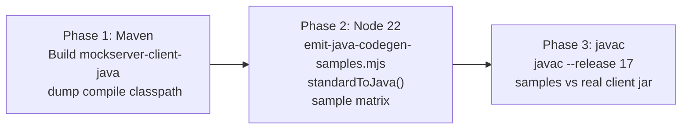

Each phase runs inside its own Docker image via `run-in-docker.sh`. Set `CODEGEN_COMPILE_USE_DOCKER=false` to run the same commands against host toolchains for local validation.

| Phase | Image | What it does |
|-------|-------|-------------|
| 1 | `mockserver/mockserver:maven` | `./mvnw install -pl mockserver-client-java -am -DskipTests -DskipITs -T 1C` then `dependency:build-classpath` to a file |
| 2 | `node:22` | Runs `mockserver-ui/scripts/emit-java-codegen-samples.mjs` — no `npm ci` needed; `standardCodegen.ts` is dependency-free |
| 3 | `mockserver/mockserver:maven` | `javac --release 17` on all emitted `.java` files against the Phase 1 classpath |

A **coverage floor** asserts at least 23 emitted samples — a regression that silently shrinks the emitter output fails loudly rather than passing with reduced coverage.

**Companion test:** `mockserver-ui/src/__tests__/fixtureCoverage.test.ts` is a Vitest meta-test that verifies the canonical fixture set at `test-fixtures/expectations/` collectively exercises every top-level key in the server `expectation.json` schema, every `ACTION_FAMILY_KEY`, every `StandardActionType`, and every `BodyMatcherType`. Adding a new server feature without a covering fixture fails CI until a fixture is added.

**Ratchet ledger:** `test-fixtures/expectations/known-gaps.json` tracks accepted per-language JSON-path gaps in the cross-language round-trip fidelity tests. A stale entry (one that no longer excuses any diff) fails CI — the ratchet re-arms as client models are completed. This file conflicts on every rebase when multiple worktrees are active; always resolve from `origin/master` after a rebase.

### AI Eval Gate

**File:** `.buildkite/scripts/steps/validate-ai-evals.sh` (runs in both `pipeline-infra.yml` and `pipeline-java.yml`)

Runs the AI-component eval harness (`.opencode/evals/run-evals.sh`) with `STRICT=1`.
`STRICT` is what makes it a gate: without it the runner counts a fixture with no
recorded baseline as `PENDING` and still exits 0 — which is exactly how the suite
sat at "5 fixtures, 0 baselines, OK" until commit `aff5730a0`.

Enforced mechanically:

| Condition | Exit |
|---|:--:|
| A fixture has no committed `.result` baseline | 1 |
| A committed baseline disagrees with the fixture's `expected_verdict` | 1 |
| A fixture is malformed (bad frontmatter, `id` ≠ filename stem, invalid verdict, `FLAG` on a review agent) | 2 |
| A `.result` is orphaned (its fixture was deleted or renamed) | 2 |
| The corpus drops below the `MIN_TASKS` floor, or is empty | 2 |

Buildkite is path-filtered, so this runs on builds that trigger `mockserver-infra`
or `mockserver-java` rather than literally every build. All AI-component paths —
`.opencode/`, `.claude/`, `AGENTS.md`, `CLAUDE.md`, `opencode.jsonc` — route to the
infra pipeline, so any change that could move a verdict does run the gate. It is
duplicated into the java pipeline for the same reason the opencode config lint is:
consistency with that precedent, not extra coverage (AI-component paths never
trigger the java pipeline on their own).

**What this gate does not do (1): it cannot detect a laundered baseline.** Both
`expected_verdict` and `.result` are committed, so editing them together to match a
degraded agent passes silently. That is why `.opencode/evals/**` is an enumerated
control path requiring `review-final` and explicit approval.

**What this gate does not do (2): it does not re-invoke the agents.** Buildkite has no
model credentials, and a live agent run is neither cheap nor deterministic.
Recording a baseline stays an agent-in-the-loop step performed locally
(`.opencode/evals/README.md`). So CI proves the corpus is **complete and
self-consistent**; it does not prove the agents still behave that way today. The
behavioural check is the local commit-workflow gate on AI-component changes
(`.opencode/rules/evaluation-harness.md`).

### Build Wall-Clock

Steps run in parallel unless a `- wait` or `depends_on` orders them, so a step belongs after a barrier only if it consumes something produced before it.

- **Artifact-only Maven runs pass `-DskipITs` as well as `-DskipTests`.** In this repo `-DskipTests` silences surefire only; failsafe still runs every `*IntegrationTest`. A step that runs Maven only to assemble artifacts for a later step — the Sonatype snapshot deploy, the UI e2e and codegen jar builds, the maven-plugin build, and the `install`/`deploy` calls in `scripts/release/` — must pass both, or it silently re-runs the full integration suite the build already ran. The snapshot deploy did this for 23 minutes a build, of which the upload was the last few seconds.
- **Container integration tests run alongside `:maven: build`, not after it.** They consume only the netty fat jar, the `mockserver-netty-docker` jar (for `docker_variant_smoke_local`: `docker/local`, the standard image, needs that jar's QUIC native) and the WAR, which `:maven: container-test jars` builds test-free. They sit before the post-build `wait` and are ordered by `depends_on: container-test-jars`; `container-tests-run.sh` downloads with `--step container-test-jars`, so it cannot pick up the same-named copies `:maven: build` also uploads. Master-only, as before.
- **`mockserver-netty`'s integration tests run alongside `:maven: build`**, in three shards fed by one test-free prebuild (see [Step 3b](#step-3b-netty-integration-test-shards)). The prebuild and the slowest shard together take far less than the rest of `:maven: build`.
- **The allocation gate runs alongside `:maven: build`.** `perf-alloc-gate.sh` builds its own reactor from the restored cache and uses nothing the build produces. It still runs on PRs and master, and the plain `wait` before the deploy block still stops a red gate from publishing.
- **UI build and Playwright e2e run alongside lint and unit tests** in `pipeline-ui.yml`. Neither consumes their output. The trade-off, accepted deliberately: e2e now runs even when the unit tests are red, instead of being skipped.

### Spot Resilience (agent-lost auto-retry)

The `default` agent queue is a mix of on-demand and Spot instances (see [aws-infrastructure.md](aws-infrastructure.md#scaling-behaviour)). When AWS reclaims a Spot instance mid-build, the Buildkite agent is lost and the running job ends with **exit status `-1`** (or `255`) — an infrastructure kill, not a test failure. The Maven build is the pipeline's longest step, so a reclaim part-way through used to fail the whole build and require a manual re-run (~2 Spot evictions/day were observed).

Two complementary mitigations:

- **`automatic_retry` on agent-lost** — the long, non-`soft_fail` command steps (`:maven: build`, deploy snapshot, container integration tests, build-and-push `:snapshot`) declare `retry.automatic` for `exit_status: -1` and `255` (`limit: 2`). A Spot reclaim silently re-queues the job onto a fresh agent instead of reddening the build. **Real test failures exit `1` and are NOT retried**, so this never masks genuine breakage.
- **Higher on-demand ratio** — the default queue's `on_demand_percentage` was raised from 20% to 60% so a long build is much less likely to land on a Spot instance in the first place (the on-demand base capacity of 1 is unchanged).

### Transient Maven Central Resilience

A single transient failure from `repo.maven.apache.org` (a `Connection reset` / timeout / 5xx while resolving one artifact or plugin) used to redden a whole multi-module build — including builds that had already passed every test, and child pipelines (python/ruby/node/UI) that only touch Maven to build the mockserver jar before their own language tests. Three complementary, defence-in-depth mechanisms address it. They are layered deliberately: each covers a failure window the others do not.

| Layer | Mechanism | Bridges | Where |
|-------|-----------|---------|-------|
| In-Maven retry | `aether.connector.http.retryHandler.count=5` + `requestSentEnabled=true` + `connectionMaxTtl=120` | A sub-second blip: immediate in-process retries of the failed transfer | `mockserver/.mvn/maven.config` (every reactor-rooted Maven invocation inherits it) |
| Warm local repo | Restore the S3 `maven` dependency cache before the jar build so most resolutions never touch Central at all | Everything already cached (the common case) | `cache-restore.sh maven` in the java, maven-plugin, **python, ruby, node and UI** pipelines; `build-local-mockserver-image.sh` now mounts `--cache maven` |
| Step re-run | Buildkite `retry.automatic` on a dedicated **sentinel exit code 42** | A longer outage window (minutes): the whole step is re-queued and re-run later | `run-in-docker.sh` remaps transient failures to 42 (CI only); **jar-only** steps opt in with `- exit_status: 42` (`limit: 2`) |

**Why the native-transport property names, not `maven.wagon.http.*`.** Maven 3.9 defaults to the native Maven Resolver HTTP transport, which **ignores** the legacy `maven.wagon.http.*` properties — setting those would be a silent no-op (a false-green). The `aether.connector.http.*` keys are the ones the native transport reads (verified: with them a `Connection reset` is retried the configured number of times; without them the resolver's default of 3 immediate retries applies). Note the native default is already 3 **immediate, no-backoff** retries, which is why a sub-second blip can still slip through and why the warm cache and step-retry layers matter more than the raised count.

**Why a sentinel exit code for the Buildkite retry.** Buildkite `retry.automatic` matches only on exit status, and a transient Central failure exits `1` — the **same** code as a genuine test/compile failure — so retrying on `1` would silently retry real regressions into green. Instead, `run-in-docker.sh` inspects the build output on failure and, **only** when it sees a Maven *resolution* phrase (`Could not transfer artifact` / `Failed to read artifact descriptor` / `Could not resolve dependencies` …) **and** a *network* cause (`Connection reset` / timeout / 5xx) on the same line, remaps the exit to `42`. That precision is load-bearing:

- A test that itself logs `Connection reset` (many MockServer tests do) carries no resolution phrase on that line → **not** remapped.
- A genuine missing-artifact / 404 (`Could not find artifact`, no network cause) → **not** remapped, so a real dependency bug stays red.
- The remap is **CI-only** (`BUILDKITE=true`); local `run-in-docker.sh` keeps its original `exec` semantics and real exit code.

**What a retry can and cannot mask.** It CAN mask (by re-running, up to `limit: 2`) a transient-infra window that outlasts Maven's own in-process retries. It CANNOT mask a test, compile, or asset regression on the steps that opt in: each of those steps isolates a `-DskipTests` Maven resolution in its **own** `run-in-docker.sh` invocation, separate from the invocation that runs the tests (the jar build, then a distinct pytest/rspec/Playwright/etc. run) — so a real test failure occurs in an invocation whose log carries no Maven-resolution line, exits `1`, and can never reach `42`. It also cannot mask a Central outage longer than the retries — that still ends red after the cap.

**Why the java `:maven: build` step is deliberately NOT opted in.** That step runs `clean install` — dependency resolution AND the entire unit + Failsafe reactor — in one classified `run-in-docker.sh` invocation. Under the default `-T 1C` fail-fast reactor a transient transfer line in one module can co-occur in the same log with a genuine test failure in another, so the "never reach 42" invariant would NOT hold there and a 42-retry could re-run a real (flaky) test failure. The java reactor build therefore relies only on layers 1 and 2 (in-Maven retry + the warm maven cache it restores at the top of its pipeline, which it is also the sole saver of). Only steps whose Maven work is a pure `-DskipTests` jar build, isolated from their tests, carry the step-retry.

**Coverage and limits.** The sentinel is produced centrally in `run-in-docker.sh`, so it covers every Maven build that runs through it. Maven invocations that bypass `run-in-docker.sh` (host `mvn` in `perf-test-microbench.sh`, and the host-`mvnw` fallbacks in `docker-build-verify.sh` / `verify-tcnative-stamp.sh`) do not get the step-retry, but still benefit from the in-Maven retry layer. The `maven` cache key is the hash of every `mockserver/**/pom.xml`, so a **dependency bump changes the key and forces a cold (cache-miss) build** — meaning the warm-cache layer does *not* help the very Dependabot PRs that most often trigger the transient, which is precisely why the in-Maven retry and step-retry layers exist alongside it. Client pipelines restore the maven cache **read-only**; the java and maven-plugin pipelines remain the sole savers.

### Python and Ruby Client Integration Tests

**Files:** `.buildkite/scripts/steps/python-integration-test.sh`, `.buildkite/scripts/steps/ruby-integration-test.sh`

These pipelines run independently from the Java pipeline and do not have access to Java build artifacts. To test against the HEAD-built MockServer (not a stale `:snapshot` from Docker Hub), both scripts source a shared helper:

- **Helper:** `.buildkite/scripts/build-local-mockserver-image.sh` — builds the `mockserver-netty-docker` JAR (the shaded server jar with JNA unrelocated, which the published images ship) from the Maven reactor (skipped if the JAR already exists), copies it into `docker/local/`, and runs `docker build` to produce a local image tagged `mockserver-under-test:local` (configurable via `MOCKSERVER_IMAGE` env var).

The test fixtures (`conftest.py` for Python, `integration_spec.rb` for Ruby) also respect the `MOCKSERVER_IMAGE` env var when launching a container in standalone/local mode.

#### HEAD-built image for the Java Testcontainers suite

`MockServerContainerIntegrationTest` (`:whale: testcontainers integration test`, `java-testcontainers-test.sh`) normally runs the **pinned released image** (`TestcontainersImages.PINNED_MOCKSERVER_IMAGE`). During a release, master carries a non-`-SNAPSHOT` version (from `release: set version` until the next-version commit) while that version's image may not be published yet. On a minor or major `set version` commit the client is already the new major.minor and `MockServerClient` rejects the previous image; on the `update version references` commit the pin already names the new image, which the `:docker:` release step may not have pushed yet. So the step uses the pin only when the `mockserver/pom.xml` version is a `-SNAPSHOT` with the pin's major.minor; otherwise it builds `mockserver-under-test:local` with the helper above and passes it to the suite as `-Dtestcontainers.mockserver.image`. The step log states which image ran and why; `assert-suite-ran.sh` still fails the step if the suite skipped. `PinnedImageVersionTest` (main build) already tolerates a pin one minor behind, so it passes on the release commit.

### UI End-to-End (Playwright) Step

**Files:** `.buildkite/scripts/steps/ui-e2e.sh`, `mockserver-ui/e2e/playwright.config.ts`, `mockserver-ui/e2e/start-mockserver.mjs`

The `:playwright: UI end-to-end (real browser)` step in `pipeline-ui.yml` drives the served dashboard in headless Chromium against real MockServers built from HEAD. It covers every dashboard area (one spec each for Mock, Observe, Verify, Resilience, Library / Inspect and the shell, plus the original dashboard, follow and live-scroll specs) and is a hard gate. CI runs exactly what `npm run test:e2e` runs locally.

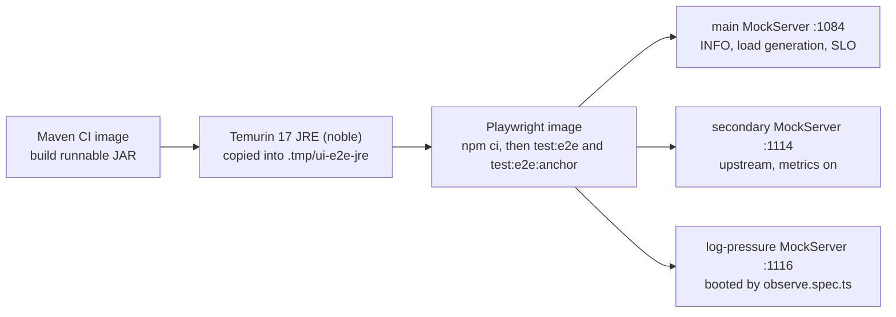

- **One container, one loopback.** The Playwright config boots the servers itself (`webServer` entries running `start-mockserver.mjs main|secondary`), inside the Playwright container, with the JRE the step stages from the `eclipse-temurin:17-jre-noble` image (`E2E_JAVA`). Every server, the browser and the Node upstreams some specs start are on `127.0.0.1`, so a server can forward to a listener the test runner opened. The earlier topology (server in its own container on a Docker network) could not reach those listeners.
- **Why two servers.** The main server keeps metrics off, because a test proves the dashboard never polls metrics on such a server; the Metrics view tests use the secondary server, which has them on. The secondary is also the proxied upstream for the record / replay, cassette, drift and contract tests, and the server without SLO tracking for the SLO 403 test.
- **Serial, one worker.** Every spec resets and inspects the same servers (expectations, the event log, server-wide chaos and load scenarios), so tests run one at a time. Its 236 tests took 8.5 minutes on a developer Mac (three runs, October 2026); the step timeout is 40 minutes to cover the JAR build and `npm ci` as well.
- **Fail-closed.** A test whose precondition the topology must provide calls `requireOrSkip` (`e2e/ci-guard.ts`): a skip locally, a failure when `CI` is set. In CI the `no-silent-skip-reporter.ts` reporter also fails the run if any test is skipped other than by `test.fixme`, which is kept only for a known open defect named by its id. After the run, `ui-e2e.sh` reads the JUnit XML and fails unless every spec it lists ran at least one test and the total that ran is at least `E2E_MIN_TESTS` (236), so a spec dropped from `testMatch`, renamed, or emptied by `test.fixme` cannot pass silently. Lower the floor or edit the list only when tests are removed on purpose.
- **Artifacts.** JUnit XML (the configs write it to `../test-reports/`, because a reporter's `outputFile` is relative to the config's directory, `e2e/`) and each server's log (`mockserver-ui/test-reports/*.xml`, `*.log`; the servers log at INFO to a file, not the console), plus traces and screenshots of failed tests.

### Maven CI Image Push Pipeline

**File:** `.buildkite/docker-push-maven.yml`

**Trigger:** Manual (via Buildkite UI or API)

Builds and pushes `mockserver/mockserver:maven` — the Docker image used by the CI build pipeline. Run this when:
- `docker_build/maven/Dockerfile` or `docker_build/maven/settings.xml` change
- Monthly, to pick up base OS security updates
- After upgrading Maven or JDK versions

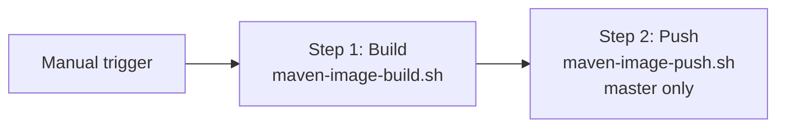

The pipeline has two steps separated by a `- wait` directive:

1. **Build:** `.buildkite/scripts/steps/maven-image-build.sh` builds the `mockserver/mockserver:maven` image
2. **Push** (master only): `.buildkite/scripts/steps/maven-image-push.sh` authenticates to Docker Hub via AWS Secrets Manager (`mockserver-build/dockerhub`) and pushes the image

### Release Image Push (Docker step of the release pipeline)

**Script:** `scripts/release/components/docker.sh`, invoked as the `:docker: Docker Image` step of `release-pipeline.yml` (`release-runner.sh docker`).

**Trigger:** Runs automatically as part of the `mockserver-release` pipeline — there is no separate manual image pipeline.

**Queue:** `release` — needs `mockserver-release/cosign-key` (image signing) and the release-scoped Docker Hub / ECR push credentials.

Builds and pushes the production MockServer Docker images as multi-arch images (`linux/amd64` + `linux/arm64` via QEMU). Four image variants are published: main, GraalJS, clustered, and webhook. After push, each image is cosign-signed by digest, and the same digests are mirrored to GHCR.

The `RELEASE_VERSION` / tag is derived from the release pipeline context.

Tags pushed per image:
- `mockserver/mockserver:mockserver-X.Y.Z` + `:X.Y.Z` + `:latest` (main, GraalJS, clustered variants)
- `mockserver/mockserver-webhook:mockserver-X.Y.Z` + `:X.Y.Z` (admission webhook)
- Same tags to ECR Public (URI resolved dynamically via `aws ecr-public describe-repositories`) and mirrored to GHCR

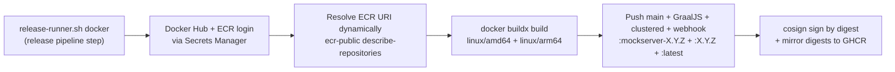

The ECR repository URI is resolved at runtime via `aws ecr-public describe-repositories` rather than hardcoded — the registry alias is AWS-assigned and must not be hardcoded (`scripts/release/components/docker.sh`).

The GHCR mirror runs only when the GHCR login succeeds, so the Docker step does not abort on a GHCR problem. The release **Verify** step (`scripts/release/components/verify.sh`) is the gate: it makes the anonymous pull a user would make (token from `ghcr.io/token?service=ghcr.io`, then the `X.Y.Z` manifest) for both `mock-server/mockserver` and `mock-server/mockserver-webhook`, retried with backoff, and fails the release if either is missing or the package is private (GHCR's token endpoint answers `UNAUTHORIZED` for a private package and `DENIED` for a missing one).

### Release Preflight Credential Gate

**A dead or under-scoped publishing credential fails the release *before* it starts, not half-way through.** The release preflight pipeline (`.buildkite/release-preflight-pipeline.yml`) runs `scripts/release/check-release-credentials.sh` as a hard gate on the **release queue**, dispatched by `.buildkite/scripts/release-runner.sh check-credentials`. This closes the gap that half-published 8.0.0: an npm token that still *existed* (the old presence check passed) but could no longer authenticate, so `npm publish` 401'd after the version bumps had already been pushed. <!-- version-ref:keep -->

**Release queue only — this is load-bearing, not incidental.** The release queue is the only queue whose agents carry the `mockserver-release/*` grants (`read_release_secrets` / `read_build_secrets_release` / `read_dockerhub_release_secret`, attached to the release stack alone in `terraform/buildkite-agents/main.tf`), so it is the only place every required credential can actually be read and proven. In particular `website-role` probes to VALID only from here (the release agent's instance role is trusted to `sts:AssumeRole`); from any other identity the assume is denied and the probe correctly reports INDETERMINATE — which would make the gate exit 2 every time off-queue.

The gate propagates the probe's exit code verbatim and is **not `soft_fail`** (a credential gate that cannot fail the build is decoration):

| Probe exit | Meaning | Gate |
|-----------|---------|------|
| 0 | every required credential VALID / VALID(SHAPE) | **pass** |
| 1 | a required credential REJECTED / MALFORMED / ABSENT | **fail** |
| 2 | a required credential INDETERMINATE (could not be proven) | **fail** (fail-closed — an unprovable credential is not a green one) |
| 3 | no usable AWS session | **fail** — on the release queue the instance role should always yield a session, so this means the agent's own AWS identity (IMDS / instance role) is broken and nothing could be probed |
| 64 | bad probe arguments | **fail** — a wiring bug, never a credential problem |

**The cosign probe does not need cosign on the agent.** It uses the cosign on `PATH` if there is one, and otherwise downloads the same pinned, checksummed cosign the release signs with (`resolve_cosign` in `scripts/release/_lib.sh`, shared with `docker.sh`, `helm.sh` and `test-cosign-signing.sh`), then runs `cosign public-key` with the stored password. A failed download or checksum stays INDETERMINATE; a key the password does not decrypt is REJECTED. `--self-test` checks each of those outcomes against a throwaway key pair.

On any non-zero exit the wrapper (`.buildkite/scripts/steps/check-release-credentials.sh`) posts a Buildkite **error annotation** naming the failing credential(s) and their outcome (parsed from the probe's own table), so a red build says *which* credential and *which* outcome rather than "script failed".

**Why the probe is not dispatched like a release stage.** The probe is CI-agnostic and takes only `--required-only` / `--self-test`; it rejects any other argument with exit 64 (so a typo can never silently no-op into a false green). `release-runner.sh` hands every ordinary release *stage* a `--execute` / `--dry-run` flag — which the probe would reject — so `release-runner.sh` has a dedicated `check-credentials` case that `exec`s the step wrapper *without* those flags, leaving the probe's strict argument contract untouched. Running the probe by hand before a release (`scripts/release/check-release-credentials.sh`) remains useful and works identically off-CI.

### Release Pipeline Security

#### File-based secrets (no `-e` in docker run)

All release scripts that run toolchains inside Docker containers (`scripts/release/components/maven-central.sh`, `maven-plugin.sh`, `helm.sh`, `docker.sh`) write secrets to `0600` files under `.tmp/` and read them from inside the container via mounted volume, rather than passing them as `docker run -e VAR=value`. Environment variables are readable from `/proc/1/environ` and via `docker inspect`; file-based secrets under `.tmp/` are not.

| Secret | File pattern | Removed from container via |
|--------|-------------|---------------------------|
| GPG key (base64) | `.tmp/gpg-key.$PID` | `trap` cleanup function on EXIT |
| GPG passphrase | `.tmp/gpg-passphrase.$PID` | same trap |
| Sonatype credentials | `.tmp/sonatype-creds.$PID` (username\npassword) | same trap |
| GHCR token | `.tmp/ghcr-creds.$PID` (username\ntoken) | `trap ... EXIT` in helm.sh |
| cosign key | `.tmp/cosign-key.$PID` | removed after signing |
| cosign password | `.tmp/cosign-pw.$PID` | removed after signing |
| Sonatype netrc | `.tmp/sonatype-netrc.$PID` | `trap ... EXIT` in polling loop |

Curl calls to the Sonatype Central Portal API use `--netrc-file` rather than `Authorization: Basic <base64>` in a shell variable, so credentials are not held in the shell environment across the 30-minute polling loop.

#### TOTP tolerance window (by design)

The TOTP verification step (`release-verify-totp.sh`) accepts ±5 minutes of clock skew (`TOTP_TOLERANCE_WINDOWS=10`). This is intentional — release-queue agents scale to zero, so the agent that runs the verifier cold-starts after the operator enters the code in the Buildkite block step. The Lambda autoscaler poll, EC2 spot acquisition, and agent bootstrap together take up to ~2.5 minutes. A standard ±1-window tolerance would produce false rejections on every cold-start without adding security, because the `allowed_teams: ["release-managers"]` gate on the block step is the primary access control.

To change this behaviour: either pre-warm the release queue or move TOTP validation into the block step itself (which runs in the Buildkite control plane, not on an agent).

#### Docker image cosign signing

After pushing release images to Docker Hub and ECR, the release pipeline cosign-signs each image digest using the same key infrastructure as Helm chart signing (`mockserver-release/cosign-key` in Secrets Manager). Signing is by digest so the signature binds to the exact manifest content, not a mutable tag.

Signing is strictly non-fatal: if the cosign key is absent or the binary is not installed, the images remain published and the release continues. The guard is:

```bash
if aws secretsmanager describe-secret --secret-id mockserver-release/cosign-key; then
  # sign
fi
```

See [Docker image verification](docker.md#verifying-image-signatures) for how to verify a signed image.

### Build Docker Image

The `mockserver/mockserver:maven` image is defined in `docker_build/maven/Dockerfile`:

- Base: Ubuntu 24.04 (Noble)
- JDK: OpenJDK 17
- Maven: 3.9.16 (manually installed from Apache)
- Dependencies: Pre-fetched by running a throwaway build during image creation
- Corporate CA: Optional certificate injection for TLS proxy environments (see [Docker](docker.md#maven-ci-image))
- Global Maven settings: `docker_build/maven/settings.xml` is copied to `conf/settings.xml`. It
  deliberately declares **no** repositories. These settings apply to every Maven process in the
  container — including the child builds started by `maven-invoker-plugin`, whose own `-s <settings>`
  replaces the *user* settings but not the global ones. Adding a snapshot repository here therefore
  makes the *whole* CI build reach over the network for MockServer's own artifacts, which can fail a
  build with a `403`/timeout in an unrelated module, and lets a previously published snapshot win
  whenever a locally installed one is older; see
  [Build System → The build never resolves from the snapshot repository](../operations/build-system.md#the-build-never-resolves-from-the-snapshot-repository).

Changes to `docker_build/maven/settings.xml` only reach CI once the `docker-push-maven` pipeline
rebuilds and pushes the image.

### Docker Registry Authentication

Docker push pipelines authenticate to two registries:

**Docker Hub** — credentials stored in AWS Secrets Manager (`mockserver-build/dockerhub`):

```json
{"username": "...", "token": "..."}
```

The shared script `.buildkite/scripts/docker-login.sh` fetches the secret and runs `docker login`.

**AWS ECR Public** — authenticated via IAM instance role (no stored credentials needed):

The shared script `.buildkite/scripts/ecr-login.sh` runs `aws ecr-public get-login-password --region us-east-1 | docker login --username AWS --password-stdin public.ecr.aws`.

Buildkite agent EC2 instances have IAM permissions for both Docker Hub secret access and ECR Public push (via `managed_policy_arns` in `terraform/buildkite-agents/main.tf`).

All Docker push scripts call both login scripts and push tags to both registries in a single `docker buildx build` command.

### Managing Buildkite Pipelines

Pipelines are managed via Terraform in `terraform/buildkite-pipelines/`. The Terraform stack includes all 15 pipelines (orchestrator, 11 child pipelines, 2 Docker image push pipelines, and 1 release pipeline), each pointing to `mock-server/mockserver-monorepo.git`. To add a new pipeline:

1. Create the pipeline YAML in `.buildkite/`
2. Add an entry to `local.pipelines` in `terraform/buildkite-pipelines/pipelines.tf`
3. Add a `trigger_if_changed` call in `.buildkite/scripts/generate-pipeline.sh`
4. Run `terraform apply` in `terraform/buildkite-pipelines/`

The Buildkite API token is stored in AWS Secrets Manager (`mockserver-build/buildkite-api-token`) and is used by the Terraform Buildkite provider for pipeline management.

### Checking build status from the command line

Use `scripts/ci/bk-pipeline-status.sh` to query (or watch) a pipeline build instead of hand-writing `bk`/`curl` calls each time. It wraps the **reliable** `bk build list` / `bk job log` commands — preferred over `bk auth token` + `curl` to the REST API and over the Secrets Manager tokens, because only the locally-authenticated `bk` CLI dependably has both build-state and `read_build_logs` scope, and it needs no AWS SSO session.

```bash
scripts/ci/bk-pipeline-status.sh -p mockserver-java -c <commitSha>          # one-shot status
scripts/ci/bk-pipeline-status.sh -p mockserver-java -c <commitSha> --watch  # poll until terminal
scripts/ci/bk-pipeline-status.sh -p mockserver-java -b <number> --logs      # tail the failing job log
scripts/ci/bk-pipeline-status.sh -p mockserver-java -b <number> \
  --grep 'BUILD FAILURE|<<< (FAILURE|ERROR)|npm error'                       # find the failure in the whole log
```

It prints `build#<n> <commit> build=<state> <job>=<state> exit=<code>` and exits `0` (passed) / `2` (failed) / `3` (timeout). For continuous watching, drive it with the agent Monitor tool in `--watch` mode (see the `build-monitor` skill).

## GitHub Actions

Several workflows run on GitHub Actions (CodeQL, zizmor, agent-config-scan, Maven dependency submission, scheduled hygiene jobs such as certificate-expiry, and issue/label automation). The security-relevant ones are described below.

### CodeQL Security Analysis

**File:** `.github/workflows/codeql-analysis.yml`

**Triggers:**
- Push to `master`
- Pull requests targeting `master`
- Weekly schedule: Tuesdays at 22:00 UTC

**Languages scanned:** Java, JavaScript, Python, Ruby, C#, Go, Rust and Actions, one matrix job per language, all with the `security-extended` query suite.

**Permissions:** `permissions: {}` at workflow level; the job grants only `contents: read` and `security-events: write`.

**Process:**

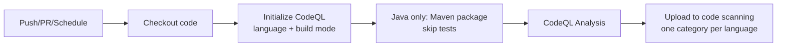

| Language | Build mode |
|----------|-----------|
| Java | `manual`: JDK 17 plus `./mvnw clean package -DskipTests -Dmaven.javadoc.skip=true` in `mockserver/` |
| Go | `autobuild` (Go has no `none` mode); confirm the first `Analyze (go)` run on `master` is green, because there are several Go modules and no `go.work` |
| JavaScript, Python, Ruby, C#, Rust, Actions | `none`: source is extracted without a build |

**Results:** each language uploads under its own category, `.github/workflows/codeql-analysis.yml:analyze/language:<language>`. The category is set explicitly so it stays identical to the one the original four languages already use (the default would now include the matrix `build-mode`, which would orphan their existing alerts). Its alerts appear in the repository's Security tab under "Code scanning alerts". C#, Go, Rust, Actions and `security-extended` were added in October 2026, so the first runs raise alerts for code that predates the change.

### zizmor (GitHub Actions audit)

**File:** `.github/workflows/zizmor.yml`

**Triggers:** push to `master`, pull requests targeting `master`, weekly on Wednesdays at 05:23 UTC, and `workflow_dispatch`.

**What it does:** installs zizmor with `pip install --require-hashes` from `.github/zizmor/requirements.txt`, runs `zizmor --offline --format=sarif --no-exit-codes .github/`, and uploads the SARIF with `github/codeql-action/upload-sarif` (same SHA as the CodeQL workflow) under the category `zizmor`.

**Results:** code scanning alerts in the Security tab, tool `zizmor`, category `zizmor`. Findings never fail the job; only an error does. The job is check run `Audit GitHub Actions`.

**Permissions:** `permissions: {}` at workflow level; the job grants only `contents: read` and `security-events: write`. Checkout uses `persist-credentials: false`, and no third-party action is used. See [security.md → Static Analysis: zizmor](../operations/security.md#static-analysis-zizmor-github-actions).

### agent-config-scan (AI agent configuration audit)

**File:** `.github/workflows/agent-config-scan.yml`

**Triggers:** push to `master`, pull requests targeting `master`, weekly on Wednesdays at 05:41 UTC, and `workflow_dispatch`.

**What it does:** runs the scanner's self-test (`python3 -I -m unittest discover -s scripts/security/tests`), then `python3 -I scripts/security/agent_config_scan.py --sarif …`, and uploads the SARIF with `github/codeql-action/upload-sarif` (same SHA as the CodeQL workflow) under the category `agent-config`. It uses the runner's `python3` and the standard library only, so nothing is installed.

**Results:** code scanning alerts in the Security tab, tool `agent-config-scan`, category `agent-config`. **Unlike zizmor, a finding fails the job** (exit 1); the upload step runs with `if: always()`, so the alerts are still recorded. The job is check run `Scan AI agent configuration`. Because `dependabot-auto-merge.yml` requires every check run to be green, an open finding on `master` also blocks Dependabot auto-merge until it is fixed or baselined.

**Permissions:** `permissions: {}` at workflow level; the job grants only `contents: read` and `security-events: write`. Checkout uses `persist-credentials: false`, and no third-party action is used. See [security.md → AI agent configuration scan](../operations/security.md#ai-agent-configuration-scan) for the rules and how to change the policy.

### Maven Dependency Submission

**File:** `.github/workflows/dependency-submission.yml`

Dependabot vulnerability **alerts** are computed from the dependency graph submitted to GitHub — for Maven, an *accurate transitive* graph requires **dependency submission** (a workflow that resolves the tree and POSTs it), not static manifest indexing. GitHub's managed Maven auto-submission only discovers a project at the **repository root**, so after the Java project moved into `mockserver/` it silently stopped and the graph froze at a pre-move snapshot (phantom Spring advisories, missed `log4j`/`jsoup` pins). This explicit workflow restores accurate submission for the monorepo layout, covering the `mockserver/` reactor and the separate `mockserver-maven-plugin` build under distinct correlators.

The full rationale, the two-project coverage table, the cost/trigger design, and the recommendation on the (now inert) managed submission live in **[docs/operations/security.md → Maven Dependency Graph Submission](../operations/security.md#maven-dependency-graph-submission)** — the authoritative home, since alerting is a security concern.

**Triggers:** push to `master` touching `mockserver/**/pom.xml`, plus `workflow_dispatch`.

**Credentials:** both jobs hold `contents: write` and run `mvnw`, which executes third-party Maven plugins, so checkout uses `persist-credentials: false`. The write token never reaches `.git/config`. The submission action posts the graph through the REST API using its own `token` input (default `github.token`), not git.

**Note:** an earlier `dependency-submission.yml` was removed on the belief that the built-in graph gave equivalent coverage. That belief was wrong for a non-root Maven project and is what let the graph go stale — see the security.md section above.

### Dependabot cooldown

**File:** `.github/dependabot.yml`

Every `updates` entry sets `cooldown: { default-days: 7 }`. The SemVer ecosystems (maven, npm, pip, bundler) also set `semver-major-days: 14`, and their minor and patch updates use the 7-day default. Dependabot does not propose a new release until it has been published for that long. This gives the registry time to yank a hijacked or malicious release before auto-merge can land it. Cooldown applies only to **version** updates. **Security updates are not delayed** ([Dependabot options reference → `cooldown`](https://docs.github.com/en/code-security/dependabot/working-with-dependabot/dependabot-options-reference#cooldown-)), so CVE fixes still arrive immediately. GitHub Actions, Docker and Terraform do not support the `semver-*-days` keys, so they set only `default-days`. zizmor's `dependabot-cooldown` audit flags any entry without a cooldown.

### Dependabot auto-merge

**File:** `.github/workflows/dependabot-auto-merge.yml`

**Bottom line:** minor/patch Dependabot PRs are merged automatically once **every check that actually exists on the PR head commit has genuinely passed** — read live from **both** GitHub check APIs, never from a maintained list. Anything ambiguous fails closed and the PR is left for a human.

**Why not GitHub-native auto-merge?** Native auto-merge waits only on the branch-protection **required-status-check list**. In this repo Buildkite and both Snyk scans are **not** required checks (see [Pull requests from external forks](#pull-requests-from-external-forks) — a docs-only change can merge on green CodeQL alone). So native auto-merge would merge a Dependabot PR the moment its *required* checks were green while Buildkite or a Snyk scan was still pending or **red** — and any newly-added check is invisible to it until someone remembers to add it to the required list. That silent under-coverage is the exact class of miss this repo has shipped before. **Do not replace this workflow with native auto-merge or `gh pr merge --auto`.**

**The defining property — read the checks that exist, not a list.** The two GitHub APIs report **disjoint** sets and both must be aggregated:

| API | Endpoint | What it carries here (verified on PR #2562's head) |
|---|---|---|
| Check Runs | `GET /commits/{sha}/check-runs` | 6 runs on PR #2562 — CodeQL, the then four `Analyze (*)` language runs, and the fork-only `Build & test full reactor` (which is `skipped` on in-repo branches). Since October 2026 there are about 11: CodeQL, eight `Analyze (*)` runs, `Audit GitHub Actions` (zizmor) and `Build & test full reactor`, plus a `zizmor` code scanning results run on pull requests |
| Commit Statuses | `GET /commits/{sha}/status` | 3 statuses — `buildkite/mockserver` and **both** Snyk scans |

A workflow reading only check-runs would see every run green and merge **while missing the build and the vulnerability scanner entirely**. This workflow aggregates every check run plus the 3 statuses (9 signals on PR #2562, about 14 since October 2026) and requires every one to be green. It picks up new check runs, such as `Analyze (actions)`, `Analyze (csharp)`, `Analyze (go)`, `Analyze (rust)` and `Audit GitHub Actions`, without change because it reads the live list. CodeQL and zizmor go red only on a tool or extraction failure, never on findings, but a broken extractor blocks **every** Dependabot auto-merge until it is fixed: **confirm the first `Analyze (go)` run on `master` is green** (the riskiest new job: several Go modules, no `go.work`, one module on `go 1.25.0`). If a language stays broken, fix or remove it from the CodeQL matrix rather than adding an exclusion to this workflow.

**Fail-closed decision matrix.** The job refuses (and logs *why*) on any of:

- author is not `dependabot[bot]`; PR not `open`; PR is a draft;
- head repo ≠ base repo (a **fork** — never merged, never mergeable via this path);
- the PR matches none of the three accepted classes — a `*-minor-and-patch-*` group branch (path A), a distroless **digest** branch whose PR title is also Dependabot's digest-bump shape (path B), or a Dependabot **security** update whose body carries the security-fix footer and whose title parses to a single **within-major** version bump (path C) — see major exclusion, digest handling, and security handling below;
- `mergeable` is not `true` (unknown/conflicting), or `mergeable_state` is `dirty`/`behind`/`blocked`/`unknown`;
- **zero** checks found on the head commit (the empty-set trap — silence is never success);
- any check-run not `completed`, or with conclusion `failure`/`cancelled`/`timed_out`/`action_required`/`stale`/`startup_failure`/null/**any unrecognised value**;
- any commit status whose state is not `success` (i.e. `pending`/`failure`/`error`/unrecognised);
- no successful check at all (e.g. everything `skipped`); or any API call erroring.

`skipped` and `neutral` check-run conclusions are treated as **non-blocking** (GitHub itself treats them as non-failing), because the fork-only `Build & test full reactor` check is legitimately `skipped` on every in-repo branch — treating `skipped` as a failure would merge nothing. Requiredness cannot be read without the branch-protection list this workflow deliberately avoids, so it defers to GitHub's own non-failing treatment of `skipped`/`neutral` while still requiring at least one genuine `success`.

**Why that leniency is safe, and the assumption it rests on.** It can only ever apply to *check runs*. `buildkite/mockserver` and both Snyk scans are **commit statuses**, and the legacy Commit Status API has only four states — `error`, `failure`, `pending`, `success`. There is no `skipped` or `neutral` for a status to report, so the build and the vulnerability scanners are structurally incapable of reaching the non-blocking path: they either pass or they refuse the merge. That is why no allowlist of required contexts is needed — naming them would reintroduce exactly the maintained list that made native auto-merge unsafe.

**If Buildkite or Snyk ever migrates to the Checks API** (for example by installing Snyk's GitHub App in checks mode), this reasoning stops holding: a `skipped` or `neutral` from them would become non-blocking, and the workflow would be able to merge past the build or a vulnerability scan. Revisit the leniency if either ever stops reporting as a commit status. The `Reported as` column in the table above is the thing to check.

**One residual gap, recorded rather than fixed.** The workflow gates only checks that have already posted; it cannot tell "this context does not apply" from "this context has not reported yet". It relies on Buildkite and Snyk registering their `pending` status within seconds of a push, well before the slower CodeQL runs complete — so any sweep that sees a green check-run also sees those statuses (as `pending`, which refuses). A future check that reports much faster than Buildkite could in principle open that window.

**Majors are excluded structurally, not by parsing.** `.github/dependabot.yml` groups `minor`+`patch` into `*-minor-and-patch` groups for every ecosystem; **majors are excluded from every group's `update-types`**, so a major arrives as an **ungrouped single-dependency** branch (e.g. `dependabot/maven/mockserver/com.graphql-java-graphql-java-27.0.0`) that does not match `^dependabot/.+-minor-and-patch-[0-9a-f]+$`. This is **spoof-resistant** because the head branch lives **in this repository** and is created by **Dependabot alone**: a PR author cannot cause Dependabot to name a major-bump branch after a minor/patch group, and the fork gate independently rejects any branch not in this repo. Group membership is therefore a *structural* signal, not a parsed version string — and being conservative (declining an eligible PR) is always the safe failure direction. Verified against this repo's real Dependabot history: genuine minors group here (`grafana/k6` 2.0.0→2.1.0 landed as a `docker-minor-and-patch` group PR) while majors and tag bumps do not (`eclipse-temurin` 17→25→26 and `ubuntu` 24.04→25.10 all arrived ungrouped, on non-hex-tailed branches).

**Docker digest bumps are the second accepted class — matched directly, not by grouping.** Six of the ten open Dependabot PRs are Docker **digest** bumps — a new image SHA on an *unchanged* tag, titled `bump distroless/java17 from <old-sha> to <new-sha>` (the shas backticked), on ungrouped branches like `dependabot/docker/docker/clustered/distroless/java17-90003c9`. A digest has no semver, so it belongs to no `*-minor-and-patch` group and was refused. **Dependabot's grouping of digest updates is inconsistent** — a distroless digest once landed *inside* the `docker-minor-and-patch` group (`dependabot/docker/docker/docker-minor-and-patch-9bdcecea1d`, "across 6 directories with 1 update"), yet the current six arrive one-per-directory and ungrouped — so digests cannot be caught by grouping alone. They are matched **directly** instead, by a second branch regex plus a title check, on **two independent Dependabot-generated signals that must both hold**:

| # | Signal | Regex | What it rules out |
|---|---|---|---|
| 1 | Branch is a **distroless** image path with a hex-sha tail | `^dependabot/docker/.+/distroless/[a-z0-9._-]+-[0-9a-f]{7,}$` | Any non-distroless image; any version tail (`ubuntu-25.10`, `eclipse-temurin-26-jdk-noble` — dots / non-hex end the string) |
| 2 | PR **title** is Dependabot's digest-bump shape | `bump [^ ]+ from .[0-9a-f]{7,}. to .[0-9a-f]{7,}.` | Any version bump — its title reads `from 24.04 to 25.10` / `from 17-jdk-noble to 25-jdk-noble`, bare versions with no hex-sha tokens |

**Why this is scoped to distroless, and why that makes majors impossible.** The distroless runtime bases (`gcr.io/distroless/java25`, `gcr.io/distroless/java-base-debian12`) are pinned on **non-semver tags** (`nonroot` / `debug-nonroot` / `latest`). Across the **dozens** of distroless PRs in this repo's history, **every one is a digest bump and not one is a version or tag change** — it is the single image class that can only ever move by digest. Dependabot bumps tags and digests, never the image *repository name*, so `gcr.io/distroless/java25` can never silently become `.../java26` (that is a manual Dockerfile edit, reviewed as such). The semver-tagged images in the same directories (`alpine`, `ubuntu`, `eclipse-temurin`, `grafana/k6`) are deliberately **not** matched: their minor/patch stay in `docker-minor-and-patch`, their majors arrive ungrouped and are refused, and their own digest bumps stay ungrouped and are refused too — a deliberate choice of **safety over completeness**, because a rule broad enough to catch their digest bumps could not reliably tell a bare-hex digest tail from a bare-numeric version tail.

**The `healthcheck-golang` group is deliberately outside both paths.** The Docker entry in `.github/dependabot.yml` has a `healthcheck-golang` group (`patterns: ["golang"]`, `group-by: dependency-name`, no `update-types`) for the Go toolchain the eight server images use to build the HEALTHCHECK probe. It is listed before `docker-minor-and-patch` so golang updates never join that group, its branch never matches `GROUP_BRANCH_REGEX`, and golang is not distroless, so its PRs are always left for a human to merge. See [docker.md → Docker HEALTHCHECK](docker.md#docker-healthcheck).

**Why the two-signal AND, and how it fails safe.** Requiring both the branch shape **and** the digest-bump title means a version bump can never be admitted even if a branch somehow shared the digest shape: a title like `from 1.2.3 to 2.0.0` fails signal 2 and the PR is refused. Both signals are generated by Dependabot, not the PR author, and the branch (signal 1) is immutable and base-repo-only, so neither can be forged from a fork. And the failure direction is always conservative: anything the two signals don't jointly confirm is **refused**, so the worst case is "a digest PR is left for a human", never "a major auto-merged".

**Security fixes are the third accepted class — bounded by an EXPLICIT semver check, not by grouping.** Dependabot **security** updates match neither path A nor path B: every `groups:` entry in `.github/dependabot.yml` omits `applies-to:`, which **defaults to `version-updates`**, so a security fix is raised **ungrouped** (e.g. `dependabot/npm_and_yarn/mockserver-ui/fflate-0.4.9`) or inside GitHub's own auto-created `npm_and_yarn` security group — never on a `*-minor-and-patch-<sha>` branch. Left unhandled they sit open indefinitely (this shipped: #2640/#2645/#2646/#2647 were fully green yet unmerged for days). **Grouping cannot fix this**: GitHub's docs are explicit that "`update-types` only affects version updates, not security updates", so `update-types: [minor, patch]` is **silently ignored** on an `applies-to: security-updates` group — a security group named `*-minor-and-patch` would let a **major** security bump auto-merge under path A, the exact failure Rule 6d exists to reject. Path C therefore derives its major-exclusion from an **explicit semver comparison of the title versions**, on **two independent Dependabot-generated signals that must both hold**:

| # | Signal | How it is checked | What it rules out |
|---|---|---|---|
| 1 | PR **body** carries Dependabot's security-fix footer | body contains `You can disable automated security fix PRs` | Every ordinary version-update PR (verified absent on grouped version PRs #2628/#2630) — so a non-security ungrouped PR cannot reach path C |
| 2 | PR **title** is a single **within-major** version bump | `bump <name> from <X> to <Y>` with **dotted-numeric** X, Y (`VERSION_PAIR_REGEX`); **exactly one** such pair; and `major(X) == major(Y)` (and, when major is `0`, `minor(X) == minor(Y)` — a 0.x minor is breaking under semver) | A major bump (`3.1.5 → 4.0.0`); a breaking 0.x-minor (`0.4.8 → 0.5.0`); a multi-dependency grouped security title (`… group across 3 directories with 5 updates`) that carries no single parseable pair; and a digest bump, whose backticked hex shas are not dotted numerics |

**Why the title/body parse is trustworthy, and how it fails safe.** Both signals are **Dependabot-generated text on a base-repo branch** — the same trust level as path B's digest title — because the author gate has already proven the author is `dependabot[bot]` and the fork gate has proven the head branch lives in this repo, so a PR author can forge neither. The major bound is computed **explicitly** (`major(X) == major(Y)`), not inferred from a branch name, and every unparseable or cross-major case is **refused**, so the worst case is "a security PR is left for a human", never "a major auto-merged".

**Recommended guard (control change — land separately; do not self-edit the guard).** Add a rule to `.buildkite/scripts/steps/check-false-green-guards.sh` that parses `GROUP_BRANCH_REGEX`, `DIGEST_BRANCH_REGEX`, `DIGEST_TITLE_REGEX`, `VERSION_PAIR_REGEX` and `SECURITY_BODY_MARKER` out of `dependabot-auto-merge.yml` and **fails the build** unless the acceptance invariants still hold — concretely:

- `DIGEST_BRANCH_REGEX` is **anchored (`^…$`)**, is confined to the **`dependabot/docker/`** prefix, contains the literal path segment **`/distroless/`**, and ends in a **`[0-9a-f]{N,}` run with `N >= 7`** (so it can only match a hex-sha tail, never a dotted or alphabetic version); **and**
- `DIGEST_TITLE_REGEX` requires a **`[0-9a-f]{7,}` hex run on both the `from` and `to` side** (so a bare-version title cannot satisfy it); **and**
- the acceptance is a **two-signal AND** — the workflow must refuse a `DIGEST_BRANCH_REGEX` branch whose title fails `DIGEST_TITLE_REGEX` (assert the `title` fail-closed branch is present); **and**
- every Dependabot group whose name ends `-minor-and-patch` still declares `update-types` that is a non-empty subset of `{minor, patch}` (never `major`, never absent — an absent `update-types` groups *all* magnitudes) **(Rule 6d)**; **and**
- **path C keeps its explicit semver major-exclusion (Rule 6e)** — `VERSION_PAIR_REGEX` still requires a **dotted-numeric** (non-hex, non-wildcard) version on both sides, and path C's acceptance block still contains **both** the major comparison (`if [ "$from_major" != "$to_major" ]`) **and** the 0.x-minor comparison (`if [ "$from_minor" != "$to_minor" ]`), **each carrying a live `return 1` inside that comparison's own `if … fi`** (bound to that specific `if`, so C1's `npairs` refuse cannot cover a gutted major/minor check). Rule 6e is a textual tripwire: it verifies each refuse is present and bound to its comparison, not that it is reachable or that the branch polarity is correct — an unreachable or `else`-swapped refuse is a conspicuous rewrite left to diff review.

This turns the dangerous edits — dropping the `/distroless/` scope, lowering the hex-run floor so a version tail can match, removing the title cross-check, adding `major` to a minor/patch group, or gutting path C's major/0.x-minor refusal so a major security bump would auto-merge — into hard build failures rather than silently-shippable changes. The branch↔contents invariant is stated where both artefacts can be checked against each other: the regex-definition comment in `dependabot-auto-merge.yml` cross-references this section, and this section names the exact files and fields.

**Security posture (all load-bearing — do not weaken):**

| Property | Setting | Why |
|---|---|---|
| Trigger | `schedule` (every 3h) + `workflow_dispatch`; **never** `pull_request`/`pull_request_target` | No PR-authored input ever reaches the job. A sweep is inherently self-retrying and carries the lowest attack surface; dependency bumps need not merge within seconds. |
| PR code | **no `actions/checkout`**, no PR ref fetched | This runs with write permissions in base-repo context; it never executes PR code. State is read via the API; the merge is by PR number. |
| Actions | **none** (uses `gh` in a `run:` step) | Nothing third-party to compromise or SHA-drift; trivially satisfies `allowed_actions: selected`. |
| Token | workflow `permissions: {}`; job `contents: write` + `pull-requests: write`; token from `github.token` | Least privilege at job level only; no `secrets.*` reference. |
| Merge | `gh pr merge --squash --delete-branch` | Keeps `master` linear per `AGENTS.md`. |
| Release gate | Reads `vars.RELEASE_IN_PROGRESS`; holds all merges while a release is cutting | Additive — only ever *prevents* a merge; needs no token/permission (the `vars` context is rendered in, not fetched). |

**Release-in-flight gate — stand down while a release is cutting.** A release ships whatever `master` is at that moment, so a bump that auto-merges mid-release lands in the release unreviewed — exactly how six `distroless/java17` digest bumps shipped inside 8.0.0 (they auto-merged at 01:04–01:05 UTC, hours before the release was cut). The gate pauses **all** auto-merges (routine *and* security — see below) while a release is in flight. <!-- version-ref:keep -->

- **Signal.** The repository variable `RELEASE_IN_PROGRESS`, set to release-start **epoch seconds**. The workflow reads it from the **`vars` context** (`env.RELEASE_IN_PROGRESS`), so there is **no API call, no token, and no new permission** — unlike a Buildkite query the signal is structurally un-"unreadable". The **only** writer is `.github/scripts/dependabot-release-gate.sh` (`set`/`clear`/`status`), which the release pipeline calls: `set` at the start (`prepare.sh`), `clear` at the end (`finalize.sh`) **and from a failure/abort trap** in the local orchestrator (`release.sh`).
- **Write side is INERT today — a known gap, surfaced loudly, not silently.** Writing the variable needs a token that can write Actions variables (a fine-grained PAT's **Variables: read and write** repository permission, or a classic PAT's `repo` scope). The release loads a GitHub PAT from `mockserver-release/github-token` — but that PAT is fine-grained and does **not** currently carry it: it returns **HTTP 403** on the `/actions/variables` API. So the write side is inert: `dependabot-release-gate.sh` fails every `set`/`clear`, and rather than swallowing it (the original silent-failure bug) it **shouts** — a delimited `INERT` block on stdout **and** stderr, plus a red `dependabot-release-gate` Buildkite annotation saying auto-merge is **not** being held — while still exiting 0 so the release never aborts on a gate hiccup. **The one remaining blocker is that PAT permission: the hold does not actually engage until someone adds "Variables: read and write" to that fine-grained PAT.** The read side (the `vars` context) needs no token and is unaffected; when the flag is never written, the gate simply reads empty and every merge proceeds as it did before this control existed.
- **How the write runs (no host `gh` dependency).** The release-queue AMI installs no host `gh` (its bootstrap installs no packages), so the gate does **not** call a host `gh`. `scripts/release/_lib.sh`'s `release_gate` runs it inside the pinned `maniator/gh` image via the existing `in_docker "$GH_IMAGE"` convention (as `components/github.sh` does), passing the PAT through the **`GH_TOKEN` environment** (`docker -e GH_TOKEN` passthrough — never on any argv). The runner is pluggable via `GATE_GH_CMD` (override → host `gh` → none); if **no** runner can be resolved that is treated as a write failure and takes the same loud `INERT` path (distinct from a 403), never a quiet success. The host always decides and annotates; only the `gh` call is containerised.
- **Decision matrix (never silent — every branch logs, holds also comment).** override `ignore_release_gate=true` → proceed · flag **unset** → proceed · flag = epoch, age ∈ [0, max) → **HOLD** · age ≥ max → proceed (STRANDED flag, logged loudly) · age < 0 (future/skew) → **HOLD** (fail closed) · flag present but **not an epoch** → **HOLD** (fail closed; a garbage flag is an operator error to surface, not ignore). Ambiguity **holds**, because a held bump costs at most one 3-hourly sweep of delay while a bump merged into a release is the expensive failure.
- **Stranded-flag backstop.** Today's release failed mid-way and needed a `post-maven` re-run, so a naive "set at start / clear at finalize" flag would still be set. The gate therefore **auto-expires** a flag older than a max age (default **12h**, override `vars.RELEASE_GATE_MAX_AGE_HOURS`) — set generously so it never lifts mid-release, since the failure-trap `clear` handles the normal failed case far sooner. The 12h ceiling is the last resort if even the trap does not run.
- **Visibility.** Every hold is logged **and** posted as an idempotent PR comment, keyed to the release token so repeated sweeps within one release comment exactly once (a later release comments afresh). A comment-post failure never lets the merge through — the hold returns before the merge regardless.
- **Manual override.** A `workflow_dispatch` run with `ignore_release_gate: true` forces merges through for a genuinely urgent bump. It is dispatch-only (a PR author cannot set it), and empty on the schedule path (⇒ `false`).
- **Security updates are gated too, deliberately.** A security bump auto-merging into an unreviewed release carries the same "unreviewed content in a cut release" risk as a routine bump — arguably worse, as it is a code change. The hold lasts only until the release finishes (the next 3-hourly sweep re-evaluates and merges it), and a truly urgent fix during a long release can use the manual override. This is a deliberate choice, not silent lumping.
- **Bypass-resistance.** The gate cannot be circumvented by a re-run (a re-run re-reads `vars` at that moment) or a label (there is no `pull_request`/label trigger). It only ever *prevents* a merge, so it cannot weaken the check aggregation or the major-exclusion above.

**Trialling / going live.** `dry_run` defaults **ON** (env `DEFAULT_DRY_RUN: 'true'`), so scheduled runs log their decision (`DRY-RUN: would squash-merge …`) and merge nothing. `workflow_dispatch` exposes a `dry_run` toggle and an optional single-`pr` input to evaluate one PR. To enable live merging on the schedule, flip `DEFAULT_DRY_RUN` to `'false'`. Watch it decide correctly first.

### PR Tests (fork-safe)

**File:** `.github/workflows/pr-tests.yml`

**Why it exists:** Buildkite does not build fork PRs (next section), so community PRs
had **no automated test signal at all** — the contributor could not tell whether
their change worked and reviewers had nothing to look at. This workflow gives fork
PRs a real test signal in an environment with **nothing worth stealing**.

**Security model (all points load-bearing — do not weaken):**

| Property | Setting | Why |
|---|---|---|
| Trigger | `on: pull_request` (+ `workflow_dispatch`) — **never** `pull_request_target` | `pull_request` runs fork code with a read-only token in the fork's context and **no repo secrets**. `pull_request_target` would run untrusted code in the base-repo context **with** secrets — the classic credential-leak vector. |
| Secrets | none referenced; no `environment:` | Nothing for a malicious PR to exfiltrate. |
| Token | workflow `permissions: {}`; job `contents: read` only | Least privilege; the repo default is already `read`. |
| Checkout | `persist-credentials: false` | The fork's code never finds a token in `.git/config`. No later step needs git auth. |
| Actions | `actions/checkout`, `actions/setup-java`, `actions/upload-artifact` — GitHub-owned, **SHA-pinned** with version comments | Passes the repo's `allowed_actions: selected` / `github_owned_allowed: true` / `verified_allowed: false` policy. |

**What it runs:** the full Maven reactor `clean install` (Surefire unit tests **and**
Failsafe integration tests) plus the standalone `examples/java` build — the same
build Buildkite runs for in-repo branches, via the same flags as
`scripts/buildkite_quick_build.sh` (plus `-fae` so every module's failures are
collected, not just the first), so `mockserver-netty`'s leak gate applies here as it
does on Buildkite. GitHub-hosted Ubuntu runners have Docker, so the
Docker-gated Testcontainers suites **genuinely execute**: the cloud blob-store
contract suites run against **local emulator containers** (adobe/s3mock for S3,
fake-gcs-server for GCS, Azurite for Azure — all with well-known dev credentials,
no cloud accounts), and the async broker suites run against local
Kafka/RabbitMQ/Mosquitto containers. Failing tests are summarised in the log by the
reused `java-collect-failures.sh` collector and uploaded as a `failed-tests`
artifact so the contributor can see **which test failed and why** without maintainer
help.

Because those Docker-gated suites are guarded by
`Assume.assumeTrue(DockerAvailability.isAvailable(…))`, a runner image with an
unusable Docker daemon would report them **SKIPPED** while Maven still exits 0 — a
silent false green covering far less than it appears to. To close that, the workflow
runs Buildkite's own `assert-suite-ran.sh` (unmodified) over the same report globs its
`java-cloud-store-test.sh` / `java-async-broker-test.sh` steps assert, turning a skip
into a loud failure; it runs even after a test failure so a Docker-less run cannot
slip through green.

**What it does NOT run** (each genuinely cannot work on a hosted runner — not merely
"too slow"):
- The **privileged transparent-proxy end-to-end suites** (`SoOriginalDstEndToEndIntegrationTest`,
  `TproxyEndToEndIntegrationTest`, `EbpfOriginalDestinationEndToEndIntegrationTest`),
  which need the `docker` CLI to build a `--cap-add=NET_ADMIN`/`--privileged` sibling
  container — behaviour a GitHub-hosted runner cannot be relied on to support. Note
  that `RUN_TRANSPARENT_PROXY_E2E` does **not** keep them out of this build: it is a
  Buildkite **shell-step** gate only (`.buildkite/scripts/steps/java-transparent-proxy-test.sh`),
  and nothing in Maven or the test code reads it. Their only code-level gate is
  `DockerCliTestSupport.isDockerAvailable()` (a `docker info` probe), which is **true**
  on `ubuntu-latest`, so a plain `mvn install` would otherwise run them here. They are
  therefore excluded **explicitly**, by name, via `-Dfailsafe.excludesFile` in the
  reactor build step — a POM-`<includes>`-preserving exclude that drops only those
  three classes and no other integration test (deliberately **not** `-Dit.test=!…`,
  which overrides the POM includes/excludes wholesale). They remain covered by
  Buildkite's privileged transparent-proxy step for in-repo branches.
- The **client-language pipelines** (Node/Python/Ruby/Go/.NET/Rust/PHP), the **UI**
  build, the **k3d/Helm** container-integration tests, **Docker image** builds, and
  snapshot/release **publishing** — those live in Buildkite or need
  credentials/privileged tooling. A fork PR touching those areas still needs the
  maintainer fork-CI trigger below.

**Runtime & scope:** ~1.5–3h on a 4-core hosted runner (Testcontainers image pulls
included); `timeout-minutes: 240` is generous headroom under GitHub's 6h job cap, so
a single job (no matrix) is appropriate — slow-but-complete feedback is the explicit
goal.

**Fork-only gating:** the job is guarded by
`if: github.event_name == 'workflow_dispatch' || github.event.pull_request.head.repo.fork == true`,
so it runs on **fork PRs and manual dispatch only**. In-repo branch PRs already get
the full Buildkite pipeline, so running this expensive suite on them too would double
the compute for no new signal; `workflow_dispatch` keeps a way to smoke-test the
workflow so we still notice if it breaks.

**Cache safety:** `setup-java`'s `cache: 'maven'` is safe for fork PRs. GitHub scopes
a cache written by a `pull_request` run to that PR's ref, and PR runs cannot write to
the base/default-branch scope, so a fork PR **cannot poison the cache `master`
restores** — a fork run only reads `master`'s cache (public dependency jars) and
writes its own.

**First-time-contributor approval:** the repo's fork-PR approval policy is
`first_time_contributors` (`gh api repos/.../actions/permissions/fork-pr-contributor-approval`),
so a brand-new contributor's workflow run requires one-click maintainer approval
before it starts. That is defence-in-depth against CI-minute abuse — even though the
workflow is secret-free, the approval gate stops an anonymous PR from burning runner
minutes. `all` (require approval for every outside collaborator) is the more
conservative option if abuse ever becomes a problem.

### Pull requests from external forks

PRs from a third-party **fork** (`isCrossRepository: true`) do not get the full pipeline automatically, unlike in-repo branches (e.g. Dependabot, which pushes to branches inside this repo and therefore builds normally). Three things differ:

- **Buildkite does not build fork PRs — and must not.** The orchestrator triggers from GitHub webhooks scoped to this repository's branches, and `build_pull_request_forks` is `false`, so a fork PR never gets a `buildkite/mockserver` status. **Do not "helpfully" enable it.** Buildkite agents run on EC2 with IAM roles, mount the Docker socket, and can read AWS Secrets Manager — the Sonatype, Docker Hub, PyPI/RubyGems, npm, SwaggerHub, and website credentials, the **GPG signing key**, the GitHub token, and the release TOTP seed. Building an outside contributor's code there would run arbitrary code with access to every publish credential and the signing key. Keeping fork builds off is the control that prevents that; the fork-safe test signal is provided instead by the secret-free **[PR Tests](#pr-tests-fork-safe)** GitHub Actions workflow above.
- **`pr-tests` (GitHub Actions) gives fork PRs their test signal.** It runs the full reactor build and test suite with no secrets and a read-only token (see [PR Tests (fork-safe)](#pr-tests-fork-safe)), so a fork PR shows a `PR Tests` check with real pass/fail feedback in addition to Snyk and CodeQL.
- **CodeQL and `pr-tests` require manual approval for first-time contributors.** A first-time contributor's Actions runs land in the `action_required` state (GitHub's fork-contributor gate) and will not start until a maintainer approves them.

To drive a fork PR green so it can be merged:

```bash
# 1. Approve the pending CodeQL (GitHub Actions) run
RUN_ID=$(gh run list --repo mock-server/mockserver-monorepo --branch <fork-branch> \
  --json databaseId,headSha --jq '.[]|select(.headSha=="<PR_HEAD_SHA>")|.databaseId' | head -1)
gh api -X POST "repos/mock-server/mockserver-monorepo/actions/runs/$RUN_ID/approve"

# 2. Trigger Buildkite by pushing the PR's exact head SHA to a throwaway in-repo branch.
#    Buildkite reports the buildkite/mockserver commit status keyed to the SHA, which
#    GitHub then surfaces on the fork PR (same commit) — making it mergeable.
git push origin <PR_HEAD_SHA>:refs/heads/ci/pr-<NNNN>-verify
# ... wait for the build, then clean up:
git push origin --delete ci/pr-<NNNN>-verify
```

To push fixes to a fork PR branch, the PR must have `maintainerCanModify: true`; then
`git push git@github.com:<fork-owner>/<repo>.git <local-ref>:<branch> --force-with-lease=<branch>:<old-sha>`.
(Note: git remotes are repo-global and shared across worktrees, so re-`set-url` a reused `fork` remote before pushing to a different owner.)

`mergeStateStatus: UNSTABLE` means mergeable with non-required checks pending/failing; `BLOCKED` means a **required** check is failing. Buildkite is not configured as a hard-required check, so a docs-only fork change can merge on green CodeQL without waiting for the ~20-minute Buildkite integration suite.

## Build Agent Infrastructure

See [AWS Infrastructure](aws-infrastructure.md) for details on the Buildkite agent EC2 instances, AutoScaling Group, and Lambda-based autoscaler.

## Buildkite CLI Access

The Buildkite CLI (`bk`) provides authenticated access to builds, pipelines, and agents from the terminal. It uses browser-based OAuth login (similar to `aws sso login`) — no long-lived API tokens to manage.

### Install

```bash
brew tap buildkite/buildkite
brew install buildkite/buildkite/bk
```

Or download a binary from the [GitHub releases page](https://github.com/buildkite/cli/releases).

### Authenticate

```bash
bk auth login
```

This opens a browser window for OAuth login to Buildkite (similar to `aws sso login`). Once authenticated, the CLI stores credentials in the macOS keychain. No API token creation or manual secret management required.

After login, select the organization:

```bash
bk auth switch mockserver
```

### Verify

```bash
bk auth status
```

### Common Operations

The `bk` CLI uses `-p {pipeline}` for pipeline selection. The organization is set globally via `bk auth switch`.

```bash
# List recent builds
bk build list -p mockserver

# View a specific build
bk build view 3292 -p mockserver

# View a build as JSON
bk build view 3292 -p mockserver --json

# Cancel a build
bk build cancel 3292 -p mockserver -y

# Rebuild (retrigger) a build
bk build rebuild 3292 -p mockserver -y

# List agents (across all pipelines in the org)
bk agent list

# List agents as JSON
bk agent list --json
```

### REST API Token (via CLI)

The `bk` CLI can extract its OAuth token for use with the REST API:

```bash
TOKEN=$(bk auth token)
curl -sH "Authorization: Bearer $TOKEN" \
  "https://api.buildkite.com/v2/organizations/mockserver/pipelines/mockserver/builds/3292"
```

This avoids creating and managing separate API tokens. The token is the same OAuth token created by `bk auth login`.

> **Reading build logs requires the `bk` CLI token — not the Secrets Manager API tokens.** The Buildkite API tokens in Secrets Manager (`mockserver-build/buildkite-api-token` and `-readonly`) are scoped for build state, triggering, and retrying jobs, but **lack the `read_build_logs` scope**, so `/jobs/<id>/log` returns `"doesn't have the read_build_logs scope"`. Use `bk auth token` (above) or `bk api` with the locally-authenticated CLI:
>
> ```bash
> bk api "pipelines/mockserver-release/builds/<N>/jobs/<JOB_ID>/log" \
>   | python3 -c "import sys,json; print(json.load(sys.stdin).get('content',''))"
> ```
>
> The `chrome-devtools` MCP browser cannot read the UI either — it is a separate browser profile that is not logged into Buildkite.

### Opencode Integration

Once `bk` is installed and authenticated, opencode agents can use it directly for build operations (cancel, rebuild, inspect) without needing a separate API token. The `bk` CLI is the recommended approach.

**Note:** `bk auth login` requires an interactive TTY (browser OAuth flow), so it must be run by the user in a separate terminal before opencode can use `bk` commands. If the agent detects `bk` is not authenticated, it will prompt the user to run `bk auth login` manually.

## Agent Starvation from Script-Based Triggers (Resolved)

### Problem

The orchestrator emits `command` steps that run `trigger-pipeline.sh`, which creates a child build via the Buildkite API and then **polls until completion** (up to 2 hours). Each polling trigger job occupies an agent slot while doing essentially nothing — just `sleep 30` + `curl` in a loop.

When multiple commits land on `master` in quick succession (e.g. from concurrent opencode sessions), each parent build triggers ~6 child pipelines, and each trigger job holds an agent:

| Concurrent parent builds | Trigger jobs (agents blocked polling) | Agents remaining for actual work |
|---|---|---|
| 1 | ~6 | 4 of 10 |
| 2 | ~12 | 0 of 10 (starvation) |
| 3 | ~18 | 0 of 10 (starvation, queued jobs can't start) |

Cancel intermediate (running) builds is set to `!master` (disabled on master) on **every** pipeline because cancelling on master drops legitimate builds and shows misleading failures. This filter is now applied uniformly in Terraform (`terraform/buildkite-pipelines/pipelines.tf`). Previously several child pipelines (`mockserver-container-tests`, `mockserver-performance-test`, `mockserver-infra`, the per-client and release pipelines) had empty filters — so a fresh master commit cancelled the previous still-running build before it could report, which was especially disruptive for the long-running container-tests (~20m) and performance-test pipelines. The parent pipeline's trigger jobs still hold a (cheap, `trigger`-queue) agent while waiting on children.

### Why Native Trigger Steps Are Used on Push Builds Only

Buildkite's native `trigger` step type runs inside the Buildkite backend and consumes **no agent** (verified: the job records `type=trigger` with no agent assigned). `generate-pipeline.sh` therefore emits a **native trigger step on push (non-PR) builds** and keeps the polling `command` step running `trigger-pipeline.sh` **on PR builds**.

**The PR path cannot use native triggers**, and this is not a style preference — it was adopted and reverted twice (`23c51bab8`, `553784bf3`). A native trigger step creates the child build as the *parent build's author*, inheriting that author's Buildkite permissions. Bot-authored PRs (Dependabot) have no Buildkite permissions, so the step fails **silently** — the child build is never created and nothing turns red. `trigger-pipeline.sh` sidesteps this by authenticating with the pipeline's own API token and passing the PR metadata (`pull_request_id`, base branch, repository) explicitly. Do not "simplify" the hybrid into an unconditional native trigger.

**Two properties cannot be carried onto a native trigger step**, both rejected at config validation with HTTP 422 (they fail the pipeline *upload*, they do not silently no-op):

| Property | Why its loss is acceptable on the native path |
|---|---|
| `retry: { automatic: { exit_status: -1 } }` | It guards the **agent** running the polling script against Spot reclamation. A native trigger has no agent to reclaim, so the hazard disappears with it. |
| `timeout_in_minutes` | Nothing parent-side then bounds the wait for a stuck child. This is why **every agent-run step in the `.buildkite/pipeline-*.yml` files carries its own `timeout_in_minutes`** — a stuck child step is cut short by its own bound. Keep it that way: a new child step without a timeout silently widens the parent's wait, and `check-pipeline-step-timeouts.sh` fails the build when one appears. That guard matches step blocks textually against an explicit list of the keys a step may lead with — deliberately, since matching any `- ` list item would false-positive on plugin entries — so a step leading with some key outside that list would not be seen. Widen the list rather than loosening the match. |

**The native path has no parent-side wall-clock backstop, and two stretches are genuinely unbounded.** The per-step timeouts above cover steps defined in the pipeline YAML; they do not cover the Terraform-defined bootstrap step every child runs (`buildkite-agent pipeline upload`, `terraform/buildkite-pipelines/pipelines.tf`, which carries no timeout), nor the agent's checkout/bootstrap phase, which is not a step and cannot carry one. A child wedged in either leaves the parent waiting indefinitely under `async: false`, where the old command path capped it at two hours. This is accepted as benign rather than fixed: a native trigger step **holds no agent**, so an indefinite wait does not consume the trigger-queue capacity this change exists to free — it is a visible zombie build, not a saturation event. On master, where intermediate builds are never cancelled, it persists until someone cancels it.

Observed native-step behaviour that the hybrid relies on: a child superseded by `skip_intermediate_builds` reports as **`skipped`** (neutral), not `failed`, so a rapid rebase cannot turn the parent red; a genuinely failed child **does** fail the parent under `async: false`; and cancelling the parent cancels the child.

### Options Investigated

#### Option A: Separate Agent Pool for Triggers (Recommended)

Add a second, cheap agent stack on small instances (e.g. `t3.small` or `t3.micro`) dedicated to the `trigger` queue. Trigger jobs run on tiny instances while real work runs on the existing `default` queue.

| Property | `default` queue (current) | `trigger` queue (new) |
|---|---|---|
| Instance types | `c5.2xlarge`, `c5a.2xlarge`, `m5.2xlarge` | `t3.small`, `t3.micro` |
| Cost per instance (spot) | ~$0.06–0.12/hr | ~$0.004–0.008/hr |
| Max instances | 10 | 10–15 |
| Agents per instance | 1 | 3–5 (trigger jobs are idle polling) |
| Workload | Maven builds, Docker, k3d tests | `sleep` + `curl` polling loops |
| Memory needs | 7–16 GB | <256 MB |

**Pros:**
- Completely eliminates agent starvation — trigger jobs never compete with real work
- Very low cost (~$0.04/hr for 10 trigger agents vs ~$1/hr for 10 build agents)
- Simple Terraform change (add a third `module "buildkite_trigger_stack"` block)
- No pipeline YAML or script changes needed — only update `generate-pipeline.sh` to emit `agents: { queue: trigger }` for trigger steps

**Cons:**
- Adds a third ASG/Lambda scaler to manage
- Small increase in baseline infrastructure complexity

**Implementation:**

1. Add Terraform module in `terraform/buildkite-agents/main.tf`:
   ```hcl
   module "buildkite_trigger_stack" {
     source  = "buildkite/elastic-ci-stack-for-aws/buildkite"
     version = "~> 0.7.0"

     stack_name            = "buildkite-mockserver-trigger"
     buildkite_agent_token = var.buildkite_agent_token
     buildkite_queue       = "trigger"

      instance_types          = "t3.small,t3a.small,t3.micro"
      min_size                = 0
      max_size                = 4
      on_demand_percentage    = 0
      on_demand_base_capacity = 0

      agents_per_instance         = 4
      associate_public_ip_address = true
      managed_policy_arns         = [aws_iam_policy.read_buildkite_api_token.arn]
   }
   ```

2. Update `generate-pipeline.sh` to target the `trigger` queue:
   ```bash
   STEPS="${STEPS}  - label: \":pipeline: ${label}\"
       command: \".buildkite/scripts/trigger-pipeline.sh ${pipeline_slug} '${label}'\"
       timeout_in_minutes: 120
       agents:
         queue: trigger
   "
   ```

#### Option B: Concurrency Groups on Trigger Steps

Add `concurrency: 1` and `concurrency_group: "trigger/<pipeline-slug>"` to each trigger step. This ensures only one trigger job per child pipeline runs at a time — when build #4051 is already polling `mockserver-java`, build #4052's `mockserver-java` trigger queues instead of grabbing another agent.

**Pros:**
- No infrastructure changes — purely a pipeline YAML change
- Reduces worst-case agent consumption from N×6 to 6 (one per child pipeline)

**Cons:**
- Builds become serialised — build #4052 can't start `mockserver-java` until #4051 finishes
- Still wastes 6 expensive agents on polling (just caps it at 6 instead of unlimited)
- Increases total build wall-clock time for master

#### Option C: Increase Max Agents

Raise `max_size` from 10 to 20+ to accommodate concurrent builds.

**Pros:**
- Simple — change one number in `terraform.tfvars`
- No pipeline changes needed

**Cons:**
- Doubles cost during burst periods (~$1.20/hr → ~$2.40/hr with c5.2xlarge)
- Doesn't fix the root cause — trigger jobs still waste expensive instances
- Cost scales linearly with concurrency

#### Option D: Cancel Intermediate Builds on Master

Enable `cancel_running_branch_builds` for master (remove `!master` filter).

**Pros:**
- Frees agents immediately when a newer commit arrives
- No infrastructure cost increase

**Cons:**
- **Drops legitimate builds** — if commit A contains a real bug and commit B arrives, commit A's build is cancelled before it finishes, so the bug is never tested against commit A's code
- Current `trigger-pipeline.sh` has `cancel_child_build` trap logic that would also cancel child builds mid-run
- Not suitable for master where every commit should be validated

#### Option E: Hybrid — Cheap Trigger Pool + Concurrency Groups

Combine Options A and B: run triggers on cheap instances AND limit concurrency per child pipeline. This provides both cost efficiency and prevents runaway concurrent builds.

**Pros:**
- Best of both approaches
- Trigger agents are cheap, AND concurrency is bounded

**Cons:**
- Most complex to implement
- Serialisation delays from concurrency groups may not be worth it if the cheap pool has enough capacity

### Resolution

**Option A (Separate Agent Pool) has been implemented.** Trigger steps now target `queue: trigger` in `generate-pipeline.sh`, and a dedicated `buildkite-mockserver-trigger` stack runs on cheap `t3.small`/`t3a.small`/`t3.micro` instances with 4 agents per instance. This cleanly separates polling from building — trigger jobs never compete with real work for `default` queue agents.

**Terraform:** `terraform/buildkite-agents/main.tf` — `module "buildkite_trigger_stack"`
**Pipeline:** `.buildkite/scripts/generate-pipeline.sh` — `agents: { queue: trigger }`

If concurrent master builds remain a problem, Option E (adding concurrency groups) can be layered on top.

## Dependency Caching

Each pipeline caches its dependency manager's artifacts in S3, keyed on lockfile hashes, to avoid re-downloading dependencies on every ephemeral agent. The cache is fail-safe by design -- every failure mode (missing bucket, missing credentials, non-root agent, corrupt tarball, empty cache) results in a clean no-op (exit 0) and a cold build proceeds normally.

### Architecture

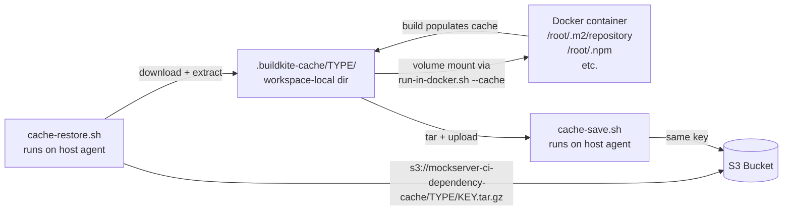

### How It Works

1. **Cache restore** (pipeline step, `soft_fail: true`): `cache-restore.sh <type>` computes a SHA-256 key from the relevant lockfiles, downloads `s3://mockserver-ci-dependency-cache/<type>/<key>.tar.gz`, and extracts it into `$BUILDKITE_BUILD_CHECKOUT_PATH/.buildkite-cache/<type>/`. If anything fails, it exits 0.

2. **Build** (existing step): `run-in-docker.sh --cache <type>` volume-mounts the workspace-local cache directory into the Docker container at the tool's default cache path (e.g., `/root/.m2/repository` for Maven, `/root/.npm` for npm). If the directory is empty (cache miss), the build starts with a cold cache -- no different from before caching was enabled.

3. **Cache save** (pipeline step, `soft_fail: true`): `cache-save.sh <type>` tars the populated cache directory and uploads it to S3 with the same key. If the key already exists in S3 (cache hit on a previous build), the upload is skipped.

### Container Image Pre-Pull

The Docker-gated Java steps that start third-party images — `:cloud: cloud blob-store contract tests`,
`:envelope: asyncapi live-broker tests` and `:elephant: binary proxy real-PostgreSQL test` — pre-pull their Testcontainers backing images via
`.buildkite/scripts/lib/pre-pull-images.sh` before Maven runs.

The reason is failure attribution, not speed. When MinIO moved to `quay.io` (Docker Hub stopped
serving `minio/minio`) the pulls began stalling from the agents, and Testcontainers surfaced it
about five minutes later as an opaque `ContainerFetchException` inside the suite. Pulling first
means a registry problem fails the step in seconds, naming the image and the registry. MinIO later
gated the quay.io repository too, which is why the S3 suite now uses the `adobe/s3mock` emulator - the
same shape as the GCS and Azure suites, which always used emulators.

| Step | Images |
|------|--------|
| cloud blob-store | `adobe/s3mock`, `fsouza/fake-gcs-server`, `mcr.microsoft.com/azure-storage/azurite` |
| asyncapi live-broker | `confluentinc/cp-kafka`, `rabbitmq`, `eclipse-mosquitto` |
| binary proxy real-PostgreSQL | `postgres` |

The image names and tags are **no longer duplicated**. They live once, in
`mockserver/mockserver-testing/src/main/resources/org/mockserver/test/test-container-images.properties`,
read both by the suites (via `org.mockserver.test.TestContainerImages`) and by the pre-pull call
sites (via `.buildkite/scripts/lib/test-images.sh`), so the pre-pull list and the `*_IMAGE`
constants can no longer drift. To bump a tag or add a backing image, edit that one file.
Testcontainers' Ryuk image is deliberately excluded — its tag is coupled to the Testcontainers
version and would drift.

The retry covers `docker pull` only. It must never be widened to wrap Maven: these steps exist
partly to assert the suites actually ran, and a retry around the test invocation would turn a real
failure green. An image already present locally is skipped rather than re-pulled, which mirrors
Testcontainers' own pull-if-absent policy and keeps a registry outage from failing a build that
would otherwise have run off the cache. On pull-request builds the pre-pull is skipped, matching
`run-in-docker.sh`, which also `exit 0`s socket steps on PRs.

### ECR Pull-Through Cache (durable fix)

The pre-pull makes a registry outage fail fast and clearly, but a cold scale-to-zero agent still
depends on quay.io, Docker Hub and mcr.microsoft.com being reachable and un-throttled — that is what
failed the cloud step 2 of 3 builds. The durable fix is a regional **ECR pull-through cache** in the
`mockserver-build` account (`terraform/buildkite-agents/ecr-pull-through-cache.tf`): CI pulls
in-region from ECR, and ECR contacts each upstream only on a first cache miss.

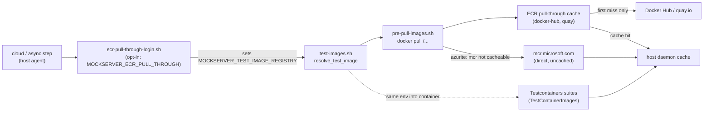

**Image indirection (why, and how it stays off by default).** Both the pre-pull and the suites
resolve image names through an optional registry prefix, `MOCKSERVER_TEST_IMAGE_REGISTRY`:

- **Unset** (the default — local developers, and forks that have no ECR access): the public names
  are used verbatim, so those environments are completely unaffected.
- **Set** to the account's ECR host: names are rewritten to the pull-through cache repositories, e.g.
  `adobe/s3mock` → `<registry>/docker-hub/adobe/s3mock`, `fsouza/fake-gcs-server` →
  `<registry>/docker-hub/fsouza/fake-gcs-server`, and the Docker Hub *official* image `rabbitmq` →
  `<registry>/docker-hub/library/rabbitmq`. **`mcr.microsoft.com/...` (azurite) is the exception: it
  is passed through UNCHANGED** even when the registry is set, because ECR pull-through cache does not
  support `mcr.microsoft.com` as an upstream (see below) — azurite always pulls direct from Microsoft.

The two cached ECR repository prefixes (`docker-hub`, `quay`) — plus the `mcr.microsoft.com`
passthrough — are a contract shared by the Terraform pull-through rules, `resolve_test_image` in
`test-images.sh`, and `TestContainerImages.toEcr` (locked by the Docker-free unit test
`TestContainerImagesTest`, which asserts both the rewrites and the mcr passthrough). Any *other*
unmapped host is rejected, so a new registry cannot be silently mis-cached. The host must reference the
same name the suite will, because Testcontainers' pull-if-absent policy checks the cache by the exact
name it is asked for — so `ecr-pull-through-login.sh` logs the host daemon in to ECR, sets the env var,
and the step passes that same var into the `run-in-docker` container.

`ecr-pull-through-login.sh` is **opt-in and fail-safe**: it does nothing unless
`MOCKSERVER_ECR_PULL_THROUGH=true`, and on any problem (no opt-in, PR build, no `aws`/`docker`, no
credentials, login failure) it leaves the env var unset and the step falls back to the public
registries. This is why the code half of the change is safe to ship *before* the Terraform is applied.

Docker Hub pull-through requires upstream credentials, and ECR requires them in a Secrets Manager
secret whose name begins `ecr-pullthroughcache/` with JSON `{"username","accessToken"}` — the existing
`mockserver-build/dockerhub` secret cannot be reused (wrong name prefix and wrong JSON key), so a
dedicated `ecr-pullthroughcache/dockerhub` secret is provisioned (value set out of band). quay.io is
pulled anonymously and needs no credential.

**`mcr.microsoft.com` is NOT supported by ECR pull-through cache.** Creating the rule fails with
`UnsupportedUpstreamRegistryException` (the supported upstreams are ECR Public, Docker Hub, quay.io,
registry.k8s.io, ghcr.io, GitLab, and Azure ACR — not the public Microsoft container registry). So
**azurite continues to pull direct from `mcr.microsoft.com` and stays dependent on that registry's
availability** — the host pre-pull from `489d6e705` remains its only guard. Only the Docker Hub images
(s3mock, fake-gcs-server, cp-kafka, rabbitmq, eclipse-mosquitto) are actually cacheable; no test image
uses quay.io any more, so the quay pull-through rule is currently unused. See
`docs/infrastructure/aws-infrastructure.md` for the resources and IAM.

### Cache Types and Keys

| Type | Lockfiles hashed | Container mount target |
|------|-----------------|----------------------|
| `maven` | All `pom.xml` files in `mockserver/` | `/root/.m2/repository` |
| `npm` | `package-lock.json` + `package.json` from `mockserver-ui/`, `mockserver-client-node/`, `mockserver-node/` | `/root/.npm` |
| `pip` | `pyproject.toml`, `setup.cfg`, `requirements.txt` from `mockserver-client-python/` | `/root/.cache/pip` |
| `bundler` | `Gemfile` + `Gemfile.lock` from `mockserver-client-ruby/`, `jekyll-www.mock-server.com/` | `/usr/local/bundle/cache` |
| `gradle` | All `gradle-wrapper.properties` files | `/root/.gradle/caches` and `/root/.gradle/wrapper/dists` |

### Fail-Safe Design

The previous caching attempt (reverted) broke builds by writing to `/var/cache` (requires root) and bridging state across ephemeral agents via host volumes. This redesign avoids both problems:

- **No root-owned host paths**: caches live under the workspace checkout directory, which the `buildkite-agent` user always owns
- **No cross-agent state**: each job downloads its own cache from S3; no host-volume bridge between jobs
- **`set -uo pipefail` without `set -e`**: errors are handled inline, never propagated
- **`soft_fail: true`**: pipeline-level safety net -- even if the script somehow exits non-zero, the build continues
- **Credential check up-front**: `aws sts get-caller-identity` is tested before any S3 operation; if it fails, the script bails immediately with exit 0
- **Idempotent keys**: cache key is a pure function of lockfile content; same deps = same key = upload skipped

### Activation

The S3 bucket and IAM policy are defined in `terraform/buildkite-agents/dependency-cache.tf`, and `aws_iam_policy.dependency_cache` is **attached** to the `default` and `release` queues in `main.tf` — see the `managed_policy_arns` lists. The pipelines wire it up with `cache-restore.sh` / `cache-save.sh` steps for the `maven`, `npm`, `pip`, `bundler` and `gradle` cache types. **Caveat — the split restore/build/save-step design currently persists nothing.** Restore, the build steps, and save run as *separate* Buildkite jobs (split by `wait`), and every job's checkout is `git clean -ffxdq`'d before it runs, which deletes the workspace-local `.buildkite-cache/` a build job populated before the save job sees it; consecutive jobs may also run on different ephemeral agents. As directly observed in `mockserver-java` #2217 (`maven`) and `mockserver-editors` #523–#525 (`gradle`), the save steps find nothing to save and the restores 404-miss. The mechanism is common to every cache type, so treat the dependency cache as **not currently persisting** until the save runs in the same job that populates it. The "save ownership" notes below describe the *intended* design, not present behaviour.

> **Note:** the header comment in `dependency-cache.tf` still describes the policy as "DETACHED / reverted" from an earlier iteration; that comment is stale — the policy is attached in `main.tf` today. Treat the `managed_policy_arns` attachments (and live AWS state) as authoritative.

**Save ownership — `gradle` (namespaced by scope).** The `gradle` cache carries a **scope** dimension — a second
positional argument to `cache-restore.sh` / `cache-save.sh` that prefixes the S3 object as
`gradle/<scope>/<key>.tar.gz` instead of `gradle/<key>.tar.gz`. The `<key>` itself is still a pure hash of the
content of **every** `gradle-wrapper.properties` in the checkout (so it rotates on any Gradle version bump and is
otherwise stable), but the scope keeps two pipelines from sharing one object. This exists because the two wrapper
files pin different Gradle versions — the netty integration test uses 8.14, `mockserver-jetbrains` uses 9.5.1 — and
`cache-save.sh` is first-write-wins: without a scope both pipelines computed the same key, so whichever saved first
stored only *its* distribution and left the other re-downloading on every build. Each pipeline now owns exactly one
scope and saves independently: **`mockserver-java` owns `gradle/java`** (saved after the maven reactor's Gradle
integration test) and **`mockserver-editors` owns `gradle/editors`** (saved after the JetBrains steps). `gradle`
therefore **requires** a scope: `cache-restore.sh gradle` with no scope fails closed (soft no-op, never a build
failure) rather than serve a colliding object, and scope must match between restore and save. To add a **third**
gradle consumer, give it its own scope (e.g. `cache-restore.sh gradle <name>` + a matching save) — never reuse
another pipeline's. The other cache types (`maven`/`npm`/`pip`/`bundler`) take no scope and are unchanged.

**Editors gradle cache — currently persists nothing (verified from CI logs).** Two things are true here, and the second overrides the first:

- **The Plugin Verifier's IDEs live *inside* `GRADLE_USER_HOME`, not outside it.** With `ides { recommended() }` the verifier resolves its IDEs as **ordinary Gradle dependencies**, extracted under `~/.gradle/caches` — CI logs (`mockserver-editors` build #525, "JetBrains plugin verify") read every IDE from `/root/.gradle/caches/9.5.1/transforms/<hash>/transformed/idea*-<ver>`. That is exactly the directory `--cache gradle` mounts, so the IDEs sit *on* the cache mount alongside the Gradle **distribution** (`~/.gradle/wrapper/dists`) and the resolved SDK/Kotlin/Gson (`~/.gradle/caches`). `intellijPlatformIdesCacheEnabled` / `intellijPlatformIdesCache` do **not** apply to `recommended()` — redirecting them leaves the redirect dir at 0 B while the IDEs extract to the Gradle cache regardless. `recommended()` currently resolves to **7 IDEs**; a verify downloads ~**4.18 GB** and leaves ~**28 GB** extracted in `~/.gradle/caches` (~10–20 GB compressed).
- **But nothing is ever saved or restored.** `cache-restore.sh gradle editors`, the JetBrains steps, and `cache-save.sh gradle editors` are **three separate Buildkite jobs**. Every job's "Preparing working directory" runs `git clean -ffxdq`, which deletes the workspace-local `.buildkite-cache/` that the previous job populated — and the jobs can also land on **different ephemeral agents** with no shared filesystem. So the save step finds no cache directory and no-ops (`Cache directory ... does not exist -- nothing to save`) and every restore is a 404 miss. Observed run after run in `mockserver-editors` #523–#525 (and identically for `maven` in `mockserver-java` #2217, *even when* restore and save ran on the same instance — `git clean` alone is sufficient to wipe it). The save completes in ~3–5 s: it is **not** hitting the 15-minute timeout, there is simply nothing to tar.

Even if the transport were fixed (e.g. by saving in the same job that populates the cache), two further problems would keep it ineffective or stale: (1) the ~28 GB payload (~10–20 GB compressed) against the **15-minute** `cache-save.sh gradle editors` timeout, which is `soft_fail` and would no-op *silently* on a timeout; and (2) the cache **key** hashes only `gradle-wrapper.properties`, while `recommended()` drifts to newer EAP IDEs every few weeks — and `cache-save.sh` is **first-write-wins** (`head-object` then skip), so even a working cache would freeze at the first-saved IDE set and go stale. Whether to pin the IDE set (which trades away automatic EAP coverage) is a separate decision.

**Save ownership.** The `maven` cache is *saved* only by the `mockserver-java` and `mockserver-maven-plugin` pipelines (they build the full reactor, so their `~/.m2` is the canonical superset). The `python`, `ruby`, `node` and `ui` pipelines restore the `maven` cache **read-only** — they build only a jar subset, so letting them save would risk overwriting the full cache with a partial one under the same key.

Until the IAM policy is re-attached, the cache scripts will detect missing credentials and no-op gracefully. No pipeline will break.

## Local CI Simulation

To run the Buildkite build locally:

```bash
# Using the same Docker image as CI
scripts/local_buildkite_build.sh

# Or directly
docker run -v $(pwd):/build/mockserver \
  -w /build/mockserver \
  -a stdout -a stderr \
  mockserver/mockserver:maven \
  /build/mockserver/scripts/buildkite_quick_build.sh
```
