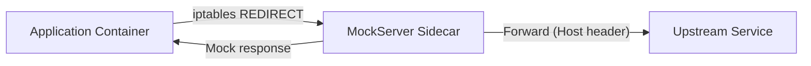

# Transparent Proxy / Sidecar Mode

MockServer can run as a Kubernetes sidecar proxy with transparent HTTP interception. This enables service mesh integration patterns where MockServer intercepts traffic destined for external services.

## Architecture



## Transparent Proxy Mode

When `transparentProxyEnabled=true`, MockServer treats all incoming HTTP connections as proxy requests. Instead of requiring clients to send explicit HTTP CONNECT requests, it uses the `Host` header to determine the forwarding target.

This works with Linux iptables REDIRECT rules that redirect outbound traffic to MockServer's port, making the interception transparent to the application.

### How it works

1. iptables redirects outbound traffic from the application container to MockServer's port
2. MockServer resolves the original destination:
   - **On Linux**: reads the original destination from the kernel conntrack table (`/proc/net/nf_conntrack`) which records the pre-REDIRECT destination. This is the most accurate method and works even when the Host header is missing, wrong, or the request is non-HTTP (binary).
   - **Fallback**: if conntrack is unavailable (non-Linux OS, `nf_conntrack` module not loaded, or the entry has been flushed), MockServer falls back to the `Host` header from the incoming request.
3. If an expectation matches, MockServer returns the mock response
4. Otherwise, MockServer forwards the request to the original target

**CONNECT and SOCKS on an intercepted connection.** A client that sends a CONNECT (or SOCKS) request on an intercepted connection, for example one with `HTTPS_PROXY` pointing at the port the traffic is redirected to, gets a tunnel to MockServer itself, as on any other connection: the original destination (from the resolver chain, a PROXY protocol header or `proxyRemoteHost`) is not used for the tunnel. The requests inside it are matched against expectations and, when none matches, forwarded to the host and port the CONNECT names. (Only MockServer answers the `PROXIED_` preamble that opens a tunnel's loopback leg, so the tunnel cannot go to any other destination.) Requests that are not tunnelled are unchanged: unmatched ones still go to the original destination.

### Configuration

| Property | Default | Description |
|----------|---------|-------------|
| `transparentProxyEnabled` | `false` | Enable transparent proxy mode |
| `proxyProtocolTrustedSources` | `""` (any source) | Startup-only. Comma-separated IP addresses and CIDR blocks (IPv4 or IPv6) a PROXY protocol v1/v2 header is accepted from, normally the load balancer that adds it. List only the load balancer, never a range clients connect from: the check is the connection's TCP peer, which is the end client behind a client-IP-preserving load balancer (AWS NLB instance targets, `externalTrafficPolicy: Local`), and in sidecar REDIRECT mode trusting `127.0.0.1` or the pod IP trusts every process in the pod. A connection from any other source that starts with a PROXY header is closed, as HAProxy does when a header arrives from a source its ACL does not allow; connections without a header are unaffected. Entries with host bits set, `/0`, a block covering every IPv4 address, a zone ID, a leading-zero octet or the `::a.b.c.d` spelling refuse the start (each entry is checked on its own), and the accepted ranges are logged at startup. Environment variable: `MOCKSERVER_PROXY_PROTOCOL_TRUSTED_SOURCES` |

Environment variable: `MOCKSERVER_TRANSPARENT_PROXY_ENABLED`

### iptables example (init container)

The UID-based RETURN rule **must come before** any REDIRECT rules to prevent an infinite redirect loop: when MockServer forwards a request upstream, its own outgoing packet would otherwise match the REDIRECT and loop back to itself.

```yaml
initContainers:
  - name: iptables-init
    image: alpine:3.19
    securityContext:
      capabilities:
        add: ["NET_ADMIN"]
    command:
      - sh
      - -c
      - |
        # RETURN first — exclude MockServer's own egress (UID 65534) to prevent redirect loop
        iptables -t nat -I OUTPUT -m owner --uid-owner 65534 -j RETURN
        iptables -t nat -A OUTPUT -p tcp --dport 80 -j REDIRECT --to-port 1080
        iptables -t nat -A OUTPUT -p tcp --dport 443 -j REDIRECT --to-port 1080
```

The `excludeUid` must match `app.runAsUser` (default 65534). The Helm chart configures this via `sidecar.iptables.excludeUid`.

## Helm Chart

The Helm chart includes sidecar configuration under the `sidecar` key:

```yaml
sidecar:
  enabled: false
  transparentProxy: false
  iptables:
    enabled: false
    excludeUid: 65534   # must match app.runAsUser to prevent redirect loop
```

When `sidecar.transparentProxy` is true, the `MOCKSERVER_TRANSPARENT_PROXY_ENABLED` environment variable is set in the deployment.

### Automatic Sidecar Injection (Admission Webhook)

When `webhook.enabled=true`, the chart deploys a MutatingAdmissionWebhook that automatically injects the MockServer sidecar and iptables init container into pods. This removes the need to manually edit every Deployment. See [helm.md](helm.md) for full details.

The webhook Docker image (`mockserver/mockserver-webhook`) is published to Docker Hub and ECR Public by the release pipeline alongside the main MockServer image. Install with the webhook enabled:

```bash
helm install mockserver mockserver/mockserver \
  --set webhook.enabled=true
kubectl label namespace my-namespace mockserver.org/sidecar-injection=enabled
# Annotate pods: mockserver.org/inject: "true"
```

**Building locally (optional, for development):**

```bash
# Build the fat jar and Docker image
cd mockserver && ./mvnw package -pl mockserver-k8s-webhook -DskipTests && cd ..
cp mockserver/mockserver-k8s-webhook/target/mockserver-k8s-webhook-*-jar-with-dependencies.jar \
  docker/webhook/mockserver-webhook.jar
docker build -t mockserver/mockserver-webhook:6.1.1-SNAPSHOT docker/webhook
```

## Implementation

| Component | Location |
|-----------|----------|
| Configuration properties | `Configuration.java`, `ConfigurationProperties.java` |
| Transparent proxy logic | `mockserver-netty/src/main/java/org/mockserver/netty/proxy/TransparentProxyInitializer.java` |
| Composite resolver chain | `mockserver-netty/src/main/java/org/mockserver/netty/proxy/CompositeOriginalDestinationResolver.java` |
| TPROXY resolver (local address) | `mockserver-netty/src/main/java/org/mockserver/netty/proxy/TproxyOriginalDestinationResolver.java` |
| eBPF resolver | `mockserver-netty/src/main/java/org/mockserver/netty/proxy/EbpfOriginalDestinationResolver.java` |
| SO_ORIGINAL_DST resolver (JNA) | `mockserver-netty/src/main/java/org/mockserver/netty/proxy/SoOriginalDstResolver.java` |
| Conntrack resolver (fallback) | `mockserver-netty/src/main/java/org/mockserver/netty/proxy/ConntrackOriginalDestinationResolver.java` |
| Conntrack table helper | `mockserver-netty/src/main/java/org/mockserver/netty/proxy/SoOriginalDstHelper.java` |
| DNS intent resolver | `mockserver-netty/src/main/java/org/mockserver/netty/proxy/DnsIntentOriginalDestinationResolver.java` |
| Pipeline handler (sets REMOTE_SOCKET) | `mockserver-netty/src/main/java/org/mockserver/netty/proxy/TransparentProxyHandler.java` |
| Webhook HTTPS server | `mockserver-k8s-webhook/.../webhook/WebhookServer.java` |
| Admission webhook handler | `mockserver-k8s-webhook/.../webhook/AdmissionReviewHandler.java` |
| JSONPatch builder | `mockserver-k8s-webhook/.../webhook/SidecarPatchBuilder.java` |
| Injection config | `mockserver-k8s-webhook/.../webhook/SidecarInjectionConfig.java` |
| Webhook Dockerfile | `docker/webhook/Dockerfile` |
| Helm values | `helm/mockserver/values.yaml` |
| Helm deployment | `helm/mockserver/templates/deployment.yaml` |
| Helm webhook templates | `helm/mockserver/templates/webhook-*.yaml` |

## Original-Destination Resolution

MockServer resolves the original destination of intercepted connections through a composite chain (`CompositeOriginalDestinationResolver`). Each resolver is tried in order; the first non-null result wins.

### Resolver Chain

| Priority | Resolver | Strategy | Requirements |
|----------|----------|----------|--------------|
| 1 | `TproxyOriginalDestinationResolver` | Reads `channel.localAddress()` — with TPROXY iptables rules, this IS the original destination | `transparentProxyTproxy=true`, `CAP_NET_ADMIN`, Netty epoll |
| 2 | `EbpfOriginalDestinationResolver` | eBPF map lookup | `transparentProxyEbpf=true` |
| 3 | `SoOriginalDstResolver` | O(1) `getsockopt(SO_ORIGINAL_DST)` via JNA (no JNI) | Linux, Netty epoll (`EpollSocketChannel`), JNA native loadable |
| 4 | `ConntrackOriginalDestinationResolver` | O(n) parse of `/proc/net/nf_conntrack` | Linux, `nf_conntrack` module loaded, file readable |
| 5 | `DnsIntentOriginalDestinationResolver` | Infers destination from DNS query history | Fallback when all above return null |

The default chain for REDIRECT-based transparent proxy is: **SO_ORIGINAL_DST → conntrack → dns-intent**. When `transparentProxyTproxy=true`, TPROXY is prepended as the first resolver.

### SO_ORIGINAL_DST (Primary Path)

`SoOriginalDstResolver` calls `getsockopt(fd, SOL_IP, SO_ORIGINAL_DST, ...)` via JNA — not JNI. JNA loads the C library dynamically at runtime, so no compile-time native code is needed. The resolver is an O(1) socket-option read and returns null (never throws) on unsupported platforms (non-Linux, NIO transport, JNA unavailable), allowing the chain to fall through.

Requirements:
- Linux OS
- Netty epoll transport (`EpollSocketChannel`) — the NIO transport does not expose a raw file descriptor
- JNA loadable at runtime (`com.sun.jna.Native`) — JNA must be **unrelocated**: `libjnidispatch` binds its JNI entry points to the `com.sun.jna` class names, so relocated JNA cannot initialise

Where JNA loads:

| Artifact | JNA | SO_ORIGINAL_DST / eBPF lookups |
|---|---|---|
| `mockserver/mockserver` images (`-graaljs`, `-clustered`, `-aot`, `-http3`) | unrelocated (built from the build-internal `mockserver-netty-docker` jar) | work on epoll |
| `mockserver-netty` jar-with-dependencies, the unshaded module | unrelocated | work on epoll |
| `mockserver-netty-no-dependencies` (library jar on Maven Central) | relocated to `shaded_package.com.sun.jna`, so it cannot clash with an embedding app's own JNA (Testcontainers, docker-java) | fall back to conntrack |

### Conntrack (Fallback)

`ConntrackOriginalDestinationResolver` parses `/proc/net/nf_conntrack` to find the pre-`iptables -j REDIRECT` destination. This is O(n) per connection (n = tracked connections), capped at 200,000 lines to bound CPU cost. If the table exceeds the cap or `nf_conntrack` is unavailable, the resolver returns null and the chain continues to dns-intent.

### TPROXY Mode

With `transparentProxyTproxy=true`, iptables uses `-j TPROXY` instead of `-j REDIRECT`. The kernel preserves the original destination as the socket's local address, so resolution is trivial (`channel.localAddress()` returns it directly). No conntrack lookup or `getsockopt` is needed.

### Testing

- Unit tests for all resolvers run cross-platform (macOS/Linux/Windows)
- `SoOriginalDstResolverTest` verifies sockaddr decoding and platform-support gating
- `TproxyOriginalDestinationResolverTest` verifies TPROXY mode flag and local-address extraction
- `CompositeOriginalDestinationResolverTest` verifies chain ordering and null fall-through
- `SoOriginalDstEndToEndIntegrationTest`, `TproxyEndToEndIntegrationTest` and `EbpfOriginalDestinationEndToEndIntegrationTest` are the privileged end-to-end suites. They spin up a sibling Linux container via the Docker CLI (not Testcontainers) with `--cap-add=NET_ADMIN` (SO_ORIGINAL_DST / TPROXY) or `--privileged` (eBPF), plus `--userns=host` so a user-namespace-remapped daemon accepts them, to set up iptables/BPF rules. They are Docker-gated via `DockerCliTestSupport.isDockerAvailable()` (a `docker info` probe), and additionally SKIP cleanly when the kernel lacks the required module (`xt_TPROXY`/BPF) or when the daemon refuses to start the privileged container (`DockerCliTestSupport.containerStartRejected(...)` — e.g. a user-namespace-remapped daemon rejecting `--privileged`).
- `EbpfOriginalDestinationEndToEndIntegrationTest` proves the eBPF resolver itself answered, not a fallback. It freezes the proxy JVM with `SIGSTOP` so the REDIRECTed client connection waits in the accept queue, reads that socket's cookie from `ss -e` (`sk:`, the value `SO_COOKIE` returns), writes a map entry for it naming an upstream that only the map knows, and resumes the proxy. It then asserts that the request reached that upstream and that the resolver deleted the entry. A control request with no map entry runs first and must not reach the upstream: there SO_ORIGINAL_DST resolves the REDIRECTed address, where nothing listens for the proxy's own connection.
- **CI collection:** these three suites are named `*EndToEndIntegrationTest` so Maven Failsafe (`**/*IntegrationTest.java`) collects them. Prior to this they were named `*EndToEndIT`, which matches neither Surefire (`**/*Test.java`) nor Failsafe, so they were never executed on any build. The `:shield: transparent-proxy e2e tests` Buildkite step runs all three on the `default` queue on trusted branch builds (the Docker socket is withheld from PR builds) and fails if any of them skipped. See `docs/infrastructure/ci-cd.md` (transparent-proxy end-to-end step).
- `.buildkite/scripts/steps/docker-transparent-proxy-verify.sh <image>` proves a built image end to end: in the image's own JVM both JNA-based resolvers report platform support, and an iptables-REDIRECTed request sent with a deliberately wrong `Host` header still reaches its original destination. TPROXY and eBPF are off and the script fails unless conntrack is unreadable to MockServer, so only `SO_ORIGINAL_DST` can have found it. The iptables/curl and origin sidecars share the MockServer container's network namespace, since the image is distroless. It needs `NET_ADMIN`, so it is run locally, not in CI. Setting the `mockserver.e2e.jar` system property points the three Java suites above at another jar, such as the `mockserver-netty-docker` jar.
- The `TransparentProxyHandler` is tested with an `EmbeddedChannel` to verify `REMOTE_SOCKET` attribute setting and graceful fallback

## Limitations

- **SO_ORIGINAL_DST requires Linux + epoll**: On macOS or Windows, or with NIO transport, the resolver returns null and conntrack (also Linux-only) is tried next. Both fall through to dns-intent on non-Linux hosts.
- **The `mockserver-netty-no-dependencies` library jar falls back to conntrack**: it relocates JNA so that it can sit next to an embedding app's own JNA, so the SO_ORIGINAL_DST and eBPF lookups cannot run from it even on epoll. The published images do not have this limitation: they are built from the `mockserver-netty-docker` jar, which carries JNA unrelocated (see [docker.md](docker.md)).
- **Conntrack lookup is O(n) with a cap**: The `/proc/net/nf_conntrack` scan is capped at 200,000 lines. If the table exceeds this, MockServer falls back to Host-header resolution via dns-intent.
- **iptables required without the webhook**: Without the admission webhook, an init container or external mechanism must configure traffic redirection. With the webhook enabled, iptables rules are injected automatically into opted-in pods.
