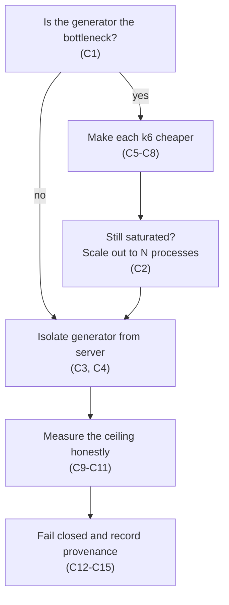

# k6 Load-Testing Lessons: A Transferable Guide

What MockServer's performance work taught us about running k6 efficiently and
measuring honestly, written so another team can apply it to their own project.
Each lesson gives the evidence from this repo (a commit, a doc section or a CI
build number), how to apply it elsewhere, and any precondition. Lessons marked
**G** are general practice; values marked **M** are specific to MockServer's rig
and should not be copied blindly.

For MockServer's own measurement reference see
[performance-measurement.md](../code/performance-measurement.md); for the
optimisation process see the
[Performance Optimisation Playbook](performance-optimisation-playbook.md) and the
project-agnostic [AI-Assisted Optimisation Guide](ai-assisted-optimisation-guide.md).

## TL;DR

1. **The load generator ran out of capacity before the server did.** One k6
   process spent about 4x MockServer's CPU per request, so the top of the
   ladder measured k6. Four independent k6 processes, merged through Prometheus
   native histograms, raised the measured ceiling 4x.
2. **k6 itself can be made much cheaper.** The changes were: `gracefulStop` no
   longer than the gap between stages, a raised `GOGC` paired with a sized
   `GOMEMLIMIT`, a lean summary, and k6 pinned to its own physical cores or
   socket. Together they took k6 from 311 to 240 µs per request, and its GC
   from 55–60% to about 10% of a CPU.
3. **The last p99 tail was k6's own garbage collection, not the server.**
   94–98% of requests slower than 5 ms fell inside k6 GC seconds.
4. **The most transferable lessons are about method.** Prove the rig is valid
   on every rung. Stop the ceiling at the first failed rung. Compare A/B on one
   machine. Fail closed when a check cannot run. Always ask what a number is a
   measurement *of*.

## How the lessons fit together

## 1. Generator capacity and isolation

| # | Lesson | Evidence | How to apply elsewhere | Precondition |
|---|---|---|---|---|
| C1 (G) | **Assume the load generator saturates first, and prove it does not on every rung.** | One k6 cost ~4x the server's CPU per request (`3d5f8096f`). A published 41k headline once came from a rung the run itself had excluded as client-limited; the valid peak was 23.8k. | Per rung, gate on: generator mean CPU under 85% of its pin, dropped iterations under 1%, VU occupancy under 0.80, and server headroom. Record why each rung is excluded (`34ecab6ba`, `120407b1c`). | An open-model executor (`constant-arrival-rate`), so a slow server shows up as dropped iterations, not as a lower offered rate. |
| C2 (G) | **Scale out with independent generators, and merge histograms, not percentiles.** | N=4 processes gave a 4x ceiling. 8 processes on the same cores was worse: 289 → 316 µs per request, and p99 at 44k rose from 4.8 to 16.4 ms (build 535). | Start all processes at a shared wall-clock instant (we saw 0–9 ms skew). Give each 1/N of the rate. Merge with `histogram_quantile` over summed histograms. Check that request counts add up exactly. | Mergeable metrics, such as Prometheus native histograms. k6's trend-stats gauges cannot be merged. |
| C3 (G) | **Isolate with cpusets, never with CPU quotas.** | A `--cpus 2` CFS quota made a clustered A/B's p95 ratio 3.43 against a true 1.34 (`7be02b4aa`). | Give the generator and the server physically disjoint cores. Make it hyperthread-aware: a sibling thread is worth about a quarter of a core. Record cgroup throttling counters. | None. |
| C4 (G\*) | **On multi-socket hosts, give the generator its own socket and bind its memory.** | Counting cores alone silently put k6 beside the server on a 2-node host (`6857d6f42`, `4a15ee97d`). With a socket of its own, k6 ran at 62% of its ceiling at 128k req/s (build 595). | `--cpuset-cpus` plus `--cpuset-mems`, derived from the host's NUMA topology. Record the placement as observed (`docker inspect`), not as intended. | \*Only matters on multi-socket or SNC hosts. On one NUMA node it does nothing. |

## 2. k6 runtime (Go) tuning

| # | Lesson | Evidence | How to apply elsewhere | Precondition |
|---|---|---|---|---|
| C5 (G) | **k6 memory is VU runtimes × stage overlap, plus Trend storage.** | Each VU costs ~290 KB. A 30 s `gracefulStop` overlapping stages started 6,016 VUs per process for a 2,048 pool; matching it to the gap cut the init heap from 1.75 GB to 0.61 GB ([performance-measurement.md](../code/performance-measurement.md)). Trends cost ~72 B per request. | Set `gracefulStop` ≤ the gap between stages, and `preAllocatedVUs == maxVUs`. Size the pool by Little's law (rate × latency × margin). Profile with `--profiling-enabled`. | **Caveat:** a short `gracefulStop` drops in-flight iterations, and those appear in no metric. Parse k6's progress line for "interrupted" and fail on it. |
| C6 (G) | **Raise `GOGC`, and always pair it with `GOMEMLIMIT`.** | k6 GC fell from 55–60% to about 10% of a CPU (builds 552 vs 553; `9938b1094`). Raising `GOGC` did nothing while the 6k-VU heap was large; it only pays once the live heap is small. | Try `GOGC` at 400–1600. Size `GOMEMLIMIT` to the memory the process can actually reach (its NUMA node or the Docker VM, not the host's total). Never use `GOGC=off` without a limit: one run's heaps reached ~113 GiB (build 605). | It trades memory for CPU, so you need memory headroom. |
| C7 (G) | **Rule out the generator's own GC before blaming the server for tail latency.** | 94–98% of requests over 5 ms fell inside k6 GC seconds, and the 4 processes collected in phase (`8097a5cc2`). | Run k6 with `GODEBUG=gctrace=1`, and compare client-side latency with the server's own server-side histogram. Report a GC-masked p99 beside the raw p99. | Any Go-based generator. The same idea applies to JVM-based generators. |
| C8 (G) | **Measurement features cost CPU, so cost each one.** | Full summary vs lean: 143 vs 127 µs per request. Per-iteration diagnostics cost ~17 µs. Prometheus remote write costs 5–9 µs, and a 1 s push costs about the same as 5 s. | Measure each feature's µs per request and keep only what a gate needs. Avoid high-cardinality tags: we replaced a per-window tag with wall-clock windows. | None. |

## 3. Measurement method

| # | Lesson | Evidence | How to apply elsewhere |
|---|---|---|---|
| C9 (G) | **The ceiling is the highest healthy rung *below the first failed rung*.** | A healthy rung after a failure produced a false 152k (`d6aa87f03`). Coarse steps under-reported by about a third: 32k reported vs 47k served (`9aab5d963`). | Stop at the first failure. Use fine steps near the knee. Give the ceiling a latency bound (for example p99 ≤ 10 ms), not just a throughput figure. |
| C10 (G) | **Compare like with like.** | VM-to-VM variance of a few percent swamped small effects. 1 vs 4 processes at the same aggregate rate differed 1.2–2x in p50, a regime effect rather than noise (`10ea78e4c`). | Run both A/B arms on one machine, paired and alternated, and use the median of per-pair ratios. Match the per-process rate, not just the total. |
| C11 (G) | **Ask what a number is a measurement *of*.** | Offered rate is not capacity: a handshake rate fixed at 50/s can never move. The first `docker stats` sample is cold (it read 1183% CPU). | Use the mean, not the worst sample, and discard warm-up samples. Deliberately degrade the subject and confirm the number moves (see [optimisation-safety.md](../code/optimisation-safety.md)). |
| C12 (G) | **Fail closed, with preflight checks.** | DNS labels over 63 characters broke Docker DNS and Go resolvers (`ee589d86f`). A daily compare once passed because its history could not be read (`18aff025d`). | Preflight the metrics pipeline. Detect slow flushes, and wait a quiet tail longer than 2 push intervals. Abort if the server dies. Fail when a baseline is missing instead of passing. |
| C13 (G) | **Soak tests need gates derived from repeated runs.** | Absolute soak gates set from one run were noise. GC was ruled out cheaply (longest pause 0.098 ms), and early-window spikes were recorded as open findings ([playbook](performance-optimisation-playbook.md)). | Derive thresholds from N repeats. Keep heavy control-plane calls off the gated arm. Track drift, not just absolute values. |
| C14 (G) | **Keep instrument overhead low.** | 10 Hz receive-queue sampling with forked `awk` could not keep up (55 ms per read of a 12.8k-socket table). One long-lived Python sampler took ~6 ms (`1263240e1`). | Use one long-lived sampler process, and have it report its own overruns and CPU use. |
| C15 (G) | **Record provenance, and check runs really happened.** | Setting any cpuset env, even to its default value, made a run ineligible to compare. Leaked `PERF_*`/`K6_*` env broke lint (builds 605/606). Buildkite's skip-intermediate-builds silently killed queued perf runs. | Record observed placement and runtime env in each result. Isolate tests from ambient env. Check that scheduled or queued runs actually ran. Keep perf hosts scale-to-zero and on demand, because they are expensive. |

## 4. Specific to MockServer's rig (M)

These values came from MockServer's hardware and latency. The method behind
each one transfers; the numbers do not.

- The c5.12xlarge core split (6 cores for the server, 1 for the upstream, 1 for
  Prometheus, 16 for k6) and the 17-core single client. 13 cores achieved 92.1%
  of a 48k target and 17 achieved 98.4%.
- A VU pool of 0.08 × rate, derived from MockServer's latency. Size yours by
  Little's law.
- The 10 ms p99 ceiling bound, the 8,000 req/s per-process cross-run floor, and
  the 24k/40k cross-check caps.
- INFO-level event-log heap behaviour and the soak's event-log retrieve arm.

## 5. Starter checklist for another project

1. Use the `constant-arrival-rate` executor with `preAllocatedVUs == maxVUs`,
   and set `gracefulStop` ≤ the gap between stages.
2. Pin the generator and the server to disjoint physical cores with cpusets,
   never `--cpus`. On a multi-socket host, give the generator its own socket.
3. Set `GOGC` to 400–1600, with `GOMEMLIMIT` at about 50% of the memory k6 can
   reach.
4. Use `discardResponseBodies: true` unless you read bodies, and set
   `responseType: 'text'` only on the requests that do.
5. Trim `systemTags` to the tags you use. At high rates, avoid a per-request
   `check()` in the hot path (`http_req_failed` already covers status codes).
6. Set `summaryTrendStats` to just the percentiles you gate on. For long runs,
   stream metrics out (Prometheus remote write with native histograms) rather
   than holding Trends in memory.
7. Set `K6_NO_USAGE_REPORT=true` in CI.
8. Gate each rung on generator health (CPU, dropped and interrupted iterations,
   VU occupancy), and stop the ceiling at the first failed rung.
9. Past one process's capacity, scale out to N k6 processes merged by
   histogram, and test N, because more processes is not always better.
10. Record GC traces from the generator, and compare client-side latency with
    the server's own histogram.

## Appendix: open improvements in MockServer's own perf suite

Ranked by expected benefit. Not yet done; each needs a trial run before adoption.

1. **The single-k6 daily sweep runs on k6 defaults**: no `GOGC`, no
   `GOMEMLIMIT`, and a 30 s `gracefulStop` (`.buildkite/scripts/steps/perf-test-run.sh`).
   Expect about 10–20% less k6 CPU per request and fewer GC-tail stalls. It is
   kept on defaults deliberately, so adopting this means a trial arm and a
   baseline re-seed.
2. **`check()` runs on every sweep request.** Removing it should save a few µs
   per request; unmeasured.
3. **`systemTags` are not trimmed.** Each sample carries about 14 default tags.
4. **Two k6 pins disagree.** The CI perf scripts pin `grafana/k6` 1.7.1, while
   Dependabot has moved `docker_build/performance/Dockerfile` to 2.4.0, although
   its comment says it matches the version the suite is validated against.
   Either measure 2.x on the rig, re-validating the interrupted-iteration
   parser, or keep the Dockerfile on the validated version.
5. **`discardResponseBodies` is set in only two scripts.** Making it the
   default, with bodies kept only where identity checks read them, would help
   the large-file regression arm most.
6. **The soak and load runs leave k6 unpinned.** Pinning would reduce
   interference and noise.
7. **The 2-hour soak keeps Trend samples in memory**, with per-window
   submetrics. Streaming them out, or trimming `summaryTrendStats`, would bound
   that memory.
8. **Hygiene:** set `K6_NO_USAGE_REPORT=true`, and add `steady.js` to the
   `k6 inspect` lint.

Considered and rejected: `--compatibility-mode=base` (affects init time only),
`noVUConnectionReuse` and `batch` (would change what is measured), and
`K6_WEB_DASHBOARD` (adds cost).
