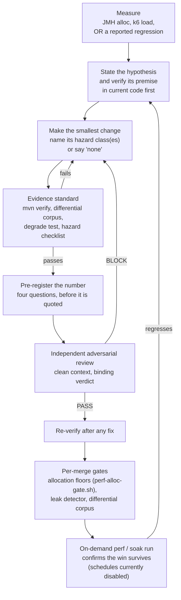

# Performance Optimisation Playbook

**This is a process document, not a reference.** It describes *how* MockServer's CPU, memory and
GC optimisation work gets done — the loop, the evidence standard, the toolkit, and the mistakes
that recur — so another team can copy the method, not just the numbers. For the numbers and the
mechanics of each gate, follow the links out to the reference docs; this page does not repeat
them.

## TL;DR

- **A faster benchmark is motivation, never verification.** Every optimisation change must also
  pass a functional/behavioural evidence standard — `mvn verify` (not `mvn test`), a byte-for-byte
  differential corpus against the old path, and a deliberately-broken "degrade" run that proves the
  correctness test can actually fail. See [optimisation-safety.md](../code/optimisation-safety.md).
- **Never regress the small/common case to speed up the large/rare one.** A fast-path threshold —
  where a cache kicks in, where a code path branches — is chosen empirically from the JMH
  break-even point, and every change is benchmarked at both tiny-N and large-N before it ships. See
  [performance-tuning.md § Optimization principles](../operations/performance-tuning.md#optimization-principles).
- **Every unit gets an independent adversarial review with a binding PASS/BLOCK verdict**, from a
  freshly spawned reviewer agent with clean context that did not write the change, plus a fresh
  re-verify after any review-driven fix. The repo runs two agent harnesses on different model
  families (Anthropic under Claude Code, OpenAI under opencode), so cross-provider review is
  available, but a given unit is not guaranteed one.
- **A number is not believed until it answers four questions**: what is it a number *of*, what
  would make it lie, does degrading the subject move it, and is this the regime you care about.
  This checklist has a documented hit rate against real measurement failures in this programme.
- **The toolkit is boring on purpose**: JMH micro-benchmarks with the `gc` profiler for
  allocation, k6 for end-to-end load, a 2-hour soak for drift, and — when something needs
  explaining — JFR, `jcmd`, GC logs, thread dumps and **heap dumps**, which have found several real
  defects here (below). Async-profiler, flame graphs and core dumps have not been needed yet — see
  [Techniques available but not used here](#techniques-available-but-not-used-here).
- **A disabled feature should cost nothing — this is a standing rule enforced by review, not an
  automated gate**, and it has a known gap: `forwardCredentialHeadersByHost`'s field on the shared
  request class (below) slipped through exactly because nobody proved the disabled path cost
  nothing before it merged.

## Context and Terms

Every change described here — performance or otherwise — goes through the same review mechanism:
an independent adversarial review with a binding PASS/BLOCK verdict, from a freshly spawned
reviewer agent with clean context that did not write the change, plus a fresh re-verify after any
review-driven fix. The repo runs two agent harnesses on different model families (Anthropic under
Claude Code, OpenAI under opencode), so cross-provider review is available, but a given unit is not
guaranteed one. That review is what "PASS" and "BLOCK" mean throughout this page.

A few terms recur below, defined once here rather than inline:

- **Control plane vs. data plane.** The data plane serves an actual mocked HTTP response — the
  path exercised millions of times. The control plane is everything around it: configuring
  expectations, clearing state, verifying calls — what a test suite touches between requests, not
  during them.
- **`[perf-run]` / `[perf-soak]`.** The k6 + JMH regression suite and the 2-hour soak are started
  by creating a Buildkite build whose message contains that tag (see
  [Measurement Toolkit](#measurement-toolkit) — the automatic schedules that once triggered them
  are currently off).
- **Rung / ladder / knee.** A k6 load test sweeps a "ladder" of request rates ("rungs") looking for
  the throughput ceiling (the "knee") where latency starts climbing.
- **Backlog row.** Open performance-measurement work is tracked as numbered rows in
  [performance-measurement-backlog.md](../plans/performance-measurement-backlog.md) — a "row" is
  one open or recently-closed investigation, kept for its evidence trail.
- **A benchmark arm.** One parameterised variant of a JMH or k6 benchmark (one matcher type, one
  body size, one concurrency level).

## The Optimisation Loop

The loop has one asymmetry worth naming: an optimisation arrives carrying its own success signal
(a chart that moved), and that signal tends to end scrutiny early. A correctness fix carries no
such signal and gets scrutinised by default. The entire evidence standard below exists to put the
same scrutiny back onto the thing that looks finished.

## The Process, In Order

| Step | What happens | Where it's enforced |
|---|---|---|
| 1. Verify the premise | Confirm the thing you think is slow/leaky is still true in current code, and name the commits you checked | Judgement, written in the commit message (or PR description, if your team uses PRs) |
| 2. Classify hazards | Name which hazard class(es) the change belongs to (reuse/pooling, caching, ref-counting, laziness, concurrency, topology) — or say "none" | Commit message / PR description |
| 3. Make the change | Smallest change that addresses the verified premise. Recommended, not an enforced requirement: state what the disabled/zero-usage cost is | — |
| 4. Evidence standard | `mvn verify` on the affected module; byte-identical differential corpus old vs new; a degrade test proven to go red | [optimisation-safety.md § Evidence Standard](../code/optimisation-safety.md#the-evidence-standard) |
| 5. Pre-register the number | Four validity questions answered *alongside* the figure, before anyone quotes it | [optimisation-safety.md § Is This Number Measuring What You Think?](../code/optimisation-safety.md#is-this-number-measuring-what-you-think--a-pre-registration-checklist) |
| 6. Adversarial review | An independent reviewer agent, clean context, binding PASS/BLOCK; re-review after any fix. Cross-provider review is available (Anthropic/Claude Code and OpenAI/opencode) but not guaranteed per unit | [ai-assisted-development.md](ai-assisted-development.md) |
| 7. Per-merge gates | Allocation-floor benchmarks (`perf-alloc-gate.sh`, every Java build), leak detection at `paranoid`, the already-pinned differential corpora | [optimisation-safety.md § Where This Plugs Into the Gate Chain](../code/optimisation-safety.md#where-this-plugs-into-the-gate-chain) |
| 8. Post-merge confirmation | An on-demand (or, when the schedule is enabled, daily/weekly) perf or soak run confirms the win survives outside the change's own measurement | [performance-measurement.md](../code/performance-measurement.md) |

## Why This Order, Not a Shorter One

**The data plane wins ties.** When a change trades data-plane cost (serving a mocked response —
what MockServer does millions of times) for control-plane gain (what a test suite touches between
tests), the data plane wins unless the case for the reverse is very compelling, and that case has
to be measured, not asserted. The trade usually hides in a shared structure the control plane wants
indexed and the data plane has to maintain — ask what a change adds to *every mutation*, not just
to the operation it was written to speed up. Full treatment, including a worked example that
judges the repo's own `clear`-fast-path commit (`4cda4041f`) honestly rather than inventing a clean
one: [optimisation-safety.md § The Data Plane Wins Ties](../code/optimisation-safety.md#the-data-plane-wins-ties).

**Hazard classes exist because a benchmark cannot see them.** Six classes — reuse/pooling,
caching, reference counting, laziness/init order, concurrency/pool changes, topology changes — each
evade a benchmark for a structural reason (concurrency needs concurrency to show; a cache is
fastest and most wrong when it never invalidates) and each has occurred in this codebase. The
hazard-class table, the required evidence per class, and a worked topology example (the HTTP/2
multiplex migration, below) are in
[optimisation-safety.md § Hazard Classes](../code/optimisation-safety.md#hazard-classes).

**A performance change that removes waiting is a concurrency change.** Fixed sleeps, poll
granularity and quiet periods routinely pay for races nobody wrote down. Shortening or removing one
is a concurrency change even when it reads as "just a speedup" — see the [event-loop quiet-period
removal](#event-loop-shutdown-sped-up-and-exposed-a-response-truncation-race) worked example below.

**The small/common-vs-large/rare rule exists because a threshold is a bet, and bets should be
measured, not guessed.** A conditional fast path (a cache, an index) that only pays off above some
size needs that break-even point found empirically, in a fine-grained JMH sweep with enough
warm-up, forks and error bars to trust — then both the typical small case and the large case it was
built for are benchmarked, and the change ships only if neither regresses. See
[performance-tuning.md § Optimization principles](../operations/performance-tuning.md#optimization-principles).

## Measurement Toolkit

**Cadence note, read this before the table.** All of this repository's perf schedules — the daily
04:00 UTC regression run, the Saturday `perf-xl` run, the Sunday soak — are currently **disabled**
(`local.perf_schedules_enabled = false` in `terraform/buildkite-pipelines/perf-schedules.tf`;
[performance-measurement.md § Summary](../code/performance-measurement.md)). They ran on that
schedule for most of this programme's history, which is where the daily-run history behind the
derived bands and gates below comes from. Today every run has to be started by hand, from the
Buildkite UI or an API build whose message contains `[perf-run]` or `[perf-soak]`.

| Tool | Measures | Cadence | Gates the build? |
|---|---|---|---|
| Per-merge allocation floors (`perf-alloc-gate.sh`) | `gc.alloc.rate.norm` on nine pinned JMH rows: matching (two `detailedMatchFailures` arms), inbound decode, response write, `processAction`, and four matching-scan-arm rows | Every Java pipeline build (PR and master) | Yes, all nine rows. Five floors (the four scan-arm rows plus `ProcessActionBenchmark`) are set at the highest master-build reading in a derivation window × 1.025; the other four (`MatchingBenchmark`, `MatchingBenchmark_detailed`, `InboundDecodeBenchmark`, `ResponseWriteBenchmark`) are provisional floors set from local measurement |
| JMH micro-benchmarks, on-demand run (`MatchingBenchmark` et al., `-prof gc`) | Allocation bytes/op and time/op at the shipped-default param cell | On-demand `[perf-run]` | `MatchingBenchmark.time_per_op` and `.alloc_bytes_per_op` on every matcher arm (two on a tighter per-benchmark band; the third held on its wider 5%-of-median band); `forward.error_rate` (from the k6 `forward.js` scenario, not JMH); `churn.alloc_ratio_index_n15000` |
| Per-benchmark allocation bands | A benchmark's own derived band (often tens of B/op) in place of a flat 5%-of-median band, for the gated matcher arms above and for 33 notify-only `microbench_extra` benchmarks | Re-derived as run history accumulates | Gating follows the arm's own budget entry, not the mere existence of a band — `microbench_extra` stays notify-only even where it has one |
| k6 end-to-end load (`regression.js`) | p50/p95/p99 latency and throughput for `match`, `forward`, `template`, `large`, each over HTTP and HTTPS/HTTP2 | On-demand `[perf-run]` | Notify-only |
| `growth.js` | CPU/latency ratio between a 10–30%-full event log and a full one, over a sustained run | Same run as above | Notify-only; flagged above an absolute floor of 1.30 (steady-state CPU/heap should hold ≈1.0) |
| 2-hour soak | Drift over a long run; absolute p95/p99 gates derived from 8+ qualifying runs | On-demand `[perf-soak]` | Gating on the absolute p95/p99; the drift ratio itself (`ratio_worst`) is notify-only |
| Startup benchmark scripts (`bench_startup.py`, `warmup_probe.py`, `gap_probe.py`) | Launch→ready, launch→port-bind, first-request latency | On-demand, variant matrix | Not gated — documented and re-measured on change |
| Deep JFR allocation profile (`perf-test-allocprofile.sh`) | Allocation per request, peak direct memory, and allocation-by-site/hot-methods at the ceiling rung, with `jfr settings=profile`, `jdk.CPUTimeSample`, NMT and GC file logging all enabled together | Same run as the k6 suite above, a separate step | Never — annotation only, `soft_fail`, never compared or baselined (the extra instrumentation depresses throughput by design) |
| CI hidden-ref runs | A fuller suite (full `mvn verify`, netty integration tests) for one unit before it lands, on the ordinary build queue | On-demand, per unit | No — a verification aid, not a perf gate |
| Perf queue | Three `c5.12xlarge` agents, one per job, scale from zero | Used by `[perf-run]`/`[perf-soak]`, or a manual UI build | — |

Full mechanics (schema, thresholds, bimodal metrics, growth-ratio window placement, tail-sample
minimums) are in [performance-measurement.md](../code/performance-measurement.md) and
[performance-tuning.md § Performance regression pipeline](../operations/performance-tuning.md#performance-regression-pipeline).
Open measurement work is tracked in
[performance-measurement-backlog.md](../plans/performance-measurement-backlog.md).

### What "evidence" means for each tool

- **The per-merge allocation gate is deliberately loose; the per-benchmark bands are deliberately
  tight, and that gap is exactly what let a real regression through once.** Five of
  `perf-alloc-gate.sh`'s nine floors (the four matching-scan-arm rows plus `ProcessActionBenchmark`)
  are set at about 2.5% above the highest reading seen in a derivation window of master builds; the
  other four (`MatchingBenchmark`, `MatchingBenchmark_detailed`, `InboundDecodeBenchmark`,
  `ResponseWriteBenchmark`) are provisional floors from local measurement, not yet derived the same
  way. That 2.5% margin is wide enough to clear JMH's own run-to-run noise, which is multimodal
  (each fork lands on one of a few discrete allocation readings, a JIT escape-analysis artefact, not
  a code difference). An on-demand `[perf-run]`'s per-benchmark bands are far narrower than a flat 5% rule
  on every benchmark that has one: 0.75–1.5% of the median on the two gated matcher arms (a flat 5%
  band on those arms was 7,270–39,700 B/op wide), and down to as little as 0.002% of the median on
  the tightest notify-only `microbench_extra` benchmarks, whose bands run from a 1 B/op floor up to
  302 B/op. See
  [Worked example: `forwardCredentialHeadersByHost`](#forwardcredentialheadersbyhost-adding-8-bytes-to-every-request)
  below for what slipped through the loose gate and was caught by the tight one, and
  [performance-tuning.md § Per-benchmark allocation bands](../operations/performance-tuning.md#per-benchmark-allocation-bands)
  for how each band is derived.
- **The soak's absolute gates are derived, not assumed, and sit just above the worst window actually
  seen.** Eight qualifying runs set the match p95/p99 gates at the slowest counting run's whole-run
  p95 or p99 respectively, plus headroom (`max(3 × 1.4826 × MAD, 10% of median)`, or 3× the sample
  SD where a mode has fewer than three runs) — for p99 the slowest counting run's whole-run p99
  was 4.437 ms, an outlier mode on its own against the rest. The resulting p99 gate (8.5 ms) landed
  just above
  the single worst *window-level* reading seen across all eight runs (8.385 ms, an early spike just
  after warm-up in one run, not that run's own steady-state or whole-run figure) — see the soak
  closeout in [performance-measurement-backlog.md §
  Closed 2026-11-10](../plans/performance-measurement-backlog.md#closed-2026-11-10) and `eddafc6e0`.
  The companion drift bound (`ratio_worst`, 1.64) is notify-only, derived from the same eight runs,
  because a separate, unrelated latency clump (tracked as its own backlog row) can move it on
  otherwise-unchanged code.
- **A within-run A/B beats two separate builds.** Two builds can land on different VMs, and
  VM-to-VM variance of a few percent can swamp a small effect — so a close comparison measures both
  arms on one machine (one job) or repeats each arm several times. This is MockServer's own
  Buildkite guidance (`AGENTS.md`), derived from the clustered-state and `CandidateIndexBenchmark`
  A/Bs.

## Diagnosis Techniques Actually Used Here

These are the tools that have actually found a real CPU, memory or GC problem in this codebase —
not a generic list of what profiling tools exist.

| Technique | What it found | Evidence |
|---|---|---|
| **Heap dumps (`-XX:+HeapDumpOnOutOfMemoryError`; a live `jcmd GC.heap_dump`/`GC.class_histogram`; a streaming class-histogram parser for the resulting `.hprof`)** | Three real defects. (1) An MCP protocol handler was built fresh per TCP connection instead of being shared: an OOM dump named it directly — 334,480 `McpToolRegistry$ToolDefinition` instances (8,362 duplicate registries × 40 tools) and 2,836,432 `ObjectNode`s against a 1.23 GB heap, about 476 MB of pure duplication at ~3,120 concurrent connections. (2) The netty unit-test fork retained 47 stopped servers' event logs — 312 MB of live heap with them, 102 MB without, traced to GC roots. (3) The event-log byte-budget weigher counted only raw body bytes: a degrade experiment (ten retained entries with 10,000-byte bodies) weighed in at exactly 100,000 bytes — zero structural overhead counted, undercounting real retention by up to 4.8× at `INFO`. A separate live heap dump of a real event log, read the same way, then quantified the missing overhead directly — about 2 KB of fixed per-entry structure the old weigher was treating as zero — which is what set the new weigher's per-entry and per-header terms. | `2a5999395`, `f84dad4d3`, `f3ade3b73`. Every perf SUT runs with `-XX:+HeapDumpOnOutOfMemoryError` by default (`perf-test-run.sh`); the dump is read with a purpose-built streaming class-histogram parser (`.buildkite/scripts/lib/HprofHisto.java`, the same shallow-size accounting as `jmap -histo`) because the obvious tools don't apply to an `.hprof` file sitting on disk — `jmap`/`jhsdb` need a live PID or a core dump, `jhat` was removed in JDK 9, and Eclipse MAT needs a large download and dump-sized indexes (`f1773f512`, `ac4fe8970`) |
| **`jcmd GC.class_histogram`, before/after a log reset (H1 − H2)** | What the heap actually retains per logged entry, by log level and collector — the basis for the event-log byte-budget's divisors. Real retention per counted byte is 0.50–0.80× at `WARN` and 1.04–2.03× at `INFO` once drained, measured under both G1 and generational ZGC. **JFR cannot attribute retained heap under ZGC**, which is why this method uses `jcmd`, not a JFR allocation profile, for this specific question. | [memory-management.md § Re-measured multiples](../code/memory-management.md#re-measured-multiples-2026-09-28) |
| **GC logs (`-Xlog:gc*`)** | Ruled GC out as the cause of an early soak p99 spike (longest pause 0.098 ms, no allocation stall), redirecting the investigation toward a base-image change instead | Soak backlog row 136a, [performance-measurement-backlog.md](../plans/performance-measurement-backlog.md) |
| **Thread dump (`jstack`) on the actual forked JVM, not the outer Maven process** | A `mockserver-core` parallel-test-phase hang to the 1800-second fork timeout was CPU starvation from interpreter-only GraalJS (no Truffle JIT on stock OpenJDK) under CPU contention, not a lock deadlock — threads were pinned `RUNNABLE` in Truffle's `DefaultLoopNode`/`WhileNode`, not blocked. Fixed by shrinking a test's loop bound from 1,000,000,000 to 1,000,000 iterations | `docs/operations/build-system.md § Troubleshooting`; fix commit `2b39b8f48` |
| **Allocation-per-op accounting** | A field added to the base `HttpRequest` class for one feature's bookkeeping grew *every* request's allocation by 8 bytes, whether the feature was configured or not — caught by the tight per-benchmark allocation bands, not the loose per-merge gate | `3bf8b8ac3` — see [Worked example](#forwardcredentialheadersbyhost-adding-8-bytes-to-every-request) below |
| **Source hunting (reading the matcher source directly)** | A planned optimisation's own soundness analysis was wrong about which flag a control-plane `clear()` respects; reading `HttpRequestPropertiesMatcher`'s source settled it (a clear is always case-insensitive, regardless of `matchExactCase`), and a differential test — not review — is what actually caught the discrepancy between the plan and the code | `4cda4041f` |
| **Isolate by commit, one variable at a time** | Separated "the optimisation caused this" from "the optimisation exposed a pre-existing race" by running the identical failing test against the parent commit, then the child commit, with nothing else changed | See [Worked example below](#event-loop-shutdown-sped-up-and-exposed-a-response-truncation-race) |
| **Hold the headline variable fixed, sweep the suspected confounder** | A relay-path JMH benchmark's allocation scales with payload size, but the relay handlers themselves copy nothing — the real driver is per-TCP-fragment object churn in the flanking HTTP codecs, which is itself linear in payload size at a fixed fragment size and so produces the same scaling signature as a per-byte copy would | `RelayByteCopyBenchmark`, [performance-measurement.md § The proxy-path benchmarks](../code/performance-measurement.md#the-proxy-path-benchmarks-items-9b-9c) |
| **Check the ladder/rung granularity before trusting a knee** | The reported healthy ceiling depends on rung placement: with 2,000 rps gaps, one run's rung read 0.949 against a 0.950 validity floor, which would have moved the reported ceiling from 41,000 to ~36,000; placing rungs 1,000 rps or less apart near a suspected knee avoids this | [performance-measurement.md, the "Ladder granularity" paragraph](../code/performance-measurement.md) |

### Techniques available but not used here

Named in planning discussions but with no evidenced use in this repository's history:
async-profiler, flame graphs, and core dumps. If you reach for one of these, it's worth checking
first whether `jcmd`/JFR/GC logs/heap dumps already answer the question — that combination is what
has found every CPU, memory and GC defect recorded in this document so far.

## The Evidence Standard, In Detail

Three checks, in the order they're usually skipped:

1. **`mvn verify`, not `mvn test`.** Surefire's `test` goal excludes `**/*IntegrationTest.java`;
   failsafe's `verify` goal picks them up. On `mockserver-netty` that's roughly 1,219 tests under
   `test` against 2,275 under `verify` — a perf change checked only with `mvn test` has skipped
   nearly half the suite and essentially everything that drives a real socket.
2. **Identical inputs, identical outputs, old path vs new.** Not "tests still pass" — byte-for-byte
   comparison of response bytes, header order, status, trailers, frame boundaries, serialised
   event-log entries. The already-pinned corpora run on every build: the HTTP/1.1, HTTP/2, HTTP/3
   and gRPC suites in `mockserver-netty`'s `rest` integration-test shard, the servlet suite in
   `mockserver-war`, and the in-process suite in `mockserver-integration-testing`. The shard fails
   closed only if the HTTP/1.1/2 or HTTP/3 corpus specifically did not run — the gRPC, servlet and
   in-process corpora are not covered by that same fail-closed assertion. A brand-new comparison
   written specifically for one PR's old-vs-new path is different again: it is landing-PR evidence,
   not wired into permanent CI, because it is meaningful only against an old path that stops
   existing once the PR merges.
3. **Prove the correctness test can fail.** Deliberately introduce the hazard you just fixed (skip
   an invalidation, drop a `release()`, reuse a buffer uncleared) and confirm something goes red. A
   test that cannot fail is not evidence — it is false confidence with a green checkmark.

See [optimisation-safety.md § The Evidence Standard](../code/optimisation-safety.md#the-evidence-standard)
for the exact commands and the corpus-regeneration flags.

Beyond the three checks, a handful of specific traps recur often enough to call out on their own:

- **Refuse a run that measured the wrong binary or a dead subject, rather than averaging it in.**
  A clustered-state A/B refuses to compute a ratio when its two nodes' image revisions disagree
  (`clustered_skip_reason=revision_mismatch`) — a ratio computed across two different commits would
  be arithmetically fine and describe code the measured binary never actually ran. Separately, a
  run against a stale (by default, over 7-day-old) image **fails the build and is not persisted or
  compared** (`config.image_stale`) — this is the signal that the nightly snapshot pipeline itself
  has stopped publishing fresh images, which would otherwise show as a quiet green run measuring
  the same old binary every day under a truthfully-labelled commit. A perf run whose subject
  process died mid-run also now fails instead of reporting results for a corpse (`ec59fbe23`).
- **A warmed JIT hides what the code actually allocates.** An allocation bound measured after full
  C2 optimisation shows what escape analysis can eliminate, not the code's real cost on a cold or
  lightly-loaded path; run an allocation test once with `-XX:TieredStopAtLevel=1` (interpreter plus
  C1 only) before trusting its bound.
- **Dead-code elimination turns a discarded benchmark result into a fiction, not a fast number.**
  Every arm of a dashboard-UI (JavaScript) benchmark discarded its own result, so V8 eliminated the
  work entirely; the warm arm reported 0.0377 ms against a real cost of 4.12 ms — about 140× too
  fast — and it read as the *fastest* number in its own comparison table. The equivalent advice on
  the JVM side is to consume each JMH result through a `Blackhole`, or return it, or the JIT can do
  the same thing to a Java benchmark that V8 did here.
- **A derived band or gate needs out-of-sample validation before it ships, not just an in-sample
  replay.** Replaying the per-benchmark allocation bands against the exact history they were
  derived from produced zero noise flags, which only proves they fit their own training data. The
  honest estimate derives bands on an earlier window of builds (502–679) and replays them on later,
  unseen builds (681–741): 1 noise flag in 840 windows, while still catching a real regression (the
  build-724 change, all 4 rows). The companion bimodal-metric rule's
  own replay cut false flags from 25 to 9 across 154 compared runs.
- **A decline with reasons is a deliverable.** A backlog row that is investigated and declined, with
  the reason written down, is progress — it stops the same idea being re-proposed and re-investigated
  later without new evidence. See [optimisation-safety.md § Declined
  optimisations](../code/optimisation-safety.md#declined-optimisations--do-not-re-propose) for the
  repo's own table of these.
- **An "obviously safe" concurrency fix can cost raw throughput — measure both, not just the one
  you were optimising for.** Moving event-log queries off the log-writing thread (so a slow query
  could no longer starve incoming request logging) *reduced* concurrent query throughput to about
  0.55× at six threads, from memory-bandwidth saturation during parallel per-entry cloning — an
  honest cost that was accepted because the regression it fixed (dropped request-log entries under
  concurrent query load) was the actual goal, and the thread pool was capped at cores/2 rather than
  cores, since more threads only added GC pressure and stole cores from serving (`8185b2bfb`).
- **A gate that cannot fail is not a gate, and that failure mode can hide for a long time.** The
  Netty leak detector lived in the same configuration property CI used for its own ring-buffer
  overrides, so any CI build that set that property replaced the detector's flags with its own and
  ran the leak gate checking nothing — silently, for as long as the two shared one property. It
  only moved to a dedicated property after the overlap was found. Separately, a JUnit `RunListener`
  that threw on a detected leak did *not* fail the build: Surefire catches listener exceptions and
  reports `SUCCESS` — it detected four real leaks, threw 88 times, and still went green, which is
  why leaks are now written to a file that outlives the fork instead.

### The pre-registration checklist (four questions, one minute, a documented hit rate)

Before quoting any performance number:

1. **What is this a number OF?** Check the instrument actually touches the subject it's named for —
   not something merely correlated with it.
2. **What would make it lie, and can you tell from the output?** Prefer an instrument whose failure
   mode is loud.
3. **Degrade it and confirm red.** Break the thing the number is about; watch the number move. If it
   doesn't, the instrument isn't attached to what you think it is.
4. **Is this the regime you care about?** A number measured where the resource is free (idle CPU,
   a warmed JIT) says nothing about the case where it's scarce.

Full treatment, including the dead-code-elimination and warmed-JIT traps above and the rest of the
documented failures: [optimisation-safety.md § Is This Number Measuring What You
Think?](../code/optimisation-safety.md#is-this-number-measuring-what-you-think--a-pre-registration-checklist)

## Adversarial Review and the Behavioural Backstop

**Every optimisation unit gets the same review mechanism as any other change** — an independent
adversarial review with a binding PASS/BLOCK verdict, from a freshly spawned reviewer agent with
clean context that did not write the change, plus a fresh re-verify after any review-driven fix.
The repo runs two agent harnesses on different model families (Anthropic under Claude Code, OpenAI
under opencode), so cross-provider review is available, but a given unit is not guaranteed one (see
[ai-assisted-development.md](ai-assisted-development.md)). Two things matter specifically for
performance work:

- **The reviewer runs in a clean context, independent of the author.** A reviewer that shares the
  author's context tends to inherit the author's framing of what the change does, which is exactly
  the blind spot a benchmark's own success signal creates.
- **A reviewer that says "I can't run this arm under my current permissions, so I can't attribute
  cause vs. exposure" is doing its job correctly** — that sentence is where the real follow-up
  experiment is hiding (see [Event-loop shutdown sped up, and exposed a response-truncation
  race](#event-loop-shutdown-sped-up-and-exposed-a-response-truncation-race) below).

**Functional/behavioural tests are not optional for a performance change.** The differential corpus
must be adversarial in exactly the dimensions the change touches — buffering/flushing changes need
bodies that cross buffer and flow-control boundaries; encoding changes need non-ASCII fixtures
including the characters where encoding alphabets differ; framing changes need boundary-minus-one,
boundary, boundary-plus-one sizes. A convenient, stable benchmark fixture is also an
*unrepresentative* one — see [optimisation-safety.md § The Benchmark-Shaped Correctness
Loss](../code/optimisation-safety.md#the-benchmark-shaped-correctness-loss) for real examples,
including a proxy-auth encoder assertion that passed against a deliberately wrong encoder because
its ASCII test credential's base64 happened to contain neither `+` nor `/` — the only two characters
where the standard and URL-safe alphabets differ.

## Worked Examples

Each of these is a real change in this repository, kept because a worked example that judges this
codebase's own work is worth more than an invented one.

### `forwardCredentialHeadersByHost` adding 8 bytes to every request

A feature's bookkeeping field (a reference back to the original request, for a credentialed
forward copy) was added directly to the base `HttpRequest` class — the object every single request
is represented by. Every request therefore grew by 8 bytes whether or not the feature was ever
configured, a direct violation of "a disabled feature should cost nothing." The per-merge
allocation gate (`perf-alloc-gate.sh`) let the change merge unflagged, because 8 bytes is far
inside those floors' headroom. The much tighter, notify-only per-benchmark allocation bands used by
the on-demand `[perf-run]`'s microbench step caught it afterward, flagging +8 B/op on five banded
`microbench_extra` benchmarks (`ForwardPathBenchmark.cloneLarge`, `.cloneSmall`,
`.renderPathAndBodyMedium`, and `InboundDecodeBenchmark.mapRequestWithBody` at two body sizes). The
fix (`3bf8b8ac3`) moved the field onto a package-private subclass used only by the credentialed
copy, and a dedicated test, `HttpRequestFootprintCostTest`, now pins `HttpRequest`'s field list and
size so the regression can't silently return.

### A final field whose owner is per-connection is not a shared field

MockServer's MCP protocol handler was annotated `@Sharable` — Netty's declaration that one instance
is safe to use across every channel — but both TCP transports constructed a new one per
connection, and each construction eagerly built a 40-tool registry, each tool carrying its own
Jackson JSON schema tree (about 156 KB of retained Jackson nodes, held for the connection's life,
with the feature on by default). An OOM heap dump from a high-connection-load run named the cause
directly: 334,480 duplicate tool-definition objects (8,362 registries × 40 tools) and 2,836,432
`ObjectNode`s against a 1.23 GB heap — roughly 476 MB of pure duplication at about 3,120 concurrent
connections. Both transports were affected, including HTTP/2, whose per-connection child
initializer held the handler in a `final` field — which reads as shared on inspection, because
`final` usually means "this doesn't change." But the field's *owner*, the initializer itself, was
constructed fresh per connection, so the field being final said nothing about sharing. The fix
(`2a5999395`) moved the single instance onto the genuinely server-scoped initializer, and was
verified red-then-green on both transports independently: reintroducing per-connection
construction in just the HTTP/2 path failed only the HTTP/2 case while the HTTP/1.1 case still
passed.

### The `clear()` lookup-index optimisation

A per-test teardown calling `clear(path)` ran a full linear scan against every registered
expectation; an internal benchmark cycle measured a create/exercise/verify/clean cycle growing
~6.8× between an empty store and 15,000 expectations, with `clear` responsible for 59% of that
growth. The fix (`4cda4041f`) adds a second lookup structure (a path-only index, alongside the
existing method+path buckets) so a literal-path clear can be served in roughly constant time;
anything that can't be narrowed soundly falls back to the untouched full scan, so correctness
cannot regress by omission.

This is also the worked example in [optimisation-safety.md § The Data Plane Wins
Ties](../code/optimisation-safety.md#the-data-plane-wins-ties): the new index is maintained on
every structural mutation, and the matching engine schedules lazy removal of expired expectations
*during its own scan* — so the serving path mutates the store, and the "control-plane" optimisation
is not actually free to the data plane. It shipped anyway, on the honest statement "a small
constant added to data-plane-triggered mutations, buying three orders of magnitude on a
control-plane operation" — not "free".

A second lesson sits inside the same commit: the implementation plan's own soundness analysis
claimed the new path-only index "must respect `matchExactCase`". Reading the matcher's source
showed the opposite — a control-plane matcher (which `clear` is) is *always* case-insensitive
regardless of that flag — and a differential test, not code review, is what actually caught the
discrepancy between the plan and the code.

### The EXACT_100 / JSON_BODY_100 matcher allocation bands

Closing an open backlog row: once two matcher JMH arms built up enough run history to derive a
trustworthy band, they moved from a flat 5%-of-median gate — which on these arms meant a
7,270–39,700 B/op-wide band, wide enough to hide real regressions of tens of bytes — to a derived
band of 2,100 and 5,950 B/op respectively, under 1.5% of their medians. A third arm,
`REGEX_100_detailed`, was deliberately held back on its wider 5% band: its own historical
allocation levels are 3,600 B/op apart, wider than its derived 2,010 B/op band, so listing it as-is
would fail the build on unchanged code the next time it flipped levels (`d68a943b8`). The lesson
generalises: a derived band is only safe to gate on once it's wide enough to cover the benchmark's
own known noise modes — and allocation readings are **near-deterministic within one fork, but can
land on one of a few discrete JIT escape-analysis outcomes across different forks or
architectures**, not a single fixed number. Tightening a gate is itself a change that needs
evidence, including replaying it against the full run history before trusting it in production.

### The HTTP/2 multiplex migration — hazard class 6 (topology)

Every HTTP/2 test passed before this fix; after it, every HTTP/2 request started running on a
per-stream child channel instead of the shared connection channel (`822de0b40` and the surrounding
commit range, through `89c4b7e76`). Four real defects (#2641, #2667, #2669, #2683) shipped while
every HTTP/2 test stayed green — this codebase's own docs group them as "the `channelReadComplete`
family of defects," because a handler that overrides `channelReadComplete` without propagating it
starves the codec's flow-control flush, so a response larger than the peer's 65,535-byte initial
flow-control window silently stalls rather than erroring. Every HTTP/2 test used a body under that
window, including one literally named for a "large body" at 50,000 bytes — 15 KB short of the
window — so none of them could ever observe the hang (netty-pipeline.md § Testing convention). A
test fixture now exposes named body sizes including one comfortably over that window, with a
static initialiser that fails the build if the over-window size is ever shrunk to or below the
boundary, so the blind spot can't be silently reintroduced. The same migration also carries a
guard written as a type check on the per-stream channel class rather than "does this channel have a
parent" — because on an ordinary HTTP/1.1 socket the accepted connection's "parent" is the server's
own *listening* socket, and a parent-based guard would have reset that instead, shutting down the
entire server on the first concurrent HTTP/2 stream. Full detail:
[optimisation-safety.md § Worked example: topology change](../code/optimisation-safety.md#worked-example-topology-change-hazard-class-6),
[netty-pipeline.md](../code/netty-pipeline.md).

### The startup-time programme

Not a single fix but a whole measurement-first programme: every lever (JDK flags, SerialGC,
log-level tuning, exploded classpath, stored/uncompressed jars) was benchmarked and most were
*rejected*, with the measurement that ruled each one out kept in the doc specifically so it is not
re-litigated. What shipped — a background warm-up request issued right after port bind, lazy
BouncyCastle provider registration, a lazy forward-client event-loop group, and AppCDS/Leyden-AOT
baked into the Docker images at build time — is dated, versioned and hardware-annotated in every
figure, because an undated number cannot be compared to anything. The extension SPI's "zero cost
when unconfigured" claim has its own positive-control test (`ExtensionClassLoadingTest`), which
pins that no extension class loads in a fresh JVM when none is configured, rather than relying on
inspection. See [startup-performance.md](../code/startup-performance.md), including its own caught
false-green: a daily CI field stored an empty string for the instance type for months because
`curl -s` exits 0 on an empty body, so a populated-but-empty field passed review undetected.

### The soak's early-spike finding

Deriving the soak's absolute p95/p99 gates from eight qualifying runs required looking at
each run's early window, not just its overall numbers. Three of the four on-demand soaks on one
commit showed an early p99 spike that outlasted the 15-minute warm-up. GC logs ruled GC out
(longest pause 0.098 ms, no allocation stall recorded) — eliminating the most obvious suspect
cheaply before chasing a harder one. The spike appeared in none of the runs before a distroless
base-image move and in most of the runs after it, which is suggestive of an image regression but
not proof; the finding was written down as its own open backlog row for bisection rather than
quietly dropped because the derived gate happened to absorb it and the run could still close
(`eddafc6e0`).

### Event-loop shutdown sped up, and exposed a response-truncation race

A fix made shutdown wait for a response's bytes to actually finish flushing before tearing down the
event loops, rather than completing as soon as the response was *dispatched* (`11fdbc0f8`). That
correctness fix also unblocked removing a redundant fixed sleep in Netty's shutdown sequence — a
non-zero "quiet period" (Netty then sleeps a fixed ~100 ms) that was costing roughly 108 ms on every `stop()` (about 76% of the
wall-clock of a test suite that starts and stops a server per test method), now 0 ms. **The two
changes shipped together deliberately, because the quiet period had been incidentally masking the
same flush race**: removing it alone, without first fixing what it waited for, would have made
response truncation *more* likely, not less.

The mechanism was found the hard way. A nearby candidate was blamed first: a non-zero quiet period
that made Netty sleep a fixed ~100 ms during shutdown, shortened toward zero as a hypothesis about
what changed the timing. An independent reviewer reproduced the truncation 3 of 3 times but said
plainly it could not run that alternate-quiet-period arm under its own permissions, so it could
not tell cause from exposure — correctly refusing to guess. Running that arm directly showed the
*identical* failure at both quiet-period settings, which ruled the quiet-period change out as the
cause. The decisive experiment was then isolating by commit, one variable at a time: the same test
against two commits, 15 of 15 passes on the parent commit (`a3f0f0750`), 1 failure after an
event-log change that moved queries off the log-writing thread (`8185b2bfb`) — which is
what showed *that* commit was exposing a pre-existing race, not creating one. `11fdbc0f8`'s own
flush-completion analysis then explained the mechanism: the response-writer had been completing
the in-flight token at dispatch, not at flush, all along — a long-standing race that slow shutdown
had been winning by accident, until the event-log change made `stop()` faster. Post-fix, the same
test ran 20 of 20 clean.

**The general rule this produced**: a performance change that removes or shortens waiting — a
sleep, a poll interval, a quiet period, a lock-hold duration — is a concurrency change. Treat any
intermittent failure that appears after such a change as evidence of a real, pre-existing race, not
flakiness, and isolate it by running the identical test against the commit before and the commit
after, one variable at a time, before theorising about mechanism.

### `mockserver-core`'s 1800-second parallel-phase hang — GraalJS, not a deadlock

A `mockserver-core` test run hanging to the 1800-second fork timeout, with zero test failures and a
varying count of completed test classes, looked like a deadlock. It was CPU starvation: GraalVM's
Polyglot engine runs interpreter-only on stock OpenJDK (no Truffle JIT), so each billion-iteration
loop in a template-engine test took roughly 14 seconds flat-out, and three such loops ran
concurrently in the parallel test phase — slow on its own, but it was CPU *contention* on a
constrained build agent that turned that slowness into outright starvation, blowing the fork
timeout non-deterministically rather than just running long. `jstack`-ing the actual forked test
JVM (not the outer Maven process) showed threads pinned `RUNNABLE` inside Truffle's
loop-execution frames — busy, not blocked. The
fix shrank the loop bound from one billion iterations to one million, which kept the tests'
intended assertions (output correctness, concurrent-engine thread-safety) while removing the hang
(`2b39b8f48`); see also the standing troubleshooting note in
[build-system.md § Test Configuration](build-system.md).

## Pitfalls and Lessons Learned

- **A field named for the server's ceiling can be a property of the rig.**
  `rig_valid_peak_achieved_rps` is the maximum over only the rungs where the load generator was
  demonstrably not the bottleneck, so it is capped wherever the client stops being clean. In build
  325 it read 2,000.1 while the server achieved 28,377 rps (optimisation-safety.md § Is This Number
  Measuring What You Think?). Before quoting a throughput figure, know which population it is
  computed over (valid rungs only, or every rung) and whether the client or the server was the
  limit at that rung.
- **Too coarse a sweep can move the reported ceiling by thousands of rps on its own.** A 2,000 rps
  gap between load-test rungs can land a real rung just under a validity floor (0.949 against
  0.950), understating the reported ceiling by roughly 5,000 rps versus what 1,000-rps-or-finer
  rungs near the same knee would have shown (above,
  [Diagnosis techniques](#diagnosis-techniques-actually-used-here)).
- **VM-to-VM variance can swamp a real effect.** For a close comparison, measure both arms on one
  machine in one job, or repeat each arm several times across builds.
- **Removing slack exposes masked races** (above) — any change that removes waiting is a
  concurrency change in disguise.
- **A monotonic scaling check is weak evidence for mechanism.** If a benchmark's result scales
  cleanly with the variable you swept, ask what else is also linear in that variable before
  trusting the story — then hold your variable fixed and sweep the suspected confounder, as the
  relay-path benchmark above did for fragment count versus payload size.
- **A JDK flag's effect can reverse by platform.** `-XX:-MaxFDLimit` *raises* the file-descriptor
  ceiling on macOS (the JDK otherwise clamps to `min(hard, 10,240)` regardless of the shell's
  `ulimit`) and *lowers* it on Linux (the JDK otherwise raises the soft limit to the hard limit,
  which the flag disables). A cross-platform benchmark that doesn't account for this measures the
  JDK's own defaults, not the server.
- **Init-order changes alter heap-derived capacities.** `maxLogEntries` and `maxExpectations`
  derive from free heap at call time, so moving *when* initialisation happens can silently resize a
  store without touching any store code — assert the derived capacity, not just behaviour that
  happens to fit inside it.
- **A backlog row is a hypothesis, not a fact.** A performance programme that audited its own five
  remaining rows found three premises were stale or wrong — a "response write path" row whose named
  files were already optimal; a "template re-parsed per request" row that three earlier commits had
  already fixed; a "deduplicate the repeated parses" row whose parses in fact each fed a *different*
  output field. Two further rows had named the wrong retainer for the object they were hunting; one
  of those had been recorded as "positively ruled out" and was in fact the actual cause. Verify the
  premise against current code and name the commits checked, every time, before implementing a
  planned row (see [optimisation-safety.md § A Planned Item Is a Hypothesis, Not a
  Fact](../code/optimisation-safety.md#a-planned-item-is-a-hypothesis-not-a-fact)).
- **Measure in the regime you actually care about.** "Does an idle server pay anything for this
  feature being enabled?" answers "no" by construction whenever there's spare CPU. The real test is
  under concurrent load, where idle slack doesn't exist to absorb the cost.
- **A gate that can't be checked to fail isn't a gate.** See the leak-detector and listener-exception
  examples under [The Evidence Standard, In Detail](#the-evidence-standard-in-detail) — both were
  real controls that silently checked nothing for a period, discovered by asking "what would make
  this fail, and has that ever actually happened?"

## Appendix: Where Each Gate Lives

| Gate | File / script | What it's for |
|---|---|---|
| Evidence standard, hazard classes | [optimisation-safety.md](../code/optimisation-safety.md) | Pre-merge correctness proof for any perf change |
| JMH harness, allocation gate, k6 regression schema | [performance-measurement.md](../code/performance-measurement.md) | How every number in this doc is actually produced |
| Tuning knobs, JVM flags, GC selection, regression pipeline | [performance-tuning.md](../operations/performance-tuning.md) | What to turn, and why the default is what it is |
| `maxLogEntries` / `maxExpectations` sizing, event-log byte-budget weigher | [memory-management.md](../code/memory-management.md) | Heap-derived capacity defaults, retention tuning, and the `jcmd`-based re-measurement method |
| Startup variant matrix, dead ends, what shipped | [startup-performance.md](../code/startup-performance.md) | Cold-start specific measurement and decisions |
| Open measurement work | [performance-measurement-backlog.md](../plans/performance-measurement-backlog.md) | Rows waiting on one more run, an owner decision, or attribution work |
| Adversarial review process | [ai-assisted-development.md](ai-assisted-development.md), [ai-sdlc-integration-spec.md](ai-sdlc-integration-spec.md) | The review mechanism every unit — perf or otherwise — passes through |
| Leak detection at `paranoid` | `mockserver/pom.xml` (`mockserver.leakArgLine`), [netty-pipeline.md § ByteBuf Leak Detection in Tests](../code/netty-pipeline.md#bytebuf-leak-detection-in-tests) | Per-merge reference-counting hazard gate |
| GraalJS parallel-phase hang troubleshooting | [build-system.md](build-system.md) | Diagnosing a 1800-second `mockserver-core` hang as CPU starvation, not a deadlock |
