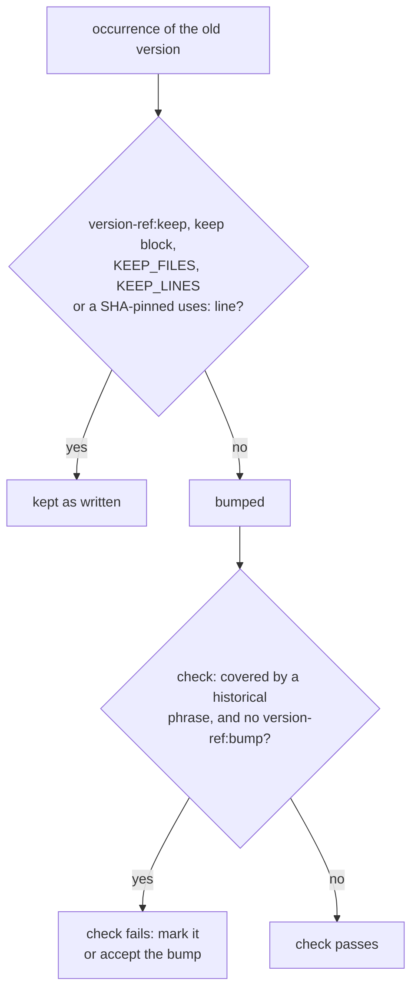

# Release Process

> Read [release-principles.md](release-principles.md) first if you're modifying anything in this pipeline. The principles are load-bearing: ignore them and you'll re-create the tight CI coupling we just removed.

## Operator runbook

The end-to-end checklist a release manager follows. **Use this every release.** Everything below assumes a healthy `master` branch.

### 1. Decide the version

Run the `/prepare-release` slash command from this repo. It inspects `changelog.md`, `mockserver/pom.xml`, and the latest `mockserver-X.Y.Z` git tag, then recommends:

- `release-version` (e.g. `9.1.0`)
- `next-version` (e.g. `7.6.1-SNAPSHOT`)
- `old-version` (e.g. `7.5.0` — auto-derived, you don't need to type it on the form)
- `release-type` (almost always `full`)
- `create-versioned-site` — leave at the default **`auto`**. The release scripts derive the correct value from the release version vs the previous tag (`yes` for a major/minor release, `no` for a patch), so you no longer have to pick it. If you *do* set an explicit `yes`/`no`, it is treated only as a confirmation: the pipeline **fails closed** (before it tags or pushes) when your choice contradicts the version. This guard exists because a major/minor release with `no` silently overwrites the previous version's archived docs site — the 8.0.0 release destroyed `7-5.mock-server.com` this way. <!-- version-ref:keep -->

The skill applies SemVer rules:

| Trigger in `## [Unreleased]` | Bump |
|---|---|
| Any bullet prefixed `BREAKING:` | **Major** |
| Bullets under `### Added` or `### Changed` | **Minor** |
| Only `### Fixed` bullets | **Patch** |
| Empty/vague | **Block** — don't release |

If you want to override the recommendation, fine — but be deliberate about it.

### 2. Validate locally (optional but recommended)

```bash
./scripts/release/test-all.sh --quick
```

Runs every component in dry-run mode locally. Takes ~5 min (Maven Central / maven-plugin / javadoc are skipped under `--quick`). The full run is `./scripts/release/test-all.sh`; it runs the whole Maven test suite, as the release does, so allow an hour or more. Working tree must be clean afterwards — if you see modifications, that's a bug in a dry-run, fix it before triggering CI.

### 3. Trigger a dry-run on Buildkite (recommended for major releases)

Open https://buildkite.com/mockserver/mockserver-release → "New Build" and fill in:

| Field | Value |
|---|---|
| Branch | `master` |
| Commit | (latest on master) |
| Release Version | from step 1 |
| Next SNAPSHOT Version | from step 1 |
| Release Type | `Full Release (all steps)` |
| Create Versioned Site? | `Yes` for major/minor, `No` for patch |
| **Dry Run?** | **`Yes — build/validate only, skip publish`** |

The dry-run exercises every step inside the actual Buildkite container images. Its `Maven Central` and `Maven Plugin` steps run the same Maven build and tests as the release, with the same settings (see [Release Maven tests run with CI's settings](#release-maven-tests-run-with-cis-settings)), so a test that would fail the release fails here first, before anything is tagged or pushed. Expect the `Maven Central` step to take ~45 min. Treat the dry-run as the final gate before publishing. It still requires the TOTP block step (there is no longer a downstream-approval gate — see step 7).

### 4. Trigger the real release

Same form as step 3, but flip **Dry Run? → `No — actually publish`**.

After the form, Buildkite immediately hits a `block` step asking for a 6-digit TOTP. The token expires every 30 s; if your agent fleet is cold-starting, you may have to wait ~1 min for an agent to come up before the TOTP step actually runs. The verifier accepts ±5 minutes of clock skew, so a slow start is forgiven.

### 5. Manual gate 1 — enter the TOTP

The TOTP seed lives in Secrets Manager under `mockserver-release/totp-seed`. Use the same authenticator app you set up for previous releases. If you've lost the seed, rotate it: generate a new seed (e.g. `python3 -c "import secrets, base64; print(base64.b32encode(secrets.token_bytes(20)).decode())"`), update the secret in AWS Secrets Manager, and re-enroll it in your authenticator (issuer `MockServer Release`).

After this gate the pipeline runs `Prepare` (pom bump + tag + push) and then `Maven Central` (mvn deploy + Sonatype publish + sync wait). The build and tests alone take ~45 min on the release agent; the step then waits for Sonatype validation and the Central sync (step timeout 300 min). If the tests fail, the step's `failed-tests` artifact holds the failing classes' reports and output.

### 6. Watch Maven Central

Open these URLs in tabs while step 5's job runs:

- **Live deployment state at Sonatype:** https://central.sonatype.com/publishing/deployments
  - States transition: `VALIDATING` → `VALIDATED` → `PUBLISHING` → `PUBLISHED`
  - `FAILED` means the pipeline will abort and surface the reason
- **Canonical "is it live?" check** (returns 200 once synced): https://repo1.maven.org/maven2/org/mock-server/mockserver-netty/<release-version>/
  - The pipeline polls this URL itself; you can watch the same thing in your browser
- **Central artifact view** (what end users see): https://central.sonatype.com/artifact/org.mock-server/mockserver-netty/<release-version>

### 7. Downstream publish (automatic — no gate)

There is no second manual approval. The `Maven Central` step's sync wait already polls repo1 until the main MockServer artifacts (`mockserver-netty`, `mockserver-client-java`, `mockserver-core`, `mockserver-junit-jupiter`) for this release are live — all modules publish in one Central deployment and sync together, so that poll *is* the gate. As soon as it succeeds the pipeline proceeds automatically (the timeout is a generous ~2h, so a lagging sync won't fail the release).

Versioned Site and Update Version References run first (sequentially), then the remaining channels publish in parallel: Maven Plugin, Docker, npm, Helm, Javadoc, SwaggerHub, Website, JSON Schema, PyPI, RubyGems, GitHub Release.

### 8. Verify the publishes

| Channel | Verification |
|---|---|
| Docker Hub | https://hub.docker.com/r/mockserver/mockserver/tags — `<release-version>`, `<release-version>-graaljs`, `<release-version>-http3`, and `latest` should appear; cosign signatures attached to each image digest |
| npm — mockserver-node | https://www.npmjs.com/package/mockserver-node |
| npm — mockserver-client-node | https://www.npmjs.com/package/mockserver-client-node |
| PyPI | https://pypi.org/project/mockserver-client/ |
| RubyGems | https://rubygems.org/gems/mockserver-client |
| RubyGems — testcontainers-mockserver (soft) | https://rubygems.org/gems/testcontainers-mockserver |
| Packagist — mockserver-testcontainers (PHP, soft) | https://packagist.org/packages/mock-server/mockserver-testcontainers |
| GitHub Release | https://github.com/mock-server/mockserver/releases |
| Helm chart | https://www.mock-server.com/index.yaml — should list the new version |
| Versioned docs site (major/minor only) | `https://<release-version-with-dash>.mock-server.com` — e.g. `7-6.mock-server.com`. Verify it serves the **new** version and that the **previous** version's subdomain still serves the **old** one; `latest_version` in `terraform/website/terraform.tfvars` decides which bucket `main` publishes into, so a missed versioned-site step overwrites the previous archive in place |
| Website | https://www.mock-server.com — version pin in the footer should match |
| Homebrew/homebrew-core (a few hours later — bumped by BrewTestBot) | https://formulae.brew.sh/api/formula/mockserver.json → `.versions.stable` should equal `<release-version>` |

### 9. Homebrew homebrew-core — fully automated, no action required

The `mockserver` formula in `Homebrew/homebrew-core` is bumped automatically by **BrewTestBot** (Homebrew's own automation account). This is a JAR-based formula that depends on an OpenJDK installation. It is the only Homebrew channel: MockServer does not publish its own tap. The chain for homebrew-core:

1. The Maven release publishes a `mockserver-netty-<version>-brew-tar.tar` artifact to Maven Central (built and signed by `maven-central.sh`'s `-P release` profile, same lifecycle as the regular jars).
2. The Homebrew formula has a `livecheck` block pointing at Maven Search (`https://search.maven.org/remotecontent?filepath=org/mock-server/mockserver-netty/maven-metadata.xml`). BrewTestBot's scheduled livecheck picks up the new version, computes the URL + SHA256, and opens a PR against `Homebrew/homebrew-core`.
3. Homebrew CI builds bottles (pre-compiled binaries) for the supported macOS/Linux targets. A Homebrew maintainer reviews and merges the BrewTestBot PR once all checks pass.
4. End-users running `brew upgrade mockserver` get the new version.

The whole cycle from Maven Central publish → live on Homebrew typically takes a few hours. No human action is required, and no MockServer-side script needs to invoke `brew`. The only thing the release pipeline has to keep doing is publishing the `*-brew-tar.tar` artifact (see `mockserver/pom.xml`'s `release` profile).

If a bump ever does not happen within a day or two of release, check:
- The `mockserver-netty-<version>-brew-tar.tar` artifact is actually present at `https://repo1.maven.org/maven2/org/mock-server/mockserver-netty/<version>/` (canonical mirror) and resolvable via `https://search.maven.org/remotecontent?filepath=org/mock-server/mockserver-netty/<version>/mockserver-netty-<version>-brew-tar.tar` (the URL livecheck actually polls).
- The `mockserver.rb` formula in `homebrew-core` still has a `livecheck` block (`gh api repos/Homebrew/homebrew-core/contents/Formula/m/mockserver.rb`).
- BrewTestBot's recent activity on this formula: `gh search prs --repo Homebrew/homebrew-core --author BrewTestBot mockserver`.
- Whether the BrewTestBot PR is open but unmerged: a Homebrew maintainer needs to approve and merge.

If a manual bump is genuinely required (e.g. the bot is broken), `brew bump-formula-pr --strict --version=<release-version> mockserver` from a workstation with `brew` and an authenticated `gh` CLI will open the PR by hand.

### 10. Postman & Bruno collections — automated, no action required

The Postman and Bruno collections are now **part of the pipeline**. The `postman-collection`
component (`scripts/release/components/postman-collection.sh`, a `soft_fail` step in the parallel
publish group) regenerates both collections from the OpenAPI spec
(`jekyll-www.mock-server.com/mockserver-openapi.yaml` — the single source of truth, version-stamped
by `prepare.sh`), validates the examples, and republishes the Postman collection to the public
workspace via the Postman API (key in Secrets Manager at `mockserver-build/postman-api-key`). Bruno
is git-native — the committed `.bru` files *are* the published collection.

**To change a request or add an endpoint:** edit the OpenAPI spec, then run
`python3 scripts/collections/generate_collections.py` and commit the regenerated
`examples/postman/**` + `examples/bruno/**`. The release component's drift guard fails if the
committed collections are out of sync with the spec. Validate locally with
`python3 scripts/collections/test_collections.py` (starts a MockServer in Docker and fires every
example).

### 11. Announce (optional)

If this is a notable release, post to:

- mockserver Slack / Discord (if you have one)
- The `mock-server` GitHub Discussions / Releases page (the GitHub Release notes are auto-generated from the changelog by the `github.sh` component)
- Twitter / Mastodon / etc.

---

## Architecture

```
scripts/release/
├── _lib.sh                       # shared functions: logging, dry-run, AWS,
│                                 # git, docker wrapper, version helpers
├── release.sh                    # orchestrator (prepare → update-version-references → components → finalize)
├── prepare.sh                    # validate + bump pom + tag + push
├── update-version-references.sh  # commit + push changelog / _config.yml /
│                                 # package.json / etc. so the parallel
│                                 # publish group reads the new version
├── finalize.sh                   # SNAPSHOT bump + deploy to Sonatype
├── preflight.sh                  # verify host has docker + bash + git + jq …
├── check-release-credentials.sh  # CI-agnostic credential liveness probe (gate)
├── check-perf-preflight.sh       # CI-agnostic performance preflight probe (gate)
└── components/                   # one script per deployable artifact
    ├── maven-central.sh          # build + sign + Sonatype + publish + wait
    ├── maven-plugin.sh           # mockserver-maven-plugin release
    ├── docker.sh                 # multi-arch Docker Hub + ECR Public
    ├── npm.sh                    # mockserver-node + mockserver-client-node
    ├── pypi.sh                   # mockserver-client-python
    ├── rubygems.sh               # mockserver-client (Ruby)
    ├── helm.sh                   # Helm chart (OCI: GHCR + legacy HTTP: S3)
    ├── javadoc.sh                # Javadoc to S3
    ├── website.sh                # Jekyll site
    ├── schema.sh                 # JSON Schema
    ├── swaggerhub.sh             # OpenAPI spec to SwaggerHub (see versioning note below)
    ├── github.sh                 # GitHub Release
    ├── binary.sh                 # per-platform jlink bundles (GitHub Release assets)
    ├── versioned-site.sh         # X-Y.mock-server.com Terraform
    ├── client-{go,dotnet,rust,php}.sh   # polyglot MockServer client publishers (soft_fail)
    ├── tc-{node,python,dotnet,go,rust}.sh  # Testcontainers module publishers (soft_fail)
    ├── tc-ruby.sh                # Testcontainers module -> RubyGems (self-bumps version.rb)
    └── tc-php.sh                 # Testcontainers module -> Packagist (subtree-split mirror)

.buildkite/scripts/
├── release-runner.sh             # Buildkite adapter (meta-data → env vars);
│                                 # `check-credentials` / `check-perf` dispatch the gates below
├── release-verify-totp.sh        # Buildkite-only TOTP gate
└── steps/
    ├── check-release-credentials.sh  # preflight credential-gate wrapper
    │                                  # (annotates + fails the build)
    └── check-perf-preflight.sh       # preflight PERFORMANCE-gate wrapper
                                       # (deepens clone, annotates + fails the build)

.buildkite/release-pipeline.yml          # flat list of steps; each step is one
                                         # release-runner.sh invocation
.buildkite/release-preflight-pipeline.yml # host-tool preflight + credential gate
```

`scripts/release/check-release-credentials.sh` probes every required publishing
credential for **liveness** (not mere presence) and runs automatically as a hard,
non-`soft_fail` gate in the preflight pipeline on the release queue — see
[Release Preflight Credential Gate](../infrastructure/ci-cd.md#release-preflight-credential-gate).
It is also worth running by hand before a release.

### Go modules and the `/vN` suffix

Both Go modules (`mockserver-client-go`, `mockserver-testcontainers/go`) are published
by a git tag named after their directory (`mockserver-client-go/vX.Y.Z`,
`mockserver-testcontainers/go/vX.Y.Z`). Go's semantic import versioning also requires
the module path to end in `/vN` for the release major `N`, or `proxy.golang.org`
rejects the tag; 8.0.0 shipped with `/v7` and no suffix and was never installable. <!-- version-ref:keep -->

- `prepare.sh` runs `scripts/release/go_module_major.py --set <major>`, which rewrites
  every reference to either module (go.mod files, imports, examples, docs, website
  snippets, the Java and UI Go code generators) and adds the changed files to the
  release commit. On a minor or patch release it changes nothing.
- `client-go.sh` and `tc-go.sh` sync to `origin/master` (so the tag lands on a commit
  with the rewrite) and run `go_module_major.py --check <major>` before tagging; a
  mismatch fails the step instead of pushing an uninstallable tag. A dry run only
  reports the mismatch, because prepare's rewrite has not run.
- `changelog.md` and `docs/plans/` are historical and are never rewritten.

### Release preflight performance gate

`scripts/release/check-perf-preflight.sh` stops a release from publishing on top of
a known, unreviewed performance regression — the "we shipped a 2× slowdown" failure.
It reads **one S3 query** (the newest run for the branch in
`s3://mockserver-ci-perf-results/runs/<branch>/`) and **one JSON read**
(`mockserver-performance-test/perf-budgets.json`) and grades three things, fail-closed:

- **Validity** — the newest run's own `.validity.valid` must be `true`. A run that
  measured nothing trustworthy is not evidence.
- **Recency** — keyed off **git ancestry, not wall-clock age**. The daily producer is
  commit-gated (it writes no new object when master has not moved), so an object-age
  rule would cry wolf on a quiet master. Instead the run's `.commit` must be an
  ancestor-or-equal of the release commit: equal ⇒ this exact code was measured
  (`CURRENT`); a proper ancestor whose later commits change nothing that rebuilds the
  `:snapshot` image (`mockserver/` except the maven plugin, `mockserver-ui/`,
  `test-fixtures/`) and nothing under `docker/` ⇒ the release ships the measured code
  (`EQUIVALENT`, passes); any other proper ancestor ⇒ the release contains unmeasured code
  (`STALE`, blocks); not an ancestor ⇒ `DIVERGENT` (blocks). A run is filed under the
  commit its SUT image was built from, which can be older than the commit its build was
  on; the `STALE` row then names both.
- **Budgets** — the **blocking set is read from the budget file's own `gating` field**,
  never hard-coded. Only `gating:true` budgets can block. Those with an **absolute
  floor** (today: `forward.error_rate` and `churn.alloc_ratio_index_n15000`) are evaluated
  directly against the newest run;
  a breach blocks unless a reviewed acceptance covers it. **Relative-only** gating
  budgets (`microbench.*`, floor `null`) cannot be judged from a single run — they are
  reported as a delegated seam, covered by the daily `perf-test-compare.sh` gate, the
  baseline-freshness watchdog, and the recency check. `premerge_alloc.*` gating budgets
  are per-merge (`perf-alloc-gate.sh`) and out of scope for a daily run object.

**Clearing `STALE`.** Wait until `mockserver-java` has pushed the `:snapshot` images for the
release commit, or for its newest ancestor that changes `mockserver/`, `mockserver-ui/` or
`test-fixtures/`. Then start a `mockserver-performance-test` build on `master` at the release
commit with `[perf-run]` in its message (without the marker the commit guard can skip it). A
`[perf-run]` build whose commit is not served the pulled image fails in its first minutes
rather than measuring the wrong binary. In the run log, `provenance: OK` must show the release
commit as the harness commit. When the run is persisted, re-run the preflight. If only
`docker/` changed since the measured commit, no `:snapshot` rebuild happens on its own: start
a `mockserver-java` build on `master` at the release commit first, as the `STALE` row says. If
`master` moves past the release commit before the image is pulled, the build is refused;
release the new tip instead.

Every state it cannot resolve is its **own loud outcome, never a silent pass**:
`NO_SESSION`/`S3_DENIED` (exit 3), `NO_HISTORY` (exit 1), `MALFORMED`/`INDETERMINATE`
(exit 2). Exit codes: `0` pass, `1` finding (INVALID/STALE/DIVERGENT/BREACH/NO_HISTORY),
`2` indeterminate, `3` precondition. It runs automatically as a hard, non-`soft_fail`
gate in the preflight pipeline **on the `perf` queue** — the queue whose IAM role holds
the perf-results S3 grant. `--self-test` unit-tests the grader without AWS.

**Adding a gating budget.** The gate only knows where to find an absolute gating budget's
value if its key is mapped in `gval()` in the script. An unmapped one makes every release
preflight `INDETERMINATE`. `--lint-budgets` (budget file only, no AWS) fails when a
`gating:true` budget with a floor has no mapping and is not a `premerge_alloc.*` entry.
`.buildkite/scripts/test/perf-preflight-gate-test.sh` runs it with the other gate checks,
in `perf-test-lint.sh` when the budget file changes and in `mockserver-infra` when the
gate script changes. So a new gating budget fails CI in the commit that adds it, rather
than at release time.

**Accepted regressions** are recorded — the only way to silence a `BREACH` — in
`mockserver-performance-test/perf-accepted-regressions.json` (a reviewed diff, owned by
the perf owner). It MUST be a JSON array (a malformed or non-array file is a hard
`INDETERMINATE`, so a hand-edit typo cannot silently disable budget evaluation). Each
entry is `{ "metric", "commit", "max_value", "reason", "accepted_by", "date" }` and an
entry silences a breach only when **all three bindings** hold:

- `metric` equals the budget key (e.g. `forward.error_rate`);
- `commit` is a **concrete ≥7-character prefix** of the run commit — there is **no
  `"*"` wildcard**. Because a PASS requires the run commit to equal the release commit
  (`CURRENT`), a commit-bound acceptance covers exactly **one release** and self-expires
  when the next commit lands; a recurring flap must earn a fresh reviewed entry (that
  forcing function is the point).
- `max_value` is present and the breaching value is `<=` it, so an acceptance recorded
  for a small breach cannot silence a later, worse one — a worse regression re-blocks.

`reason`/`accepted_by`/`date` are required for the audit trail but do not gate. An absent
file means nothing is accepted (the safe default).

> **Queue note.** The gate runs on the `perf` queue, which has at most three agents. If a
> release preflight is triggered while perf builds (the daily regression's measurement
> steps, or the weekly ~2-hour soak) occupy all of them, the step **waits for an agent**
> rather than failing — the Buildkite `timeout_in_minutes` counts execution time, not
> queue wait. An operator who sees "waiting for agent" should check the perf pipeline
> schedule rather than assume the gate is stuck.

### SwaggerHub versioning convention

`scripts/release/components/swaggerhub.sh` enforces that **both** the SwaggerHub registry label and the uploaded spec body's `info.version` field use the `major.minor.x` form (e.g. `7.0.x`), never the full patch version. The script:

1. Asserts that the on-disk spec's `info.version` matches `RELEASE_VERSION` exactly (ensures `prepare.sh` bumped it correctly).
2. Derives `API_VERSION="${MAJOR}.${MINOR}.x"` from `RELEASE_VERSION`.
3. Creates a throwaway copy of the spec with `info.version` rewritten to `API_VERSION` and uploads that copy — the on-disk spec keeps the full patch version.

Uploading under the full patch version (e.g. `7.0.0`) rather than `7.0.x` leaves every `mockserver_api_version`-based link in the website 404ing, because `_config.yml` uses the `.x` form and all SwaggerHub links on the site reference it.

## How a release happens

### Step-by-step, locally

```bash
# 1. Verify your machine has the required host tools.
./scripts/release/preflight.sh

# 1b. (needs AWS access) Probe every required publishing credential for liveness,
#     not mere presence. Read-only; never prints secret values. This is the same
#     check the preflight pipeline runs automatically on the release queue.
./scripts/release/check-release-credentials.sh

# 1c. (needs perf-results S3 read) Assert the current performance picture is
#     acceptable before releasing: the newest perf run is valid, measures the
#     release commit's history, and breaches no gating budget. Reads S3 + the
#     committed budget file; fails closed on anything it cannot evaluate. This is
#     the same gate the preflight pipeline runs automatically on the perf queue.
./scripts/release/check-perf-preflight.sh

# 2. Run the entire pipeline in dry-run mode. Builds everything, but skips
#    every external write (npm publish, twine upload, S3 sync, gh release
#    create, git push, etc.).
./scripts/release/release.sh --version 9.1.0 --dry-run

# 3. Run a single component.
./scripts/release/components/npm.sh --dry-run        # exits with `RELEASE_VERSION` unset
RELEASE_VERSION=9.1.0 ./scripts/release/components/npm.sh --dry-run

# 4. Run only a few components.
./scripts/release/release.sh --version 9.1.0 --only=npm,pypi --dry-run

# 5. Skip components.
./scripts/release/release.sh --version 9.1.0 --skip=docker --dry-run
```

DRY_RUN defaults to `true` unless you pass `--execute`. **Locally you almost never want `--execute`** — that publishes for real.

### Step-by-step, on Buildkite

The same scripts run; the only difference is the wrapper:

1. Operator triggers the `mockserver-release` pipeline.
2. The input step collects: release version, next SNAPSHOT, type, versioned-site flag.
3. The TOTP block prompts for a 6-digit code; `release-verify-totp.sh` validates it.
4. Each subsequent step calls `.buildkite/scripts/release-runner.sh <stage>`, which:
   1. Reads Buildkite meta-data and exports it as `RELEASE_VERSION`, `NEXT_VERSION`, etc.
   2. Sets `DRY_RUN=false` (Buildkite releases for real).
   3. `exec`s the matching script under `scripts/release/`.

The release scripts themselves see only env vars. They have no idea Buildkite exists.

## Disaster recovery

Buildkite outage on release day? No problem. From a developer machine with `docker`, `aws`, `git`, `jq`, `python3`, and `bash`:

```bash
# Authenticate to AWS (for Secrets Manager + S3)
aws sso login --profile mockserver-build

# Run the same scripts the CI would have run.
# CREATE_VERSIONED_SITE is left unset — it defaults to `auto`, which the scripts
# derive from the version (yes for a major/minor release, no for a patch). Set it
# explicitly only if you want the extra confirmation cross-check.
RELEASE_VERSION=9.1.0 \
NEXT_VERSION=7.6.1-SNAPSHOT \
RELEASE_TYPE=full \
./scripts/release/release.sh --execute
```

Every component runs in the same pinned Docker image whether you're on a laptop or a CI agent. There is no implicit CI state to recreate.

## Switching CI providers

This pipeline assumes nothing about Buildkite. If you want to run it on GitHub Actions, write a 30-line `.github/workflows/release.yml` that:

1. Receives release inputs (`workflow_dispatch` with `release_version` etc.).
2. Exports them as env vars.
3. Calls `./scripts/release/release.sh --execute` (or one component at a time, with explicit job dependencies).

Same for any other CI provider. The release scripts don't change.

## The contract

Release scripts (`scripts/release/*`) read these env vars:

| Variable | Required | Default | Purpose |
|---|---|---|---|
| `RELEASE_VERSION` | yes | — | The version being released (X.Y.Z) |
| `NEXT_VERSION` | no | `RELEASE_VERSION` patch+1 -SNAPSHOT | Next dev version |
| `OLD_VERSION` | no | latest `mockserver-X.Y.Z` tag | Previous release |
| `RELEASE_TYPE` | no | `full` | One of: full, maven-only, docker-only, post-maven |
| `CREATE_VERSIONED_SITE` | no | `auto` | `auto` derives it (`yes` major/minor, `no` patch); an explicit `yes`/`no` must agree with the version or the run fails closed before tagging |
| `DRY_RUN` | no | `true` | `false` to actually publish |
| `AWS_PROFILE` | no | (not set) | Used outside CI for Secrets Manager auth |

No other vars are read. **No `BUILDKITE_*` lookups happen in release scripts** — that's the whole point.

## Version-bearing files updated by the release pipeline

The release pipeline writes every version-bearing file in the repo, so contributors should not maintain version numbers by hand. The list is exhaustive — if a release ever leaves one of these files stale, it is a pipeline bug.

| File | Updated by | What gets set |
|------|------------|---------------|
| `mockserver/pom.xml` and every child pom (~34 files — the full mockserver/ subtree, excluding `target/`) | `prepare.sh` (`update_pom_versions` in `_lib.sh`) | `<version>` and `<parent><version>` from `SNAPSHOT` → `RELEASE_VERSION` |
| `mockserver/pom.xml` and child poms (re-bump) | `finalize.sh` (`update_pom_versions`) | `<version>` and `<parent><version>` from `RELEASE_VERSION` → `NEXT_VERSION` (the next `-SNAPSHOT`) |
| `changelog.md` | `update-version-references.sh` | Promote `## [Unreleased]` to `## [RELEASE_VERSION] - YYYY-MM-DD` and re-open an empty `## [Unreleased]` |
| `jekyll-www.mock-server.com/_config.yml` | `update-version-references.sh` | `mockserver_version`, `mockserver_api_version`, `mockserver_snapshot_version` |
| `mockserver/mockserver-core/src/main/resources/org/mockserver/openapi/mock-server-openapi-embedded-model.yaml` | `prepare.sh` | OpenAPI `version:` field |
| `mockserver-node/package.json` | `update-version-references.sh` | `version`, and the embedded `mockserver-netty-<version>-jar-with-dependencies.jar` URL |
| `mockserver-client-node/package.json` | `update-version-references.sh` | `version`, and `devDependencies["mockserver-node"]` |
| `mockserver-client-python/pyproject.toml` | `update-version-references.sh` | `version = "…"` |
| `mockserver-client-ruby/lib/mockserver/version.rb` | `update-version-references.sh` | `VERSION = '…'` |
| `mockserver-client-rust/Cargo.toml` and `mockserver-client-rust/Cargo.lock` | `prepare.sh`; `components/client-rust.sh` re-bumps `Cargo.toml`, and its `cargo check` updates the lock, then it commits both | `Cargo.toml` `version = "…"`, and the `mockserver-client` package `version` in `Cargo.lock`. CI builds with `--locked`, so a stale lock fails the Rust pipeline |
| `helm/mockserver/Chart.yaml` | `components/helm.sh` | `version:` and `appVersion:` (must match app version per Helm policy) |
| All `*.html`, `*.md`, `*.yaml`, `*.yml`, `*.json`, `*.txt` outside `target/`, `node_modules/`, `helm/charts/`, `.tmp/`, and the changelog | `update-version-references.sh` (`version_refs.py rewrite`) | Every reference to the old version (or old API version) → the new one, except lines marked as history. See [Version references](#version-references) |
| `terraform/website/terraform.tfvars` | `components/versioned-site.sh` | Append `"<MINOR>.<PATCH>" = { bucket_name = "…" }` and update `latest_version = "<SUBDOMAIN>"` |

**Sanity check before promoting a dry-run**: `git diff` should show every file in the table above changed exactly once. If `git diff --name-only | wc -l` is wildly larger than this table suggests, something is rewriting more than expected; if smaller, a version-bearing file may have been added without wiring it into `update-version-references.sh` (or `prepare.sh` for OpenAPI / pom files).

## Version references

**The release bumps every reference to the previous version, except lines explicitly marked as history.** `scripts/release/version_refs.py` rewrites each bounded occurrence of the old version (and the old `X.Y.x` line) in the files above. No phrase ever keeps one. A version stays as written only when a person has marked it, or when it sits on a SHA-pinned `uses:` line, so "in X.Y.Z it ran on every read" survives only if it carries a marker. `scripts/release/preflight.sh` and `scripts/release/test-version-refs.sh` fail when an unmarked line reads as history.



| Signal | Keeps | Use it for |
|--------|-------|------------|
| `version-ref:keep` anywhere on the line | the whole line | Markdown/HTML: `<!-- version-ref:keep -->` at the end of the line, or inside the last cell of a table row. YAML: `# version-ref:keep` |
| `version-ref:keep-begin` ... `version-ref:keep-end` | every line between them | a code block or a table that records a past result. A begin with no end fails the check |
| `KEEP_FILES` in `version_refs.py` | the whole file | a file that is wholly a historical pin, such as `scripts/perf/startup-variants.json` |
| `KEEP_LINES` in `version_refs.py` | the occurrences inside the fragment; others on that line are still bumped | a file that cannot carry a marker (JSON, `llms-full.txt`), plan docs, and CI or agent control files whose edits need separate approval. The check fails unless each fragment is on exactly one line of its file (a deleted file is ignored) |
| `uses: owner/action@<40-hex SHA>` on the line | every version on that line | nothing to add: the `# vX.Y.Z` after a SHA pin names that action's release, which must match the SHA, never MockServer's |
| `version-ref:bump` | nothing | silences the check on a line that reads as history but should follow each release |

**The check.** It lists an occurrence that a phrase in `HISTORICAL_PATTERNS` covers, when the line has no marker. It looks at the current release (`mockserver_version` in `_config.yml`) and at every later version up to the next major. Text about the coming release ("default `true` since X.Y.Z") is history once that release ships, and the release after it would otherwise bump it, so it is marked when it is written. The phrases are: `in`, `since`, `until`, `before`, `fixed/added/changed/removed ... in`, `from`, `than`, `after`, `require(s)`, `X.Y.Z and earlier`, `X.Y.Z's`, `pre-X.Y.Z`, `the X.Y.Z release` (or `changelog`, `behaviour`, `dashboard`, `default`), and a past-tense verb after the version. `version_refs.py` is the source of truth. A phrase on another version on the same line does not trigger it. These phrases only decide what the check reports; they never keep a version. Settle each report with `version-ref:keep` or `version-ref:bump`. The check also fails on any reference to the current release or its `X.Y.x` line under `.github/workflows/` that the release would bump: GitHub refuses a workflow change from the release token, which has no `workflow` scope. Settle it with `version-ref:keep` or remove the version.

```bash
python3 scripts/release/version_refs.py check .          # unmarked history, open blocks, stale lists: exit 1
python3 scripts/release/version_refs.py check . --list   # every occurrence with its verdict
./scripts/release/test-version-refs.sh                   # fixture tests plus the repository check
```

## Dry-run behaviour by component

| Component | Dry-run does | Dry-run skips |
|---|---|---|
| `prepare` | Validate inputs, show pom diff | pom write, git commit, tag, push |
| `maven-central` | `mvn clean install` (build + test), the same command the release runs | Signed deploy, Sonatype upload, publish, sync wait |
| `maven-plugin` | Build core + `mvn clean verify` of the plugin (with tests), as the release does | tag, deploy, push |
| `docker` | `docker buildx build` (local `--load`, amd64 only) | `--push` to Docker Hub + ECR, cosign signing by digest |
| `npm` | `npm install`, grunt build | `git push tag`, `npm publish` (uses `--dry-run`), the wait for the version to become installable |
| `pypi` | `python -m build`, `twine check` | `twine upload` |
| `rubygems` | `gem build` | `gem push` |
| `tc-ruby` | `gem build` (self-bumps `version.rb`) | `gem push` (skips if `mockserver-build/rubygems` secret absent) |
| `tc-php` | Validate `composer.json` | subtree split + push to `mock-server/mockserver-testcontainers-php` mirror (skips if mirror repo not provisioned) |
| `helm` | `helm lint`, `helm package` | `helm push` to `oci://ghcr.io/mock-server/charts`, S3 upload, commit/push |
| `javadoc` | `mvn javadoc:aggregate` | S3 sync |
| `website` | `bundle install`, `jekyll build` | S3 sync, CloudFront invalidation |
| `schema` | jq-generate self-contained schemas | S3 sync |
| `swaggerhub` | Validate spec file | POST to SwaggerHub |
| `github` | Extract changelog notes, print preview | `gh release create` |
| `versioned-site` | `terraform plan` | `terraform apply`, S3 mirror |
| `update-version-references` | Show diff of version-reference rewrite | git push |
| `finalize` | Show pom version-bump diff | git push, mvn deploy snapshot |
| `binary` | Build all five platform jlink bundles | `gh release upload` (asset push to GitHub Release) |

## Pinned Docker images

All toolchain calls run inside these images. Defined in `scripts/release/_lib.sh`:

```bash
MAVEN_IMAGE=maven:3.9.16-eclipse-temurin-17@sha256:1a35…  # Temurin JDK 17.0.20.1
NODE_IMAGE=node:20-bookworm
RUBY_IMAGE=ruby:3.2-bookworm
HELM_IMAGE=alpine/helm:3.16.2
GH_IMAGE=maniator/gh:v2.62.0
PYTHON_IMAGE=python:3.12-slim-bookworm
TERRAFORM_IMAGE=hashicorp/terraform:1.15
```

Override any of them by exporting the corresponding env var. Change them in `_lib.sh` to update for everyone.

**`MAVEN_IMAGE` is pinned by digest, not just by tag.** An official `maven:<version>-eclipse-temurin-17` tag is re-pushed with each new Temurin JDK until the next Maven version replaces it, and then it stops moving. `3.9.9-eclipse-temurin-17` froze at JDK 17.0.15 while CI moved on to 17.0.19, so the 9.0.0 release hit a JDK 17.0.15 `HttpClient` bug (JDK-8307648) that CI never saw. <!-- version-ref:keep --> The digest fixes the exact JDK. When you bump it, choose an image at least two weeks old, read its JDK version from the image (`mvn -version`, or `JAVA_VERSION` in the image config), and keep it at or above the JDK 17 that CI runs (`docker_build/maven/Dockerfile`).

### Release Maven tests run with CI's settings

`RELEASE_MAVEN_TEST_FLAGS` in `_lib.sh` is passed to the `maven-central` build, so the release runs its tests with the settings of CI's reactor build and netty IT shards (`scripts/buildkite_quick_build.sh`, `scripts/buildkite_netty_it.sh`). CI is what proves the tests green; the pom defaults are a configuration CI never runs. In 9.0.0, two tests that assert on WARN log output failed only in the release, because it used the pom default log level `ERROR`. <!-- version-ref:keep -->

| Flag | Why the release passes it |
|---|---|
| `-Dmockserver.testLogLevel=INFO` | Tests that assert on logged events need those events logged. The pom default is `ERROR` |
| `-Dmockserver.testArgLine=-Dmockserver.maxLogEntries=10000 -Dmockserver.maxExpectations=5000` | The event-log and expectation caps CI runs with (the pom's own argLine caps the log at 1,000 entries) |
| `-Dmockserver.testOutput=quiet -DredirectTestOutputToFile=true` | Keep the `INFO`-level server output out of the release step log. It goes to `*-output.txt` files in the surefire/failsafe report directories instead. When the tests fail, `collect_failed_tests` (`_lib.sh`, which runs CI's `java-collect-failures.sh`) copies the failing classes' reports and output into `mockserver/target/failed-tests/` and prints a pass/fail summary, and the step uploads that directory as a Buildkite artifact. Release agents are ephemeral, so the artifact is the only copy |

Deliberately not copied from CI: `-P clustered-libs` and `-Dmockserver.shadeSourcesJar=false` (CI packaging shortcuts; the release needs the shaded sources jars), `-P netty-it-skip` (CI runs those ITs in separate shard steps with the same flags; the release runs them in the reactor), and `-B --no-transfer-progress` (log formatting only). The `maven-plugin` step keeps the pom defaults, because CI's maven-plugin build (`.buildkite/scripts/steps/maven-plugin-build.sh`) uses them.

The dry run runs these same commands, which is why it takes as long as the release's build.

### npm waits up to 45 minutes for a package to become installable

After `npm publish`, `npm.sh` polls the npm install packument every 30 s for up to 45 minutes before it publishes the next package. npm processes a large package before it lists the new version: `mockserver-node` bundles the jar (~87 MB), and for 9.0.0 that took ~20 minutes, past the old 5-minute ceiling. <!-- version-ref:keep --> A re-run of the step skips the publish and resumes the wait. The step's timeout (110 min) covers both packages' waits.

### Maven runs install `unzip` first

**Every container that runs `mvn` in a release script starts with `${maven_packaging_prelude}` from `_lib.sh`, which installs `unzip` and fails the step if it cannot.** The `src/packaging/assert-*.sh` assertions bound to `package`/`verify` run `unzip` over the built jars, and the `maven:*-eclipse-temurin-17` image does not include it. Without the prelude, `mvn install` and both deploys fail in the release. A dry-run skips the raw deploy payloads entirely, so it can pass while they would fail: those payloads must carry the prelude themselves.

| Call | How it gets the prelude |
|---|---|
| `in_maven …` (maven-central build, maven-plugin, docker, javadoc, binary, finalize SNAPSHOT deploy) | Built into `in_maven` |
| Raw `in_docker "$MAVEN_IMAGE" … bash -ec '…'` (the GPG-signed deploys in `maven-central.sh` and `maven-plugin.sh`) | The payload starts with `"${maven_packaging_prelude}"'…'` |

`.buildkite/scripts/steps/check-release-maven-prelude.sh` (the `mockserver-infra` pipeline) enforces this over `scripts/release/**` and `.buildkite/scripts/release-*.sh`. It fails if:

- a containerized `mvn` run (`in_docker`, `run-in-docker.sh`, `docker run` or `docker container run`) has no expanding reference to the prelude before `mvn` (a reference inside single quotes never expands, so it does not count);
- `in_maven` loses the prelude;
- the prelude, run against a stub `apt-get`, stops installing `unzip`, calls apt when `unzip` is already present, or exits 0 when apt fails.

On every run it also checks its own detection against `check-release-maven-prelude.fixture`. It cannot see `mvn` inside a heredoc payload (`bash -s <<EOF`), a command held in a variable (`sh -c "$CMD"`), or a wrapper function that forwards `"$@"` to `in_docker`; write `mvn` literally in the `in_docker` call, or use `in_maven`.

We install `unzip` into the public image instead of switching `MAVEN_IMAGE` to the CI image `mockserver/mockserver:maven`, which already has it. That image is re-pushed under the same mutable tag, either by its own pipeline or locally with the `docker-build-push` skill, which can bake a corporate root CA into it. It also uses Ubuntu's OpenJDK rather than Temurin, so a release would no longer be pinned to a known toolchain. The deploy step already ran `apt-get` in this image, so the prelude adds no new network dependency. If a packaging script starts using another tool the image lacks, add it to the prelude.

### Credentials reach containers through `--secret-env`, never `-e`

**Every release step that hands a credential to a container uses `in_docker … --secret-env NAME=VALUE`, not `-e NAME=VALUE`** (release-principles §7). `in_docker` writes each value to a `0600` file in a private `.tmp/secret-env.*` directory. It replaces the entrypoint with a small `sh` loader that runs as the container's PID 1, exports the files as environment variables, and runs the real command as its child. The secret is therefore not in `docker inspect`, not in the container's `/proc/1/environ`, and not on the host `docker run` command line; only the command's own processes see it.

- **Cleanup.** The staging and the `docker run` happen in a subshell whose `trap` removes the directory when the call returns, fails, or is interrupted (INT/TERM). A `kill -9` of the release script cannot run a trap, so `release-runner.sh` and `release.sh` also remove any leftover `.tmp/secret-env.*` before they start.
- **Cancellation.** PID 1 in a container ignores signals it has no handler for, so the loader forwards TERM/INT to the command and exits with the command's exact status (143 for a command killed by SIGTERM). Cancelling a release step stops Maven or terraform promptly.
- **Usage.** `--secret-env NAME` (no value) takes the value from the environment variable `NAME`; the Dependabot release gate uses this for `GH_TOKEN`. `--secret-env` requires an explicit `--` before the command and a non-empty value; either mistake fails the step. Because the loader replaces the image entrypoint, pass `--entrypoint` for an image whose entrypoint is the tool itself (`--entrypoint gh` for `GH_IMAGE`, `--entrypoint /bin/terraform` for `TERRAFORM_IMAGE`). The `run-in-docker.sh` banner then shows `<in_docker --secret-env loader, secrets: NAME …>` and the command, not a reproduce line, because the staged directory no longer exists after the run.

**Credentials still on a command line** (follow-ups; none goes through `docker run -e`):

| Where | How the credential is passed |
|---|---|
| `tc-dotnet.sh`, `client-dotnet.sh` | `dotnet nuget push --api-key` inside the container; dotnet has no environment-variable alternative |
| `swaggerhub.sh` (`sh_api_call`) | `curl -H "Authorization: …"` on the host |
| `postman-collection.sh` | `curl -H "X-Api-Key: …"` on the host |
| `mcp.sh` | `mcp-publisher login dns --private-key …` on the host (the CLI accepts the key only as a flag) |
| `.buildkite/scripts/steps/java-deploy-snapshot.sh` (CI, not the release) | `run-in-docker.sh -e SONATYPE_USERNAME=… -e SONATYPE_PASSWORD=…` for the snapshot deploy |

The `curl` cases can move to a `0600` config file read with `curl -K`, as `check-release-credentials.sh` already does.

## Common operations

### Retry semantics — what a Buildkite Retry actually reruns

A Buildkite job **Retry** button re-executes the step's script from the **build's pinned commit** — whichever commit was at `HEAD` when the build was triggered. That means:

| Change type | Retry sufficient? |
|---|---|
| Config / data files (secrets, YAML, env vars) | Yes — the script re-reads them at runtime |
| Script logic in `scripts/release/*.sh` or `_lib.sh` | **No** — the pinned commit's version of the script runs, not your local edits |

If you need a script-logic fix to take effect, you must **trigger a fresh build** from the commit that includes the fix.

**Half-published release recovery:** when a release half-publishes (for example, Maven Central artifacts are already live but downstream steps failed), use `RELEASE_TYPE=post-maven` to skip the Maven Central step on the fresh build and complete only the remaining publish steps:

```bash
# On Buildkite — trigger a new build with:
#   Release Type → "Post Maven (skip maven, publish remaining)"
#   Release Version → same version as the failed build

# Locally:
RELEASE_VERSION=9.1.0 RELEASE_TYPE=post-maven ./scripts/release/release.sh --execute
```

`RELEASE_TYPE=post-maven` is wired into each component via the `skip_unless_release_type` guard in `scripts/release/_lib.sh` — components that already published (such as `maven-central`) check this flag and exit early, while remaining components run normally.

### Re-run a single component after a partial-pipeline failure

If, say, the Maven Central step succeeded but `npm` failed:

```bash
# On Buildkite: open the build, click Retry on the failed step. The
# release-runner.sh adapter re-reads meta-data and re-invokes.

# Locally:
RELEASE_VERSION=9.1.0 ./scripts/release/components/npm.sh --execute
```

### Reproduce a CI failure locally

```bash
# Pull the same env vars Buildkite was using (or set them by hand) and run
# the same script.
RELEASE_VERSION=9.1.0 \
NEXT_VERSION=7.6.1-SNAPSHOT \
./scripts/release/components/maven-central.sh --dry-run
```

That reproduces what the agent was doing, in the same Docker image, on your laptop.

### Add a new deployable component

1. Create `scripts/release/components/<name>.sh` following the pattern of an existing component.
2. Wire it into the orchestrator: add `<name>` to `ALL_COMPONENTS` in `release.sh`.
3. Add a step to `.buildkite/release-pipeline.yml` that runs `.buildkite/scripts/release-runner.sh <name>`.
4. Test with `RELEASE_VERSION=X.Y.Z ./scripts/release/components/<name>.sh --dry-run`.

## For agents / LLMs reading this in a future session

If you're modifying this pipeline, **respect the principles** in [release-principles.md](release-principles.md). In particular:

- Do NOT add `buildkite-agent meta-data get` or any `BUILDKITE_*` env-var reads to a script under `scripts/release/`. If a release script needs information that currently comes from Buildkite meta-data, plumb it through as a regular env var via the adapter.
- Do NOT call any tool natively if it has an upstream Docker image. The whole pipeline relies on language toolchains being containerised so the agents stay minimal and the scripts stay portable.
- Do NOT introduce dynamic pipeline generation (the previous design did this and we explicitly removed it). The Buildkite YAML is meant to be flat and obvious.
- DO add `--dry-run` support to every new component. The smoke-test pattern (`RELEASE_VERSION=99.99.0 ./scripts/release/components/<name>.sh --dry-run`) is how operators sanity-check changes locally before triggering CI.
- DO write each component as one self-contained file: build, package, sign, publish — all in one place. No splitting across multiple steps.

When in doubt, ask: "could a human ship this release from their laptop with just `docker`, `aws`, `git`, and `bash` installed?" If the answer is no, you've broken a principle.
