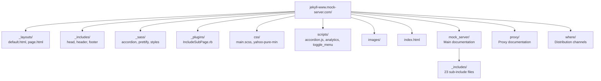

# Website

## Overview

The MockServer documentation website at `https://www.mock-server.com` is a Jekyll static site hosted on AWS S3 with CloudFront CDN.

**Source:** `jekyll-www.mock-server.com/`

> **Missing pages return HTTP 404.** CloudFront maps the private bucket's 403 (missing object) to a real 404 serving `error403.html` (which still `meta refresh`es humans to the homepage). This keeps deleted URLs out of search-engine indexes — see the CloudFront notes in [docs/infrastructure/aws-infrastructure.md](../infrastructure/aws-infrastructure.md#cloudfront-distributions). The status code is set in `terraform/website/sites.tf` (`custom_error_response.response_code`). After `terraform apply`, cached error responses keep serving the old status for up to `error_caching_min_ttl` (300s), so run a CloudFront `/*` invalidation to take effect immediately. Roll back by setting `response_code = 200` and re-applying.

## Site Configuration

**File:** `jekyll-www.mock-server.com/_config.yml`

| Setting | Value |
|---------|-------|
| URL | `https://www.mock-server.com` |
| Markdown engine | kramdown |
| Sass output | `:compressed` |
| `mockserver_version` | `9.2.0` |
| `mockserver_api_version` | `9.2.x` |
| `mockserver_snapshot_version` | `6.1.1-SNAPSHOT` |
| Google Analytics | GA4 measurement ID `G-20BB7EJG4E` (in `_config.yml` as `ga4_measurement_id`) |
| Custom plugin | `jekyll-code-example-tag` |

## Site Structure



## Content Sections

### Mock Server (`mock_server/`)

| Page | Content |
|------|---------|
| `getting_started.html` | Quick start guide |
| `creating_expectations.html` | Expectation creation (request matchers + actions) |
| `running_mock_server.html` | Running MockServer (all deployment options) |
| `mockserver_clients.html` | Client libraries (Java, JavaScript, Ruby) |
| `verification.html` | Request verification |
| `configuration_properties.html` | Full configuration reference |
| `HTTPS_TLS.html` | TLS/SSL configuration and mTLS |
| `using_openapi.html` | OpenAPI specification support |
| `response_templates.html` | Velocity/Mustache/JS response templates |
| `debugging_issues.html` | Troubleshooting guide |
| `clearing_and_resetting.html` | State management |
| `initializing_expectations.html` | Expectation initialisation on startup |
| `persisting_expectations.html` | Persistent expectations across restarts |
| `running_tests_in_parallel.html` | Parallel test execution patterns |
| `isolating_single_service.html` | Single-service isolation testing |
| `control_plane_authorisation.html` | Control plane auth (JWT, mTLS) |
| `CORS_support.html` | CORS configuration |
| `performance.html` | Performance tuning |
| `mockserver_ui.html` | Dashboard UI |

### Sub-includes (`mock_server/_includes/`)

23 reusable content fragments for code examples and configuration blocks:

| Include | Content |
|---------|---------|
| `request_matcher_code_examples.html` | Request matching examples |
| `response_action_code_examples.html` | Response action examples |
| `forward_action_code_examples.html` | Forward action examples |
| `error_action_code_examples.html` | Error action examples |
| `openapi_request_matcher_code_examples.html` | OpenAPI matcher examples |
| `running_docker_container.html` | Docker usage instructions |
| `running_mock_server_detail.html` | Detailed server startup options |
| `running_mock_server_summary.html` | Server startup summary |
| `running_npm_module.html` | npm module usage |
| `helm_chart.html` | Helm chart usage |
| `tls_configuration.html` | TLS config reference |
| `logging_configuration.html` | Logging config reference |
| `performance_configuration.html` | Performance config reference |
| `cors_configuration.html` | CORS config reference |
| `clustering.html` | Clustering documentation |
| `control_plane_authentication_configuration.html` | Auth config |
| `control_plane_authentication_jwt_configuration.html` | JWT auth config |
| `control_plane_authentication_mtls_configuration.html` | mTLS auth config |
| `initializer_persistence_configuration.html` | Init/persistence config |
| `template_restriction_configuration.html` | Template security config |
| `creating_expectations.html` | Expectation creation details |
| `retrieve_code_example.html` | Retrieve API examples |
| `verification_summary.html` | Verification summary |

### Proxy (`proxy/`)

| Page | Content |
|------|---------|
| `getting_started.html` | Proxy quick start |
| `verification.html` | Proxy request verification |
| `record_and_replay.html` | Record & replay functionality |
| `configuring_sut.html` | Configuring system-under-test |

### Where (`where/`)

Distribution channel pages: `docker.html`, `downloads.html`, `github.html`, `kubernetes.html`, `maven_central.html`, `npm.html`, `slack.html`, `trello.html` (auto-redirects to GitHub Projects after 3 seconds)

## Layouts

### `default.html`

Base HTML5 template:
- `` — meta tags, SEO (Open Graph, Schema.org), Google Fonts, CSS
- `` — navigation sidebar with section links
- `{{ content }}` — page content
- `` — copyright, JavaScript (toggle menu, prettify, accordion)

### `page.html`

Extends `default` — wraps content in a `<div class="post">` with `<h1>` title.

## Custom Plugins

### `IncludeSubPage.rb`

Provides two Liquid tags:

- `` — includes a file relative to the current page
- `` — includes a file from the site root

Both tags strip YAML front matter before rendering.

## Branding & Fonts

- **Title font:** page titles (`.page_header h1`) and the site/brand header (`.header h1`) use the
  Google web font **Permanent Marker**, loaded via `_includes/head.html` alongside
  `Averia Sans Libre`. Section headings (`h2`) intentionally stay on `Averia Sans Libre` for
  readability. Rules live in `_sass/_styles.scss`. (Apple's *Marker Felt* is **not** usable here —
  it is a proprietary system font with no web-font licence, so it only renders on Apple devices;
  Permanent Marker is the cross-platform equivalent.)
- **Brand "M" icon / favicons:** the marker-style "M" is shared across the site and the dashboard:
  - Website: `favicon.svg` (adaptive `prefers-color-scheme` fill), `favicon.ico`
    (native 16/32/48/64/128/256 frames), `apple-touch-icon.png` (180×180),
    `images/mockserver-icon.png` (195×195). Wired up in `_includes/head.html` (SVG first, `.ico`
    fallback).
  - Dashboard: `favicon.svg`, `favicon.ico` and `apple-touch-icon.png` in `mockserver-ui/public/`
    (no `mockserver-icon.png` — that one is website-only), referenced from `mockserver-ui/index.html`
    under the `/mockserver/dashboard/` base path.
- **How the icons/logo are generated:** the "M" and the "MockServer" wordmark are outlined from the
  *Permanent Marker* font with `fonttools` (text → vector paths, so there is no font dependency),
  filled `#333333`, with path coordinates rounded to 2 dp. The same source produces the CNCF
  Landscape wordmark — see [../distribution/cncf-landscape-entry.md](../distribution/cncf-landscape-entry.md).

## Building the Website

```bash
# Local development server
cd jekyll-www.mock-server.com
bundle install
bundle exec jekyll serve

# Or use the script
scripts/jekyll_server.sh

# Production build
cd jekyll-www.mock-server.com
bundle exec jekyll build
# Output in _site/
```

## Performance Headline Lint

**The website pipeline fails when the hand-written performance headline disagrees with the
published figure.** `.buildkite/scripts/steps/website-perf-headline-lint.sh` runs first in the
`:jekyll: validate Jekyll site` step (`website-build.sh`), before the Jekyll build, and names
`file:line` for every disagreement. Run it locally from the repo root; it needs only `bash`, `awk`
and `jq`.

| Checked place | Why it is hand-written |
|---|---|
| `description` in the front matter of `mock_server/performance.html` | Jekyll does not render Liquid in front matter; it is also the meta, Open Graph and JSON-LD description |
| each `schema_faq` answer that states a rate (`req/s`, `req/sec`, `requests/sec`, `requests per second`, `requests a second` or `rps`, in any case) | same; Google surfaces these |
| the `mock_server/performance.html` line in `llms.txt` | plain text |
| "six CPU cores" / "six-core" wording in the page body | hand-written beside the Liquid figures |

What it checks against `_data/perf_figures.json` (rules in
`.buildkite/scripts/steps/lib/website-perf-headline-check.jq`):

- **The headline.** A rate written `about N` (also `~N`, `ceiling of N`) states the headline and
  must equal `headline.healthy_ceiling_rps`. Each checked place must state it that way. `136,000`,
  `136000 RPS` and `136k` are the same figure.
- **Every other rate** must be a published figure: the ceiling, the achieved rate (to the
  precision it is written: `136,300` for 136,327.2), or the sub-millisecond-p95 rate. The other
  rung the qualifying runs read (128,000 today) is allowed only while the page data carries
  `headline_rule`, the ceiling is one of the two rungs, and the page's run-tally gate
  (`hc == …`) names the same pair as `RW_EXPECTED_CEILING_RPS` / `RW_ADJACENT_CEILING_RPS` in
  `perf-website-publish.sh`. A third rung the runs read (144,000) is not a published figure, so
  the FAQ answers and the `llms.txt` line call it "a higher rate".
- **Latencies** (`N ms`) must round from the headline p50, p95, p99, whole-rung p99 or the p99
  bound; **core counts** must equal `headline.server_cores`.
- **The run tally** ("the twelve like-for-like runs") must be the same number everywhere it is
  stated, by value: `13` and `thirteen` agree. A count is read as a numeral or in words up to
  ninety-nine. A count in words it cannot read (`a hundred and two`), or an FAQ answer or
  `llms.txt` line that mentions like-for-like runs with no count right before them, fails the
  lint. The per-rate counts ("in five, … in three and … in two") are not in the page data, so
  they stay a manual reconcile.

It fails closed: missing or unreadable page data, a missing `healthy_ceiling_rps`,
`healthy_ceiling_rps_display` or `server_cores`, a display figure that is not the number, a
description or answer that is not a one-line double-quoted string, or no `llms.txt` line. Its
fixture tests (`.buildkite/scripts/test/website-perf-headline-lint-test.sh`, on a cut-down page in
`fixtures/website-perf-headline/`) run in the infra pipeline, which is where a change to the lint
or to `perf-website-publish.sh` routes; they also run the lint on the committed site.

## Deployment

> **Resolve the live target dynamically — do not trust hard-coded bucket/distribution
> names.** The `versioned-site` release step (`scripts/release/components/versioned-site.sh`)
> repoints the `mock-server.com` + `www.mock-server.com` CNAME aliases at the **newest
> _versioned_ bucket and distribution** on every release. So "the current site" moves
> with each release: as of 7.0.0 it is bucket `aws-website-mockserver-7-0` /
> distribution `ED1HOMPC7011S`, and the previous current site (`nb9hq` /
> `E3R1W2C7JJIMNR`) is now frozen as the `5-15.mock-server.com` **archive** — uploading
> to it corrupts that archive. Older docs and `~/mockserver-aws-ids.md` may name the
> wrong "current" bucket; always re-resolve before deploying:
>
> ```bash
> # Live bucket + distribution serving www.mock-server.com:
> aws cloudfront list-distributions --profile mockserver-website \
>   --query "DistributionList.Items[?contains(Aliases.Items,'www.mock-server.com')].{Id:Id,Origin:Origins.Items[0].DomainName}" \
>   --output table
> ```

1. Build: `bundle exec jekyll build`
2. Resolve the live bucket + distribution with the command above.
3. Upload `_site/` to that bucket. For a manual deploy use `aws s3 sync` **without**
   `--delete` (or `aws s3 cp` for a single targeted page). **Do not use `--delete`
   from a local Jekyll build** — see the warning below.
4. Invalidate that distribution — `/*` for a broad refresh, or the specific changed
   paths for a targeted deploy (CloudFront ignores query strings, so a `?cb=`
   cache-buster does **not** flush the edge; you must invalidate).

> **NEVER run `aws s3 sync --delete` from a local `jekyll build` for a manual deploy —
> it destroys release-managed content.** The live bucket holds files the Jekyll build
> does **not** reproduce, all published by the release pipeline (`scripts/release/`),
> not by `jekyll build`:
> - `versions/**` — archived per-version documentation snapshots
> - `apidocs/**` — generated Javadoc API docs
> - `mockserver-*.tgz` + `index.yaml` — the Helm chart repository
> - legacy root-level redirect pages (e.g. `/creating_expectations.html`)
>
> A `--delete` sync from a local `_site/` flags **all of these for deletion** (a real
> deploy on 2026-07-01 showed 13,641 deletions vs 103 legitimate uploads). Always
> dry-run first (`aws s3 sync _site s3://<bucket> --delete --dryrun`) and confirm the
> deletions are only stale files you intend to remove. For a routine docs deploy, omit
> `--delete` entirely: it uploads changed/new files and removes nothing. The full
> `--delete` publish is reserved for the release pipeline, which syncs from a tree that
> **includes** `versions/`, `apidocs/`, and the Helm repo.

The `mockserver-website` profile authenticates directly into the website account
(`014848309742`) as admin, so manual deploys do **not** need the cross-account
`assume_website_role` that CI (`scripts/release/`) uses.

See [AWS Infrastructure](../infrastructure/aws-infrastructure.md) and [Release Process](release-process.md) for details.

## Website Infrastructure Security

The following controls are applied to the CloudFront distributions and DNS for `mock-server.com`. These are managed by Terraform in `terraform/website/`.

### CloudFront Response Security Headers

A shared `aws_cloudfront_response_headers_policy` (`mockserver-security-headers`) is attached to the default cache behaviour of all distributions:

| Header | Value |
|--------|-------|
| `Strict-Transport-Security` | `max-age=31536000; includeSubDomains` |
| `X-Content-Type-Options` | `nosniff` |
| `X-Frame-Options` | `SAMEORIGIN` |
| `Referrer-Policy` | `strict-origin-when-cross-origin` |
| `Content-Security-Policy` | Conservative allow-list (self + Google Analytics) — may need tuning for third-party widgets |

All headers have `override = true` so they cannot be suppressed by S3 object metadata.

### CAA DNS Records

Route 53 CAA records on `mock-server.com` restrict TLS certificate issuance to Amazon CA:

```
0 issue    "amazon.com"
0 issuewild "amazon.com"
```

This prevents a compromised or rogue CA from issuing a certificate for the domain. Managed by `aws_route53_record.caa` in `terraform/website/sites.tf`.

### S3 Static Website Hosting

S3 static-website hosting (`aws_s3_bucket_website_configuration`) is **not** configured. CloudFront uses the private OAC REST S3 origin with `default_root_object = "index.html"`, which avoids exposing the S3 website endpoint publicly.

### Cross-Account Role ExternalId

The `mockserver-release-website` IAM role in the website account enforces `sts:ExternalId` on the trust policy. The ExternalId is **active** -- callers must supply the correct value or the assume-role call will be denied.

- **Secret location:** the `external_id` key in the `mockserver-release/website-role` secret (build account, eu-west-2). The same secret also holds the `role_arn` key.
- **CI path (`scripts/release/`):** `assume_website_role()` in `_lib.sh` loads the `external_id` from the secret and passes `--external-id` to `aws sts assume-role`. `versioned-site.sh` loads it and passes `TF_VAR_role_external_id` into the dockerized terraform so CI applies keep the trust-policy condition in sync.
- **Manual apply:** set `TF_VAR_role_external_id=<value>` when running `terraform apply` in `terraform/website/`. The value is in the secret above (never committed to the repo).
- **Terraform plumbing:** `cross-account-role.tf` conditionally adds the `sts:ExternalId` Condition when `var.role_external_id != ""`. The `main.tf` providers pass `external_id` in their `assume_role` blocks (also conditional).

**OAC-only origin access:** All distributions authenticate to S3 through a single Origin Access Control (OAC), signing origin requests with SigV4. The legacy Origin Access Identity resources and the `AllowLegacyOAIRead` bucket-policy grant were removed (2026-06-05) after confirming all 9 distributions reference only `origin_access_control_id` in their origin config, so the OAI grants were dead code.

## SEO & Metadata Files

| File | Purpose |
|------|---------|
| `sitemap.xml` | XML sitemap for search engines |
| `sitemap.html` | HTML sitemap for users |
| `robots.txt` | Search engine crawl directives |
| `feed.xml` | Atom/RSS feed |

## Proxy Sub-includes

`proxy/_includes/` contains reusable fragments for proxy documentation:

| Include | Content |
|---------|---------|
| `analysing_behaviour.html` | Proxy behaviour analysis examples |

## External References

The website navigation includes links to:

- **SwaggerHub API Reference:** https://app.swaggerhub.com/apis/jamesdbloom/mock-server-openapi
- **GitHub Examples:** https://github.com/mock-server/mockserver-monorepo/tree/master/examples

## Authoring Rules

### No Mermaid renderer — use PNG diagrams

The Jekyll site (`jekyll-www.mock-server.com/`, served at `https://www.mock-server.com`) has **no Mermaid renderer**. The `Gemfile` installs only `jekyll` and `jekyll-code-example-tag` — there is no `jekyll-mermaid` gem, no Mermaid JS, and no `kramdown-parser-gfm`. A Mermaid fenced code block renders as broken raw text in the browser.

**Always use PNG images for diagrams in the Jekyll consumer site.** The docs/ internal architecture files may use Mermaid normally (GitHub's renderer handles them).

Diagram authoring workflow:

1. **Source:** `jekyll-www.mock-server.com/images/MockServerScenarios.pptx` — the canonical diagram source. All production diagram slides live here.
2. **Renderers:** Python scripts under `jekyll-www.mock-server.com/images/diagram-tools/`:
   - `build_diagrams.py` — clones/rebuilds generated slides in the PPTX from their definitions (idempotent; run after editing definitions, not after hand-tuning a slide).
   - `render_diagrams.py` — exports slides to PNG and writes them to `jekyll-www.mock-server.com/images/`.
   - `build_ai_diagrams.py` / `render_ai_architecture.py` — same pattern for AI-specific diagrams.
3. **Output:** committed PNG files in `jekyll-www.mock-server.com/images/` (e.g. `MockServerBreakpoints.png`, `MockServerCluster.png`). Reference them from HTML with ``.

To add a new diagram: define the slide in `build_diagrams.py`, register its index in `render_diagrams.py`, run both scripts, and commit the PPTX and the generated PNG.

### Client-accordion convention

Every code-example accordion that shows multiple client languages follows a fixed tab order. Inner tab buttons appear as `<button class="accordion inner">` and must be in this sequence:

| Position | Tab label | Notes |
|----------|-----------|-------|
| 1 | Java | Typed fluent builder; static imports omitted for brevity |
| 2 | JavaScript | Raw-JSON object literal passed to the JS client |
| 3 | Python | Typed Python builder |
| 4 | Ruby | Typed builder, or `from_hash({…})` for complex structures |
| 5 | Go | Typed Go builder |
| 6 | .NET | Typed C# builder |
| 7 | Rust | Typed Rust builder |
| 8 | PHP | Typed PHP builder |
| 9 | REST API | `curl` command with raw JSON body — always last |

Additional rules:

- **No standalone JSON tab.** JSON is embedded inside the JavaScript example (shown as a JS object literal) and/or the REST API example (as a `curl` body). There is never a ninth "JSON" tab between PHP and REST API.
- **Ruby `from_hash` requires string keys.** When Ruby uses `from_hash({…})` for raw-structure upserts, all keys must be string literals (`'httpRequest' => …`), not Ruby symbol keys (`:httpRequest =>` fails). See `mock_server/_includes/request_matcher_code_examples.html` for canonical examples.
- **Prefer typed builders.** Use the language's typed client builder in each tab. Fall back to a raw-JSON `from_hash` / object literal only for Java-only features (e.g. a complex matcher type not yet modelled in other clients).
- **The Ruby tab sends what the REST API tab sends.** `mockserver-client-ruby/spec/website_examples/check_website_examples.rb` runs every Ruby block through the Ruby client with HTTP intercepted (no server, no network, a few seconds) and compares the JSON it sends to `/mockserver/*`, normalised, with the REST API tab of the same tab set (any tab titled with "REST API", as `curl` commands or a raw HTTP request). Every Ruby block must either match or be listed in `allowlist.yml` beside it with its finding, a reason and the digest the check prints; a listed block that starts sending something else, an entry that no longer applies, a block that raises, and a page whose Ruby blocks the check did not all find each fail it. Run it after editing a Ruby or REST API tab: `cd mockserver-client-ruby && ruby spec/website_examples/check_website_examples.rb --verbose`.
- **So do the Python, Go, .NET, Rust and PHP tabs.** The same check with `--lang python` (or `go`, `csharp`, `rust`, `php`) runs each block of that language as its own process against a local server on port 1080 that records every request and answers as MockServer would, so the real client and any raw HTTP call in the block are both captured; `spec/website_examples/languages.rb` turns each block into a runnable program (a Go snippet becomes a package, a .NET block a class, a Rust block a module, each built once into one program; a block that does not build is a `does_not_compile` finding). Each language has its own `allowlist-<lang>.yml` with the same rules. It needs that language's toolchain and Ruby: Python with `requests` (the client runs from its source tree), Go, the .NET SDK, Cargo, or PHP after `composer install` in `mockserver-client-php`. Run it with `cd mockserver-client-ruby && ruby spec/website_examples/check_website_examples.rb --lang go --verbose`, or in that language's CI image with `.buildkite/scripts/steps/website-examples.sh go` (Docker; this is how CI runs it, in each language's pipeline and in the website pipeline). Keys and digests treat the release version, the API version (from `_config.yml`) and the Go module major (`mockserver-client-go/vN`) as placeholders, so the release's version rewrites (`scripts/release/version_refs.py`, `go_module_major.py --set`) change no allowlist entry.
- **A REST API `curl` body is the JSON the shell sends.** Inside `-d '…'` write each single quote as `'\''` (the shell otherwise ends the string there, as in `"I'\''m a teapot"` or a JavaScript template's `'\''path'\''`), and write a template as one JSON string with `\n` escapes, never Java-style `"…" + "…"` concatenation. Where a client cannot express a field (for example `keyMatchStyle` in the Python client, whose `from_dict` turns it into a header or parameter of that name), send the raw JSON over HTTP in that tab rather than a typed call that sends something else.

Reference file: `jekyll-www.mock-server.com/mock_server/_includes/request_matcher_code_examples.html`.

### Java extension examples are compiled

The Java code on `mock_server/extensions.html` is not a client call, so the client-tab checks above do not cover it. The request filter and response transformer shown there are compiled classes in `examples/java/src/main/java/org/mockserver/examples/mockserver/extensions/`, and `RequestFilterAndResponseTransformerExampleTest` loads them into an embedded MockServer and fails unless the page has a `<pre>` block equal to each source file, ignoring the `package` line. After editing either example, copy the class into the page, escaping `<`, `>` and `&`.

**CI runs this check when the page or the example changes.** The test runs in the `mockserver-java` pipeline, with the rest of `examples/java` (`scripts/buildkite_quick_build.sh`), and `generate-pipeline.sh` triggers that pipeline for a change to `examples/java/` or `mock_server/extensions.html` as well as for server changes. To run it locally from the repo root, with the reactor's SNAPSHOT artifacts installed as `examples/java/README.md` describes:

```bash
mockserver/mvnw -f examples/java/pom.xml test -Dtest=RequestFilterAndResponseTransformerExampleTest
```
