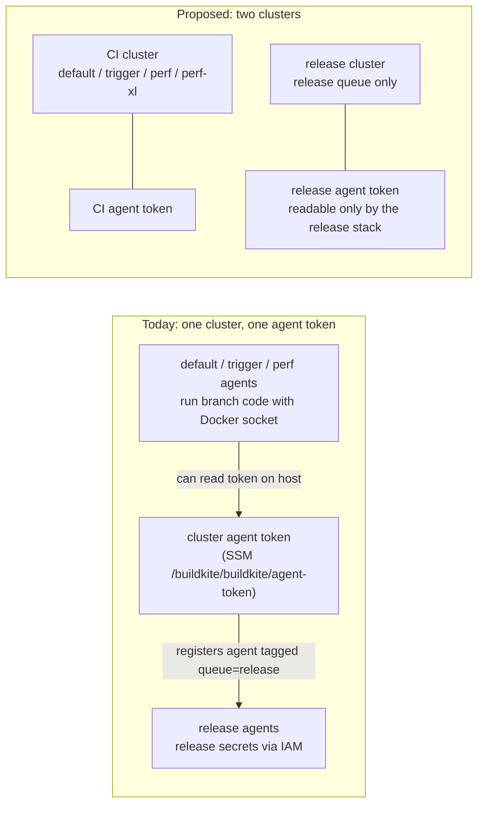

# Buildkite release isolation and fork-PR CI: design note

Status: **design only, not implemented.** Owner decision needed before any Terraform is written or
applied. Covers two supply-chain hardening items: CI for pull requests from forks, and a separate
Buildkite cluster for releases. Date: 2026-11-09.

## 1. Outcome

- **Fork PRs: keep Buildkite off and keep the GitHub Actions route.** `build_pull_request_forks` is
  now set to `false` explicitly in `terraform/buildkite-pipelines/pipelines.tf` (it was the provider
  default), and fork PRs keep getting their test signal from the secret-free
  `.github/workflows/pr-tests.yml`. Enabling Buildkite fork builds is not safe in any form until the
  release cluster below exists, and is not needed after it either.
- **Release: move the `release` queue into its own Buildkite cluster with its own agent token**, put
  the `release` pipeline and the release-queue gates of `release-preflight` in it (the preflight's
  `perf` and `default` queue checks cannot move, see §3), make `release` the new cluster's default
  queue, and verify every step that runs there with Buildkite signed pipelines. Today one cluster and one agent token serve every queue, so any build
  that gets root on a `default` agent can register an agent that receives release jobs.
- **Do this before keyless (Sigstore OIDC) image signing.** A rogue agent that receives a release job
  can mint that job's Buildkite OIDC token. With keyless signing that token is a signing identity.

## 2. Model

## 3. Components

| Change | Where | Effect |
|---|---|---|
| New cluster `release` with queue `release`, its own `buildkite_cluster_agent_token` and SSM parameter | `terraform/buildkite-pipelines/clusters.tf` | A CI-agent compromise no longer yields a token that can join the release queue |
| The `release` pipeline gets the new `cluster_id`. `release-preflight` cannot move whole: it also runs a `perf`-queue gate (the S3 perf-results grant is on the perf role) and a `default`-queue preflight. Either split it (a release-cluster pipeline for the release-queue preflight and credential gate; a CI-cluster pipeline for the perf and default checks) or keep it in the CI cluster and run only its release-queue gate from a release-cluster pipeline. Every other pipeline stays in the Default cluster | `pipelines.tf`, `.buildkite/release-preflight-pipeline.yml` | Release jobs can only be taken by release-cluster agents |
| The release cluster's default queue is `release` (`buildkite_cluster_default_queue`) | `clusters.tf` | The bootstrap `pipeline upload` step and any step without an `agents: queue` run on release agents, not on a queue with no agents |
| `buildkite_release_stack` reads the new token parameter; the other stacks cannot read it (IAM `ssm:GetParameter` scoped per parameter) | `terraform/buildkite-agents/main.tf`, `run.sh` | Token separation is enforced by IAM, not by convention |
| Remove `release` from the Default cluster's queues | `clusters.tf` | Nothing in the CI cluster can target the release queue |
| Buildkite signed pipelines: a JWKS key held only by the release stack signs steps; release agents run with `verification-jwks-file` and `verification-failure-behavior=block`. This covers every pipeline in the release cluster, the release-queue part of `release-preflight` included | release stack agent config | A branch-edited `release-pipeline.yml` or preflight cannot run on release agents unless its steps are signed |
| Optional: a KMS-backed cosign key (`cosign sign --key awskms:///<key-arn>`) with `kms:Sign` granted only to the release stack role | `terraform/buildkite-agents`, `docker.sh`, `helm.sh` | The private key never lands on agent disk; today it is written to a `0600` file under `.tmp/` for each signing call |
| Restrict who can create builds of `release` / `release-preflight` (a Buildkite team with build access only for maintainers; the pipelines already have `trigger_mode = none`) | Buildkite teams (Terraform `buildkite_pipeline_team`) | Only maintainers can start a build that reaches release agents |

## 4. Rationale and trade-offs

- **Why a cluster, not just a queue or an IAM change.** Queues are agent tags inside a cluster; any
  agent holding the cluster token can claim any queue name. The token is on every CI host, and Docker
  socket access is host root. The release stack's IAM role protects the secrets themselves, so a rogue
  agent cannot read Secrets Manager directly, but it can take release jobs, report them green, and mint
  each job's OIDC token. `terraform/buildkite-agents/dependency-cache.tf` already records the same gap
  for the OIDC dependency-cache writer.
- **Why signed pipelines as well.** The release pipeline's first step uploads
  `.buildkite/release-pipeline.yml` from the commit being built, so whoever can create a release build
  on a branch defines the steps that run beside the release secrets. Signing moves that authority to
  whoever holds the signing key. The alternative, defining the release steps in Buildkite settings
  instead of the repo, works but loses review of the pipeline in Git.
- **Why not Buildkite fork builds, even on an isolated pool.** Fork builds would need a third cluster
  with a stripped IAM role (no Secrets Manager, no `sts:AssumeRole`, no shared S3 write), pipeline
  steps defined outside the repo (the fork owns `generate-pipeline.sh`), and scale-to-zero capacity.
  The GitHub Actions route already gives fork PRs the full reactor build with nothing worth stealing,
  and its worst failure is a test signal that differs from Buildkite. The Buildkite route's worst
  failure is a leaked signing key.
- **Cost.** One more scale-to-zero agent stack is not needed: the existing release stack moves
  cluster. The cost is the migration and keeping two tokens.

## 5. Migration outline (for when it is approved)

1. `terraform/buildkite-pipelines`: add the cluster, its `release` queue (also its default queue),
   agent token and SSM parameter; move `release` to it and apply the chosen `release-preflight` split.
   `terraform plan` and review; apply only with owner sign-off.
2. `terraform/buildkite-agents`: point `buildkite_release_stack` at the new token parameter; scope
   each stack's `ssm:GetParameter` to its own token. Plan, review, apply. Agents scale to zero, so the
   cutover has no in-flight jobs to drain.
3. Generate the pipeline-signing JWKS pair outside the repo, store the private key where only the
   release stack can read it, publish the public key to the release agents, and sign the release
   pipeline upload. Run `release-preflight` end to end before the next release.
4. Rotate the old Default-cluster token, since it was readable on CI hosts.
5. Only then consider keyless cosign signing (Buildkite OIDC to Fulcio), which would bind image
   signatures to `organization:mockserver:pipeline:mockserver-release` instead of a stored key.

## 6. Open questions for the owner

- `release-preflight`: split it into a release-cluster pipeline and a CI-cluster pipeline, or keep it
  in the CI cluster and trigger only its release-queue gate from the release cluster?
- Move the cosign key to AWS KMS (`awskms://`) at the same time, or keep the Secrets Manager key?
- Which accounts should be able to create release builds (the Buildkite team membership)?
- Should the perf queues move too? They hold no release secrets but write perf results; they can stay
  in the CI cluster.
- Is losing auto-built Buildkite status on fork PRs acceptable permanently? (It is the status quo.)
