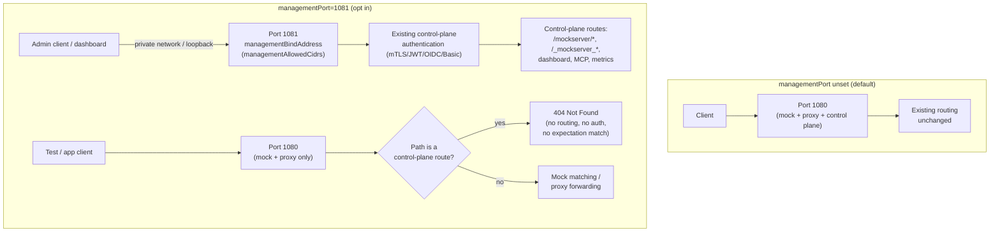

# Separate Control-Plane (Management) Listener

## 1. TL;DR

Add an **opt-in** second TCP listener that serves only the control plane
(`/mockserver/*`, `/_mockserver_*`, the dashboard, MCP, metrics) so an operator
can stop the management API being reachable on the mock/proxy port at all,
instead of relying only on authentication to gate it there.

- **Off by default.** Unset `managementPort` → zero behavioural change; today's
  single combined listener keeps serving both data-plane and control-plane
  traffic exactly as now.
- **On**: a second listener binds `managementPort` on `managementBindAddress`
  (default `127.0.0.1`), serves control-plane routes only, and the existing
  mock/proxy listener(s) **stop serving the control plane at all** — they
  answer `404 Not Found` for any control-plane path (§5, with rationale for
  rejecting the "still serve" and "403" alternatives).
- **Composes with, does not replace,** the existing control-plane
  authentication (mTLS / JWT / OIDC / Basic, `docs/code/tls-and-security.md`).
  Network segmentation and request authentication are independent layers; this
  spec adds the first without weakening the second.
- Credit: proposed by Matthew Hall in PR #2955 (`controlPlanePort` /
  `controlPlaneBindAddress` / `controlPlaneAllowedCidrs`). This spec adopts the
  goal and renames the properties (§3) to avoid colliding with the already
  shipped `controlPlane*` authentication/CORS property family, and changes the
  routing and enforcement design to close weaknesses found in that PR's
  approach (§4, §8).
- **Zero data-plane cost when unused**: with `managementPort` unset, the mock
  port's request path takes the same route-classification branch it takes
  today — no new branch, no new attribute read, no new socket.

## 2. Flow

Both listeners are bound by the same `MockServer`/`LifeCycle` instance against
the same `HttpStateHandler` / expectation store / event log — one process, one
in-memory state, two sockets. This is **not** a second server process and does
not change `docs/code/clustered-state.md`'s per-node state model (§12).

## 3. Properties

All names are new; none alias or reuse an existing `controlPlane*` key (which
already means "authentication/authorisation for control-plane requests", not
"which socket they arrive on" — reusing the prefix invited exactly the
confusion PR #2955's own doc changes showed, mixing a transport decision into
auth-settings tables). Equivalent forms follow the standard four-tier
resolution (`docs/code/configuration-reference.md`): JVM system property
(`-Dmockserver.<name>`), properties file, environment variable
(`MOCKSERVER_<NAME>`), and the `Configuration` object — except where noted.

| Property | Default | Equivalent forms | Mutability |
|---|---|---|---|
| `managementPort` | unset (feature off) | `-Dmockserver.managementPort`, `MOCKSERVER_MANAGEMENT_PORT`, properties file, `Configuration.managementPort(Integer)` | **startup-only** |
| `managementBindAddress` | `127.0.0.1` | same four forms, `Configuration.managementBindAddress(String)` | **startup-only** |
| `managementAllowedCidrs` | unset (no IP filter beyond the bind address — independent of `managementBindAddress`, maintainer-confirmed §13) | same four forms, `Configuration.managementAllowedCidrs(String)` | **startup-only** |

**Startup-only, enforced the same way as the existing startup-only
control-plane trust settings** (`controlPlaneTLSMutualAuthenticationCAChain`,
`controlPlaneBasicAuthentication*`, etc. — see
`docs/code/configuration-reference.md` and
`docs/code/tls-and-security.md#runtime-mutability-of-the-control-plane-trust-anchor`):

- `ConfigurationDTO.applyTo` never applies these three fields.
- `HttpState.applyConfigurationUpdate` logs a `WARN` naming the value in force
  when a `PUT /mockserver/configuration` supplies a different value, and does
  not apply it.
- `ConfigurationDTOTest.STARTUP_ONLY_PROPERTIES` gains the three keys.
- `GET /mockserver/config` / `--print-config` show them like any other
  startup-only property (no masking needed — none is a credential).

**Why startup-only, specifically.** Which socket the control plane is
reachable on is a network-topology decision an operator makes when wiring
firewalls and Kubernetes `NetworkPolicy`/`Service` objects. A control-plane
caller that could move the management API back onto the data-plane port, or
widen `managementAllowedCidrs`, at runtime could undo the operator's
segmentation from inside the thing it constrains — the same reasoning already
applied to `controlPlaneCorsAllowOrigin` and `proxyProtocolTrustedSources`.

**Validation at startup** (fail fast, not at request time):
`managementPort` out of `0–65535` throws `IllegalArgumentException`, matching
`serverPort`/`http3Port`; `managementAllowedCidrs` is parsed with the same
strict CIDR parser already used for `proxyProtocolTrustedSources`
(`docs/code/configuration-reference.md#how-values-are-loaded`, final
paragraph) — a value it cannot parse refuses the start, for the same reason:
a parsing mistake must not silently widen trust. `managementBindAddress` that
fails to resolve/bind follows the existing `bindPort` failure path
(`docs/code/netty-pipeline.md` §"Outcome: after binding each port...") — an
explicit port that cannot bind throws `BindException` with the `lsof` hint;
port `0` retries up to 10 times.

`managementPort=0` picks a free ephemeral port, exposed through
`MockServerClient.managementPort()` (new accessor, mirroring the existing
`getLocalPort()`/`http3Port` future-based accessors) for tests that need to
address the management listener without hard-coding a port.

## 4. Routing rule

**When `managementPort` is set:**

| Listener | Serves | Control-plane route arrives |
|---|---|---|
| `managementPort` (new) | Control-plane routes only (`/mockserver/*`, `/_mockserver_*`, bare legacy aliases, dashboard static assets, dashboard WebSocket, callback/breakpoint WebSockets, MCP, `/mockserver/metrics`) | Routed and authenticated exactly as today |
| `serverPort`/`securePort`/`http3Port` (existing) | Mock matching and proxy forwarding only | **`404 Not Found`**, before routing, before authentication, before any expectation (including a `respondBeforeBody` catch-all) can answer it |

**Recommendation: `404`, not "still serve on both" and not `403`.**

- **Rejected: still serve the control plane on the data-plane port too.**
  That is today's status quo with authentication as the only gate — exactly
  what the maintainer decision opts out of. It would give a false sense of
  isolation: a misconfigured firewall rule, an open container port, or a
  stray load-balancer forward would still reach the control plane.
- **Rejected: `403 Forbidden`.** It confirms to an unauthenticated prober that
  a control-plane route *exists* and is merely denied from this network
  position — a reconnaissance signal today's fully-anonymous response
  (`401`) doesn't give. It is also wrong when a user's own expectation
  legitimately matches `/mockserver/anything` as a data-plane path
  (control-plane paths are not reserved — `HttpState.isControlPlaneRoute`
  only applies when no path-based mock exists there).
- **Chosen: `404`.** Indistinguishable from outside from "no expectation
  matches this path", the ordinary answer the mock port already gives for
  any unmatched path. No new HTTP status is introduced anywhere in the stack:
  the data-plane listener simply never offers `HttpState.isControlPlaneRoute`
  a path to match against, so the lookup falls through to ordinary
  expectation matching, which 404s on its own when nothing matches.

**Enforcement is a single `enum ListenerRole { DATA, MANAGEMENT }` channel
attribute**, set exactly once, at bind time, by which `ServerBootstrap`
accepted the connection — never derived from the request's path, host header,
PROXY-protocol payload, or any other attacker-influenced input. This is the
direct fix for the PR #2955 weakness where CONNECT proxy-authentication
exemption was keyed on a target that merely *looked like* the control plane
(a fail-open shape: an attacker picks a target that resembles the exemption
pattern and skips proxy auth). Here the role is fixed per-channel at
`channelRegistered` on the single Netty pipeline-construction code path
(`MockServerUnificationInitializer`), read by exactly one place —
`HttpState.handle` / `HttpRequestHandler` — and never recomputed from message
content. There is exactly **one** enforcement site, not two that can drift
(the PR's second weakness: auth checked once in `isProxyAuthenticated` and
again in `processActionAfterFilter`): `ListenerRole` is read once, at the top
of request dispatch, and the result (serve vs. 404) is decided before any
other branch runs. **Implementation ordering (added by council review, §14):**
this check must land as the very first branch inside `HttpState.handle`,
ahead of the existing control-plane route-candidate check, so a `DATA`-role
channel never evaluates `isControlPlaneRoute`, CORS, or the WebSocket-upgrade
gate at all — not merely evaluate-then-reject. **WebSocket-upgrade detection
must be brought under this same gate, not left as a parallel check**: if
`ControlPlaneWebSocketUpgradeGate` is (or becomes) a code path invoked
independently of `isControlPlaneRoute`, the DATA-listener short-circuit must
explicitly skip it too, or a WebSocket upgrade attempt on the data-plane port
would bypass the short-circuit entirely rather than getting the intended
`404`.

## 5. Interplay with existing control-plane authentication

Unchanged and fully composed, not duplicated:

- mTLS, JWT, OIDC, Basic (`docs/code/tls-and-security.md#control-plane-authentication`)
  apply to the `managementPort` listener exactly as they apply to control-plane
  routes on the combined listener today — same `HttpState.controlPlaneRequestAuthenticated`
  call, same `AnyOfAuthenticationHandler` composition, same audit entries.
- `controlPlaneAuthorizationEnabled` / `controlPlaneScopeMapping` (role-based
  per-route and per-MCP-tool authorization) apply unchanged.
- `controlPlaneCorsAllowOrigin` / `controlPlaneTrustedHostSuffixes` (browser
  Origin gate) apply unchanged to the dashboard and WebSocket upgrades served
  from `managementPort`.
- **Network segmentation is additive, not a substitute.** An operator who sets
  `managementPort` but no authentication still has an *unauthenticated* but
  *network-restricted* control plane — the documentation (§11) states this
  explicitly and recommends pairing `managementPort` with at least
  `controlPlaneBasicAuthenticationRequired` or mTLS for any deployment where
  the management network itself is not fully trusted (e.g. a shared CI
  cluster). This mirrors how defense-in-depth is documented everywhere else
  in the control-plane docs.

## 6. CIDR allowlist semantics

`managementAllowedCidrs` (unset = no additional restriction; the socket is
still constrained by `managementBindAddress`) is checked against the **TCP
peer address Netty's channel reports for the management listener's
accept()**, using the same parser as `proxyProtocolTrustedSources`
(`docs/code/configuration-reference.md`, strict IPv4/IPv6 CIDR, no host
names, no negation).

**PROXY protocol must not influence this check — by construction, not by a
special case.** `ProxyProtocolOriginalDestinationHandler`
(`docs/code/netty-pipeline.md` §"Port Unification Handler") reads
PROXY-protocol headers on every listener it is installed on and sets
`PROXY_PROTOCOL_SOURCE` from a value the *connecting client declares in its
payload* — exactly the kind of attacker-controlled input that must never
decide a trust boundary. The management listener's pipeline **never installs
that handler at all** (it is wired only onto listeners configured as
proxy-facing in `MockServerUnificationInitializer`), so the
`managementAllowedCidrs` check always reads the channel's real
`remoteAddress()`. This is a structural exclusion, not a flag or precedence
rule a future change could invert — the direct fix for the PR #2955-adjacent
bug class where a declared/forwarded address could be mistaken for the real
one. **Test requirement (council review, §14):** §11 must include a positive
regression case — a crafted PROXY protocol header sent to the management
listener from an address *outside* `managementAllowedCidrs`, asserting the
connection is still refused by real peer address.

## 7. HTTP/2, HTTP/3, `/bind`, WebSockets

- **HTTP/2**: the management listener runs the same `PortUnificationHandler`
  → ALPN/h2c detection as any other listener (`docs/code/netty-pipeline.md`
  §"Protocol Detection Order"), so control-plane routes are reachable over h2
  on `managementPort` exactly as they are on the combined port today. No new
  code path.
- **HTTP/3 (QUIC)**: **in scope for v1** (maintainer decision, 2026-11-11 —
  see §13). `http3Port` (`docs/code/http3.md`) is still experimental, but
  `managementPort` must extend to it rather than leaving a gap: when
  `managementPort` is set, `Http3Server` gains the same `ListenerRole`
  concept — a per-connection/per-QUIC-stream role fixed at the point the QUIC
  listener accepts the connection, read by the same single enforcement site
  as the TCP case. MCP-over-HTTP/3 control-plane traffic
  (`docs/code/tls-and-security.md` §"MCP control plane") is reachable only on
  a management-role HTTP/3 listener once `managementPort` is set, and a
  data-role HTTP/3 connection answers `404` for a control-plane path exactly
  as the TCP listener does (§4). Whether this needs a distinct
  `managementHttp3Port` or can share `managementPort`'s number on UDP is an
  implementation detail for the units in §15, not a design fork — the
  routing and enforcement rule is identical to §4's TCP case.
- **`/bind`**: `PUT /mockserver/bind` dynamically adds *data-plane* ports
  (mock/proxy) to a running server (`docs/code/netty-pipeline.md` §"Outcome:
  after binding each port..."). It is itself a control-plane route, so once
  `managementPort` is set, `/bind` is only reachable on the management
  listener — consistent with every other control-plane route. A port added
  via `/bind` is always bound with `ListenerRole.DATA`; `/bind` cannot create
  additional management listeners (there is exactly one per process, fixed at
  startup, per §3's startup-only rule).
- **WebSockets** (dashboard push channel, callback/breakpoint WebSockets): the
  WebSocket upgrade path is itself a control-plane route
  (`ControlPlaneWebSocketUpgradeGate`, `docs/code/tls-and-security.md`
  §"Browser Origins"), so it is served only from `managementPort` once set,
  and returns the same `404` from the data-plane listener as any other
  control-plane route under §4 — the upgrade request never reaches
  `ControlPlaneWebSocketUpgradeGate` on that listener at all. Per §4's
  implementation note, this requires upgrade detection to sit behind the same
  `ListenerRole` short-circuit as every other control-plane route, not behind
  an independent check the short-circuit doesn't see.

## 8. Clients, dashboard, and WAR deployment

- **Java/Node/Python/Ruby/.NET/Go/Rust/PHP clients**: none auto-discover a
  management port today — every client is constructed with an explicit
  `host`/`port` (`docs/code/client-and-integrations.md`, `new
  MockServerClient("localhost", 1080)`). With `managementPort` set, the
  operator points the client at the **management** port instead of the
  mock/proxy port — this is purely a deployment/wiring change, not a client
  code change. No client library changes are required; `MockServerClient`
  gains only the optional `managementPort()` accessor for ephemeral-port tests
  (§3).
- **Dashboard**: served as a static asset + WebSocket from `managementPort`
  when set (it is a control-plane route, §4/§7). The dashboard's own
  JavaScript already talks to whatever origin served the page
  (`docs/code/dashboard-ui.md`), so no dashboard code change is needed — a
  browser pointed at `http://<managementBindAddress>:<managementPort>/mockserver/dashboard`
  gets a dashboard whose API/WebSocket calls stay on that same origin.
- **WAR / servlet deployment**: **not applicable.** `mockserver-war` and
  `mockserver-proxy-war` run inside a container-managed servlet (Tomcat,
  Jetty, etc.) that owns the one HTTP port the container exposes; MockServer
  never binds its own listener in that mode (`docs/code/overview.md`,
  `docs/code/client-and-integrations.md` §"Precedent" on `MockServerServlet`).
  A second socket is outside MockServer's control there, so the three new
  properties **fail startup with a clear error** when loaded inside a
  servlet container (maintainer-confirmed, §13 — consistent with how other
  startup-only, network-trust-deciding properties fail loud rather than
  silently no-op). Document this limitation prominently (§11).

## 9. Docker / Helm

- **Docker**: `managementPort` is opt-in via an environment variable/property
  file, exactly like every other MockServer property
  (`docs/infrastructure/docker.md` §"Port"). No Dockerfile change is required
  for the feature to work, but the images should **not** `EXPOSE` a second
  port by default (keeping `EXPOSE 1080` unchanged, consistent with "off by
  default = no change", §10) — an operator who sets `managementPort` adds
  their own `-p` mapping or Kubernetes port. Consumer docs
  (`jekyll-www.mock-server.com/mock_server/_includes/running_docker_container.html`)
  get a new example showing `-e MOCKSERVER_MANAGEMENT_PORT=1081 -p 127.0.0.1:1081:1081`
  with a warning not to publish the management port to `0.0.0.0` in the
  container-to-host mapping, which would defeat `managementBindAddress`.
- **Helm**: `docs/infrastructure/helm.md` documents `app.serverPort` (chart
  value → `SERVER_PORT`) and a single `Service`/`livenessProbe`/`readinessProbe`
  against port 1080. That probe hits a control-plane path, so once
  `managementPort` is set the path `404`s on the data port (§4) — the probe
  **must** retarget to the management port, or every pod fails health checks
  cluster-wide. To avoid silent breakage on upgrade, the retarget is tied to
  a new optional `app.managementPort`/`app.managementBindAddress` chart
  value: the probe template (and a second `Service` port) switch to it
  **only when that value is set**, defaulting to today's behaviour
  otherwise, so setting the feature and retargeting the probe happen in one
  values edit, never two steps that can be done out of order. **Docs
  requirement (council review, §14):** `values.yaml`'s comments and the
  consumer Helm guide must present `app.managementPort` and the probe
  retarget as **one example block**, not two independently-documented
  settings — the backwards-compat seat flagged setting one without the other
  as a cluster-wide-outage risk.

## 10. Backwards compatibility and data-plane cost

- **Off by default.** `managementPort` unset ⇒ `ListenerRole` is never
  consulted (or is always `DATA`, depending on implementation — see §13),
  every existing route, test, client default, Docker image, and Helm chart
  behaves byte-for-byte as before. This matches the standard already applied
  to every other control-plane startup-only property.
- **Data-plane cost when unused: zero.** The routing check in §4 is "is this
  listener's `ListenerRole` `MANAGEMENT`" — a single channel-attribute read
  already on the request's hot path context lookup, defaulting to `DATA`
  everywhere except the new listener. No new allocation, no new hash lookup
  against a path table that doesn't already exist (`HttpState.isControlPlaneRoute`
  is unchanged — it is simply not consulted at all on a `DATA`-role channel,
  which is a *smaller* amount of work than today's combined-listener check, not
  larger).
- **On, cost is confined to the new listener**: one extra bound socket, one
  extra pipeline per accepted connection on that socket — no different from
  any other additional `/bind` port today.

## 11. Test plan

| Area | Test |
|---|---|
| Default (off) | Existing full suite unchanged — no new skips, no new `assumeTrue` needed since this adds no Docker dependency |
| Startup validation | `managementPort` out of range throws; invalid `managementAllowedCidrs` entry refuses to start (mirror `ProxyProtocolTrustedSourcesTest` cases); `managementPort=0` binds an ephemeral port and `MockServerClient.managementPort()` returns it |
| Routing — positive | Every control-plane route family (expectation CRUD, verify, reset, dashboard static, dashboard WS, callback WS, MCP over HTTP/1.1+HTTP/2, `/mockserver/metrics`, `/bind`) reachable on `managementPort`, same response as today's combined listener |
| Routing — negative | Same route list hit on the data-plane port(s) returns `404`, with **no** entry in the event log (data-plane requests are logged as mocked traffic, not control-plane audit — verify no audit entry is created for the rejected attempt, since none ran); includes a WebSocket-upgrade attempt on the data-plane port (§4, §7), confirming it is also `404`'d by the same short-circuit rather than bypassing it |
| Ordering regression (merge-blocking, §14) | Asserts the `ListenerRole` check is reached before `isControlPlaneRoute`, CORS, and WebSocket-upgrade evaluation on a `DATA`-role channel — e.g. by asserting none of those code paths' instrumentation/log lines fire for a data-plane control-plane-path request — so a future refactor that moves the check later fails this test, not just a slower request |
| Data-plane unaffected | Mock matching and proxy forwarding on the data-plane port behave identically whether or not `managementPort` is set |
| CIDR allowlist | A peer outside `managementAllowedCidrs` is refused before any authentication runs (connection reset/refused, not `401`); a PROXY-protocol header sent to the management listener does **not** change the evaluated peer address — explicit positive regression case per §6, not just an absence-of-feature test |
| Startup-only enforcement | `PUT /mockserver/configuration` with a different `managementPort`/`managementBindAddress`/`managementAllowedCidrs` is ignored with the standard `WARN`, mirroring `ConfigurationDTOTest.STARTUP_ONLY_PROPERTIES` |
| Composition with auth | mTLS/JWT/OIDC/Basic/authorization-role tests run once against the management listener to confirm no behavioural drift from the combined-listener versions |
| HTTP/2 | h2/h2c control-plane requests succeed on `managementPort`; existing `Http2*IntegrationTest` pattern extended with a management-listener variant |
| HTTP/3 (in scope, §7, §13) | `Http3Server` honours `ListenerRole`: a management-role QUIC connection serves MCP-over-HTTP/3 control-plane requests; a data-role QUIC connection `404`s a control-plane path exactly as the TCP data listener does; `managementAllowedCidrs`/CIDR-vs-PROXY-protocol isolation (§6) is re-verified on the QUIC path since it is a distinct transport, not a reused TCP pipeline |
| `/bind` | A port added via `/bind` while `managementPort` is set is `DATA`-role and serves no control-plane route |
| WAR | Loading the WAR with `managementPort` set produces the documented startup error (§8), never a silent partial feature |
| Docker/Helm | A k3d/Testcontainers-based test (Docker-gated, `DockerAvailability`, per AGENTS.md) that starts the Docker image with `MOCKSERVER_MANAGEMENT_PORT` set and confirms the data port 404s on `/mockserver/status` while the management port answers it; a Helm chart test confirming the probe retargets only when `app.managementPort` is set |
| Clustered state | A two-node `InfinispanStateBackend` cluster test confirms an expectation created via node A's management port is visible to node B's data port's matching (state, not routing, is clustered — see §12) |

## 12. Clustered state

No interaction beyond what already exists. `docs/code/clustered-state.md`
clusters the **expectation/state backend** (`StateBackend` SPI,
`InfinispanStateBackend`, cross-node invalidation), which is orthogonal to
which local socket a given node's control plane is reachable on.
`managementPort` is a per-node bind-time setting — a cluster can run every
node with the same `managementPort`/`managementBindAddress` (uniform,
recommended) or, less usefully, different values per node; either way,
cross-node state propagation is unaffected because it never routes through
either listener — it goes through the configured `StateBackend` transport.

## 13. Rollout, docs, and open questions

**Rollout**: ship behind the default-off property, update
`mockserver/mockserver.example.properties` (source of truth,
`docs/code/configuration-reference.md`), `docs/code/netty-pipeline.md` (new
§"Management Listener" documenting `ListenerRole` next to the existing Port
Unification Handler section), `docs/code/http3.md` (the QUIC-side
`ListenerRole` extension, §7), `docs/code/tls-and-security.md` (cross-link
from Control Plane Authentication to this spec, clarifying segmentation vs.
authentication are independent layers, and stating plainly that an unset
`managementAllowedCidrs` means no IP filter, not loopback-only), consumer
docs (`configuration_properties.html`, `running_docker_container.html`), and
`docs/infrastructure/helm.md`/`docker.md` for the probe/port changes (§9).
Changelog entry under `### Added`, not `### Security` (it is a new opt-in
capability, not a fix to existing behaviour).

**Rejected alternatives**:
- *Reuse the `controlPlane*` property prefix* (PR #2955's naming) — rejected,
  §3: that prefix already means "authentication for control-plane requests"
  across ~15 shipped properties; a transport/segmentation setting under the
  same prefix invites exactly the confusion of conflating "who can call it"
  with "which socket it arrives on".
- *Still serve control-plane routes on the data-plane port when
  `managementPort` is set* — rejected, §4: defeats the purpose of the feature.
- *`403` instead of `404` on the data-plane port* — rejected, §4: leaks route
  existence to an unauthenticated prober and collides with legitimate mocks of
  `/mockserver/*` paths.
- *Unconditional `Proxy-Authorization` stripping or an unconditional shutdown
  hook*, carried over from assessing PR #2955 — not part of this feature's
  scope at all; this design introduces neither. If PR #2955's broader change
  set is revisited separately, those points apply there, not here.
- *A management-specific authentication scheme* — rejected: reusing the
  existing mTLS/JWT/OIDC/Basic stack unchanged (§5) avoids a second place
  auth logic can drift, directly addressing the PR #2955 assessment's
  "auth enforced in two places" finding by having exactly one.

**Open questions — resolved by the maintainer, 2026-11-11**:
1. HTTP/3: **include in v1.** `managementPort` extends to the QUIC/HTTP-3
   listener rather than deferring — see §7's updated HTTP/3 bullet and §15's
   unit breakdown. This is a scope increase from the original recommendation
   (defer); test matrix and docs sections below are updated accordingly.
2. WAR: **fail startup with a clear error** when `managementPort`/
   `managementBindAddress`/`managementAllowedCidrs` is set inside a servlet
   container (§8) — confirms the spec's tentative recommendation.
3. CIDR allowlist default: **keep `managementBindAddress` and
   `managementAllowedCidrs` fully independent.** An unset/empty
   `managementAllowedCidrs` means no IP filter beyond the bind address, with
   no implicit CIDR narrowing when the bind address is widened — confirms the
   spec's recommendation; §3's property table and docs (§13 Rollout) must say
   explicitly that an empty allowlist is "no filter", not "loopback-only".

## 14. Council review

Three independent `council-seat` reviews (security, backwards-compat/operability,
implementation-simplicity) were run in parallel against this spec. Verdicts and
how this document resolves each seat's findings:

| Seat | Verdict | Key finding | Resolution |
|---|---|---|---|
| Security | **APPROVE** | Trust-boundary design is sound: `ListenerRole` is fixed at pipeline init, never recomputed from request content; PROXY-protocol handler is structurally absent from the management pipeline — the direct fix for PR #2955's bug class. Flagged as execution-dependent: enforce the dispatch ordering at code review, run the PROXY-protocol regression test, keep docs clear that this is segmentation, not authentication | Already specified in §4/§5/§6/§11; turned into explicit code-review and test obligations (below), no design change |
| Backwards-compat / operability | **CONCERNS** (no BLOCK) | Off-by-default correctness and `404` choice are sound. Residual risk: an operator sets `managementPort` without also retargeting the Helm probe, failing rollout cluster-wide; also wanted the WAR hard-fail-vs-warn question resolved, and a test pinning the dispatch-ordering guarantee | §9's probe retarget is already conditional on the same opt-in value; strengthened its docs requirement (below) to close the *coupled-misconfiguration* gap; WAR question resolved hard-fail by the maintainer (§13); §11 gains the ordering-regression test |
| Implementation simplicity | **APPROVE** (with notes) | `ListenerRole` is materially simpler than PR #2955's per-request boolean threaded through multiple call sites. One fidelity gap: the short-circuit only works if WebSocket-upgrade detection sits behind the same gate as other control-plane routes, not a parallel check | Folded into §4/§7: upgrade detection must be brought under the same gate the `DATA` short-circuit skips |

No seat issued a BLOCK — design **approved as drafted**. Three obligations
carried into the sections above, not open design questions: (1) code review
must verify the `ListenerRole` check is the literal first branch in
`HttpState.handle`, ahead of `isControlPlaneRoute`, CORS, and WebSocket-upgrade
detection (§4); (2) the PROXY-protocol regression test (§6, §11) is
merge-blocking, not optional coverage; (3) `values.yaml` and the consumer Helm
docs must present `app.managementPort` and the probe retarget as one example
block, never two independently-documented settings (§9).

## 15. Implementation plan

Build as a gated programme under DVRR (`AGENTS.md` Agent Operating Model):
each unit gets its own worktree, its own test run, adversarial review, and a
separate commit — no unit merges without a clean PASS. Units 1–4 are the
spine everything else depends on and must land in order; 5–9 can run in
parallel worktrees once the spine is on `master`.

| # | Unit | Depends on | Test matrix rows (§11) | Risk / authority |
|---|---|---|---|---|
| 1 | `ListenerRole` enum + `managementPort`/`managementBindAddress`/`managementAllowedCidrs` properties, startup validation, startup-only enforcement (`ConfigurationDTO.applyTo`, `HttpState.applyConfigurationUpdate`, `ConfigurationDTOTest.STARTUP_ONLY_PROPERTIES`) | — | Startup validation, Startup-only enforcement | **Gated-approval** — a startup-only, trust-deciding property follows the same review bar as the existing `controlPlane*` trust-anchor properties (`docs/code/tls-and-security.md`); not an act-autonomously change |
| 2 | Second Netty listener bind + `ListenerRole` set at `channelRegistered`, PROXY-protocol handler structurally excluded from the management pipeline (§6) | 1 | CIDR allowlist (incl. PROXY-protocol regression) | **Gated-approval** — trust-boundary code; security-auditor review required before the adversarial-review gate |
| 3 | `HttpState.handle` first-branch short-circuit (§4), WebSocket-upgrade detection folded under the same gate (§7) | 1, 2 | Routing — positive/negative, Ordering regression (merge-blocking) | **Gated-approval** — the ordering-regression test this unit adds is itself a merge-blocking CI gate (control-integrity territory per `.opencode/rules/control-integrity.md`), so the unit that creates it needs the same scrutiny as a gate change |
| 4 | `/bind` always binds `ListenerRole.DATA`; composition pass against existing mTLS/JWT/OIDC/Basic/authorization tests (§5) | 1–3 | `/bind`, Composition with auth | Act-autonomously once 1–3 are on `master` and reviewed — pure composition/regression, no new trust decision |
| 5 | HTTP/2 control-plane reachability on `managementPort` (no new code path expected, §7) | 1–3 | HTTP/2 | Act-autonomously |
| 6 | HTTP/3: `Http3Server` `ListenerRole` extension, QUIC-side CIDR/PROXY-protocol re-verification (§7, §13) | 1–3 | HTTP/3 (in scope) | **Gated-approval** — new trust-boundary code on a second transport; same bar as unit 2 |
| 7 | WAR/servlet hard-fail on the three new properties (§8, §13) | 1 | WAR | Act-autonomously — a startup guard with no runtime trust surface |
| 8 | `MockServerClient.managementPort()` accessor | 1 | Startup validation (ephemeral-port case) | Act-autonomously |
| 9 | Docker/Helm: `app.managementPort`/`app.managementBindAddress` chart values, conditional probe retarget, second `Service` port, consumer docs (one combined example block per §9/§14) | 1–3, 6 | Docker/Helm | Act-autonomously for the chart/docs edit itself; the *decision* to couple port+probe in one block is already settled by council review (§14), not re-litigated per unit |
| 10 | Clustered-state regression (two-node `InfinispanStateBackend`, §12) | 1–4 | Clustered state | Act-autonomously — confirms no interaction, doesn't change clustering code |
| 11 | Docs: `netty-pipeline.md`, `http3.md`, `tls-and-security.md`, `configuration-reference.md`, `helm.md`, `docker.md`, consumer docs, changelog (§13) | all above | — | Act-autonomously, but lands last per unit so each doc reflects merged behaviour, not a design still in flight |

Units 1–3 and 6 are gated-approval specifically because they decide a new
network trust boundary — the same bar this spec itself applies to the
properties in §3. Units 4, 5, 7–11 are compositional, additive, or
documentation-only once the spine lands, so they proceed at normal
act-autonomously velocity once their dependency units have a clean PASS.
