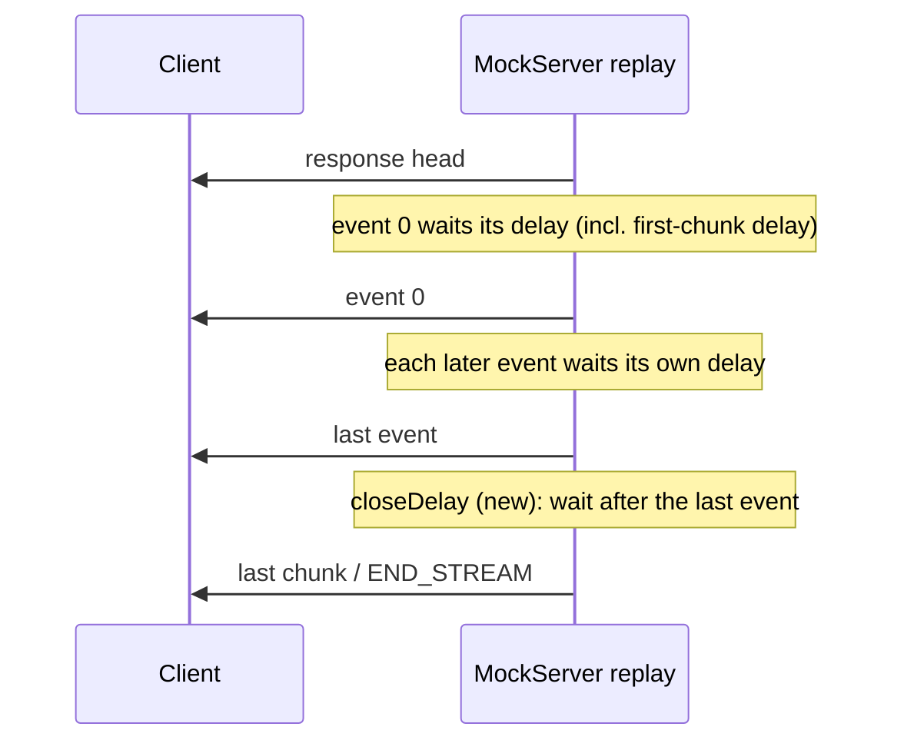

# SSE close delay — design note (#2947 part 2)

## Decision needed

A replayed SSE stream ends right after its last event, so a recorded stream that stayed open
longer replays too short and clients reconnect in a loop (#2947 measured 112 reconnects in 85 s).
This note recommends a **relative** `closeDelay` on `HttpSseResponse`, the wait **after the last
event**, plus a first-class **never close** value. It is not implemented: the open questions below
need the owner's answers first, especially how it interacts with #2945.

## Model

## Options

| Option | Meaning | Verdict |
|---|---|---|
| Absolute `closeDelay` from start of replay (the issue's proposal) | end the stream at T ms after the head | Reject: mixes absolute time with the relative `SseEvent.delay`, and breakpoint holds or scheduler lag shift every event but not the end |
| **Relative `closeDelay`** (gap after the last event) | after the last event, wait then end | **Recommend**: same model as `SseEvent.delay`; immune to holds |
| Trailing field-less event with a long `delay` | today's workaround | Keep working, but it sends an extra `\n` and the gap is a guess |
| `closeDelay` with a "never" value (e.g. `closeDelay: {"never": true}` or `keepOpen: true`) | the stream stays open until the client leaves or MockServer stops | **Recommend alongside**, rather than "a very large number" |

## Rationale

- `SseEvent.delay` is already relative, and the converter can compute the end gap exactly:
  `responseTime − firstChunkDelay − Σ chunk gaps` (all from one recording, one clock; the
  `x-mockserver-first-chunk-delay-ms` header added for #2947 part 1 makes this subtraction correct).
- A "never close" value is a different intent from a long wait; modelling it explicitly avoids
  arbitrary sentinel numbers and lets docs and the dashboard show it plainly.

## Open questions for the owner

1. **#2945 (recording open streams on stop).** A stream MockServer closed because it stopped, or
   that the client closed (`x-mockserver-stream-closed-by-client`), has no true end. Should the
   converter (a) write "never close", (b) write no `closeDelay` (end after the last event, today's
   behaviour), or (c) write the measured gap anyway? Recommendation: (a) for a stop-closed stream
   once #2945 marks it, (b) for client-closed streams.
2. **Truncated recordings** (`recordTruncatedStreamTiming`): the cut is not a real end. Recommend
   no `closeDelay`.
3. **Client disconnect during the wait**: end silently, as a client that leaves during an event's
   delay does today (`scheduleEvents` already checks `isActive`, and `finishStream` too).
4. **Overload bounds**: should a pending close count towards `maxPendingDelayedResponses`, like a
   delayed event? Recommend yes, using the same scheduler path as `SseEvent.delay`.
5. **Breakpoints (RESPONSE_STREAM)**: the wait should start after the last held event is decided,
   which falls out of scheduling it from the last `writeChunk` completion.
6. **Non-SSE formats** (NDJSON, JSON array, AWS event-stream): apply the same gap before the end?
   Recommend yes; it is format-independent.
7. **`closeConnection`**: unrelated (it governs only the socket after the stream ends); keep it so.

## Cost if accepted

Model field + equals/hashCode, DTO, Java serializer, `httpSseResponse.json`, both OpenAPI copies,
the regenerated editor schemas, Node/Python/Ruby clients (and the remaining clients for parity),
the converter (computes the gap), `HttpSseResponseActionHandler.finishStream` scheduling, consumer
docs (`ai_protocol_mocking.html`, `ai_mcp_tools.html`) and `docs/code/ai-protocol-mocking.md`.
