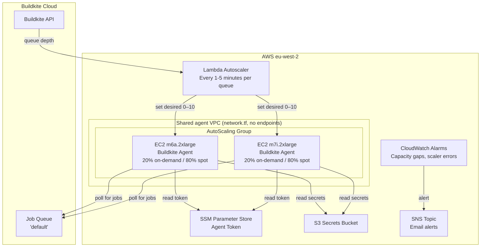
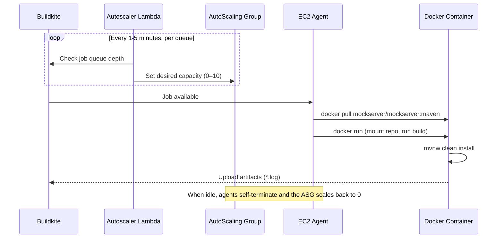
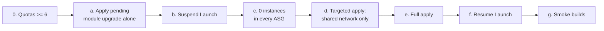
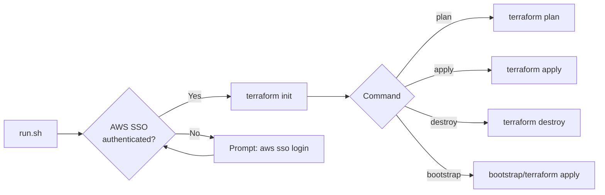

# Buildkite Agents

Terraform configuration for MockServer's Buildkite CI build agent infrastructure, using the official [Buildkite Elastic CI Stack for AWS](https://github.com/buildkite/terraform-buildkite-elastic-ci-stack-for-aws) module.

## Architecture



## How It Works



## Directory Structure

```
buildkite-agents/
├── bootstrap/               # One-time state backend setup
│   ├── main.tf              #   S3 bucket
│   └── README.md            #   Bootstrap instructions
├── main.tf                  # Elastic CI Stack module, one per queue
├── network.tf               # Shared agent VPC, 2 public subnets, IGW (no interface endpoints)
├── monitoring.tf            # CloudWatch alarms, SNS notifications, dashboard
├── backend.tf               # S3 remote state configuration
├── build-secrets.tf         # Docker Hub secret + Buildkite agent IAM policy
├── ecr-public.tf            # ECR Public repository + push IAM policy
├── ecr-pull-through-cache.tf # ECR pull-through cache (docker-hub/quay; mcr unsupported) + credential secret + agent IAM
├── perf-results.tf          # S3 bucket (mockserver-ci-perf-results) + IAM policy for perf queue
├── variables.tf             # Input variables
├── outputs.tf               # Outputs (ASG name, VPC ID, dashboard URL, perf queue outputs)
├── versions.tf              # Terraform + provider versions
├── terraform.tfvars.example # Example variable values
├── run.sh                   # Wrapper script (auth + plan/apply)
└── README.md                # This file
```

## Prerequisites

1. **Terraform** >= 1.5 — `brew install terraform`
2. **AWS CLI** — `brew install awscli`
3. **AWS SSO profile** `mockserver-build` configured:
   ```bash
   aws configure sso --profile mockserver-build
    # SSO region: eu-west-2
   # Default region: eu-west-2
   ```
4. **Buildkite agent token** — from https://buildkite.com/organizations/mockserver/agents
5. **VPC and internet-gateway quota headroom** in eu-west-2, for the one-off move to the shared VPC and for reverting it. See [Prerequisite: VPC quota headroom](#prerequisite-vpc-quota-headroom).

## Getting Started

### 1. Bootstrap the State Backend (first time only)

```bash
./run.sh bootstrap
```

This creates the S3 bucket used for remote state. Uses `import` blocks so it's safe to re-run against existing resources. See [bootstrap/README.md](bootstrap/) for details.

### 2. Configure Variables

```bash
cp terraform.tfvars.example terraform.tfvars
```

Edit `terraform.tfvars` and set your Buildkite agent token:

```hcl
buildkite_agent_token = "your-token-here"
```

> **terraform.tfvars is gitignored** — it contains secrets and must never be committed.

### 3. Preview Changes

```bash
./run.sh plan
```

### 4. Apply

```bash
./run.sh apply
```

For the first apply of the shared-VPC change, or for reverting it, do not run a plain apply. Follow the [migration runbook](#migrating-to-the-shared-vpc-one-off-runbook) below.

## Migrating to the shared VPC (one-off runbook)

**Outcome.** The change that added `network.tf` moves all five queues from one module-created VPC each (with three SSM interface endpoints apiece) to one shared VPC, and removes the VPC flow logs. One apply destroys 5 VPCs, 5 IGWs, 10 subnets, 15 interface endpoints and 5 agent security groups, and moves every ASG onto the new subnets. Run it only when there is quota headroom, with Launch suspended, and with zero instances. Create the shared network on its own before the full apply, because the full apply starts destroying the old networks at once and does not wait for the new VPC. Reverting the change uses the same procedure.



Every command below assumes this setup, run from the repository root. The snippets are written for bash, and `ASGS` is an array so the loops also work in zsh:

```bash
export AWS_PROFILE=mockserver-build AWS_REGION=eu-west-2
REPO=$(git rev-parse --show-toplevel)
cd "$REPO/terraform/buildkite-agents"
ASGS=($(aws autoscaling describe-auto-scaling-groups \
  --filters Name=tag:ManagedBy,Values=Terraform \
  --query "AutoScalingGroups[?starts_with(AutoScalingGroupName, 'buildkite-mockserver-')].AutoScalingGroupName" \
  --output text))
echo "${#ASGS[@]}"   # must print 5 (default, trigger, release, perf, perf-xl)
```

The ASGs are updated in place, so their names do not change and `ASGS` stays valid throughout.

### Prerequisite: VPC quota headroom

The new VPC and IGW must exist before the five old ones are destroyed, so the apply needs one VPC and one IGW more than are in use. In November 2026, eu-west-2 had 5 VPCs and 5 IGWs, both at their quota of 5 (the AWS default), and no default VPC. Without headroom the apply fails at its first create (`VpcLimitExceeded`) after some independent changes have already gone through. `terraform plan` cannot detect this.

| Quota | Code | Value (Nov 2026) | Needed |
|-------|------|------------------|--------|
| VPCs per Region | `L-F678F1CE` | 5 | >= 6 |
| Internet gateways per Region | `L-A4707A72` | 5 | >= 6 |

```bash
# Current values and usage
aws service-quotas get-service-quota --service-code vpc --quota-code L-F678F1CE --query Quota.Value
aws service-quotas get-service-quota --service-code vpc --quota-code L-A4707A72 --query Quota.Value
aws ec2 describe-vpcs --query 'length(Vpcs)'
aws ec2 describe-internet-gateways --query 'length(InternetGateways)'

# Request the increases (small increases are normally approved automatically)
aws service-quotas request-service-quota-increase --service-code vpc --quota-code L-F678F1CE --desired-value 6
aws service-quotas request-service-quota-increase --service-code vpc --quota-code L-A4707A72 --desired-value 6

# Wait until both requests are APPROVED, then check both get-service-quota values read >= 6
aws service-quotas list-requested-service-quota-change-history --service-code vpc \
  --query 'RequestedQuotas[].[QuotaName,DesiredValue,Status]' --output table
```

AWS documents the IGW quota as tracking the VPC quota. If the IGW request is refused for that reason, raising the VPC quota raises both. Check both values before going on.

### a. Apply the pending module upgrade on its own

Before the shared-VPC change, master already had an unapplied `elastic-ci-stack-for-aws` 1.4.0 upgrade: a new agent AMI, stack v7.9.1 and scaler v1.16.1. Apply it first, from the commit before the shared-VPC change. Then, if CI regresses afterwards, the regression can be traced to one change or the other.

```bash
git -C "$REPO" fetch origin
NET=$(git -C "$REPO" log origin/master --diff-filter=A --format=%H -- terraform/buildkite-agents/network.tf)
git -C "$REPO" worktree add --detach .tmp/agents-upgrade "$NET^"
cp terraform.tfvars .terraform.lock.hcl "$REPO/.tmp/agents-upgrade/terraform/buildkite-agents/"
(cd "$REPO/.tmp/agents-upgrade/terraform/buildkite-agents" && ./run.sh plan)   # expect 0 to add, 10 to change, 0 to destroy
(cd "$REPO/.tmp/agents-upgrade/terraform/buildkite-agents" && ./run.sh apply)
```

For this step, the copied tfvars must still have the old `on_demand_percentage = 60`. With 20, the plan also changes the default queue's capacity mix. The plan must show only the five launch templates and the five scaler Lambdas, all in place. If a unit that landed on master before the shared-VPC change adds anything else, stop and check it before applying. After the apply, wait for one master CI build to go green before starting step b. If the plan already shows no changes, the upgrade is applied; skip this step. Remove the worktree afterwards with `git -C "$REPO" worktree remove .tmp/agents-upgrade`.

### b. Suspend Launch on every ASG

Pick a window clear of the perf schedule (daily 04:00 UTC, and 08:00 UTC on Saturday and Sunday). Suspend only `Launch`. The module already keeps `AZRebalance` suspended and ignores `suspended_processes`, so Terraform will not undo this.

```bash
for asg in "${ASGS[@]}"; do
  aws autoscaling suspend-processes --auto-scaling-group-name "$asg" --scaling-processes Launch
done
```

From now on, newly queued jobs wait for an agent, and the capacity-gap alarm may fire. Jobs already running are not affected.

### c. Confirm every ASG has zero instances

```bash
aws autoscaling describe-auto-scaling-groups --auto-scaling-group-names "${ASGS[@]}" \
  --query 'AutoScalingGroups[].[AutoScalingGroupName,DesiredCapacity,length(Instances),join(`,`,SuspendedProcesses[].ProcessName)]' \
  --output table
```

Every row must show 0 instances, and `Launch` must be among the suspended processes. If an instance is still there, it is running a job or idling toward scale-in, and its agent can still pick up new jobs. Instances are protected from scale-in, so the ASG will not remove them; do it by hand:

1. Find the instance's agents and their current jobs. A trigger instance runs 4 agents; every other queue runs 1. Note the `id` of every agent whose `aws:instance-id` matches the instance:
   ```bash
   bk api "agents?per_page=100" | python3 -c 'import sys,json
   for a in json.load(sys.stdin):
       md=[m for m in a.get("meta_data",[]) if m.startswith(("aws:instance-id=","queue="))]
       print(a["id"], a["connection_state"], md, (a.get("job") or {}).get("web_url"))'
   ```
2. Stop every one of those agents gracefully, so none takes a new job. Run this once per agent id: `bk api --method PUT "agents/<agent-id>/stop" --data '{"force": false}'`.
3. Once their jobs have finished, terminate the instance:
   ```bash
   aws autoscaling terminate-instance-in-auto-scaling-group \
     --instance-id <i-...> --should-decrement-desired-capacity
   ```
4. Re-run the check until every ASG shows 0.

### d. Create the shared network on its own

The full apply starts destroying every stack's old routes, route-table associations, IGW, endpoints and subnets at the same time as it creates the new VPC. It does not wait for the new VPC. If the new VPC then fails (for example with `VpcLimitExceeded`), every queue is left without a network. Creating the shared network first, with a targeted apply that only adds resources, removes that risk: if it fails, nothing has been destroyed.

`run.sh` does not pass extra arguments, so run Terraform directly. Export the token the way `run.sh` does. If you rely on its workarounds, set `AWS_CA_BUNDLE` and `DYLD_LIBRARY_PATH` yourself as well.

```bash
export TF_VAR_buildkite_agent_token="$(aws ssm get-parameter --name /buildkite/buildkite/agent-token \
  --with-decryption --query Parameter.Value --output text)"
terraform init -input=false
terraform plan  -target=aws_route_table_association.agents -target=aws_default_security_group.agents
#   expect: 8 to add, 0 to change, 0 to destroy
#   (VPC, IGW, 2 subnets, route table, 2 associations, default SG)
terraform apply -target=aws_route_table_association.agents -target=aws_default_security_group.agents
```

The plan must show 0 to destroy; if it shows anything else, stop. Terraform warns that `-target` is for exceptional use; that is expected here. The new network has no instances yet, so this step costs nothing and affects no build.

### e. Full apply

First make sure `terraform.tfvars` has `on_demand_percentage = 20`.

```bash
./run.sh plan    # after step d: about 5 to add (agent SG replacements), 66 to change, 77 to destroy
./run.sh apply
```

The only destroys should be the 13 module network resources in each of the 5 stacks, plus 12 flow-log resources. The 13 per stack are: the VPC, the IGW, 2 subnets, the route table, the route, 2 route-table associations, 3 endpoints, the endpoint SG and the old agent SG. The 5 agent SGs are replaced create-before-destroy. The apply deletes the 5 `/aws/vpc/flow-logs/*` log groups and their history (up to 30 days); export the logs first if you want to keep them.

### f. Resume Launch

Do this only once the apply has completed and `./run.sh plan` shows no changes:

```bash
for asg in "${ASGS[@]}"; do
  aws autoscaling resume-processes --auto-scaling-group-name "$asg" --scaling-processes Launch
done
```

Re-run the step c query: `Launch` must be gone from every row, and `AZRebalance` must still be listed.

### g. Smoke-test every queue

```bash
# release, perf and default queues: the release preflight checks (read-only)
bk build create -p mockserver-release-preflight -b master -m "smoke: shared agent VPC" -y
# trigger queue: shell fixtures and lints
bk build create -p mockserver-infra -b master -m "smoke: shared agent VPC" -y
# perf-xl has no cheap build: start one instance by hand; its agent idles out after 180 s
aws autoscaling set-desired-capacity --auto-scaling-group-name \
  "$(terraform output -raw perf_xl_auto_scaling_group_name)" --desired-capacity 1
```

To pass, every job must be picked up by an agent and start. A preflight gate that fails on its own checks (for example a stale perf baseline) is not a network fault. The perf-xl agent must appear in `bk api "agents?per_page=100"` with `queue=perf-xl`. While the agents are up, check that they register with Session Manager over the public endpoints and run in the shared VPC:

```bash
aws ssm describe-instance-information --query 'InstanceInformationList[].[InstanceId,PingStatus]' --output table
aws ec2 describe-instances --filters Name=tag-key,Values=BuildkiteQueue Name=instance-state-name,Values=running \
  --query 'Reservations[].Instances[].[InstanceId,VpcId,Tags[?Key==`BuildkiteQueue`]|[0].Value]' --output table
terraform output -raw vpc_id   # every VpcId above must equal this
```

### Recovery if the apply stops part-way

If the full apply (step e) fails, **do not resume Launch**. The old routes, IGWs, endpoints and subnets may already be gone, so new instances would have no network or no subnet to launch into. Fix the cause and re-run `./run.sh apply` straight away, keeping Launch suspended until `./run.sh plan` shows no changes.

- **`VpcLimitExceeded`, or an IGW limit error, in step d.** Nothing has been destroyed. Raise the quota (see the prerequisite), then repeat step d. Launch may be resumed while you wait for the quota.
- **`VpcLimitExceeded`, or an IGW limit error, in step e.** This should not happen once step d has succeeded. If it does, every queue may be without a network: raise the quota and re-apply as soon as possible.
- **`DependencyViolation` deleting an old security group, subnet, IGW or VPC.** Something is still attached to the old network, almost always an instance that was running during the apply. Its default route may already be deleted. If so, its job dies and its agent cannot terminate itself, so it never drains and keeps billing. Find it, terminate it by hand, then re-run `./run.sh apply`:
  ```bash
  # The old module VPCs carry a Stack tag; the shared VPC does not
  for vpc in $(aws ec2 describe-vpcs --filters Name=tag-key,Values=Stack --query 'Vpcs[].VpcId' --output text); do
    aws ec2 describe-network-interfaces --filters Name=vpc-id,Values="$vpc" \
      --query 'NetworkInterfaces[].[VpcId,NetworkInterfaceId,Attachment.InstanceId,Description]' --output text
  done
  aws autoscaling terminate-instance-in-auto-scaling-group --instance-id <i-...> --should-decrement-desired-capacity
  ```
  The list may also show interface-endpoint ENIs. Those disappear on their own once Terraform deletes the endpoints.
- **Any other error.** Fix the cause and re-run `./run.sh apply`; Terraform resumes from the recorded state. Do not `terraform state rm` the old network resources to get past an error: that leaves the endpoints and IGWs still billing with nothing managing them.

**Reverting** (going back to per-queue VPCs) needs the same headroom in reverse: the five module VPCs are created while the shared one still exists. That needs quotas of at least 6 and the same procedure: Launch suspended and zero instances.

## run.sh Reference

The `run.sh` wrapper handles AWS SSO authentication, environment workarounds (corporate TLS proxy, macOS pyexpat), and runs Terraform commands.

```
Usage: run.sh [command]

Commands:
  plan       Run terraform plan (default)
  apply      Run terraform apply
  destroy    Run terraform destroy
  bootstrap  Initialise the S3 state bucket
  init       Run terraform init
```



## Variables

| Variable | Type | Default | Description |
|----------|------|---------|-------------|
| `buildkite_agent_token` | `string` | *(required)* | Buildkite agent registration token |
| `region` | `string` | `eu-west-2` | AWS region |
| `instance_types` | `string` | `m6a.2xlarge,m7i.2xlarge,m6i.2xlarge,m7a.2xlarge` | Default queue EC2 instance types, all 8 vCPU / 32 GiB; the first (the cheapest) is used for on-demand, Spot picks from all (tfvars sets the same list) |
| `min_size` | `number` | `0` | Minimum instances (0 = scale to zero) |
| `max_size` | `number` | `10` | Maximum instances |
| `on_demand_percentage` | `number` | `20` | Default queue: % on-demand vs Spot, with no on-demand base |
| `release_instance_types` | `string` | `m7i.2xlarge,m6a.2xlarge,m6i.2xlarge,m7a.2xlarge` | Release queue EC2 instance types; all on-demand, so it runs on the first and falls back down the list |
| `perf_instance_types` | `string` | `c5.12xlarge` | EC2 instance type for the perf queue. Must have enough PHYSICAL cores for the run's cpusets — see the note on the variable; `perf-test-run.sh` fails the build if they overlap |
| `perf_min_size` | `number` | `0` | Minimum perf queue instances (must remain 0) |
| `perf_max_size` | `number` | `3` | Maximum perf queue instances. One agent per instance, so concurrent perf jobs always run on separate machines |
| `perf_xl_instance_types` | `string` | `c6i.32xlarge` | EC2 instance type for the perf-xl queue (a single fixed type) |
| `perf_xl_min_size` | `number` | `0` | Minimum perf-xl queue instances (must remain 0) |
| `perf_xl_max_size` | `number` | `1` | Maximum perf-xl queue instances |
| `alert_email` | `string` | `""` | Email address for infrastructure alerts |
| `monthly_cost_budget_usd` | `number` | `1000` | Monthly AWS cost budget for the account; `alert_email` is emailed at 80% actual and 100% forecasted spend |

## Outputs

| Output | Description |
|--------|-------------|
| `auto_scaling_group_name` | Name of the agent AutoScaling Group |
| `vpc_id` | ID of the VPC every queue's agents share |
| `lambda_scaler_arn` | ARN of the Lambda autoscaler function |
| `dashboard_url` | CloudWatch Dashboard URL for agent monitoring |
| `sns_topic_arn` | SNS topic ARN for infrastructure alerts |
| `perf_auto_scaling_group_name` | Name of the perf queue AutoScaling Group |
| `perf_lambda_scaler_arn` | ARN of the perf queue Lambda autoscaler |
| `perf_xl_auto_scaling_group_name` | Name of the perf-xl queue AutoScaling Group |
| `perf_xl_lambda_scaler_arn` | ARN of the perf-xl queue Lambda autoscaler |
| `perf_results_bucket` | Name of the S3 bucket storing perf regression run history |

## Monitoring and Alerts

The infrastructure includes CloudWatch alarms and SNS email notifications for:

- **ASG capacity gap**: Desired capacity not met for 5+ minutes (EC2 launch failures or Spot unavailability)
- **Lambda scaler errors**: Autoscaler function errors
- **Lambda scaler not invoked**: EventBridge schedule broken
- **ASG launch failures**: EventBridge rule captures failed EC2 launches
- **Monthly cost budget** (`budgets.tf`): AWS Budgets emails `alert_email` directly (not via SNS) at 80% actual and 100% forecasted spend of `monthly_cost_budget_usd`

**CloudWatch Dashboard**: View real-time agent capacity, scaler health, and recent logs via the dashboard URL output.

**Email Alerts**: Set `alert_email` in `terraform.tfvars` to receive SNS notifications. You'll need to confirm the subscription via email after first apply.

## Agent Queues

Five agent queues separate workloads by resource needs:

| Queue | Instance | Capacity mix | Max | Agents/instance | Root volume | Idle scale-in | Scaler period | Purpose |
|-------|----------|-------------|-----|-----------------|-------------|---------------|---------------|---------|
| `default` | m6a.2xlarge / m7i.2xlarge / m6i.2xlarge / m7a.2xlarge | 20% on-demand (on m6a) / 80% Spot (`price-capacity-optimized`), no on-demand base | 10 | 1 | 100 GiB | 240 s | 1 min | Build and test (Maven, Docker, k3d) |
| `trigger` | t3.small / t3a.small / t3.micro | 100% Spot | 4 | 4 | 30 GiB | 180 s | 1 min | Trigger polling jobs (`sleep` + `curl` loops) |
| `release` | m7i.2xlarge, then the `default` types as fallback | 100% on-demand | 2 | 1 | 100 GiB | 180 s | 5 min | Release pipeline steps with release secrets |
| `perf` | c5.12xlarge | 100% on-demand | 3 | 1 | 100 GiB | 180 s | 2 min | Daily performance-regression benchmarks (k6 + JMH); up to three perf jobs at once, each with a whole machine to itself. 24 physical cores, so the server, upstream and k6 cpusets land on genuinely disjoint cores |
| `perf-xl` | c6i.32xlarge | 100% on-demand | 1 | 1 | 100 GiB | 180 s | 5 min | Performance runs that need more cores than one `perf` box: 128 vCPU across 64 physical cores. Same rules as `perf`; same policies minus the write API token |

All queues have `min_size = 0` (scale-to-zero). This is a hard constraint — do not set `min_size` to a non-zero value.

Every queue runs in the one VPC defined in `network.tf`, passed to each module as `vpc_id` + `subnets` with `create_vpc = false`. The module would otherwise create a VPC per queue with three SSM interface endpoints in each, billed by the hour at zero instances. The shared VPC has none: agents keep public IPv4 and reach SSM, Buildkite, ECR and S3 through the internet gateway. Each module still creates its own agent security group in that VPC. A longer scaler period means a job can wait up to that long before its instance is even requested.

The `perf` queue uses `perf-results.tf` (S3 bucket `mockserver-ci-perf-results` + IAM policy `buildkite-perf-results`) to persist historical run JSON for rolling-baseline comparison. The `perf` stack is defined as `module "buildkite_perf_stack"` in `main.tf`; `perf-xl` is `module "buildkite_perf_xl_stack"` and shares the same bucket and policy. A new queue also needs a cluster queue of the same key in `terraform/buildkite-pipelines/clusters.tf`, applied first, or its agents cannot register.

**Rolling back perf-xl.** The clean rollback is `perf_xl_max_size = 0`, which stops any instance launching. Before destroying, empty the module's versioned managed-secrets and secrets-logging S3 buckets, including every object version. Remove the `perf-xl` cluster queue from `terraform/buildkite-pipelines/clusters.tf` only after the agents stack is gone.

## Cost

Current configuration (`min_size = 0`, `on_demand_percentage = 20`, diversified instance types):
- **Idle cost:** $0 for instances (every queue scales to zero when no builds are queued) and no VPC endpoint charges (the shared VPC has none), plus minimal CloudWatch alarm costs
- **Build cost:** about $0.40/hr per on-demand default-queue agent (m6a.2xlarge; $0.47/hr per release agent on m7i.2xlarge) and $0.16–0.21/hr per Spot agent, eu-west-2 list prices
- **Root volumes:** gp3, 100 GiB (30 GiB on trigger) rather than the module's 250 GiB default; gp3 IOPS and throughput do not depend on size
- **Perf queue cost:** ~$2.42/hr when active (c5.12xlarge on-demand, eu-west-2 — verified against the AWS Pricing API), runs at most once per day when master has new commits. It was c5.4xlarge at $0.81/hr; the move is a measurement-correctness fix, because eight physical cores could not hold the run's thirteen-core cpusets and the load generator shared cores with the server it was measuring
- **Perf-xl queue cost:** $6.464/hr when active (c6i.32xlarge on-demand, eu-west-2, AWS Pricing API). Max 1 instance
- **Monitoring cost:** <$1/month (alarms + dashboard + SNS)
- Agents take 2–3 minutes to launch from cold start

## Reliability Improvements

The infrastructure is designed to handle EC2 Spot capacity fluctuations:

1. **Diversified instance types**: four 8 vCPU / 32 GiB m-class types (m6a, m7i, m6i, m7a), Spot `price-capacity-optimized` across all of them (the cheapest pools among those least likely to be interrupted)
2. **On-demand share**: 20% of default-queue capacity is on-demand (no on-demand base)
3. **Agent-lost retry**: long pipeline steps retry automatically on exit `-1`/`255`, so a Spot reclaim re-queues the job
4. **Proactive monitoring**: Alerts notify you of capacity issues before builds are blocked
